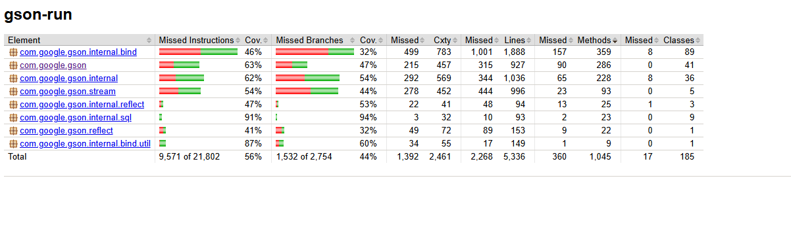
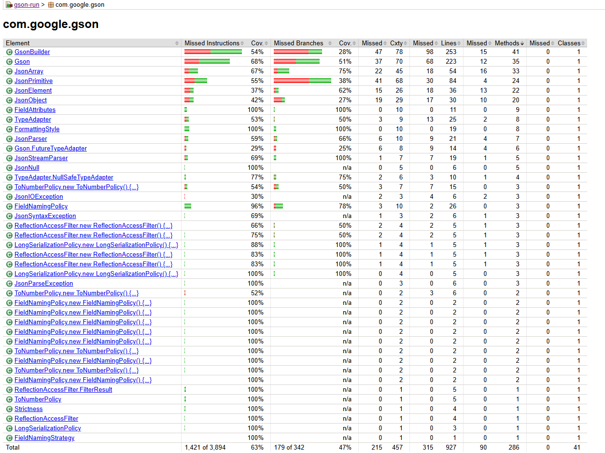
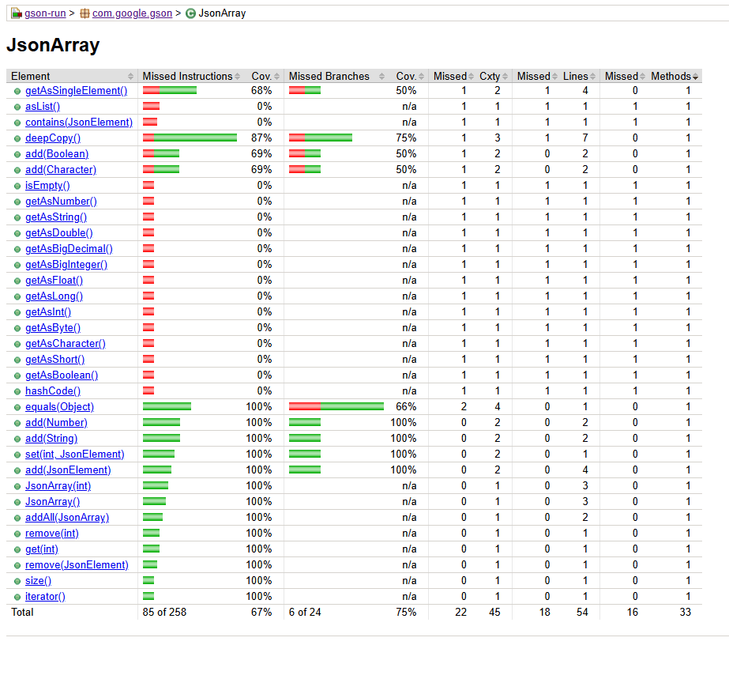
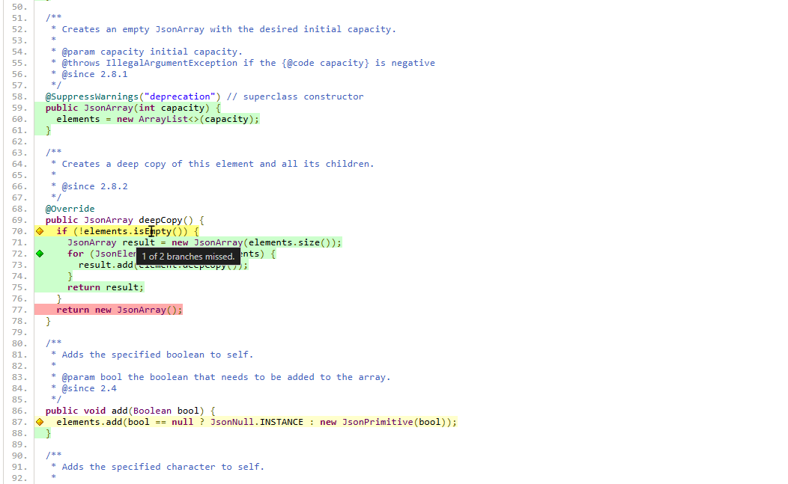
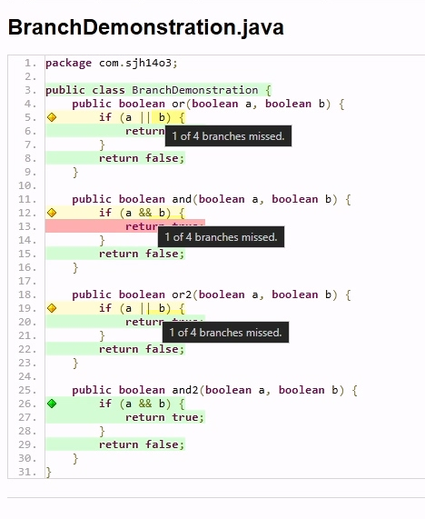
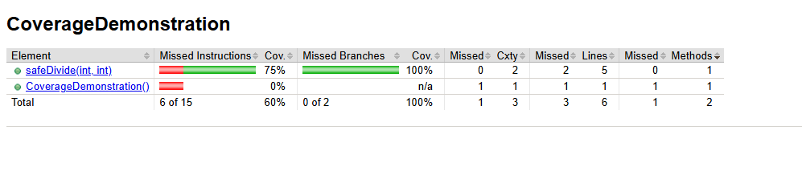
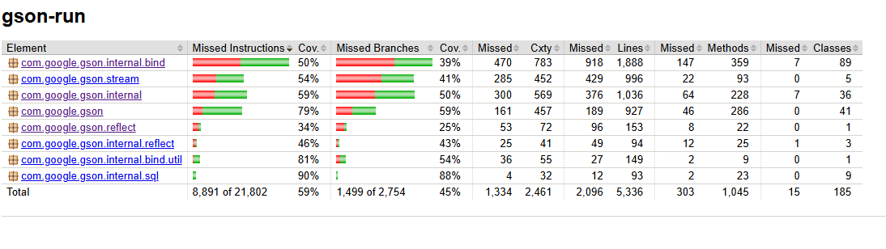
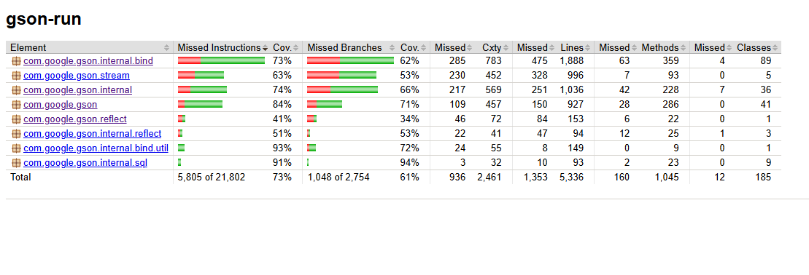
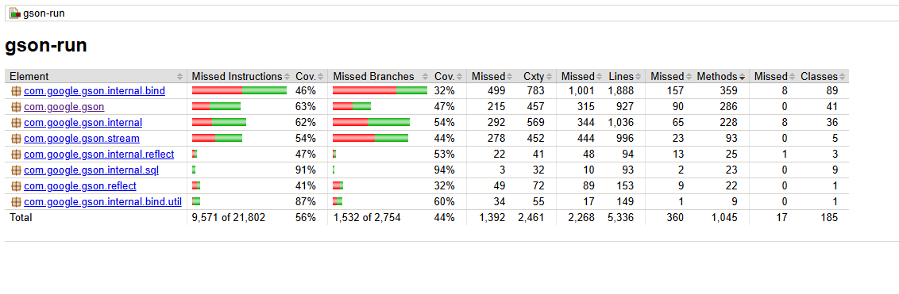
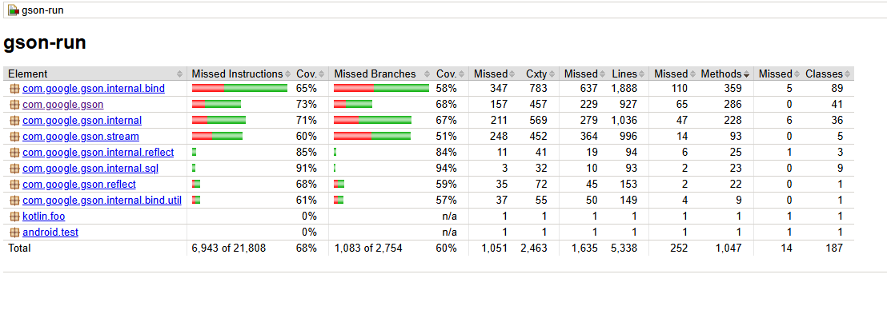

# Unit Test Generation Using OpenCode for Medium Project
We are dealing with a much larger code, from 86 to 10100 LOC.
This report won't be as detailed previously.
In addition, generated tests will not be available in this file in code fences,
so this file will purely contain analysis of generated tests and conclusion.

Two local models "gemma4:26b" and "gpt-oss:20b" are going to be utilized to generate tests
for the whole project.
They will be called "Gemma4" and "GPT-OSS" in this report.
Each model will generate tests individually (one file per session) 
and in the specified groups
(all files of the group in a single session).
Therefore, for each file, 4 unit tests will be generated.
In the next part, I have explained why I came up with this way of testing.

Token usage will be observed.
I have assumed that the cost of each local model for the same token usage is equal.  
I will observe with how much token usage, how much of the code will be covered.  
*NOTE THAT* I realized in the hard project that the context tokens shown by OpenCode is not the total
token usage, and it's just the context windows. It's too late to edit this project now.
However, since almost all session had one prompt, that number might be closer to reality.
Still, for these local models, if we run them on our own computer, it wouldn't matter.

Another matter of interest is to see how much of the code will be covered by tests.
Since we are dealing with a much larger project, this is essential.
If we do not consider the quality of the generated tests, an 80% coverage is satisfactory.

Unlike the small project, the order of analysis is file to file, rather than model to model.

## Table of Content
- [Why tests are generated both in group and individually](#Reason-behind-the-said-method-of-testing)
- [Additional notes](#Some-additional-notes-to-mention)
- [the Prompt give to models](#Prompt-Given-to-Models)
- [Group 1: Core JSON Data Model](#Group-1-Core-JSON-Data-Model)
- [Group 2: Streaming parser/writer state machines](#Group-2-Streaming-parserwriter-state-machines)
- [Group 3: Reflection & Type System](#Group-3-Reflection--Type-System)
- [Group 4: Exclusion, Reflection & Policy Engine](#Group-4-Exclusion-Reflection--Policy-Engine)
- [Group 5: Adapter infrastructure](#Group-5-Adapter-infrastructure)
- [Group 6: Specialized/reflective adapters](#Group-6-Specializedreflective-adapters)
- [Group 7: Internal utilities/data structures](#Group-7-Internal-utilitiesdata-structures)
- [Group 8: SQL](#Group-8-SQL)
- [Group 9: Facade/configuration and Miscellaneous](#Group-9-Facadeconfiguration-and-Miscellaneous)
- [When to use generate test individually](#When-to-use-singe-mode)
- [Overall summary](#Overall-summary)

## Reason behind the said method of testing
I tried three ways to generate unit tests for the whole project with "gemma4:e4b".
Initially I was planning to use this model alongside "gpt-oss:20b" to generate tests,
but it was replaced with "Gemma4:26b".
Anyhow, prompts were same apart from referencing which files to generate tests for.
To compare results, generated tests for `com.google.gson.JsonArray` will be used.

### 1. Generating test for all files of project in one session.
Firstly, I used plan mode, and prompted the agent to plan out multiple stages
for this generation. It came up with four stages:
1. Core Data Structures and Annotations
2. Core Processing Infrastructure
3. Utility and Strategy Implementations
4. Internal Utilities and Complex Adapters

After the plan was ready, I prompted it to proceed with stage 1.
After each stage was completed,
I prompted it to proceed with the following stage.
In the end, 22 files were generated, and each file contained few tests.
`JsonArrayTest` only had 68 lines.

### 2. Generating test for a single file in a session
I didn't use plan mode.
The given group is the "1.
Core JSON Data Model".
It contained 5 files (`JsonParser` wasn't part of this group at that moment).
Anyway, `JsonArrayTest` was generated with 249 lines.

### 3. Generating test for all files of a group in a session
Plan mode wasn't used.
After 1-2 files were generated,
the agent stopped and I had to prompt it to continue. 
`JsonArrayTest` was generated with 341 lines.

### Result
Local models cannot handle a colossal input,
so it is better to partition the input into relatively similar groups
and attempt to generate tests for each group separately.
It will be interesting to see how much different there will be if instead of group,
each file is given separately.
However, generating tests for every single file is going to be very tedious,
and also the model will use more context.
An interest in this report will be deciding whether the single file generated test
worth the increase cost.
Also, "single mode" term means tests that are generated when only a single file was
given to the agent. "group mode" means the same, but for a group of files.
These terms are used onward.

## Some additional notes to mention
Gemma4 always used "junit-5-skill" no matter if I prompted it explicitly or not.
On the contrary, GPT-OSS did not use it the majority of the times
when I didn't prompt it to use skill.
So to compensate for this, I explicitly will prompt the agents to use the skill.
Still, rarely GPT-OSS did not use skill.
For group 9, the tests generated without skill, since GPT-OSS refused to use the skill three times.

I have also removed everything about mocking in the skill.
This was causing the agents to mock dependencies sometimes.
With the removal of them, no more mocking was done.

At first, I wasn't planning to run the tests.
That's why I have prompted the agents not to run the files.
Consequently, generated test files contain compile error and some of their tests fail.
I had to fix every single one of them.
This might have altered coverage slightly.
For failed assertions, the majority of the time, I only inverted the assertions.
Still, this provided an opportunity to assess how accurate tests of agents can be in
their first iteration.

## Prompt Given to Models
Files to be tested are many.
So, the focus is to achieve decision coverage.
As I mentioned, "junit-5-skill" will be used.
When I had started generating tests,
I noticed that the agents tried to run the tests which wasn't necessary at first,
therefore I added to the prompt to avoid running the tests.
Files will be linked to the prompt.
At last, this is the prompt given to the agents:
> For these files, generate unit tests using Junit5.
> Achieve decision coverage. Use "junit-5-skill" skill.
> Concentration is only on units, so don't test integration and don't use mocking.
> do not build and run the tests, only generate them.

### How the tests are generated?
For each model with two modes, a folder is made.
Each folder will contain Gson project source files.
Tests have been removed to prevent interference.
It also helps so models don't have access to other agents tests.
Previously this still wasn't the case.
This time, I did not prompt the agents to add their names to the test file names.
OpenCode is opened in this folder and agents are prompted to generate unit tests.

You will find that the folder containing the tests has three sub folders.
1. *original* contains the test files originally created by agent.
2. *error free* is a copy of *original*, but all compile errors are fixed.
Some tests will fail.
3. *tests correct* is a copy of *error free*; however, all the tests will pass.

### How Coverage is calculated? Introduction to Jacoco
After the tests were generated,
I realized that calculating coverage for over ten thousand lines of code would take forever.
So I looked up tools that calculate coverage.
I found a tool called **Jacoco**.
It measures instructions and branch/decision coverage.
Since I prompted the agents to achieve decision coverage, this is a perfect tool to assess the coverage.
This tool can be added to a project dependencies as a plugin,
and upon build of a project, it will generate a report in html.
These files contain coverage assessment of the whole project.
Moreover, it is possible to see each file and its method coverage individually.
Output is located at `$project_folder/target/site/jacoco/index.html`.
At the end of analysis for each file,
there is a summary that contains the assessment of coverage by this tool for generated tests.
Note that all tests must pass in order to be able to generate a report.
As a result, I fixed assertions that generated wrongly, but the generated test files still have the wrong assertions.  
Here is a demonstration of the output of this tool:

The main page:


A package overview:


A file overview:


Inside a file:


#### Jacoco Weaknesses
Firstly, *Jacoco* also counts deprecated methods for coverage. This is probably not good in practice.

Secondly, deep into the project, I realized that the *Jacoco* branch coverage isn't exactly decision coverage.
Consider this file:
```java
public class BranchDemonstration {
    public boolean and(boolean a, boolean b) {
        if (a && b) {
            return true;
        }
        return false;
    }

    public boolean or(boolean a, boolean b) {
        if (a || b) {
            return true;
        }
        return false;
    }

    public boolean or2(boolean a, boolean b) {
        if (a || b) {
            return true;
        }
        return false;
    }

    public boolean and2(boolean a, boolean b) {
        if (a && b) {
            return true;
        }
        return false;
    }
}
```
There are two simple `or` methods alongside two simple `and` methods. I am going to create tests that achieve:
- decision coverage for `or()`.
- condition coverage for `and()`.
- decision/condition coverage for `or2()`.
- MD/DC for `and2()`.

```java
import org.junit.jupiter.api.BeforeEach;
import org.junit.jupiter.api.DisplayName;
import org.junit.jupiter.api.Test;
import static org.junit.jupiter.api.Assertions.*;

public class BranchDemonstrationTest {
    private BranchDemonstration bd;
    @BeforeEach
    void setUp() {
        bd = new BranchDemonstration();
    }

    @Test
    @DisplayName("Two assertions for or() that achieve decision coverage, but not condition coverage.")
    void test_or_decisionCoverage() {
        // 1 of 4 branches misses
        assertTrue(bd.or(true, false));
        assertFalse(bd.or(false, false));
    }

    @Test
    @DisplayName("Two assertions for and() that attain condition coverage, but not decision coverage")
    void test_and_conditionCoverage() {
        assertFalse(bd.and(false, true));
        assertFalse(bd.and(true, false));
    }

    @Test
    @DisplayName("Two assertions for or() that obtain condition/decision coverage, but not MC/DC.")
    void test_or2_conditionDecisionCoverage() {
        // 1 of 4 branches misses
        assertTrue(bd.or2(true, true));
        assertFalse(bd.or2(false, false));
    }

    @Test
    @DisplayName("Three assertions for and() that gain MC/DC.")
    void test_and2_MCDC() {
        assertTrue(bd.and2(true, true));
        assertFalse(bd.and2(true, false));
        assertFalse(bd.and2(false, true));
    }
}
```
Here is the coverage result of these tests:

  
As we can see, *Jacoco* is actually calculating MC/DC!
Which is unnecessary to an ordinary commercial project.
It was too late to change the tool.
However, I will try to find another tool that truly the required coverage in the next reports.

Thirdly, it is actually possible for a test to obtain complete branch coverage, but not complete statement coverage.
Consider the class below:
```java
public class CoverageDemonstration {
    public static int safeDivide(int dividend, int divisor) {
        try {
            if (dividend < 0) {
                dividend = -dividend;
            }
            return dividend / divisor;
        } catch (ArithmeticException e) {
            return 0;
        }
    }
}
```
This class has a single method with a decision point and possibility of exception.
Turns out if you cover both branches, but not the exception,
you will achieve full  branch coverage, but not statement coverage.
Here is a test to create this:
```java
import org.junit.jupiter.api.Test;

import static org.junit.jupiter.api.Assertions.*;

class CoverageDemonstrationTest {

    @Test
    void safeDivide() {
        assertEquals(2, CoverageDemonstration.safeDivide(4, 2));
        assertEquals(2, CoverageDemonstration.safeDivide(-4, 2));
    }
}
```
Here is the report of *Jacoco*:
  
As I said, all statements are not covered, but all decisions are covered.
There might be other ways too.
I only noticed this one.
Jacoco probably should have considered every catch block as a branch.

### Each group analysis format
First, I wrote problems that I ran into while generating tests for files in the group.
Then each file is analyzed separately.
After all files are analyzed, a group summary will be given containing a table.
The table uses the same format as [single file analysis](#Table-format) with some differences:
- information is aggregation of the files information in this group.
- statement and decision coverage is **not** average.
It's based on the total amount of statements and decisions covered.
- *method names start with test* and *private variables used* shows how many of the files in the group had them.


#### Each file analysis
First, total LOC, statements, and decisions of the file are written.

Then, each model in both modes is assessed.


Firstly, the compile error of the file is listed alongside how they were fixed.

After that, the test are ran, and successful and failed tests are determined.
Failed tests are listed afterward.
I have assumed that Gson is working completely correctly and if a test fails,
the test itself is wrong.
For this, the majority of the times, I reversed the wrong assertions.
Still, some tests failed mainly duo to exceptions.
It was not easy to fix some of them.

Then all tests are listed.
Items of the list are grabbed from the description of the test if the
tests have `@DisplayName` annotation.
If not, the method name of the test is used.
Parametrized tests are determined with [parametrized].
How many tests they had is included after the test title.

After that, some additional notes about the tests are written.
Like what utility was generated alongside.

In the end, all the missing coverage is written.
Since it might be that important, they are written in one line rather than being listed.
In the first group, I was covering the missed coverage thoroughly.
I stopped since this was taking a long time.
From group 2 onward,
I have mentioned which methods are not tested at all
and what methods have some branches that are not fully covered.


After all four models and modes are assessed, a table with some information is given.

##### Table format
This information includes:
- errors count: how many compile errors were in the file.
- statement coverage: how many of the file's statements were covered by these tests.
- decision coverage: how many of the file's decisions were covered by these tests.
- total tests: how many tests were generated.
- failed tests: how many of the tests failed.
- method names start with test: do the tests method start with "test"? this is a good practice. It is also mentioned in the used skill.
- private variables used: are the variables that needed in many tests defined as private variable? This is not completely necessary. For instance, if a unit only contains static methods, it won't be needed.
- tokens used: how many tokens were used? OpenCode shows you how much token was consumed. Note that for group modes, this is calculated by division of token consumption by total LOC of the group, multiplied by LOC of the current file. For example, if tests generation for a group with 2000 LOC consumed 50,000 tokens, for a file with 400 LOC, 10000 tokens is used.
- tokens per decision/stmt coverage %: how many tokens were used for a single coverage percent. By default, decision coverage is used, unless the file had very few decisions, or all agents achieved about the same decision coverage, but varied statement coverage. In these cases, statement coverage is used.

After that table, a summary is given about which model performed better.
Is it reasonable to generate tests for this file alongside other files to reduce token usage?

## Group 1: Core JSON Data Model
GPT-OSS in group mode did not generate tests for `JsonNull` in the output of the first prompt.
I had to prompt it to generate the test for it afterward.  
GPT-OSS in single mode did not use skill for generating test in `JsonArray` even though I explicitly had it in the prompt.
In the second attempt, however, it used skill.
### JsonArray
This file has 146 LOC, 258 statements and 24 decisions.

#### Gemma Group
The generated file contained 3 errors:
- in test `addElement_handlesNull()`, null was directly passed to add method. It must be cast into a supported type first.
- in test `set_replacesElement()`, A string was passed as second argument of `set()` method. A JsonPrimitive with a string value must be passed.
- Like previous error, but for `add()` method of a list of JsonElement in test `asList_mutableView()`.

After fixing the errors, all the 14 tests passed.  
list of tests:
1. Constructor with default capacity creates empty array
2. Constructor with capacity creates array with correct capacity
3. deepCopy() creates a deep copy of the array
4. deepCopy() of empty array returns empty array
5. add() methods work correctly with various types
6. add(JsonElement) handles null by converting to JsonNull
7. addAll() adds all elements from another JsonArray
8. set() replaces element and returns previous element
9. remove(JsonElement) removes first occurrence
10. remove(int) removes element at index
11. contains() checks for element existence
12. iterator() traverses elements in order
13. asList() returns a mutable list view
14. equals() and hashCode() work correctly

Missing coverage:
- In four implementations of `add(...)` method, only non-null branch was tested (test `addElement_handlesNull()` had to handle this).
- Like previous but for set(...)
- getAsSingleElement() and all getAs... have not been tested at all.
- in equals(), 2 of 6 branches are missed.

#### Gemma Single
The generated file contained 4 errors:
- in `testSet()`, a string was passed as second argument of set method. A JsonPrimitive with a string value must be passed.
- in `testSetOutOfBounds()`, an integer was passed as second argument of set method. A JsonPrimitive with an integer value must be passed.
- in `testGetAsMethodsSuccess()`, different types of primitives are passed in their java form, not JsonPrimitive form.
- in `testAddJsonElement()` null was directly passed to add method. It must be cast into a supported type first.

After fixing all errors, all 27 tests passed.

list of tests:
1. Constructor should create an empty array
2. Constructor with capacity should create an empty array with specified capacity
3. deepCopy() should return a new array with the same elements
4. deepCopy() should return an empty array if the source is empty
5. add(Boolean) should add boolean or JsonNull
6. add(Character) should add character or JsonNull
7. add(Number) should add number or JsonNull
8. add(String) should add string or JsonNull
9. add(JsonElement) should add JsonElement or JsonNull
10. addAll() should add all elements from another JsonArray
11. set() should replace element at index
12. set() should replace with JsonNull if element is null
13. set() should throw IndexOutOfBoundsException if the index is invalid
14. remove(JsonElement) should remove first occurrence
15. remove(int) should remove element at index
16. remove(int) should throw IndexOutOfBoundsException if the index is invalid
17. contains() should return true if element is present
18. size() should return number of elements
19. isEmpty() should return true if array is empty
20. iterator() should traverse elements
21. get() should return element at index
22. get() should throw IndexOutOfBoundsException if the index is invalid
23. [parametrized] getAs...() methods should work for single element arrays
24. getAs...() methods should throw IllegalStateException if array does not have exactly one element
25. asList() should return a mutable list view
26. equals() should work correctly
27. hashCode() should be consistent with equals

Tests were in order corresponding to the original file.
In `testGetAsMethodsFailure()`, `getAsInt()` is tested twice in each assertion group.

Missing coverage:
- getAsNumber() and getAsFloat() were not tested at all
- null argument for add(JsonElement)

#### GPT-OSS Group
The generated file contained 2 errors:
- missing package statement
- in test `setReplacesAndHandlesNull,` an integer is passed as second argument of set(). Fixed with replacing it with `new JsonPrimitive(int)`

After fixing all errors, 5 tests passed and 1 test failed.  in `setReplacesAndHandlesNull()`, `arr.set()` returns the previous element which the agent though it would be null, but it's a `JsonPrimitive`.

list of tests:
1. add null to array in various types
2. filled array deepCopy()
3. addAll()
4. set()
5. removal test with element and index
6. getAsSingle() for array with 2 elements

Missing coverage:
- deepCopy empty array case
- missed adding null as Boolean and Character
- no successful getAsSingleElement() test
- missed 2 of 6 branches in equals()
- contain(), isEmpty(), iterator(), getAs...(), and hashCode() were not tested at all

#### GPT-OSS Single
The Generated file contained no error.

19 tests passed and 2 tests failed. Failed tests are:
1. the last assertion in `testGetAsSingleElementSingle()` will throw as exception. The agent had realized this in the comment next to the assertion, but it did not fix it. Assertion is commented
2. This one is actually Gson fault! In `JsonPrimitive.deepCopy()`, the same object (reference) is returned, that's why `assertNotSame()` in `testDeepCopyNonEmpty()`, in the for loop fails!

list of tests:
1. deepCopy() of empty array returns empty array
2. deepCopy() of non-empty array deep copies elements
3. add(Boolean) handles null values correctly
4. add(Character) handles null values correctly
5. add(Number) handles null values correctly
6. add(String) handles null values correctly
7. add(JsonElement) handles null values correctly
8. addAll() correctly concatenates arrays
9. set() replaces element and null becomes JsonNull
10. remove() by element returns true when present
11. remove() by element returns false when absent
12. remove() by index returns element and shifts others
13. contains() correctly detects presence
14. size() and isEmpty() reflect state
15. iterator() traverses all elements
16. get() returns element at valid index
17. get() throws IndexOutOfBounds for invalid index
18. getAsSingleElement() works when size is 1
19. getAsSingleElement() throws when size != 1
20. equals() and hashCode() are consistent
21. asList() provides mutable view

Missing coverage:
- add(Boolean), add(Character) and set(int, JsonElement) are missing a branch.
- missed 2 of 6 branches in equals()
- for getAs...(), only getAsNumber and getAsString are covered. The rest were not covered at all

#### Comparison
| Title                          | Gemma4 Group | Gemma4 Single | GPT-OSS Group | GPT-OSS Single |
|:-------------------------------|:------------:|:-------------:|:-------------:|:--------------:|
| Errors count                   |      3       |       4       |       2       |       0        |
| Statement coverage             |     70%      |      96%      |      65%      |      81%       |
| Decision coverage              |     62%      |      95%      |      75%      |      79%       |
| total tests                    |      14      |      27       |       6       |       21       |
| failed tests                   |      0       |       0       |       1       |       2        |
| method names start with test   |      no      |      yes      |      no       |      yes       |
| private variables used         |     yes      |      yes      |      no       |       no       |
| tokens used                    |    10,693    |    24,550     |     8,110     |     15,420     |
| tokens per decision coverage % |     172      |      258      |      108      |      195       |

All agents did pretty decent.
Which model and mode to do the job comes down to a balance between token usage and coverage.
If aiming for around 80% coverage, GPT-OSS in single file is the most reasonable option.
If aiming for best coverage no matter of cost, Gemma4 Single is winner.

### JsonElement
This file has 98 LOC, 172 statements and 8 decisions.  
The Class is abstract, therefore tests will be indirect through subclasses.  
getAsCharacter() is deprecated. However, it is counted in coverage since the agents generated test for it.

#### Gemma Group
The generated file contained no errors.

10 tests passed and 4 tests failed. Failed tests are `getAsBoolean_throwsException()`, `getAsNumber_throwsException()`, `getAsString_throwsException()`, and `getAsDouble_throwsException()`. JsonArray is used to call the respective methods. However, these methods have been overridden and another exception is thrown. This can be fixed by using JsonObject instead.

list of tests:
1. isJsonArray() correctly identifies JsonArray
2. isJsonObject() correctly identifies JsonObject
3. isJsonPrimitive() correctly identifies JsonPrimitive
4. isJsonNull() correctly identifies JsonNull
5. getAsJsonObject() throws exception if not an object
6. getAsJsonArray() throws exception if not an array
7. getAsJsonPrimitive() throws exception if not a primitive
8. getAsJsonNull() throws exception if not a null
9. getAsBoolean() throws exception if not a primitive or array
10. getAsNumber() throws exception if not a primitive or array
11. getAsString() throws exception if not a primitive or array
12. getAsDouble() throws exception if not a primitive or array
13. toString() returns correct JSON representation
14. deepCopy() for JsonElement subclasses

Missing coverage:
- getAsCharacter() is not tested at all; However, it is deprecated.
- a condition in getAsJsonNull() is not covered.
- IOException in toString is not tested.
- getAsFloat(), getAsLong(), getAsInt(), getAsByte() , getAsBigDecimal(), getAsBigInteger() and getAsShort() are not tested at all.

#### Gemma Single
The generated file contained no error.

17 tests passed and 4 tests failed. Failed tests are `testGetAsJsonObjectThrows()`, `testGetAsJsonArrayThrows()`, `testGetAsJsonPrimitiveThrows()`, and `testGetAsJsonNullThrows()`. In these tests, IllegalStateException is thrown, not ClassCastException.

list of tests:
1. isJsonArray() correctly identifies JsonArray
2. isJsonObject() correctly identifies JsonObject
3. isJsonPrimitive() correctly identifies JsonPrimitive
4. isJsonNull() correctly identifies JsonNull
5. successful getAsJsonObject()
6. successful getAsJsonArray()
7. successful getAsJsonPrimitive()
8. successful getAsJsonNull()
9. failed getAsJsonObject()
10. failed getAsJsonArray()
11. failed getAsJsonPrimitive()
12. failed getAsJsonNull()
13. getAsBoolean()
14. getAsNumber()
15. getAsString()
16. getAsDouble()
17. getAsInt()
18. getASLong()
19. getAsFloat()
20. getAsByte()
21. getAsShort()

For getAsJson...(), the object that is tested should have been a `JsonElement` type. This would have made more sense.

Missing coverage:
- all getAs...() are not covered, although there are tests for them. Agent should have tested in a way that the code in `JsonElement` would be executed, not overridden code.
- IOException in toString is not tested.

#### GPT-OSS Group
The Generated file contained 1 error, which was missing package statement.

After fixing the error, all 2 tests passed.

list of tests:
1. is...() flags work
2. getAs...() throws exception on wrong type

This was a poor test generation. Using two tests for a unit generation is deficient.

Missing coverage:
- getAsJsonPrimitive() misses a false branch
- all getAs...() are not covered. This is the same as Gemma4 Group. There are a few assertions, but they are from classes that have overridden these methods.
- IOException in toString is not tested.

#### GPT-OSS Single
The Generated file contained 2 errors:
- missing package statement.
- passing null as second argument to `addProperty()` in test `toStringConvertsToJson()`.

After fixing all errors, 9 tests passed and 13 tests failed! Failed tests are:
- asserting false on a null object `isJsonNull()` call. Assertion commented.
- from test `getAsBooleanThrowsUnsupported()` onward, these methods do not throw exception, in fact, a value is returned instead. Tests are replaced with assertEquals.

list of tests:
1. isJson...() return true when correct
2. valid getAsJsonObject()
3. invalid getAsJsonObject
4. valid getAsJsonArray()
5. invalid getAsJsonArray()
6. valid getAsJsonPrimitive()
7. invalid getAsJsonPrimitive()
8. valid getAsJsonNull()
9. invalid getAsJsonNull()
10. getAsBoolean() throwing exception
11. getAsNumber() throwing exception
12. getAsString() throwing exception
13. getAsDouble() throwing exception
14. getAsFloat() throwing exception
15. getAsLong() throwing exception
16. getAsInt() throwing exception
17. getAsByte() throwing exception
18. getAsCharacter() throwing exception
19. getAsBigDecimal() throwing exception
20. getAsBigInteger() throwing exception
21. getAsShort() throwing exception
22. toString() converts to Json

The failed tests of this agent were ridiculous.

Missing coverage:
- other that getAsJsonObject(), getAsJsonArray(), getAsJsonPrimitive(), and getAsJsonNull(), other getAs...() are not covered, for the same reason as previous models.
- IOException in toString is not tested.

#### Comparison
| Title                          | Gemma4 Group | Gemma4 Single | GPT-OSS Group | GPT-OSS Single |
|:-------------------------------|:------------:|:-------------:|:-------------:|:--------------:|
| Errors count                   |      0       |       0       |       1       |       2        |
| Statement coverage             |     62%      |      47%      |      37%      |      47%       |
| Decision coverage              |     87%      |     100%      |      62%      |      100%      |
| Total tests                    |      14      |      21       |       2       |       22       |
| Failed tests                   |      4       |       4       |       0       |       13       |
| Method names start with test   |      no      |      yes      |      no       |       no       |
| Private variables used         |      no      |      no       |      no       |       no       |
| Tokens used                    |    7,178     |    32,307     |     5,444     |     16,547     |
| Tokens per decision coverage % |      83      |      323      |      88       |      165       |

Statement coverage is low because subclasses that have not overridden getAs...() methods are not used.
In addition, IOException in toString was not tested by any of the models.
It's probably hard to replicate, so it's not a big deal.
Gemma4 group generated test had the best performance here.

### JsonNull
This file has 19 LOC, 16 statements and 0 decision.
This is a very small file; In fact, it is the lowest LOC among all the files.
full decision coverage is possible with few tests.
#### Gemma Group
The Generated file contained no errors.

All 4 tests passed.

list of tests:
1. JsonNull.INSTANCE is a singleton
2. deepCopy() returns the same instance
3. hashCode() is consistent
4. equals() works correctly

Full statement and decision coverage obtained.

#### Gemma Single
The Generated file contained 1 error which was missing package statement.

After fixing the error, all 4 tests passed.

list of tests:
1. JsonNull.INSTANCE should not be null
2. deepCopy should return the same instance
3. hashCode should be consistent with class hash code
4. equals should work correctly for JsonNull instances

Full statement and decision coverage achieved.

#### GPT-OSS Group
The Generated file contained 1 error which was missing package statement.

After fixing the error, all 3 tests passed.

list of tests:
1. JsonNull is singleton
2. deepCopy() returns the same instance
3. equals() works correctly

Full statement and decision coverage attained.

#### GPT-OSS Single
The Generated file contained 1 error which was missing package statement.

After fixing the error, all 4 tests passed.

list of tests:
1. deepCopy() returns the singleton instance
2. hashCode() is constant across instances
3. equals returns true for another JsonNull instance
4. equals returns false for non-JsonNull objects

Full statement and decision coverage is accomplished.

#### Comparison
| Title                          | Gemma4 Group | Gemma4 Single | GPT-OSS Group | GPT-OSS Single |
|:-------------------------------|:------------:|:-------------:|:-------------:|:--------------:|
| Errors count                   |      0       |       1       |       1       |       1        |
| Statement coverage             |     100%     |     100%      |     100%      |      100%      |
| Decision coverage              |     100%     |     100%      |     100%      |      100%      |
| total tests                    |      4       |       4       |       3       |       4        |
| failed tests                   |      0       |       0       |       0       |       0        |
| method names start with test   |      no      |      yes      |      no       |       no       |
| private variables used         |      no      |      no       |      no       |       no       |
| tokens used                    |    1,391     |    11,126     |     1,055     |     10,297     |
| tokens per decision coverage % |      14      |      111      |      11       |      103       |

This file only had 4 methods.
Achieving full coverage was a piece of cake.
This file is so tiny that models in group mode completely covered it with using very few tokens.

### JsonObject
This file has 75 LOC, 171 statements and 18 decisions.
#### Gemma Group
The Generated file contained no error.

All 10 tests passed.

list of tests:
1. constructor creates empty object
2. addProperty() works for different types
3. add(String, JsonElement) handles null value
4. remove(String) removes member and returns it
5. remove(String) returns null if member not found
6. has(String) works correctly
7. getAsJsonPrimitive()/Array()/Object() works
8. keySet() and entrySet() work
9. asMap() returns mutable map view
10. equals() and hashCode() work correctly

This agent generated two utility methods jsonArraySize(JsonObject) and objObjectHashCode(JsonObject) for no reason. It is possible to get array size and hash code from methods of the JsonObject.

Missing coverage:
- missing null branch in all addProperty() variants.
- in equals(), 2 of 6 branches are not covered
- deepCopy() was not tested at all.

#### Gemma Single
The Generated file contained 4 errors:
- in test `newJsonObjectIsEmpty()`, non-defined variable jsontoObject used instead of jsonObject.
- above test `addStringProperty()`, a line explaining something was not commented.
- in test `addStringPropertyNull()`, null is passed without string cast.
- in test `equalsSameMembers()`, non-defined variable objermedObj2 used instead of obj2.

After fixing all errors, all 27 tests passed.

list of tests:
1. New JsonObject should be empty
2. size() should return the correct number of members
3. add(String, JsonElement) adds element
4. add(String, JsonElement) converts null value to JsonNull
5. [parametrized] addProperty() with various types (4 tests)
6. addProperty(String, String) handles null
7. addProperty(String, Number) handles null
8. addProperty(String, Boolean) handles null
9. addProperty(String, Character) handles null
10. remove(String) removes existing key and returns element
11. remove(String) returns null for non-existent key
12. get(String) returns correct element
13. getAsJsonPrimitive(String) returns JsonPrimitive
14. getAsJsonArray(String) returns JsonArray
15. getAsJsonObject(String) returns JsonObject
16. getAsJsonPrimitive() throws ClassCastException if not a primitive
17. has(String) checks for key existence
18. entrySet() returns all entries
19. keySet() returns all keys
20. asMap() returns mutable map view
21. equals() compares objects with same members
22. equals() returns false for different members
23. equals() handles identity and null
24. deepCopy() creates an independent copy

Missing coverage:
- missing null case for addProperty(...) with Number, Character, and Boolean values.
- a single branch in equals is missed.

#### GPT-OSS Group
The Generated file contained a single error which was not stating the package.

After fixing all errors, 3 tests passed and a single test failed.
- in test `getAsJsonXThrowsOnWrongType()`, `ClassCastException` is returned instead of `IllegalStateException` in both assertions.

list of tests:
- add() and remove()
- getAs...() throws exception on wrong type
- asMap()
- equals() and hashCode()

Four tests are not enough to cover this file at all. A lot of methods are not even tested.

Missing coverage:
- null JsonElement not covered in add().
- add() with null Number not covered.
- add() for Boolean, Character, and String are not tested at all.
- missing 3 of 6 branches in equals().
- deepCopy(), entrySet(), keySet(), size(), isEmpty(), getAsJsonPrimitive(), getAsJsonArray(), and getAsJsonObject() are not tested at all.

#### GPT-OSS Single
The Generated file contained an error which is missing package statement:

After fixing the error, all 8 tests passed.

list of tests:
1. add() handles null values
2. addProperty() overloads store correct primitive types
3. deepCopy() creates an independent copy
4. remove() returns removed element and handles missing key
5. has(), get(), entrySet(), keySet(), size(), and isEmpty() work correctly
6. asMap() provides a mutable view of the underlying members
7. getAsJsonPrimitive() and others throw ClassCastException on wrong type notes
8. equals() and hashCode() are consistent irrespective of insertion order

Missing coverage:
- 2 of 6 branches are missing in equals()
- getAsJsonArray() and getAsJsonObject() are not tested at all.

#### Comparison
| Title                          | Gemma4 Group | Gemma4 Single | GPT-OSS Group | GPT-OSS Single |
|:-------------------------------|:------------:|:-------------:|:-------------:|:--------------:|
| Errors count                   |      0       |       4       |       1       |       1        |
| Statement coverage             |     78%      |      92%      |      39%      |      92%       |
| Decision coverage              |     55%      |      77%      |      27%      |      88%       |
| total tests                    |      10      |      27       |       4       |       8        |
| failed tests                   |      0       |       0       |       1       |       0        |
| method names start with test   |      no      |      no       |      no       |      yes       |
| private variables used         |     yes      |      yes      |      no       |       no       |
| tokens used                    |    5,493     |    15,170     |     4,166     |     13,412     |
| tokens per decision coverage % |     100      |      197      |      154      |      152       |

Surprisingly, GPT-OSS in single file did better than Gemma4 despite having less parameters and being an older model.
However, in group file, it did the worst.
GPT-OSS in single mode is the obvious winner.
The 152 tokens usage per decision coverage percent is very reasonable.

### JsonPrimitive
This file has 173 LOC, 415 statements and 88 decisions.
#### Gemma Group
The Generated file contained 3 errors:
- Made a dummy JsonableNumber class to inherit from JsonPrimitive, which is a final class! Fixed by replacing the usage to JsonPrimitive.
- Made another dummy BooleanPrimitive class. Fixed like above.
- in test `getAsFloat_works()`, agent was trying to fix a syntax error but forgot to remove the faulty code.

After fixing all errors, all 17 tests passed.

list of tests:
1. Constructor with Boolean works
2. Constructor with Number works
3. Constructor with String works
4. Constructor with Character works
5. deepCopy() returns this
6. getAsBoolean() parses string 'true'
7. getAsNumber() handles String
8. getAsString() works for Number and Boolean
9. getAsBigDecimal() works
10. getAsBigInteger() works
11. getAsFloat() works
12. getAsLong() works
13. getAsShort() works
14. getAsInt() works
15. getAsByte() works
16. getAsCharacter() is deprecated but works
17. hashCode() and equals() work correctly

This file contains many statements and decisions, but 17 tests are inadequate to achieve high coverage.

Missing coverage:
- In getAsNumber(), only value is an instance of Number is tested. String and miscellaneous are not tested.
- In getAsString(), the miscellaneous branch is not tested.
- In getAsBigDecimal(), BigDecimal branch is not tested.
- In getAsBigInteger(), BigInteger and true isIntegral branches are not tested.
- In getAsFloat(), getAsLong(), getAsShort(), and getAsByte(), a single branch is not tested.
- In getAsCharacter(), throwing of UnsupportedOperationException is not tested.
- In hashCode(), "value == null", "isIntegral(this)", and "value instanceof Number" branches are never true.
- In equals(), 10 branches are not tested.
- In isIntegral(), a single branch is not tested.
- getAsDouble(), hashOfDoubleValue are not tested at all.

#### Gemma Single
The Generated file contained a single error. In `testBigInteger()`, a line was cut off but continued in the next line.

After fixing the error, all 17 tests passed.

list of tests:
1. Should handle boolean values correctly
2. Should parse boolean from string
3. Should handle integer values
4. Should handle double values
5. Should handle BigDecimal values
6. Should handle BigInteger values
7. Should parse number from string
8. Should throw exception when getting number from boolean
9. Should handle string values
10. Should handle character as string
11. Should throw exception if string is empty for getAsCharacter
12. Should respect equality for different numeric types with the same value
13. Should respect equality for BigDecimal scale difference
14. Should handle NaN equality
15. [Parametrized] Should correctly identify types and values (3 tests)

I was expecting to obtain better result. Decision coverage has doubled, but still it isn't enough.

Missing coverage:
- In getAsString(), the miscellaneous branch is not tested.
- In getAsBigDecimal(), parsing as String is not tested.
- In getAsLong(), parsing as String is not tested.
- In hashCode(), null, Number, and Miscellaneous instances are not tested.
- In equals(), 12 branches are not tested.
- In isIntegral(), 4 branches are not tested.
- getAsFloat(), getAsShort(), and getAsByte() are not tested at all.

#### GPT-OSS Group
The Generated file contained a single error which is missing package statement.

After fixing the error, all 5 tests passed.

list of tests:
1. boolean conversion
2. number parsing
3. string conversion
4. character handling
5. empty string getCharacter() exception

This was a terrible test generation. 5 tests for such a file is extremely insufficient.

Missing coverage:
- in getAsNumber(), getAsDouble(), getAsFloat(), getAsLong(), and getAsInt(), a single branch was not tested.
- deepCopy(), isString(), getAsBigDecimal(), getAsBigInteger(), getAsShort(), getAsByte(), hashCode(), hashOfDoubleValue(), equals(), and isIntegral() were not tested at all.

#### GPT-OSS Single
The Generated file contained no errors.

11 tests passed and 1 test failed. Failed test is `equalsAndHashCodeConsistency()`. Agent thought that initializing a JsonPrimitive with argument 42 and "42" should result in equal objects which isn't the case. This was fixed by changing assertEquals to assertNotEquals. Also, their hash code was expected to be equals and I couldn't fix it properly, so I just added two assertions verifying each hashCode separately.

list of tests:
1. boolean constructor and access
2. number constructor and access
3. string constructor and access
4. character constructor and access
5. getAsNumber() from string
6. getAsNumber() from non-numeric string throws RuntimeException
7. getAsCharacter() from empty throws UnsupportedOperationException
8. equals() and hashCode() consistency
9. bigDecimal equality with scale
10. negative zero equality
11. NaN equality
12. non-number value equals false to a number value

Missing coverage:
- in getAsBoolean(), getAsNumber(), getAsBigDecimal(), getAsFloat(), getAsLong(), getAsInt(), hashOfDoubleValue(). a single branch was not tested.
- in getAsString(), and hashCode(), two branches were not covered.
- in equals(), 15 branches are not tested.
- deepCopy(), getAsBigInteger(), getAsShort(), and getAsByte() are not tested at all.

#### Comparison
| Title                          | Gemma4 Group | Gemma4 Single | GPT-OSS Group | GPT-OSS Single |
|:-------------------------------|:------------:|:-------------:|:-------------:|:--------------:|
| Errors count                   |      3       |       1       |       1       |       0        |
| Statement coverage             |     49%      |      77%      |      29%      |      71%       |
| Decision coverage              |     31%      |      62%      |      14%      |      57%       |
| total tests                    |      17      |      17       |       5       |       12       |
| failed tests                   |      0       |       0       |       0       |       1        |
| method names start with test   |      no      |      yes      |      no       |       no       |
| private variables used         |      no      |      no       |      no       |       no       |
| tokens used                    |    12,671    |    16,968     |     9,610     |     13,627     |
| tokens per decision coverage % |     409      |      274      |      686      |      239       |

All models did poorly for this file, especially in equals() which was a complex method in terms of branching. Many other branches were also missed. Single models are clearly the better option here. Gemma4 did better overall.

### JsonParser
This file has 59 LOC, 77 statements and 6 decisions.
#### Gemma Group
The Generated file contained an error which was missing `com.google.gson.stream.JsonReader` import.

After fixing the errors, 6 tests passed and 1 test failed. The failed test was expecting an `JsonSyntaxException` in test `parseReader_multipleElements_throwsException()` but JsonReader fixes this with only reading the first element. Making a syntax error in input json will result in `JsonSyntaxException`.

list of tests:
1. parseString() works for valid JSON
2. parseString() throws exception for invalid JSON
3. parseReader() works for valid JSON
4. parseReader() throws exception for invalid JSON
5. parseReader() throws exception for multiple top-level elements
6. parse(String) follows parseString()
7. parse(Reader) follows parseReader()

Missing coverage:
- in parseReader(Reader), 2 branches and any of the exceptions are not tested.
- in parseReader(JsonReader), a branch and any of exceptions are not covered
- parse() is not tested, however, it's a deprecated method.

#### Gemma Single
The Generated file contained 2 errors:
- in test `deprecatedMethods_delegateCorrectly()`, parse(...) is called statically for the last two assertions. Fixed with instantiating JsonParser.

After fixing all errors, all 9 tests passed.

list of tests:
1. parseString: valid JSON object
2. parseString: valid JSON array
3. parseString: valid JSON null
4. parseString: throws JsonSyntaxException for invalid JSON
5. parseReader: valid JSON string
6. parseReader: throws JsonSyntaxException for incomplete document (trailing data)
7. parseReader: handles IOException
8. parseReader(JsonReader): respects strictness and handles LEGACY_STRICT
9. Deprecated methods: verify they delegate correctly

Missing coverage:
- in parseReader(Reader), a branch is missing, therefore, exception is not thrown.
- in parseReader(JsonReader), an exception is not thrown and a single branch is also not covered.

#### GPT-OSS Group
The Generated file contained 1 error which is missing package statement.

After fixing the error, all 4 tests passed.

list of tests:
1. valid parse string
2. parse string with multiple elements throws JsonSyntaxException
3. parse reader trailing data throws JsonSyntaxException
4. parse reader empty returns JsonNull

Only four tests are generated.
Because deprecated methods are not tested, statement coverage is reduced.
it is as good as Gemma4 Single if these methods are not counted.

Missing coverage:
- the constructor without argument is not tested, however, it's deprecated.
- in parseReader(Reader), a branch is missing, therefore, exception is not thrown.
- in parseReader(JsonReader), an exception is not thrown and a single branch is also not covered.
- three deprecated methods.

#### GPT-OSS Single
The Generated file contained 3 errors:
- missing package statement.
- wrong directory for importing `com.google.gson.Strictness`.
- a conceptional test that overrides a method that it can't. I commented it to avoid compile error.

After fixing all errors, 5 tests passed and 1 test failed. Failed test is:
- in parseReader_multipleTopLevelElements_throwsException(), exception message is asserted wrongly. Still, this is not important in practice, so the assertion is commented.

list of tests:
1. parseString parses valid JSON string into JsonObject
2. parseString throws JsonSyntaxException for malformed JSON
3. parseReader parses valid Reader into JsonObject
4. parseReader throws JsonSyntaxException when data remains after the first element
5. parseReader throws JsonIOException when Reader throws IOException
6. parseReader(JsonReader) restores original strictness after parsing

Missing coverage:
- the constructor without argument is not tested, however, it's deprecated.
- in parseReader(Reader), two branches are missing, therefore, exception is not thrown.
- in parseReader(JsonReader), an exception is not thrown and a single branch is also not covered.
- three deprecated methods.

#### Comparison
| Title                          | Gemma4 Group | Gemma4 Single | GPT-OSS Group | GPT-OSS Single |
|:-------------------------------|:------------:|:-------------:|:-------------:|:--------------:|
| Errors count                   |      1       |       2       |       1       |       3        |
| Statement coverage             |     63%      |      75%      |      59%      |      59%       |
| Decision coverage              |     50%      |      66%      |      66%      |      50%       |
| total tests                    |      7       |       9       |       4       |       6        |
| failed tests                   |      1       |       0       |       0       |       1        |
| method names start with test   |      no      |      no       |      no       |       no       |
| private variables used         |      no      |      no       |      no       |       no       |
| tokens used                    |    4,321     |    13,018     |     3,277     |     11,618     |
| tokens per decision coverage % |      86      |      197      |      50       |      232       |

All agents didn't test exceptions thrown in parseReader(Reader) and parseReader(JsonReader), which are rare exceptions. as a result, this can be neglected. If we also ignore deprecated methods, all agents achieve almost full coverage. Since this is a relatively small file, grouping this file with other small files is preferred. GPT-OSS group used the least tokens. Nevertheless, it had the best coverage.

### Group Summary
This group has 6 files with 570 LOC, 1,109 statements and 144 decisions.

| Title                          | Gemma4 Group | Gemma4 Single | GPT-OSS Group | GPT-OSS Single |
|:-------------------------------|:------------:|:-------------:|:-------------:|:--------------:|
| Errors count                   |      7       |      12       |       7       |       7        |
| Statement coverage             |     62%      |      79%      |      43%      |      72%       |
| Decision coverage              |     48%      |      74%      |      29%      |      75%       |
| total tests                    |      66      |      105      |      24       |       73       |
| failed tests                   |      5       |       4       |       2       |       17       |
| method names start with test   |     0/6      |      4/6      |      0/6      |      2/6       |
| private variables used         |     2/6      |      2/6      |      0/6      |      0/6       |
| tokens used                    |    41,748    |    113,139    |    31,663     |     80,951     |
| tokens per decision coverage % |     870      |     1529      |     1092      |      1079      |

Coverage achieved by single mode agents is acceptable.
We can see that single mode consumed 2.5x more tokens.
The coverage, however, increased by 25%.
In group mode, Gemma4 performed better.
In single mode, since GPT-OSS used 30% token but attained almost the same coverage, GPT-OSS is better.
I believe it's worth it to pay twice tokens to use GPT-OSS single than Gemma4 Group to get more coverage.
As we can see, the token cost per percentage coverage is not significant.

## Group 2: Streaming parser/writer state machines
Gemma4 in group mode stopped abruptly shortly after the prompt is given.
After I prompt it to continue, all test files are generated.

### JsonWriter
This file has 395 LOC, 848 statements and 136 decisions.
#### Gemma Group
The Generated file contained a single error. Code was trying to access Strictness.STRICT using Strict::STRICT.

After fixing the error, 2 tests passed and 2 tests failed. Failed tests are:
- in `testStrictness()` first part, strictness is set to `STRICT` which results in `jsonWriter.value(Double.NaN)` throwing exception which is not asserted. In the second part of this test, this is tested but exception is asserted. The second part is also testing `STRICT` again. It looks like an agent meant to test `LENIENT` in the first part.
- in `testNestingProblem()`, the first part must be expecting an exception, but it's not. the first part is commented.

list of tests:
1. value types
2. formatting styles
3. strictness
4. nesting problem

4 tests for a file with many statements is inadequate.

Missing coverage:
- in setFormattingStyle(), name(), and nullValue(),  two branches in two different points are not covered.
- in closeScope(), 5 branches are missing in total.
- in push(), peek(), value(String), and beforeName(), a single branch is not tested.
- setLenient() is not tested, however, it is deprecated.
- in value(double), 3 of 6 branches missed.
- in close(), exception is not thrown.
- in beforeValue(), two cases are not tested.
- in string(), 4 branches in total are not tested.
- setIndent(), getFormattingStyle(), isLenient(), getStrictness(), setHtmlSafe(), isHtmlSafe(), getSerializeNulls(), value(Boolean), value(float), value(Number), jsonValue(), flush(), and alwaysCreatesValidJsonNumber(), are not tested at all.


#### Gemma Single
The Generated file contained 5 errors:
- `com.google.gson.FormattingStyle` was not imported.
- an unexpected token in beginObject_endObject_works().
- calling undefined method "setLength" on a JsonWriter in valueBoolean_handlesTrueAndFalse.
- `com.google.gson.Strictness` was not imported
- `StringWriter` does not have `setLength()`. I believe the agent tried to reset the data. I will instantiate that variable again instead, since I didn't find a method to do it.

After fixing all errors, 23 tests passed and 7 tests failed. Failed tests are:
- in name_throwsException_ifAlreadyWroteAName(), after a name written, another name must be written to throw exception.
- in valueBoolean_handlesTrueAndFalse(), writer can only write a single value and writing another value will throw exception. variables `out` (for assertion) and `writer` are reset to fix this.
- In every test that `out = new StringWriter()` is replaced setLength(0), `writer = new JsonWriter(out)` is also added. This fixed many of the failures.
- in nullValue_respectsSerializeNulls(), in first assertion, '}' at the expected string is wrong. In the second assertion, writing the null value removes the name, so the expected string is "{".

list of tests:
1. Constructor should throw NullPointerException if out is null
2. setIndent() should set compact style if indent is empty
3. setIndent() should set pretty style if indent is non-empty
4. setFormattingStyle() should throw NullPointerException if style is null
5. setLenient() should set strictness correctly
6. setStrictness() should throw NullPointerException if strictness is null
7. setHtmlSafe() should set htmlSafe flag
8. setSerializeNulls() should set serializeNulls flag
9. beginArray() and endArray should work correctly
10. beginObject() and endObject should work correctly
11. endArray() should throw IllegalStateException if not in array context
12. endObject() should throw IllegalStateException if not in object context
13. endArray() should throw IllegalStateException if name is dangling
14. endObject() should throw IllegalStateException if name is dangling
15. name() should throw IllegalStateException if already wrote a name
16. name() should throw IllegalRuntimeException if not in object context
17. value(String) should handle null value
18. value(boolean) should handle true and false
19. value(Boolean) should handle null value
20. value(float) should handle finite values and throw on NaN/Infinity in strict mode
21. value(double) should handle finite values and throw on NaN/Infinity in strict mode
22. value(long) should handle long values
23. value(Number) should handle various number types
24. value(Number) should throw exception for invalid JSON numbers if not lenient
25. nullValue() should respect serializeNulls setting
26. jsonValue(String) should handle null value
27. close() should throw IOException if the document is incomplete
28. close() should work correctly for complete document
29. flush() should throw IllegalStateException if writer is closed
30. string(String) should handle escaping and HTML safe mode

Missing coverage:
- setFormattingStyle(), closeScope(), peek(), name(), value(Boolean), value(Number), jsonValue(String), flush(), string(), newline(), beforeName(), and beforeValue() have missing branches.
- getStrictness() is not tested at all.

#### GPT-OSS Group
The Generated file contained 2 errors:
- missing import for `com.google.gson.Strictness`.
- used an improper way to access written json content. It was trying to access these content with a private method which is inaccessible. I replaced it by changing output to a StringWriter

After fixing all errors, 5 tests passed and one test failed.
In the failed test, StringWriter and JsonWriter had to be reset in order to expect the correct result.

list of tests:
1. writes a simple array and closes correctly
2. throws on nested beginObject after endObject
3. serialize null when configured
4. honors HTML-safe escaping
5. fails on NaN/Infinity when strictness is LEGACY_STRICT
6. supports arbitrary numbers including BigInteger

Missing coverage:
- setFormattingStyle(), closeScope(), push(), peek(), name(), value(float), value(double), value(Number), nullValue(), flush(), close(), string(String value), beforeName(), alwaysCreatesValidJsonNumber(), newLine() and beforeValue() have missing branches
- setLenient() is not tested at all, however, it's deprecated.
- setIndent(), getFormattingStyle(), isLenient(), getStrictness(), isHtmlSafe(), getSerializeNulls(), value(boolean), value(Boolean), and jsonValue() are not tested at all.

#### GPT-OSS Single
The Generated file contained 4 errors:
- package statement.
- wrong name for an import.
- missing method declaration line for three functions.
- the last test required converting object passed to assertThrows and assertDoesNotThrow to be effectively final. I don't really understand this, but there was a quick fix for it.

After fixing all errors, 3 tests passed and 4 tests failed. Failed tests are:
- in testStringValueEscaping(), expected string was wrong.
- in testNullSerialization(), first an object must begin to write a name to the writer. Then, the expected assertion was wrong. This happened for both parts of this test.
- in testObjectScope(), exception message assertion is wrong. The assertion is commented.
- in testHTMLSafeCharacters(), I just changed the last assertion to `assertNotEqual()`. I couldn't figure out how to fix it.

list of tests:
1. write string value with escaping
2. null value respects serializeNulls flag
3. begin/end object writes correct delimiters and throws on mismatched close
4. write float NaN throws when not lenient
5. write float NaN allowed when lenient
6. html safe characters are escaped when htmlSafe true
7. multiple top-level values allowed only in LENIENT mode

These tests had so many errors. It took me a some time to fix all of them in order to run them.

Missing coverage:
- beforeName(), beforeValue(), closeScope(int, int, char), flush(), name(String), newline(), peek(), push(int), setFormattingStyle(FormattingStyle), string(String), value(String), value(float), and nullValue() have missing branches.
- setLenient(boolean) is not tested, but it's deprecated.
- alwaysCreatesValidJsonNumber(Class), close(), endArray(), getFormattingStyle(), getSerializeNulls(), getStrictness(), isHtmlSafe(), isLenient(), jsonValue(String), setIndent(String), value(Boolean), value(boolean), value(double), and value(Number)  were not tested at all.

#### Comparison
| Title                          | Gemma4 Group | Gemma4 Single | GPT-OSS Group | GPT-OSS Single |
|:-------------------------------|:------------:|:-------------:|:-------------:|:--------------:|
| Errors count                   |      1       |       5       |       2       |       4        |
| Statement coverage             |     60%      |      83%      |      66%      |      56%       |
| Decision coverage              |     33%      |      67%      |      43%      |      31%       |
| total tests                    |      4       |      30       |       6       |       7        |
| failed tests                   |      2       |       7       |       1       |       4        |
| method names start with test   |     yes      |      no       |      no       |      yes       |
| private variables used         |      no      |      yes      |      no       |       no       |
| tokens used                    |    9,961     |    24,421     |     7,192     |     23,264     |
| tokens per decision coverage % |     302      |      364      |      167      |      750       |

In single file, GPT-OSS was better, but in grouped file, Gemma4 was better.
Both winners also consumed less token.
Overall, Gemma4 Single is winner if user is willing to trade 2.5x token for a significant better performance.

### JsonReader
This file has 1232 LOC, 3045 statements and 519 decisions. It is the largest file of the project.
#### Gemma Group
The Generated file contained an error. In `testLenientReading()`, code was asserting a return value from `close()` which returns nothing. Replaced with `reader.nextLong()` since the array still had one more value end.

After fixing the error, all 3 tests passed.

list of tests:
1. reading various tokens
2. lenient reading
3. malformed json throws IOException

Just three tests are generated for the largest file of the project. As a result, coverage is low.

Missing coverage:
- setLenient(boolean) is not tested at all, however, it's deprecated.
- beginArray(), beginObject(), checkLenient(), consumeNonExecutePrefix(), doPeek(), endArray(), fillBuffer(int), getPath(boolean), hasNext(), isLiteral(char), nextBoolean(), nextLong(), nextName(), nextNonWhitespace(boolean), nextNull(), nextQuotedValue(char), nextString(), peekKeyword(), peekNumber(), push(int), and endObject() have missing branches.
- getNestingLimit(), getPreviousPath(), getStrictness(), isLenient(), nextDouble(), nextUnquotedValue(), peek(), readEscapeCharacter(), setNestingLimit(int), skipQuotedValue(char), skipTo(String), skipToEndOfLine(), skipUnquotedValue(), skipValue(), toString(), unexpectedTokenError(String), validateAscii(String), and nextInt() are not tested at all.


#### Gemma Single
The Generated file contained 2 errors:
- The Agent realized it was initializing a class that doesn't exist, but forgot to remove it.
- Non-exising `JsonToken.NUMBER_STRING_CONVERSION_TESTING` is called but not used.

After fixing all errors, 13 tests passed and 4 tests failed. Failed tests are:
- in test `hasNext_returnsFalseOnEof()`, actually an IOException is thrown. Replaced the expected exception with IOException.
- in test `nextName_returnsName()`, for a json object, only the name is received, and the value is ignored. Therefore, an exception is thrown when endObject() is called.
- in test `close_closesReader()`, nothing is thrown since calling close() for StringReader multiple times won't throw exception. Instead, placed read() in the assertion.
- in test `skipValue_skipsValues()`, one additional name-value pair is read, which throws exception.

list of tests:
1. `beginArray()` should throw `IllegalStateException` if token is not BEGIN_ARRAY
2. `endArray()` should throw `IllegalStateException` if token is not END_ARRAY
3. `beginObject()` should throw `IllegalStateException` if token is not BEGIN_OBJECT
4. `endObject()` should throw `IllegalStateException` if token is not END_OBJECT
5. `hasNext()` should return false on EOF
6. `peek()` should return the correct token for various JSON types
7. `nextString()` should return string value
8. `nextBoolean()` should return boolean value
9. `nextNull()` should consume null token
10. `nextLong()` should return long value
11. `nextDouble()` should return double value
12. `nextName()` should return property name
13. `setNestingLimit()` should throw exception for negative limit
14. `close()` should close the underlying reader
15. `setStrictness()` should work correctly
16. `skipValue()` should skip various values
17. `toString()` should return class name and location

Even 17 tests is insufficient for a large file with over 1000 LOC.

Missing coverage:
- setLenient(boolean) is not tested, however, it's deprecated.
- beginArray(), beginObject(), doPeek(), endArray(), fillBuffer(int), getPath(boolean), hasNext(), isLiteral(char), nextBoolean(), nextDouble(), nextLong(),nextName(), nextNonWhitespace(boolean), nextNull(), nextQuotedValue(char), nextString(), peek(), peekKeyword(), peekNumber(), push(int), setNestingLimit(int), skipQuotedValue(char), skipValue(), unexpectedTokenError(String), and endObject() have missing branches.
- checkLenient(), consumeNonExecutePrefix(), getNestingLimit(), getPreviousPath(), getStrictness(), nextUnquotedValue(), readEscapeCharacter(), skipToEndOfLine(), skipTo(String), skipUnquotedValue(), syntaxError(String), validateAscii(String), and nextInt() are not tested at all.

#### GPT-OSS Group
The Generated file contained 1 error which was missing import of `com.google.gson.Strictness`.

After fixing the error, 4 tests passed and 1 test failed. In test `invalidJson()`, first, object must be read before `nextName()` call. This threw exception for the malformed json.

list of tests:
1. parses numbers as long and double
2. parses booleans case-insensitively in lenient mode
3. rejects NaN/Infinity when not lenient
4. handles nested arrays and objects correctly
5. throws on invalid JSON when strict

5 tests for a mammoth of a file is not enough.  
A utility method to instantiate JsonReader is created. The Junit way is to have a private JsonReader that is instantiated with a `@BeforeEach` method.

Missing coverage:
- setLenient(boolean) is not tested, however, it's deprecated.
- beginArray(), beginObject(), checkLenient(), consumeNonExecutePrefix(), doPeek(), endArray(), endObject(), fillBuffer(int), getPath(boolean), nextBoolean(), nextDouble(), nextLong(), nextName(), nextNonWhitespace(boolean), nextQuotedValue(char), nextInt(), peek(), peekKeyword(), peekNumber(), push(int), and isLiteral(char) have missing branches.
- close(), getNestingLimit(), getPreviousPath(), getStrictness(), hasNext(), isLenient(), nextNull(), nextString(), nextUnquotedValue(), setNestingLimit(int), skipQuotedValue(char), skipTo(String), skipToEndOfLine(), skipUnquotedValue(), skipValue(), toString(), unexpectedTokenError(String), validateAscii(String), and readEscapeCharacter() are not tested at all.

#### GPT-OSS Single
The Generated file contained 2 errors:
- missing package statement.
- placing '"' inside a string without a backslash behind it. The model done that three times.

After fixing all errors, 2 tests passed and 7 tests failed. Failed tests are:
- in test `beginArraySuccess()`, an array with three integers is tested but only one of them is read and endArray() is called which throws exception. Fixed by reading two other integers and also asserting them.
- in test `strictnessToggling()`, the exception thrown is `IllegalStateException`, not `IOException`. It also needed a `beginArray()` before the second assertion.

Like GPT-OSS group, a utility method for instantiating JsonReader was generated.  
9 tests are too low to achieve a good coverage.

list of tests:
1. constructor throws NPE when the Reader is null
2. setStrictness throws NPE for null argument
3. setNestingLimit negative throws IllegalArgumentException
4. beginArray successfully reads array start and end
5. beginArray on non-array throws IllegalStateException
6. beginObject successfully reads object start and end
7. hasNext returns false after consuming all elements
8. peek returns correct token types for literals
9. strictness can be toggled between LEGACY_STRICT and LENIENT
10. skipValue correctly skips nested structure
11. exceeding the nesting limit throws MalformedJsonException

Missing coverage:
- beginArray(), beginObject(), checkLenient(), consumeNonExecutePrefix(), doPeek(), endObject(), fillBuffer(int), getPath(boolean), hasNext(), isLiteral(char), nextBoolean(), nextInt(), nextName(), nextNonWhitespace(boolean), nextNull(), nextQuotedValue(char), nextString(), nextUnquotedValue(), peek(), peekKeyword(), peekNumber(), push(int), skipQuotedValue(char), skipValue(), unexpectedTokenError(String), and endArray() have missing branches.
- close(), getNestingLimit(), getPreviousPath(), getStrictness(), isLenient(), nextDouble(), nextLong(), setLenient(boolean), skipTo(String), skipToEndOfLine(), skipUnquotedValue(), syntaxError(String), toString(), validateAscii(String), and readEscapeCharacter() are not tested at all.

#### Comparison
| Title                          | Gemma4 Group | Gemma4 Single | GPT-OSS Group | GPT-OSS Single |
|:-------------------------------|:------------:|:-------------:|:-------------:|:--------------:|
| Errors count                   |      1       |       2       |       1       |       2        |
| Statement coverage             |     37%      |      44%      |      35%      |      43%       |
| Decision coverage              |     25%      |      34%      |      26%      |      34%       |
| total tests                    |      3       |      17       |       5       |       11       |
| failed tests                   |      0       |       4       |       1       |       2        |
| method names start with test   |     yes      |      no       |      no       |       no       |
| private variables used         |      no      |      no       |      no       |       no       |
| tokens used                    |    31,070    |    42,965     |    24,678     |     27,351     |
| tokens per decision coverage % |    1,243     |     1,264     |      949      |      804       |

All models did terrible. It is evident that these small models can't attain a high coverage with tests generated in a single prompt for large files like this. GPT-OSS virtually performed as good as Gemma4 but with a significant token consumption.

### JsonTreeReader
This file has 360 LOC, 891 statements and 125 decisions.
#### Gemma Group
The Generated file contained 1 error. Path to import `org.junit.jupiter.api.Assertions` are incorrect.

After fixing the error, all 2 tests passed.

list of tests:
1. Read from JsonElement
2. Read from JsonArray

This files contains more than a thousand statements and decisions, yet just two tests were generated.

Missing coverage:
- endObject(), expect(Json Token), nextLong(), nextName(boolean), nextNull(), nextString(), push(Object), and peek() have missing branches.
- close(), getPath(), getPreviousPath(), hasNext(), isAllAscii(String), locationString(), nextBoolean(), nextDouble(), nextInt(), nextJsonElement(), numberFormatException(String, NumberFormatException), promoteName ToValue(), skipValue(), toString(), validateAscii(String), and getPath(boolean) are not tested at all.


#### Gemma Single
The Generated file contained 3 errors:
- in tests `peekIteratorArray()` and `peekClosed()`, the agent realized JsonTreeReader initialization is wrong and initiated another instant correctly, but left the wrong code.
- in test `arrayStructural()`, a JsonArray is instantiated wrongly.
- in tests `skipValue()`, `JsonArray()`, and `JsonElements()`, null is added to a JsonObject incorrectly.

After fixing all errors, 13 tests passed and 6 tests failed. Failed tests are:
- in test `peekEmpty()`, the created file is not empty, in fact it must read the null first, then it will reach `END_DOCUMENT` token.
- in test `peekIteratorArray()`, the first expected assertion is `BEGIN_ARRAY` token. In addition, array must begin the array in order to read the values inside the array.
- in test `peekIteratorObject()`, the first expected assertion is `BEGIN_OBJECT` token. Then, object must begin, and value must also be read after the key is read.
- in tests `arrayStructural()` and `objectStructural()`, the model also made a mistake in token order and traversal.
- in test `pathTests()`, agent did not traverse the object to get to the expected path.

list of tests:
1. peek empty reader returns END_DOCUMENT
2. peek JsonObject returns BEGIN_OBJECT
3. peek JsonArray returns BEGIN_ARRAY
4. peek JsonPrimitive returns correct token
5. peek JsonNull returns NULL
6. peek Iterator (Array) returns next element or END_ARRAY
7. peek Iterator (Object) returns NAME or END_OBJECT
8. peek closed reader throws IllegalStateException
9. nextString with String and Number
10. nextBoolean
11. nextNull
12. nextDouble with Number and String
13. nextDouble handles NaN and Infinity (non-lenient)
14. nextLong and nextInt with Number and String
15. beginArray and endArray
16. beginObject and endObject
17. skipValue cases
18. isAllAscii
19. getPath and getPreviousPath

As we can see, the model made so many errors in token order.

Missing coverage:
- endArray(), endObject(), getPath(boolean), nextBoolean(), nextDouble(), nextInt(), nextLong(), nextName(boolean), nextNull(), push(Object), skipValue(), validateAscii(String), and peek() have missing branches.
- getPreviousPath(), hasNext promoteName ToValue(), numberFormatException(String, NumberFormatException), toString(), and nextJsonElement() are not tested at all.

#### GPT-OSS Group
The Generated file contained 5 errors:
- missing `java.io.IOException` import.
- missing `com.google.gson.stream.JsonToken` import.
- missing `com.google.gson.stream.MalformedJsonException` import.
- in test `readSimpleStructure()`, agent called getClass() on a primitive type.
- in test `unsupportedElement()`, agent tried instantiating an abstract class. Instead, I created a class with no implementation inheriting that class for the expected result.

After fixing all errors, 2 tests passed and 1 test failed. In test `promoteName()`, a key is read, therefore, tree has traversed and `promoteNameToValue()` throws exception. A `nextName` and an assertion are removed to fix this.

list of tests:
1. read a simple element tree
2. promotes name to a value when requested
3. throws on unsupported JsonElement subtype

A utility method for instantiating JsonTreeReader was generated. Although, there are JUnit alternatives for this.

Missing coverage:
- endArray(), expect(Json Token), getPath(boolean), nextInt(), nextName(boolean), push(Object), nextString(), and peek() have missing branches.
- nextLong(), close(), getPath(), getPreviousPath(), hasNext(), isAllAscii(String), locationString(), nextBoolean(), nextDouble(), nextJsonElement(), nextNull(), numberFormatException(String, NumberFormatException), skipValue(), toString(), validateAscii(String), and getPath(boolean) are not covered at all.

#### GPT-OSS Single
The Generated file contained 4 errors:
- missing package statement.
- wrong path for importing `com.google.gson.stream.JsonToken`.
- missing unhandled exceptions. Changed method signatures to throw the exception.
- implementation of `CustomElement` was not complete.

After fixing all errors, 8 tests passed and 3 tests failed. Failed tests are:
- in test `nextDoubleTest()` last assertion, `NumberFormatException` is thrown not `IOException`.
- in test `skipValueTest()`, `skipValue()` must be called twice before the first assertion.
- in test `getPathTest()`, two first assertions expected the wrong string. Appending "." to end of the expected strings fix it.

list of tests:
1. peek detects JsonObject, JsonArray, JsonPrimitive, JsonNull, and custom element
2. nextString handles STRING and NUMBER tokens
3. nextBoolean reads BOOLEAN token
4. nextNull reads NULL token
5. nextDouble accepts NUMBER and STRING, rejects others
6. nextLong accepts NUMBER and STRING with ascii, rejects others
7. nextInt accepts NUMBER and STRING with ascii, rejects others
8. skipValue handles NAME, END_ARRAY, END_OBJECT, default cases
9. promoteNameToValue pushes key as JsonPrimitive
10. getPath reflects current stack location
11. isAllAscii correctly detects non-ASCII characters

There is a private JsonTreeReader with a `@BeforeEach` to instantiate it, but the agent didn't use it.

Missing coverage:
- endArray(), endObject(), expect(Json Token), getPath(boolean), nextBoolean(), nextDouble(), nextLong(), nextNull(), nextString(), nextInt(), push(Object),skip Value(), and peek() have missing branches.
- close(), getPreviousPath(), hasNext(), toString(), and nextJsonElement() are not tested at all

#### Comparison
| Title                          | Gemma4 Group | Gemma4 Single | GPT-OSS Group | GPT-OSS Single |
|:-------------------------------|:------------:|:-------------:|:-------------:|:--------------:|
| Errors count                   |      1       |       3       |       5       |       4        |
| Statement coverage             |     39%      |      63%      |      41%      |      68%       |
| Decision coverage              |     25%      |      57%      |      26%      |      61%       |
| total tests                    |      2       |      19       |       3       |       11       |
| failed tests                   |      0       |       6       |       1       |       3        |
| method names start with test   |     yes      |      no       |      no       |       no       |
| private variables used         |      no      |      no       |      no       |      yes       |
| tokens used                    |    9,079     |    19,706     |     7,211     |     17,113     |
| tokens per decision coverage % |     363      |      346      |      277      |      281       |

Conspicuously, GPT-OSS generated tests are better. In both single and group, with less token consumption, they made more coverage. This was a medium-size file, and it looks like it is better to generate test for it without other files presence.

### JsonTreeWriter
This file has 202 LOC, 364 statements and 56 decisions.
#### Gemma Group
The Generated file contained no error.

The single generated test failed. The model tried to receive the result object after it closed the writer.

list of tests:
1. write to json element

One single test won't achieve a satisfactory coverage.

Missing coverage:
- close(), endArray(), endObject(), get(), name(String), value(String), and put(JsonElement) have missing branches.
- flush(), jsonValue(String), nullValue(), value(Boolean), value(boolean), value(double), value(float), and value(Number) are not tested at all


#### Gemma Single
The Generated file contained no errors.

17 tests passed and a test failed. In `closeBehavior()`, `assertNotNull` must be called before `writer.close()`.

list of tests:
1. Write primitive string
2. Write primitive boolean
3. Write primitive long
4. Write null value
5. Write number (double/float)
6. Write simple object
7. Write object with null value
8. Throws exception when name is null
9. Throws exception when name used without object
10. Throws exception when endObject called without error
11. Write simple array
12. Nested array and object
13. Throws exception when endArray is invalid
14. Throws exception when get() called with stack not empty
15. Verify NaN and Infinity handling (non-lenient)
16. Throws exception on jsonValue call
17. Verify closing behavior
18. Parametrized Handle nulls in value overrides

Missing coverage:
- endArray(), endObject(), name(String), put(JsonElement), value(float), and value(double) have missing branches.
- flush(), value(Boolean), and value(Number) are not tested at all

#### GPT-OSS Group
The Generated file contained a single error which was not importing `java.io.IOException`.

After fixing the error, 1 test passed and 3 tests failed. In tests `buildArray()`, `objectWithNames()`, and `nestedStructure()`, `JsonTreeWriter.get()` is called after `JsonTreeWriter.close()`. Fixed my moving `close()` call after the `get()` call.

list of tests:
1. builds a simple array element
2. handles name/value pairs correctly
3. throws exception if endArray is called in the wrong context
4. supports nested structures

Four tests for a moderate-size file is inadequate.

Missing coverage:
- close(), endObject(), get(), name(String), put(JsonElement), value(String), and endArray() have missing branches.
- flush(), jsonValue(String), nullValue(), value(Boolean), value(boolean), value(double), value(float), and value(Number) are not tested at all

#### GPT-OSS Single
The Generated file contained 2 errors:
- missing package statement.
- missing import of `java.io.IOException`.

After fixing all errors, 11 tests passed and 2 tests failed. Failed tests are:
- in `testValueNumber()`, unused variable `nan` is initiated with `BigDecimal("NaN")` which causes exception.
- in `testClosedProductImmutability()`, the last assertion causes an exception since `writer` is closed. Replaced with `assertThrows()`.

list of tests:
1. get() returns initial JsonNull and fails when stack not empty
2. beginArray() and endArray() build an empty array correctly
3. endArray() throws when stack is empty or pending a name
4. beginObject() and endObject() build an empty object correctly
5. name() enforces position and type constraints
6. value(String) processes null and non‑null
7. value(boolean) and value(Boolean) correctly handle null
8. value(float) rejects NaN and Infinity unless lenient
9. value(double) rejects NaN and Infinity unless lenient
10. value(Number) validates NaN/Infinite according to lenient flag
11. nullValue() puts JsonNull appropriately
12. close() throws IOException if stack not empty
13. Product is immutable after close() called

Missing coverage:
- endObject(), value(Boolean), value(Number), and value(String) have missing branches.
- flush(), jsonValue(String), and value(Number) are not tested at all.

#### Comparison
| Title                          | Gemma4 Group | Gemma4 Single | GPT-OSS Group | GPT-OSS Single |
|:-------------------------------|:------------:|:-------------:|:-------------:|:--------------:|
| Errors count                   |      0       |       0       |       1       |       2        |
| Statement coverage             |     56%      |      80%      |      57%      |      83%       |
| Decision coverage              |     32%      |      58%      |      33%      |      67%       |
| total tests                    |      1       |      18       |       4       |       13       |
| failed tests                   |      1       |       1       |       3       |       2        |
| method names start with test   |     yes      |      no       |      no       |      yes       |
| private variables used         |      no      |      yes      |      no       |       no       |
| tokens used                    |    5,094     |    14,105     |     4,046     |     12,866     |
| tokens per decision coverage % |     159      |      243      |      123      |      192       |

GPT-OSS is the winner again. Not only is coverage higher, but also less token used.

### JsonStreamParser
This file has 49 LOC, 75 statements and 4 decisions.
#### Gemma Group
The Generated file contained an error which was wrong package statement.

After fixing the error, the single test passed.

list of tests:
1. parse multiple elements

Interestingly, with just a single test, a surprising coverage was achieved.

Missing coverage:
- next() and hasNext() have missing branches.
- remove() was not tested at all.


#### Gemma Single
The Generated file contained an error which was a creation of a dummy class that inherited from final class JsonStreamParser.

After fixing the error, 3 tests passed and 3 tests failed. Failed tests are:
- in test `nextThrowsExceptionWhenEmpty()`, when `parser.hasNext()` is called, `JsonIOException.class` is thrown. In the next assertion, also `JsonIOException.class` is thrown.
- in test `hasNextReturnsFalseForEmptyInput()`, last test mistake also happened. This test is completely redundant.
- in test `hasNextThrowsJsonSyntaxExceptionOnMalformedJson()`, a weird Gson behavior is seen. While `hasNext()` does not throw exception, `next()` does! This is potentially another Gson fault.

list of tests:
1. next() returns JsonElement when elements are present
2. next() throws NoSuchElementException when no elements are available
3. hasNext() returns false for empty input
4. remove() throws UnsupportedOperationException
5. hasNext() throws JsonSyntaxException when JSON is malformed
6. hasNext() throws JsonIOException when IOException occurs

Missing coverage:
- next() and hasNext() have missing branches.

#### GPT-OSS Group
The Generated file contained an error which was not importing `java.util.NoSuchElementException`.

After fixing the error, all 3 tests passed.

list of tests:
1. parses multiple JSON elements in a single string
2. throws NoSuchElementException when no more elements
3. is thread-safe when synchronized

Without considering exceptions, full coverage attained.

Missing coverage:
- hasNext() and next() have missing statements which all are exceptions.
- remove() is not tested at all, which also just throws exception.

#### GPT-OSS Single
The Generated file contained an error which was missing package statement.

After fixing the error, 3 tests passed and 3 tests failed. Failed tests are:
- in test `hasNextReturnsTrueUntilEnd()`, an array is given. The agent didn't realize that the array is only counted a single element.
- in test `hasNextFalseWhenDocumentComplete()`, another quirk is seen. While the test as expecting false on `hasNext()` call, exception is thrown for the empty json file.
- The gson weird behavior mentioned in Gemma4 Single happened in test `hasNextThrowsJsonSyntaxExceptionOnMalformedInput()`.

list of tests:
1. has next() return true until end
2. has next() false when document completed
3. next() returns correct element
4. next() throws NoSuchElementException when none
5. has next throws JsonSyntaxException on malformed input
6. remove() ThrowsUnsupportedOperationException

Missing coverage:
- next() and hasNext() have statements which are exceptions.

#### Comparison
| Title                          | Gemma4 Group | Gemma4 Single | GPT-OSS Group | GPT-OSS Single |
|:-------------------------------|:------------:|:-------------:|:-------------:|:--------------:|
| Errors count                   |      1       |       1       |       1       |       1        |
| Statement coverage             |     64%      |      77%      |      69%      |      82%       |
| Decision coverage              |     75%      |      75%      |     100%      |      100%      |
| total tests                    |      1       |       6       |       3       |       6        |
| failed tests                   |      0       |       3       |       0       |       3        |
| method names start with test   |     yes      |      no       |      no       |       no       |
| private variables used         |      no      |      no       |      no       |       no       |
| tokens used                    |    1,236     |    12,151     |      982      |     11,354     |
| tokens per decision coverage % |      16      |      162      |      10       |      113       |

This was a small file, so all agents did well on coverage. GPT-OSS is again winner, performing better even with less token consumption. 11,354 tokens to achieve a very high coverage is reasonable for this file.

### Group Summary
This group has 5 files with 2238 LOC, 5223 statements and 840 decisions.

| Title                          | Gemma4 Group | Gemma4 Single | GPT-OSS Group | GPT-OSS Single |
|:-------------------------------|:------------:|:-------------:|:-------------:|:--------------:|
| Errors count                   |      4       |      11       |      10       |       13       |
| Statement coverage             |     42%      |      56%      |      43%      |      52%       |
| Decision coverage              |     27%      |      44%      |      29%      |      40%       |
| total tests                    |      11      |      90       |      21       |       48       |
| failed tests                   |      3       |      21       |       6       |       14       |
| method names start with test   |     5/5      |      0/5      |      0/5      |      2/5       |
| private variables used         |     0/5      |      2/5      |      0/5      |      1/5       |
| tokens used                    |    56,440    |    113,348    |    44,829     |     91,948     |
| tokens per decision coverage % |    2,090     |     2,576     |     1,546     |     2,299      |

This was quite a hefty group; coverage is terrible across all agents.
Gemma4 performed slightly better in single mode, but in group mode, GPT-OSS was better.
It's probably not worth it to use twenty thousand more tokens to only have 4% more coverage,
so my choice will be GPT-OSS.
However, the coverage is not acceptable.
These local models can't cover a good portion of large files like `JsonReader`.
The best decision coverage for `JsonReader` was 34%.
Since models didn't perform significantly better in single mode, it's just better to use group mode, unfortunately.

## Group 3: Reflection & Type System
In the first attempt to generate test for `ReflectionHelper` with Gemma4,
the agent suddenly started printing "Decision-making error" non-stop.
In the second attempt, I had to give it a "continue" prompt after planning the test in its thought.
It stopped once more, but after that, the test was generated without any problem.  
GPT-OSS in single mode generated some additional classes for `ReflectionAccessFilter`.
They were used to simulate behavior if package was from some specific path.

### TypeToken
This file has 275 LOC, 689 statements and 100 decisions.
#### Gemma Group
The Generated file contained 2 errors:
- in `testGetType()`, `getRawType()` cannot be called after `getType()`.
- in `testGetArray()`, token must be of `TypeToken` class.

After fixing all errors, all 7 tests passed.

list of tests:
1. getRawType()
2. getType()
3. equals()
4. hashCode()
5. getParameterized()
6. getArray()
7. get()

Missing coverage:
- isAssignableFrom(Class), isAssignableFrom(Type), and isAssignableFrom(TypeToken) are not tested at all. However, they are deprecated methods.
- getType TokenTypeArgument(), isAssignableFrom(Type, ParameterizedType, Map), isCapturingTypeVariablesForbidden(), verifyNoTypeVariable(Type), getParameterized(Type, Type[]), and equals(Object) have missing branches.
- buildUnsupportedTypeException(Type, Class[]), get(Type), isAssignableFrom(Type, GenericArrayType), matches(Type, Type, Map), typeEquals(ParameterizedType, ParameterizedType, Map), and), and isAssignableFrom(Type, ParameterizedType, Map) are not tested at all.

#### Gemma Single
The Generated file contained 2 errors:
- in `testToString()`, a non-working dummy type is used.
- in `testGetParameterizedInvalidRawType()`, the invalid type was initialized incorrectly.

After fixing all errors, 12 tests passed and 3 tests failed. Failed tests are:
- in `testIsAssignableFromClass()`, the second assertion is also true. Agent realized this too.
- in `testIsAssignableFromType()`, it looks like the model didn't fix the issue that had realized.
- in `testNonDirectSubclass()`, agent is testing a class created in the file itself?!

list of tests:
1. basic TypeToken construction and properties
2. TypeToken equals and hashCode
3. toString
4. get(Class) method
5. get(Type) method
6. getArray method
7. getParameterized method with valid arguments
8. getParameterized throws exception for invalid rawType
9. getParameterized throws exception for argument mismatch
10. isAssignableFrom with Class
11. isAssignableFrom with Type
12. capturing type variables error
13. IllegalStateException for raw TypeToken
14. IllegalStateException for raw TypeToken subclass
15. IllegalStateException for non-direct subclass

In two methods, the agent decided to fix its issues, but it didn't fix them in the final result.  
Also, `testCapturingTypeVariablesError()` and `testRawTypeTokenThrows()` have empty body.  
Five utility classes are created. Two of them were not used.

Missing coverage:
- isAssignableFrom(Type) has missing branches, and isAssignableFrom(TypeToken) is not tested at all. However, they are deprecated methods.
- getTypeTokenTypeArgument(), isCapturingTypeVariablesForbidden(), verifyNoTypeVariable(Type), and getParameterized(Type, Type[]) have missing branches.
- buildUnsupportedTypeException(Type, Class[]), get(Type), isAssignableFrom(Type, GenericArrayType), matches(Type, Type, Map), typeEquals(ParameterizedType, ParameterizedType, Map), and isAssignableFrom(Type, ParameterizedType, Map) are not tested at all.

#### GPT-OSS Group
The Generated file contained an error. It was wrong import path for `com.google.gson.internal.GsonTypes`.

After fixing the error, 2 tests passed and 6 tests failed. Failed tests are:
- in test `typeTokenArray()`, the last assertion does a wrong casting.
- in test `captureTypeVariableForbidden()`, nothing is thrown.

list of tests:
1. TypeToken of a parameterized type
2. TypeToken of an array type
3. getParameterized returns correct type
4. getParameterized with wrong args throws
5. getParameterized on non-generic class
6. capturing type variable is forbidden
7. equals() and hashCode() honor underlying Type
8. toString() delegates to GsonTypes#typeToString

Missing coverage:
- isAssignableFrom(Class) and isAssignableFrom(Type) are not tested at all. However, they are deprecated methods.
- equals(Object), getTypeTokenTypeArgument(), isCapturingTypeVariablesForbidden(), verifyNoTypeVariable(Type), and getParameterized(Type, Type[]) have missing branches.
- buildUnsupportedTypeException(Type, Class[]), get(Type), getArray(Type), isAssignableFrom(Type Token), isAssignableFrom(Type, GenericArrayType), matches(Type, Type, Map), typeEquals(ParameterizedType, ParameterizedType, Map), and isAssignableFrom(Type, ParameterizedType, Map) are not tested at all.

#### GPT-OSS Single
The Generated file contained 5 errors:
- missing import for `java.util.List`.
- in test `defaultConstructorCapturesType()`, second assertion had a wrong method chain.
- in test `getParameterized_nonClassRawType()`, there is a placeholder that caused error. fixed by implementing an inner class.
- in test `assignableParameterizedSame()`, I had to change listString1 and listString2 to type TypeToken<?>, instead of  TypeToken<String>. I don't think getParameterized() returns TypeToken<?>.
- in test `assignableGenericArray()`, had to change the TypeToken<...> to TypeToken<?>.
- for test `equalsAndHashCode()`, I did what the same thing in the previous error.

After fixing all errors, 10 tests passed and 4 tests failed. Failed tests are:
- in test `getParameterized_ownerTypeRequired()`, an exception is not thrown.
- in test `getArray_success()`, two sides of an assertEquals were not equal.
- in test `assignableWildcard()`, the assertion was incorrect.
- in test `toStringDelegate()`, the expected string was wrong.

list of tests:
1. default constructor captures generic type correctly
2. getParameterized() creates parameterized type for Map
3. getParameterized() throws when rawType is not a Class
4. getParameterized() throws when argument count mismatched
5. getParameterized() delegates to get(Class) for non-generic class
6. getParameterized() throws when owner type is required
7. getParameterized() throws when type argument does not satisfy bounds
8. getArray() creates array type token and returns the correct raw type
9. isAssignableFrom() works for the same raw type
10. isAssignableFrom() handles parameterized types with same parameters
11. isAssignableFrom() handles wildcard upper bounds
12. isAssignableFrom() handles generic array types
13. equals() and hashCode() are consistent across equivalent tokens
14. toString() delegates to GsonTypes.typeToString

Missing coverage:
- isAssignableFrom(Class) is not tested at all, and isAssignableFrom(Type) has missing branches. However, these are deprecated methods.
- equals(Object), getTypeTokenTypeArgument(), isAssignableFrom(Type, GenericArrayType), isAssignableFrom(Type, ParameterizedType, Map), isCapturingTypeVariablesForbidden(), matches(Type, Type, Map), typeEquals(ParameterizedType, ParameterizedType, Map),verifyNoTypeVariable(Type), and getParameterized(Type, Type[]) have missing branches.
- buildUnsupportedTypeException(Type, Class[]) and get(Type) are not tested at all.

#### Comparison
| Title                          | Gemma4 Group | Gemma4 Single | GPT-OSS Group | GPT-OSS Single |
|:-------------------------------|:------------:|:-------------:|:-------------:|:--------------:|
| Errors count                   |      2       |       2       |       1       |       5        |
| Statement coverage             |     29%      |      40%      |      40%      |      67%       |
| Decision coverage              |     21%      |      33%      |      32%      |      58%       |
| total tests                    |      7       |      15       |       8       |       14       |
| failed tests                   |      0       |       3       |       2       |       4        |
| method names start with test   |     yes      |      yes      |      no       |       no       |
| private variables used         |      no      |      no       |      no       |       no       |
| tokens used                    |    9,465     |    17,448     |     8,508     |     15,616     |
| tokens per decision coverage % |     451      |      529      |      266      |      270       |

This is a quite complicated file.
Only GPT-OSS Single's generated test is somewhat satisfactory, and it's the best option even considering the cost.

### ConstructorConstructor
This file has 298 LOC, 412 statements and 72 decisions.

#### Gemma Group
The Generated file contained no error:

all 5 tests passed.

list of tests:
1. check instantiable
2. get instance creator constructor
3. get default constructor
4. new collection constructor array list
5. new map constructor linked hash map

A dummy class and interface were created.

Missing coverage:
- get(TypeToken, boolean), newDefaultConstructor(Class, ReflectionAccessFilter.FilterResult), and newSpecialCollectionConstructor(Type, Class) have missing branches.
- toString(), newDefaultImplementationConstructor(Class), newMapConstructor(Class), newUnsafeAllocator(Class), and newCollectionConstructor(Class) are not tested at all.

#### Gemma Single
The Generated file contained 4 errors:
- missing import for `java.util.HashMap`.
- Wrongly generated text. Correct values were "reflect", "HashMap", and "assertNotNull".

After fixing all errors, 9 tests passed and 2 tests failed. Failed tests are:
- in tests `get_throws_when_unsafe_disabled()` and `get_throws_when_blocked()`, no exception is thrown.

list of tests:
1. checkInstantiable: return null for concrete class
2. checkInstantiable: return error for interface
3. checkInstantiable: return error for abstract class
4. get: return InstanceCreatorConstructor when type match found
5. get: return InstanceCreatorConstructor when raw type match found
6. get: handle EnumSet with valid parameterized type
7. get: handle EnumMap with valid parameterized type
8. get: handle ArrayList via default implementation
9. get: handle LinkedHashMap via default implementation
10. get: throw exception when allowUnsafe is false and no creator available
11. get: throw exception when reflect access is blocked

Some utility classes, interfaces, etc. are generated.

Missing coverage:
- get(TypeToken, boolean), newDefaultConstructor(Class, ReflectionAccessFilter.FilterResult), and newSpecialCollectionConstructor(Type, Class) have missing branches.
- newDefaultImplementationConstructor(Class), newMapConstructor(Class), newUnsafeAllocator(Class), toString(), and newCollectionConstructor(Class) are not tested at all.

#### GPT-OSS Group
The Generated file contained 3 errors:
- in tests `rawTypeInstanceCreator()`, `defaultListConstructor()`, and `defaultMapConstructor()`, had to cast some assigned values.

After fixing all errors, 8 tests passed and a test failed. Failed tests was:
- in rawTypeInstanceCreator(), had to pass and extra argument to `getParameterized()` which was `Object.class`.

list of tests:
1. instanceCreator wins over type creator
2. raw type instanceCreator used when subclass creator missing
3. EnumSet special constructor
4. EnumMap special constructor
5. default constructor for plain class
6. default implementation for List
7. default implementation for Map
8. Throws for abstract class
9. Throws for interface


A utility class, interface, and enum were created.  
A helper method to create a `ConstructorConstructor` was created.

Missing coverage:
- checkInstantiable(Class), newCollectionConstructor(Class), newDefaultConstructor(Class, ReflectionAccessFilter.FilterResult), newMapConstructor(Class), newSpecialCollectionConstructor(Type), and get(TypeToken, boolean) have missing branches.
- newUnsafeAllocator(Class) and toString() are not tested at all.


#### GPT-OSS Single
The Generated file contained 4 errors.
The agent was trying to instantiate `TypeToken` in two methods, which has a private constructor.
Couldn't find a proper way to fix this.
The other errors are fixed.
An import was required and `ReflectionAccessFilter` had to be adjusted.

6 tests passed and 3 tests failed. Failed tests are:
- in test `interface_checkInstantiable_throws()`, msg is actually null.
- in test `inaccessibleConstructor_noUnsafe()`, exception is not thrown.
- in test `instanceCreator_forRawType()`, the agent failed to construct a Number.

list of tests:
1. Interface returns proper error message
2. Abstract class returns proper error message
3. Concrete class with public no-args constructor
4. Private no-args constructor is made accessible
5. Non-accessible constructor without allowUnsafe throws
6. InstanceCreator provided for type
7. InstanceCreator provided for raw type
8. Allows unsafe when filter allows and useJdkUnsafe true
9. BLOCK_ALL filter prevents unsafe and throws

Missing coverage:
- newUnsafeAllocator(Class), get(TypeToken, boolean), newDefaultConstructor(Class, ReflectionAccessFilter.FilterResult), newDefaultImplementationConstructor(Class), newSpecialCollectionConstructor(Type, Class), and checkInstantiable(Class) have missing branches.
- get(TypeToken), toString(), and newMapConstructor(Class) are not tested at all.

#### Comparison
| Title                          | Gemma4 Group | Gemma4 Single | GPT-OSS Group | GPT-OSS Single |
|:-------------------------------|:------------:|:-------------:|:-------------:|:--------------:|
| Errors count                   |      0       |       4       |       3       |       4        |
| Statement coverage             |     31%      |      45%      |      53%      |      41%       |
| Decision coverage              |     22%      |      38%      |      44%      |      37%       |
| total tests                    |      5       |      11       |       9       |       9        |
| failed tests                   |      0       |       2       |       1       |       3        |
| method names start with test   |     yes      |      no       |      no       |       no       |
| private variables used         |      no      |      no       |      no       |      yes       |
| tokens used                    |    10,257    |    18,790     |     9,219     |     15,258     |
| tokens per decision coverage % |     466      |      494      |      210      |      412       |

Reflection is very complicated. AI agents are not able to create tests that can attain high coverage. GPT-OSS Group had the best performance here even with the lowest token cost.

### GsonTypes
This file has 470 LOC, 886 statements and 166 decisions.
#### Gemma Group
The Generated file contained no error.

All 5 tests passed.

list of tests:
1. getRawType()
2. equals()
3. typeToString()
4. getArrayComponentType()
5. getMapKeyAndValueTypes()

5 tests for such a large file is inadequate.

Missing coverage:
- canonicalize(Type), equals(Type, Type), getArrayComponentType(Type), getMapKeyAndValueTypes(Type, Class), getRawType(Type), requiresOwnerType(Type), typeToString(Type), and checkNotPrimitive(Type) have missing branches.
- GsonTypes(), arrayOf(Type), declaringClassOf(TypeVariable), getCollectionElementType(Type, Class), getGenericSupertype(Type, Class, Class), getSupertype(Type, Class, Class), indexOf(Object[], Object), newParameterizedTypeWithOwner(Type, Class, Type[]), resolveTypeVariable(Type, Class, TypeVariable), subtypeOf(Type), supertypeOf(Type), resolve(Type, Class, Type), and resolve(Type, Class, Type, Map) are not tested at all.

#### Gemma Single
The Generated file contained a single error:
- in test `equals_comparesTypesCorrectly()`, there is a `assertNull(null, null)` statement!

After fixing the error, all 9 tests passed.

list of tests:
1. newParameterizedTypeWithOwner creates a new parameterized type
2. arrayOf creates a generic array type
3. subtypeOf handles Class and WildcardType
4. supertypeOf handles Class and WildcardType
5. canonicalize handles Class, ParameterizedType, GenericArrayType, and WildcardType
6. getRawType returns correct raw type
7. equals handles various type comparisons
8. typeToString returns correct name
9. getArrayComponentType returns correct component type

Missing coverage:
- checkNotPrimitive(Type), equals(Type, Type), getRawType(Type), requiresOwnerType(Type), subtypeOf(Type), supertypeOf(Type), typeToString(Type), and canonicalize(Type) have missing branches.
- GsonTypes(), declaringClassOf(TypeVariable), getCollectionElementType(Type, Class), getGenericSupertype(Type, Class, Class), getMapKeyAndValueTypes(Type, Class), getSupertype(Type, Class, Class), indexOf(Object[], Object), resolve(Type, Class, Type), resolveTypeVariable(Type, Class, TypeVariable), and resolve(Type, Class, Type, Map) are not tested at all.

#### GPT-OSS Group
The Generated file contained 3 errors:
- in test `rawTypeForGenericArray()`, `TypeToken.arrayOf` is called which doesn't exist. `GsonTypes.arrayOf` fixed it.
- in test `resolveTypeVariable()`, the same thing as above happened, for `TypeToken.subtypeOf()`.
- in test `resolveTypeVariable()`, `ParameterizedType pt` was not correctly instantiated.

After fixing all errors, 6 tests passed and 3 tests failed. Failed tests are:
- in resolveTypeVariable(), the last assertion is wrong, could be effect of me fixing a compiler error.
- in collectionElementType(), the second assertion was incorrect.
- in requiresOwnerType, the assertion is wrong.

list of tests:
1. getRawType() works for Class
2. getRawType() handles ParameterizedType
3. getRawType() for GenericArrayType
4. getRawType() for TypeVariable mapped to bound
5. equals() compares parameterized types
6. resolve type variable mapping
7. getCollectionElementType()
8. getMapKeyAndValueTypes()
9. requiresOwnerType() returns true for inner class

Two helper classes are created.

Missing coverage:
- canonicalize(Type), declaringClassOf(TypeVariable), equals(Type, Type), getCollectionElementType(Type, Class), getGenericSupertype(Type, Class, Class), getRawType(Type), getSupertype(Type, Class, Class), indexOf(Object[], Object), resolve(Type, Class, Type, Map), resolveTypeVariable(Type, Class, TypeVariable), subtypeOf(Type), requiresOwnerType(Type), and checkNotPrimitive(Type) have missing branches.
- GsonTypes(), getArrayComponentType(Type), supertypeOf(Type), and typeToString(Type) are not tested at all.

#### GPT-OSS Single
The Generated file contained 2 errors:
- missing package statement.
- missing import of `java.util.Map`.

After fixing all errors, 7 tests passed and 1 test failed. In test `getRawTypeBranches()`, the third assertion is wrong.

list of tests:
1. new parameterizedType with owner requires owner type
2. arrayOf returns correct type
3. wildcard bounds
4. canonicalize() branches
5. getRawType() branches
6. equals() branches
7. mapKey() and valueTypes() with properties
8. resolve() type variable

a helper class was generated.

Missing coverage:
- checkNotPrimitive(Type), declaringClassOf(TypeVariable), equals(Type, Type), getGenericSupertype(Type, Class, Class), getMapKeyAndValueTypes(Type, Class), getRawType(Type), indexOf(Object[], Object), requiresOwnerType(Type), resolve(Type, Class, Type, Map), resolveTypeVariable(Type, Class, TypeVariable), subtypeOf(Type), supertypeOf(Type), and canonicalize(Type) have missing branches.
- GsonTypes(), getArrayComponentType(Type), getCollectionElementType(Type, Class), typeToString(Type), and getSupertype(Type, Class, Class) are not tested at all.

#### Comparison
| Title                          | Gemma4 Group | Gemma4 Single | GPT-OSS Group | GPT-OSS Single |
|:-------------------------------|:------------:|:-------------:|:-------------:|:--------------:|
| Errors count                   |      0       |       1       |       3       |       2        |
| Statement coverage             |     17%      |      35%      |      58%      |      50%       |
| Decision coverage              |     16%      |      30%      |      47%      |      42%       |
| total tests                    |      5       |       9       |       9       |       8        |
| failed tests                   |      0       |       0       |       3       |       1        |
| method names start with test   |     yes      |      no       |      no       |       no       |
| private variables used         |      no      |      no       |      no       |       no       |
| tokens used                    |    16,177    |    21,854     |    14,541     |     17,781     |
| tokens per decision coverage % |     1011     |      728      |      309      |      423       |

GPT-OSS generated better test, and somehow in group mode, it performed better than single mode.
It can be credited to having more tests.
Still, the coverage is below expectation.

### ReflectionHelper
This file has 225 LOC, 396 statements and 32 decisions.
#### Gemma Group
The Generated file contained no error.

4 tests passed and 2 tests failed. Failed tests are:
- in `testIsStaticCorrect()`, the agent passed an argument to `isStatic` that caused exception.
- in `testIsAnonymousOrNonStaticLocal()`, the assertion was wrong.

list of tests:
1. field toString
2. constructor toString
3. isStatic()
4. isStatic() correct
5. isAnonymousOrNonStaticLocal()
6. tryMakeAccessible()

Utility class `TestClass` was created.

Missing coverage:
- RecordNotSupportedHelper subclass is not tested at all.
- in RecordSupportedHelper subclass, only the constructor is tested.
- appendExecutableParameters(AccessibleObject, StringBuilder), static{...}, tryMakeAccessible(Constructor), and isAnonymousOrNonStaticLocal(Class) have missing branches.
- createExceptionForRecordReflectionException(ReflectiveOperationException), createExceptionForUnexpectedIllegalAccess(IllegalAccessException), getAccessor(Class, Field), getCanonicalRecordConstructor(Class), getInaccessibleTroubleshootingSuffix(Exception), getRecordComponentNames(Class), isRecord(Class), makeAccessible(AccessibleObject), and getAccessibleObjectDescription(AccessibleObject, boolean) are not tested at all.

#### Gemma Single
The Generated file contained no error.

6 tests passed and 1 test failed. in `testCreateExceptionForUnexpectedIllegalAccess()`, exceptions are thrown, not returned. Anyhow, managed to assert the exception using a try-catch block.

list of tests:
1. isStatic() should return true for static fields and classes
2. fieldToString() should return formatted field name
3. constructorToString() should return formatted constructor signature
4. getAccessibleObjectDescription() should handle Field, Method, and Constructor
5. makeAccessible() should make object accessible
6. tryMakeAccessible() should return null on success
7. createExceptionForUnexpectedIllegalAccess() should throw RuntimeException

a utility class TestClass was generated.

Missing coverage:
- RecordNotSupportedHelper subclass is not tested at all.
- in RecordSupportedHelper subclass, only the constructor is tested.
- appendExecutableParameters(AccessibleObject, StringBuilder), makeAccessible(AccessibleObject), static {...}, tryMakeAccessible(Constructor), and getAccessibleObjectDescription(AccessibleObject, boolean) have missing branches.
- createExceptionForRecordReflectionException(ReflectiveOperationException), getAccessor(Class, Field), getCanonicalRecordConstructor(Class), getRecordComponentNames(Class), isAnonymousOrNonStaticLocal(Class), isRecord(Class), and getInaccessibleTroubleshootingSuffix(Exception) are not tested at all.

#### GPT-OSS Group
The Generated file had one error. in test `ctorDescription()`, it was required to add `NoSuchMethodException` to method signature.

After fixing the error, 4 tests passed and 2 tests failed. Failed tests are:
- in makeAccessibleSuccess(), exception is thrown and can't test the purpose of the method. I just disabled it since it was not testing `ReflectionHelper` class.
- in tryMakeAccessibleFailure(), msg is null.

list of tests:
1. getAccessibleObjectDescription() formats field
2. getAccessibleObjectDescription() formats method
3. getAccessibleObjectDescription() formats constructor
4. makeAccessible() succeeds for a private field (disabled)
5. tryMakeAccessible() returns null on success
6. tryMakeAccessible() returns failure message for inaccessible ctor

Dummy class and interface were created.

Missing coverage:
- RecordNotSupportedHelper subclass is not tested at all.
- in RecordSupportedHelper subclass, only the constructor is tested.
- getAccessibleObjectDescription(AccessibleObject, boolean), static {...}, and tryMakeAccessible(Constructor) have missing branches.
- createExceptionForRecordReflectionException(ReflectiveOperationException), createExceptionForUnexpectedIllegalAccess(IllegalAccessException), getAccessor(Class, Field), getCanonicalRecordConstructor(Class), getRecordComponentNames(Class), isAnonymousOrNonStaticLocal(Class), isRecord(Class), isStatic(Class), makeAccessible(AccessibleObject), and getInaccessibleTroubleshootingSuffix(Exception) are not tested at all.

#### GPT-OSS Single
The Generated file contained 4 errors:
- in `testMakeAccessibleSuccess`, field::setAccessible is ambiguous.
- in `testMakeAccessibleFailure` and `testTryMakeAccessibleFailure`, it was needed to add `NoSuchMethodException` to method signature.
- in `descriptionUnknown`, `getAccessibleObjectDescription()` requires AccessibleObject for first argument which I couldn't instantiate. Test is commented.
- in `descriptionConstructor`, had to change ctor type from `Constructor<? extends SampleRecord>` to `Constructor<?>`.

After fixing all errors, 7 tests passed and 7 tests failed. Failed tests are:
- in `testMakeAccessibleSuccess()`, no exception is thrown.
- in `testMakeAccessibleFailure()`, no exception is thrown.
- in `descriptionField()`, the assertion is incorrect.
- in `descriptionMethod()`, the assertion is incorrect.
- in `descriptionConstructor()`, the assertion is incorrect.
- in `testIsAnonymousOrNonStaticLocal()`, the last assertion is incorrect.
- in `testTryMakeAccessibleFailure()`, variable `msg` is null.

list of tests:
1. makeAccessible success
2. makeAccessible failure
3. description field
4. description method
5. description constructor
6. description uppercase
7. isStatic()
8. isAnonymousOrNonStaticLocal()
9. testTryMakeAccessible() success
10. tryMakeAccessible() failure
11. record detection
12. get record component names
13. getAccessor()
14. canonical record constructor

a utility record is generated.

Missing coverage:
- RecordNotSupportedHelper subclass is not tested at all.
- in RecordSupportedHelper subclass, getCanonicalRecordConstructor(Class) getRecordComponentNames(Class) isRecord(Class) getAccessor(Class Field) have missing branches which are rare exceptions. Basically, complete coverage achieved in this class.
- isAnonymousOrNonStaticLocal(Class), makeAccessible(AccessibleObject), static {...}, getAccessibleObjectDescription(AccessibleObject, boolean), and tryMakeAccessible(Constructor) have missing branches.
- createExceptionForRecordReflectionException(ReflectiveOperationException), createExceptionForUnexpectedIllegalAccess(IllegalAccessException), and getInaccessibleTroubleshootingSuffix(Exception) are not tested at all.

#### Comparison
| Title                          | Gemma4 Group | Gemma4 Single | GPT-OSS Group | GPT-OSS Single |
|:-------------------------------|:------------:|:-------------:|:-------------:|:--------------:|
| Errors count                   |      0       |       0       |       1       |       4        |
| Statement coverage             |     29%      |      45%      |      39%      |      73%       |
| Decision coverage              |     21%      |      40%      |      37%      |      65%       |
| total tests                    |      6       |       7       |       5       |       14       |
| failed tests                   |      2       |       1       |       1       |       7        |
| method names start with test   |     yes      |      yes      |      no       |      yes       |
| private variables used         |      no      |      no       |      no       |       no       |
| tokens used                    |    7,744     |    16,116     |     6,961     |     11,669     |
| tokens per decision coverage % |     369      |      403      |      188      |      180       |

GPT-OSS is clearly the winner. There is no reason not to use GPT-OSS Single for this file. With more prompts, higher coverage can be achieved for sure.

### ReflectionAccessFilterHelper
This file has 79 LOC, 101 statements and 22 decisions.
#### Gemma Group
The Generated file contained an error. `FilterResult.DENY` was not defined. It was replaced with `BLOCK_ALL`.

After fixing all errors, 9 tests passed and a single test failed. in test `canAccessTest()`, an exception is thrown. An assertion was replaced with `assertThrows()`.

list of tests:
1. isJavaType() true
2. isJavaType() false
3. isAndroidType() true
4. isAndroidType() false
5. isAnyPlatformType() true
6. isAnyPlatformType() false
7. getFilterResult() returns first non indecisive
8. getFilterResult() returns deny
9. getFilterResult() returns allow if empty or all indecisive
10. canAccess() test

Missing coverage:
- AccessChecker.static{...}, isAndroidType(String), isAnyPlatform Type(Class), and isJavaType(String) have missing branches.
- CanAccess(AccessibleObject, Object) method and  are not tested at all.


#### Gemma Single
The Generated file contained 3 errors:
- could not resolve `javax.annotation.Nonnull` from isJavaTypeTest(). Hence, removed from the provider.
- could not resolve `FilterResult.DENY`. Replaced with `FilterResult.BLOCK_ALL`.
- could not resolve `ReflectionAccess`. Commented assertions that it was used. Apparently it was supposed to be a stub.

After fixing all errors, 10 tests passed and a test failed. Failed tests are:
- in test `canAccessDefault()`, last assertions throws an exception. `assertThrows()` was used instead.

list of tests:
1. [parametrized] isJavaType checks if class name starts with java. or javax (counted 4)
2. [parametrized] isAndroidType checks for android., androidx., or java. types (counted 3)
3. isAnyPlatformType identifies Java, Kotlin, or Scala types
4. getFilterResult returns first non-INDECISIVE result
5. getFilterResult returns ALLOW if all filters are INDECISIVE
6. canAccess returns true (default behavior for non-Java 9 environments)

Missing coverage:
- AccessChecker.static{...}, isAndroidType(String), isAnyPlatformType(Class), and isJavaType(String) have missing branches.
- canAccess(AccessibleObject, Object) is not tested at all.

#### GPT-OSS Group
The Generated file contained 4 errors:
- wrong import path for `com.google.gson.internalReflectionAccessFilterHelper`. Still, the import was unused.
- missing import of `java.util.List`
- usage of `ReflectionAccessFilter.FilterResult.ALPHABET` which is not defined. Replaced with `DENY`.
- in test `getFilterResultDecisive()`, `List.of()` didn't need the argument that was faulty code.

After fixing all errors, all 5 tests passed.

list of tests:
1. isJavaType() detects java package
2. isJavaType() rejects non-Java types
3. isAndroidType() falls back to java check
4. isAnyPlatformType() includes java and kotlin
5. getFilterResult() uses first decisive filter

Not testing AccessChecker reduced coverage heavily.  
A dummy class was generated.

Missing coverage:
- isAndroidType(String), isAnyPlatformType(Class), isJavaType(String), and getFilterResult(List, Class) have missing branches.
- AccessChecker subclass is not tested at all.

#### GPT-OSS Single
The Generated file contained 3 errors:
- in tests `isJavaTypeJavaPackage()`, `isAnyPlatformType()`, and `isAndroidType()`, a wrong argument is passed to `isAnyPlatformType()`.
- in test `isAnyPlatformType()`, a non-imported dependency is passed to `isAnyPlatformType()`. Code was commented.
- in test `getFilterResultFirstDecisive()`, `FilterResult.DENY` is used which is undefined. Replaced with `FilterResult.BLOCK_ALL`

After fixing all errors, 3 tests passed and 4 tests failed. Failed tests are:
- in test `isJavaTypeJavaPackage()`, the wrong assertion was inverted.
- in test `isAndroidType()`, the wrong assertions were inverted.
- in test `isAnyPlatformType()`, the wrong assertion was inverted.
- in test `canAccessTest()`, the wrong assertion was inverted.

list of tests:
1. isJavaType returns true for java and javax packages
2. isAndroidType returns true for android and androidx packages and Java types
3. isAnyPlatformType returns true for kotlin, kotlinx, scala and Android types
4. getFilterResult returns ALLOW when list is empty
5. getFilterResult returns first non-indecisive result
6. getFilterResult returns ALLOW when all filters indecisive
7. canAccess delegates to AccessChecker and returns true for accessible method

Missing coverage:
- AccessChecker.static {...}, isAndroidType(String), isAnyPlatformType(Class), and isJavaType(String) have missing branches.

#### Comparison
| Title                        | Gemma4 Group | Gemma4 Single | GPT-OSS Group | GPT-OSS Single |
|:-----------------------------|:------------:|:-------------:|:-------------:|:--------------:|
| Errors count                 |      1       |       3       |       4       |       3        |
| Statement coverage           |     81%      |      84%      |      55%      |      92%       |
| Decision coverage            |     64%      |      64%      |      50%      |      64%       |
| total tests                  |      10      |      11       |       5       |       7        |
| failed tests                 |      1       |       1       |       0       |       4        |
| method names start with test |      no      |      no       |      no       |       no       |
| private variables used       |      no      |      no       |      no       |       no       |
| tokens used                  |    2,719     |    12,291     |     2,444     |     11,456     |
| tokens per stmt coverage %   |      34      |      146      |      44       |      143       |

It's hard to achieve good coverage. I can only test in one environment, and can't test in Android or others. Lower coverage can be accounted for this. I had to add some dependencies to the project. This was why some agents were passing String instead of class to isJavaType(), in order to replicate android or other environments. For this table, since statement coverage varied more than decision, I calculated cost per coverage % by statement. In GPT-OSS group, tests had lower coverage and Gemma4 wins for group files. However, in single file, GPT-OSS made a comeback. Since this is a small file, group models should be preferred.
mention hard to test in this environment

### ReflectionAccessFilter
This file has 64 LOC, 75 statements and 8 decisions.
#### Gemma Group
The Generated file contained no error.

all 4 tests passed.

list of tests:
1. block all java
2. block all java indecisive
3. block all android indecisive
4. block all platform indecisive

Missing coverage:
- BLOCK_ALL_ANDROID.check(Class<?>) and BLOCK_ALL_PLATFORM.check() have missing branches.
- BLOCK_INACCESSIBLE_JAVA.toString(), BLOCK_ALL_JAVA.check(Class), BLOCK_ALL_JAVA.toString(), BLOCK_ALL_ANDROID.toString(), and BLOCK_ALL_PLATFORM.toString() are not tested at all.

#### Gemma Single
The Generated file contained 2 errors:
- in test `verifyFilters()`, there was an unexpected new line.
- in test `provideFilterTestData()`, a non-existing javax class was imported. I changed it to an existing javax class.

After fixing all errors, 5 tests passed and 5 tests failed. Failed tests are:
- in test `verifyFilters()`, five of the expectedResult were incorrect.

list of tests:
1. [parametrized] Verify all static filters against various class types (9 tests)
2. Verify test `toString()` implementations

Missing coverage:
- BLOCK_INACCESSIBLE_JAVA.check(Class), BLOCK_ALL_JAVA.check(Class), BLOCK_ALL_ANDROID.check(Class), and BLOCK_ALL_PLATFORM have.check(Class) have missing branches.

#### GPT-OSS Group
The Generated file contained an error. `java.util.List` was not imported.

After fixing the error, 5 tests passed and a test failed. in test `blockAllPlatformPlatform()`, there was a wrong assertion.

list of tests:
1. BLOCK_INACCESSIBLE_JAVA on java class
2. BLOCK_INACCESSIBLE_JAVA on non-java class
3. BLOCK_ALL_JAVA on java class
4. BLOCK_ALL_ANDROID on android class simulated
5. BLOCK_ALL_PLATFORM covers java and android
6. filter result falls back to ALLOW when all INDECISIVE

Helper class `CompositeFilter` was generated.

Missing coverage:
- BLOCK_ALL_JAVA.check(Class) and BLOCK_ALL_ANDROID.check(Class) have missing branches.
- BLOCK_INACCESSIBLE_JAVA.toString(), BLOCK_ALL_JAVA.toString(), BLOCK_ALL_ANDROID.toString(), and BLOCK_ALL_PLATFORM.toString() are not tested at all.

#### GPT-OSS Single
The Generated file contained 2 errors:
- android and kotlin dummies were generated in the wrong folder.

After fixing all errors, all 9 tests passed.

list of tests:
1. BLOCK_INACCESSIBLE_JAVA: java type ⇒ BLOCK_INACCESSIBLE
2. BLOCK_INACCESSIBLE_JAVA: non-java type ⇒ INDECISIVE
3. BLOCK_ALL_JAVA: java type ⇒ BLOCK_ALL
4. BLOCK_ALL_JAVA: non-java type ⇒ INDECISIVE
5. BLOCK_ALL_ANDROID: android type ⇒ BLOCK_ALL
6. BLOCK_ALL_ANDROID: non-android type ⇒ INDECISIVE
7. BLOCK_ALL_PLATFORM: platform type (android) ⇒ BLOCK_ALL
8. BLOCK_ALL_PLATFORM: platform type (kotlin) ⇒ BLOCK_ALL
9. BLOCK_ALL_PLATFORM: non-platform type ⇒ INDECISIVE

The model did a clever trick. It created two dummy classes which I believe were for replicating android and kotlin environment.  
A simple helper class `NonJavaClass` was generated.

Missing coverage:
- in all ReflectionAccessFilters, toString() was not tested at all.

#### Comparison
| Title                          | Gemma4 Group | Gemma4 Single | GPT-OSS Group | GPT-OSS Single |
|:-------------------------------|:------------:|:-------------:|:-------------:|:--------------:|
| Errors count                   |      0       |       2       |       1       |       1        |
| Statement coverage             |     79%      |      96%      |      88%      |      91%       |
| Decision coverage              |     82%      |      82%      |      91%      |      100%      |
| total tests                    |      4       |      10       |       6       |       9        |
| failed tests                   |      0       |       5       |       1       |       0        |
| method names start with test   |     yes      |      no       |      no       |       no       |
| private variables used         |      no      |      no       |      no       |       no       |
| tokens used                    |    2,203     |    15,395     |     1,980     |     13,777     |
| tokens per decision coverage % |      27      |      188      |      22       |      138       |

GPT-OSS is winner again. This is a small file, so it is preferred to generate test for this file along with some other files to reduce token usage.

### FieldAttributes
This file has 38 LOC, 48 statements and 2 decisions.
#### Gemma Group
The Generated file contained no error.

3 tests passed and 1 test failed. In `testGetAnnotation()`, a not null assertion was wrong.

list of tests:
1. FieldAttributes test
2. getAnnotation()
3. toString()
4. constructor throws exception on null

Missing coverage:
- hasModifier() has a missing branch.


#### Gemma Single
The Generated file contained an error. in `setUp()`, clazz had the wrong type.

After fixing the error, all 11 tests passed.

list of tests:
1. Constructor should throw NullPointerException when field is null
2. getDeclaringClass() should return the correct declaring class
3. getName() should return the correct field name
4. getDeclaredType() should return the correct generic type
5. getDeclaredClass() should return the correct class type
6. getAnnotation() should return annotation if present, otherwise null
7. getAnnotations() should return all annotations in the field
8. hasModifier() should return true if modifier is present
9. hasModifier() should return false if modifier is not present
10. toString() should return the field's toString representation
11. Decision coverage for generic types and private fields

Full statement and decision coverage achieved.

#### GPT-OSS Group
The Generated file contained 2 errors:
- Wrong import path for `com.google.gson.FieldAttributes`. Why would it import itself? This happened in `ReflectionAccessFilterHelper` too.
- missing import of `java.lang.reflect.Modifier`.

After fixing all errors, all 5 tests passed.

list of tests:
1. construction stores field
2. getDeclaredType and getDeclaredClass
3. annotation retrieval
4. modifier checks
5. toString delegates to field

a utility retention and a helper `Sample` class were generated.

Full statement and decision coverage achieved.

#### GPT-OSS Single
The Generated file contained an error. in `testGetAnnotations()`, variable `Set<Annotation> anns` was instantiated with a `Collection<Annotation>`. I Fixed the typed.

After fixing the error, all 11 tests passed.

list of tests:
1. Constructor throws NPE when null is passed
2. getDeclaringClass() returns the defining class
3. getName() returns the field name
4. getDeclaredType() returns the generic type
5. getDeclaredClass() returns the raw class of the field
6. getAnnotation() returns annotation instance when present
7. getAnnotation() returns null when annotation absent
8. getAnnotations() returns all annotations in the field
9. hasModifier() returns true for existing modifier
10. hasModifier() returns false for non-present modifier
11. toString() delegates to the underlying field

A utility retention and a helper `GenericClass` was created.

Full statement and decision coverage achieved.

#### Comparison
| Title                        | Gemma4 Group | Gemma4 Single | GPT-OSS Group | GPT-OSS Single |
|:-----------------------------|:------------:|:-------------:|:-------------:|:--------------:|
| Errors count                 |      0       |       1       |       2       |       1        |
| Statement coverage           |     97%      |     100%      |     100%      |      100%      |
| Decision coverage            |     50%      |     100%      |     100%      |      100%      |
| total tests                  |      4       |      11       |       5       |       11       |
| failed tests                 |      1       |       0       |       0       |       0        |
| method names start with test |     yes      |      yes      |      no       |      yes       |
| private variables used       |      no      |      yes      |      no       |       no       |
| tokens used                  |    1,308     |    12,320     |     1,176     |     11,946     |
| tokens per stmt coverage %   |      14      |      123      |      12       |      119       |

Firstly, because there were only two decisions, statement coverage percentage per token is used to calculate cost.
Models did superb here.
It was a small and simple file.
I believe generating tests for `ReflectionAccessFilterHelper`,
`ReflectionAccessFilter` and `FieldAttributes` together in a single prompt is ideal.
Tests will achieve high coverage with much lower token consumption compared to generating tests for each file in separate sessions.
GPT-OSS did slightly better here with lower cost.

### Group Summary
This group has 7 files with 1,449 LOC, 2,607 statements and 402 decisions.

| Title                          | Gemma4 Group | Gemma4 Single | GPT-OSS Group | GPT-OSS Single |
|:-------------------------------|:------------:|:-------------:|:-------------:|:--------------:|
| Errors count                   |      3       |      13       |      15       |       20       |
| Statement coverage             |     30%      |      44%      |      51%      |      60%       |
| Decision coverage              |     23%      |      36%      |      43%      |      50%       |
| total tests                    |      41      |      74       |      47       |       72       |
| failed tests                   |      4       |      12       |       8       |       19       |
| method names start with test   |     6/7      |      3/7      |      0/7      |      2/7       |
| private variables used         |     0/7      |      1/7      |      0/7      |      1/7       |
| tokens used                    |    49,872    |    113,884    |    40,838     |     97,503     |
| tokens per decision coverage % |     2185     |     3144      |      944      |      1967      |

GPT-OSS in single mode attained the highest coverage.
In group mode, GPT-OSS performed better as well.
I don't think it's worth it to use 2.5x tokens for about 10% coverage increase.
This group was a mixture of a large file, three medium files, and three small files.

## Group 4: Exclusion, Reflection & Policy Engine
There was no problem during test generation for this group.

### Excluder
This file has 184 LOC, 450 statements and 88 decisions.
#### Gemma Group
The Generated file contained no error.

3 tests passed and 3 tests failed. Failed tests are:
- testWithVersion() had wrong assertion. the model also realized that it was false.
- in testDisableInnerClassSerialization(), the assertion is wrong.
- in testCreateTypeAdapter(), the model failed to create TypeAdapter and it's null. The Rest of the method had to be commented.

list of tests:
1. withVersion()
2. withModifiers()
3. disableInnerClassSerialization()
4. excludeFieldsWithoutExposeAnnotation()
5. withExclusionStrategy()
6. create TypeAdapter

Three utility classes were generated. Although, one of them was unused.

Missing coverage:
- clone(), create(Gson, TypeToken), excludeField(Field, boolean), isExcludedByExposeAnnotation(Field, boolean), isExcludedByStrategy(Field, boolean), isExcludedByVersion(Field), isInnerClass(Class), isValidSince(Since), isValidUntil(Until), isValidVersion(Since, Until), withExclusionStrategy(ExclusionStrategy, boolean, boolean), and excludeClass(Class, boolean) have missing branches.

#### Gemma Single
The Generated file contained an error:
- an unused import to a wrong path.

After fixing the error, 2 tests passed and 2 tests failed. Failed tests are:
- in `testExcludeField()`, after instantiating `since1`, the assertion was incorrect.
- in `testExcludeClass()`, the first assertion was incorrect.

list of tests:
1. test clone() and with methods
2. test withExclusionStrategy()
3. test excludeField() coverage
4. test excludeClass() coverage

`TestClass`, `InnerClass`, `StaticInnerClass` and `StaticInner` classes and `regardVersion` method were generated as utility.  
`InnerClass` was static and had the same implementation as `StaticInnerClass`.

Missing coverage:
- clone(), excludeClass(Class, boolean), excludeField(Field, boolean), isExcludedByStrategy(Field, boolean), isInnerClass(Class), isValidSince(Since), isValidUntil(Until), isValidVersion(Since, Until), withExclusionStrategy(ExclusionStrategy, boolean, boolean), and isExcludedByExposeAnnotation(Field, boolean) have missing branches.
- create(Gson, TypeToken) is not tested at all.

#### GPT-OSS Group
The Generated file contained an error:
- in tests `excludesTransientAndStatic()` and `fieldExcludedByStrategy()`, it was necessary to add `NoSuchFieldException` to method signature.

After fixing the error, all 10 tests passed.

list of tests:
1. ignores version when not set
2. excludes annotated with since
3. excludes annotated with until
4. excludes transient and static
5. respects require expose
6. serialize inner class when allowed
7. excludes inner class when disabled
8. excludes anonymous for deserialization only
9. field excluded by strategy
10. class excluded by strategy

A `Dummy` class was generated.

Missing coverage:
- clone(), excludeField(Field, boolean), isExcludedByExposeAnnotation(Field, boolean), isExcludedByStrategy(Field, boolean), isExcludedByVersion(Field), isInnerClass(Class), isValidSince(Since), isValidUntil(Until), isValidVersion(Since, Until), withExclusionStrategy(ExclusionStrategy, boolean, boolean), and excludeClass(Class, boolean) have missing branches.
- create(Gson, TypeToken) and withModifiers(int[]) are not tested at all.

#### GPT-OSS Single
The Generated file contained 2 errors:
- missing package statement.
- in `testVersionValidation()`, the model tried accessing private method `isValidSince`. I had to remove the test.

After fixing all errors,6 tests passed and 2 tests failed. Failed tests are:
- in testExcludeFieldByStrategy(), the agent tried to access a field that doesn't exist which threw exception. The instantiated variable was not even used.
- in testIsInnerClassUtility(), the assertion threw exception. It was replaced with `assertThrows`.

list of tests:
1. excludeField() by modifier
2. excludeField() by version
3. excludeField() by expose
4. excludeField() by strategy
5. exclude inner class
6. exclude anonymous class
7. excludeClass() with version
8. is inner class utility

`TestClass`, `InnerTestClass`, and `AnonymousTest` classes were generated as utility.

Missing coverage:
- clone(), excludeClass(Class, boolean), excludeField(Field, boolean), isExcludedByExposeAnnotation(Field, boolean), isExcludedByVersion(Field), isValidSince(Since), isValidUntil(Until), isValidVersion(Since, Until), withExclusionStrategy(ExclusionStrategy, boolean, boolean), isInnerClass(Class), and isExcludedByStrategy(Field, boolean) have missing branches.
- create(Gson, TypeToken) and withModifiers(int[]) are not tested at all.

#### Comparison
| Title                          | Gemma4 Group | Gemma4 Single | GPT-OSS Group | GPT-OSS Single |
|:-------------------------------|:------------:|:-------------:|:-------------:|:--------------:|
| Errors count                   |      0       |       1       |       1       |       2        |
| Statement coverage             |     66%      |      79%      |      62%      |      66%       |
| Decision coverage              |     51%      |      63%      |      58%      |      64%       |
| total tests                    |      6       |       4       |      10       |       8        |
| failed tests                   |      3       |       2       |       0       |       2        |
| method names start with test   |      no      |      yes      |      no       |      yes       |
| private variables used         |      no      |      no       |      no       |       no       |
| tokens used                    |    11,349    |    18,185     |    10,031     |     12,961     |
| tokens per decision coverage % |     223      |      289      |      173      |      203       |

Gemma4 Single was the only class to test create(Gson, TypeToken). This is why other models tests have less statement coverage. For a medium file like this, I was expecting higher coverage. Decision coverage in the tests was poor. If priority is high statement coverage, Gemma4 Single is the option to use. Although, about 50% more cost for 15% more statement coverage might not be great.

### FieldNamingPolicy
This file has 76 LOC, 203 statements and 14 decisions.
#### Gemma Group
The Generated file contained 2 errors:
- missing import for `java.lang.reflect.Field`.
- a text generation error in `testUpperCaseFirstLetter()`.

After fixing all errors, 8 tests passed and 1 tests failed. in testSeparateCamelCase(), assertions were expecting a wrong string.

list of tests:
1. IDENTITY policy
2. UPPER_CAMEL_CASE policy
3. UPPER_CAMEL_CASE_WITH_SPACES policy
4. UPPER_CASE_WITH_UNDERSCORES policy
5. LOWER_CASE_WITH_UNDERSCORES policy
6. LOWER_CASE_WITH_DASHES policy
7. LOWER_CASE_WITH_DOTS policy
8. separateCamelCase() utility
9. upperCaseFirstLetter() utility

a utility class `TestClass` was created.

Missing coverage:
- upperCaseFirstLetter(String) and separateCamelCase(String, char) have missing branches.

#### Gemma Single
The Generated file contained 1 error:
- in `testUpperCamelCaseWithSpaces()`, there was a text generation error.

After fixing all errors, 36 tests passed and a test failed. In testUpperCaseFirstLetter(), the first assertion was wrong.

list of tests:
1. [parametrized] IDENTITY policy returns the same name (5 tests)
2. [parametrized] UPPER_CAMEL_CASE policy capitalizes first letter (5 tests)
3. [parametrized] UPPER_CAMEL_CASE_WITH_SPACES policy capitalizes and adds spaces (5 tests)
4. [parametrized] UPPER_CASE_WITH_UNDERSCORES policy converts to upper case with underscores (5 tests)
5. [parametrized] LOWER_CASE_WITH_UNDERSCORES policy converts to lower case with underscores (5 tests)
6. [parametrized] LOWER_CASE_WITH_DASHES policy converts to lower case with dashes (5 tests)
7. [parametrized] LOWER_CASE_WITH_DOTS policy converts to lower case with dots (5 tests)
8. separateCamelCase() decision coverage
9. upperCaseFirstLetter() decision coverage

Utility class `TestClass` and method `getField()` were generated.

Full statement and decision coverage achieved.

#### GPT-OSS Group
The Generated file contained no error.

11 tests passed and 2 tests failed. Failed tests are:
- in test `separateCamelCaseSeparatesCorrectly()`, the first assertion was expecting the wrong string.
- in test `upperCaseFirstLetterProperlyOpens()`, all assertions were expecting the wrong string.

list of tests:
1. unchanged
2. leads with upper case
3. leading underscore preserved
4. adds spaces between words
5. leading underscore with spaces
6. correct upper case underscores
7. handles urls
8. preserves leading underscore
9. correct lower case underscores
10. correct lower case dashes
11. correct lower case dots
12. separate camel case separates correctly
13. upper case first letter properly opens

Utility `TestFields` class and `field(String)` method were generated.

Missing coverage:
- upperCaseFirstLetter(String) has missing branches.

#### GPT-OSS Single
The Generated file contained an error which was not including package statement.

After fixing the error, 2 tests passed and 7 tests failed. Failed tests are:
- in utility class `Dummy`, a String field `someFieldName` with `someFieldName` value must have been created. This fixed test `upperCamelCaseWithSpacesSeparates()` and other methods that were trying to access this field through `Dummy.class.getDeclaredField()`.
- Like above, field `aURL` with the same value must have been created. This fixed errors in tests `upperCaseWithUnderscoresTranslates()`, `lowerCaseWithUnderscoresTranslates()`, `lowerCaseWithDashes()`, and `lowerCaseWithDots()`.
- in test `separateCamelCaseSeparatesCorrectly()`, two assertions were wrong. Somehow, it was asserting the same thing twice with different values.
- in test `upperCaseFirstLetterUpperCasePreserved()`, three assertions had the wrong value.

list of tests:
1. identity translates name
2. upperCamelCase() adds upper case
3. upperCamelCase() with spaces separates
4. upperCamelCase() underscores translates
5. lowerCaseWith() underscores translates
6. lowerCaseWith() dashes
7. lowerCaseWith() dots
8. separateCamelCase() separates correctly
9. upperCaseFirstLetter() upper case preserved

Utility `Dummy` class and `dummyField` method were generated.

Missing coverage:
- upperCaseFirstLetter(String) is missing a branch.

#### Comparison
| Title                          | Gemma4 Group | Gemma4 Single | GPT-OSS Group | GPT-OSS Single |
|:-------------------------------|:------------:|:-------------:|:-------------:|:--------------:|
| Errors count                   |      2       |       1       |       0       |       1        |
| Statement coverage             |     93%      |     100%      |      98%      |      98%       |
| Decision coverage              |     85%      |     100%      |      85%      |      92%       |
| total tests                    |      9       |      37       |      13       |       9        |
| failed tests                   |      1       |       1       |       2       |       2        |
| method names start with test   |     yes      |      yes      |      no       |       no       |
| private variables used         |      no      |      no       |      no       |       no       |
| tokens used                    |    4,688     |    16,872     |     4,413     |     12,396     |
| tokens per decision coverage % |      55      |      169      |      52       |      135       |

This file had very basic logic.
It was trivial to attain a good coverage.
However, all models managed to expect the wrong value for assertions.
With covering one more branch, Gemma4 was better than GPT-OSS in single mode, but 33% more tokens were used.
in Group file mode, GPT-OSS obtained 5% more statement coverage with slightly less token usage.
Overall, I am pleased with the performance of models for this file.

### LongSerializationPolicy
This file has 32 LOC, 48 statements and 4 decisions.
#### Gemma Group
The Generated file contained an error. In `testDefaultNonNull()`, there was a text generation error.

After fixing the error, all 4 tests passed.

list of tests:
1. DEFAULT policy - null value
2. DEFAULT policy - non-null value
3. STRING policy - null value
4. STRING policy - non-null value

Missing coverage:
- DEFAULT.TypeAdapter<Number> and STRING.TypeAdapter<Number> are not tested at all.


#### Gemma Single
The Generated file contained an error. in test `stringSerializationProvider()`, there was a text generation fault.

After fixing the error, all 9 tests passed.

list of tests:
1. [parametrized] DEFAULT policy serialization (4 tests).
2. [parametrized] STRING policy serialization (4 tests).
3. Verify typeAdapters are not null.

Full statement and decision coverage attained.

#### GPT-OSS Group
The Generated file contained no error.

All 2 tests passed.

list of tests:
1. DEFAULT serialize to number or JsonNull
2. STRING serialize to string or JsonNull

I don't recall the last time that a test file contained no compile error and all its test passed.

Missing coverage:
- DEFAULT.TypeAdapter<Number> and STRING.TypeAdapter<Number> are not tested at all.

#### GPT-OSS Single
The Generated file contained an error which was missing package statement.

After fixing the error, all 5 tests passed.

list of tests:
1. DEFAULT serialize non-null long as number
2. DEFAULT serialize null as JsonNull
3. STRING serialize non-null long as string
4. STRING serialize null as JsonNull
5. Both policies provide non-null TypeAdapters

Full statement and decision coverage obtained.

#### Comparison
| Title                        | Gemma4 Group | Gemma4 Single | GPT-OSS Group | GPT-OSS Single |
|:-----------------------------|:------------:|:-------------:|:-------------:|:--------------:|
| Errors count                 |      1       |       1       |       0       |       1        |
| Statement coverage           |     92%      |     100%      |      92%      |      100%      |
| Decision coverage            |     100%     |     100%      |     100%      |      100%      |
| total tests                  |      4       |       9       |       2       |       5        |
| failed tests                 |      0       |       0       |       0       |       0        |
| method names start with test |     yes      |      yes      |      no       |       no       |
| private variables used       |      no      |      no       |      no       |       no       |
| tokens used                  |    1,974     |    12,902     |     1,745     |     10,735     |
| tokens per stmt coverage %   |      21      |      129      |      19       |      107       |

Because all agents achieved full decision coverage, for cost, statement coverage is used.
This is a tiny file, so it's better to generate test for this file along with some other small files.
For the first time, Gemma4 and GPT-OSS in both single and group mode had the same performance.
Obviously, the model with fewer parameters and less token usage is better here.
That is GPT-OSS.

### ToNumberPolicy
This file has 61 LOC, 127 statements and 8 decisions.
#### Gemma Group
The Generated file contained 2 errors:
- misspell of `LAZILY_PARSED_NUMBER`.
- misspell of `JsonReader`. It was originally `JsonPRism`. If the agent hadn't had mentioned its typo, I wouldn't be able to fix it.

After fixing all errors, all 6 tests passed.

list of tests:
1. DOUBLE policy
2. LAZILY_PARSED_NUMBER policy
3. LONG_OR_DOUBLE policy - Long
4. LONG_OR_DOUBLE policy - Double
5. LONG_OR_DOUBLE policy - Exception on NaN/Infinity when not lenient
6. BIG_DECIMAL policy

Missing coverage:
- LONG_OR_DOUBLE.readNumber(JsonReader), LONG_OR_DOUBLE.parseAsDouble(String, JsonReader), and BIG_DECIMAL.readNumber(JsonReader) have missing branches.

#### Gemma Single
The Generated file contained 4 errors:
- misspell of `ToNumberPolicy` in test `longOrDoublePolicy_fallbackToDoubleOnOverflow()`.
- test `longOrDoublePolicy_allowsNaNOrInfinityWhenLenient()` must have `@ParameterizedTest` annotation instead of `@Test`.
- in test `longOrDoublePolicy_throwsJsonParseException()`, wrong text is generated.
- in test `bigDecimalPolicy_readsBigDecimal()`, variable `result` must be a `Number` type.

After fixing all errors, all 16 tests passed.

list of tests:
1. DOUBLE policy: read double correctly
2. LAZILY_PARSED_NUMBER policy: reads lazily parsed number
3. [parametrized] LONG_OR_DOUBLE policy: handles integers and decimals (4 tests)
4. LONG_OR_DOUBLE policy: handles large long values by falling back to double
5. [parametrized] LONG_OR_DOUBLE policy: throws MalformedJsonException for NaN/Infinity when not lenient (3 tests)
6. [parametrized] LONG_OR_DOUBLE policy: allows NaN/Infinity when lenient (3 tests)
7. LONG_OR_DOUBLE policy: throws JsonParseException for unparseable strings
8. BIG_DECIMAL policy: reads big decimal correctly
9. BIG_DECIMAL policy: throws JsonParseException for invalid format

A utility function to instantiate `JsonReader` was created.

Full statement and decision coverage achieved.

#### GPT-OSS Group
The Generated file had no error.

6 tests passed and 2 tests failed. Failed tests are:
- in test `LongOrDouble.throwsOnNonNumber()`, another exception was thrown.
- in test `BigDecimalPolicy.throwsOnInvalid()`, nothing is thrown.

list of tests:
1. DOUBLE parses double
2. LAZILY_PARSED_NUMBER returns lazily parsed number
3. LONG_OR_DOUBLE reads long when possible
4. LONG_OR_DOUBLE reads double when dot present
5. LONG_OR_DOUBLE throws on non number
6. LONG_OR_DOUBLE throws on infinity when not lenient
7. BIG_DECIMAL parses big decimal
8. BIG_DECIMAL throws on invalid

a utility method to instantiate `JsonReader` was generated.

Missing coverage:
- LONG_OR_DOUBLE.readNumber(JsonReader), LONG_OR_DOUBLE.parseAsDouble(String, JsonReader), and BIG_DECIMAL.readNumber(JsonReader) have missing branches.

#### GPT-OSS Single
The Generated file contained 3 errors:
- wrong import path for `java.io.StringReader`.
- in test `readReturnsDouble()`, variable `n` must be a `Number` type.
- in test `singleValueReader()`, the instantiation of a `StringReader` was wrong. besides, inside the try block, `reader.beginObject()` must be called first.

After fixing all errors, all 12 tests passed.

list of tests:
1. DOUBLE read() returns double.
2. LAZILY_PARSED_NUMBER read() returns LazilyParsedNumber.
3. LONG_OR_DOUBLE integer within long range.
4. LONG_OR_DOUBLE integer out of long range falls back to double.
5. LONG_OR_DOUBLE decimal number parsed as double.
6. LONG_OR_DOUBLE infinity non-lenient throws malformed json exception.
7. LONG_OR_DOUBLE lenient returns double infinity.
8. LONG_OR_DOUBLE NaN non-lenient throws malformed json exception.
9. LONG_OR_DOUBLE NaN lenient returns double NaN
10. LONG_OR_DOUBLE malformed number throws json parse exception
11. BIG_DECIMAL valid big decimal
12. BIG_DECIMAL invalid big decimal throws json parse exception

a utility method to instantiate `JsonReader` was generated.

Missing coverage:
- LONG_OR_DOUBLE.parseAsDouble(String, JsonReade) has a missing branch.

#### Comparison
| Title                          | Gemma4 Group | Gemma4 Single | GPT-OSS Group | GPT-OSS Single |
|:-------------------------------|:------------:|:-------------:|:-------------:|:--------------:|
| Errors count                   |      2       |       4       |       0       |       3        |
| Statement coverage             |     66%      |     100%      |      71%      |      94%       |
| Decision coverage              |     50%      |     100%      |      50%      |      88%       |
| total tests                    |      6       |      16       |       8       |       12       |
| failed tests                   |      0       |       0       |       2       |       0        |
| method names start with test   |     yes      |      no       |      no       |       no       |
| private variables used         |      no      |      no       |      no       |       no       |
| tokens used                    |    3,763     |    12,374     |     3,326     |     11,337     |
| tokens per decision coverage % |      75      |      124      |      67       |      129       |

First of all, what surprises me the most, is the fact that there is a big difference between single and group mode.
Clearly, single is the better option even though this was a small file.
In group mode, GPT-OSS performed slightly better, while in single mode, Gemma4 was slightly better.

### FormattingStyle
This file has 43 LOC, 89 statements and 4 decisions.
#### Gemma Group
The Generated file contained 2 errors:
- typos in `testPretty()` and `testWithIndent()`. The Agent did comment about them.

After fixing all errors, all 8 tests passed.

list of tests:
1. COMPACT style
2. PRETTY style
3. withNewline
4. withIndent
5. withSpaceAfterSeparators
6. invalid newline
7. invalid indent
8. null values

Full statement and decision coverage attained.

#### Gemma Single
The Generated file contained an error. In test `constructor_throwsException_onNullIndent()`, `NullPointerException` had a misspelling which the model mentioned.

After fixing the error, all 15 tests passed.

list of tests:
1. COMPACT style has correct defaults
2. PRETTY style has correct defaults
3. [parametrized] withNewline, withIndent, and withSpaceAfterSeparators create new instances with correct values (3 tests)
4. Constructor throws NullPointerException if newline is null
5. Constructor throws NullPointerException if indent is null
6. [parametrized] Constructor throws IllegalArgumentException if newline contains invalid characters (4 tests)
7. [parametrized] Constructor throws IllegalArgumentException if indent contains invalid characters (4 tests)

Full statement and decision coverage obtained.

#### GPT-OSS Group
The Generated file contained an error. It tried to create `FormattingStyle` with a private constructor in tests `invalidNewlineThrows()` and `invalidIndentThrows()`. I managed to change these tests to behave like what the model intended.

After fixing the error, all 3 tests passed.

list of tests:
1. Default styles are immutable
2. Constructor rejects invalid newline
3. Constructor rejects invalid indent

Full statement and decision achieved. Surprisingly, with 3 tests.

#### GPT-OSS Single
The Generated file contained an error which was missing package statement.

After fixing the errors, all 8 tests passed.

list of tests:
1. Compact style defaults
2. Pretty style defaults
3. withNewline with valid value
4. withNewline with invalid value throws IllegalArgumentException
5. withIndent with valid value
6. withIndent with invalid value throws IllegalArgumentException
7. withSpaceAfterSeparators toggle
8. Chaining creates distinct instances

Full statement and decision gained.

#### Comparison
| Title                          | Gemma4 Group | Gemma4 Single | GPT-OSS Group | GPT-OSS Single |
|:-------------------------------|:------------:|:-------------:|:-------------:|:--------------:|
| Errors count                   |      2       |       1       |       1       |       1        |
| Statement coverage             |     100%     |     100%      |     100%      |      100%      |
| Decision coverage              |     100%     |     100%      |     100%      |      100%      |
| total tests                    |      8       |      15       |       3       |       8        |
| failed tests                   |      0       |       0       |       0       |       0        |
| method names start with test   |     yes      |      no       |      no       |       no       |
| private variables used         |      no      |      no       |      no       |       no       |
| tokens used                    |    2,652     |    12,524     |     2,344     |     12,489     |
| tokens per decision coverage % |      27      |      125      |      23       |      125       |

This was another tiny file, and all agents tests covered the whole file. Therefore, group mode is preferable for this file. In addition, notice that the token usage was almost the same.

### Primitives
This file has 45 LOC, 136 statements and 58 decisions.
#### Gemma Group
The Generated file contained no error.

All 4 tests passed.

list of tests:
1. isPrimitive()
2. isWrapperType()
3. wrap()
4. unwrap()

Missing coverage:
- all four methods have missing branches.

#### Gemma Single
The Generated file contained no error.

All 35 tests passed.

list of tests:
1. isPrimitive returns true for primitive classes
2. isPrimitive returns false for non-primitive classes
3. isPrimitive returns false for null or non-Class types
4. [parametrized] isWrapperType returns true for all nine wrapper types (9 tests)
5. isWrapperType returns false for non-wrapper types
6. [parametrized] wrap returns correct wrapper class for primitive types (11 tests)
7. [parametrized] unwrap returns correct primitive class for wrapper types (11 tests)

Full statement and decision coverage obtained.

#### GPT-OSS Group
The Generated file had no error.

All 6 tests passed.

list of tests:
1. isPrimitive recognizes primitives
2. isWrapperType recognizes wrappers
3. wrap returns Integer for int
4. wrap returns String for String
5. wrap returns int for Integer
6. wrap returns String for String

Missing coverage:
- all four methods have missing branches.

#### GPT-OSS Single
The Generated file contained an error. It was missing package statement.

After fixing the error, all 24 tests passed.

list of tests:
1. isPrimitive() returns true for primitive classes
2. isPrimitive() returns false for non-primitive classes
3. isWrapperType() recognizes all wrapper types
4. isWrapperType() rejects non-wrapper types
5. [parametrized] wrap returns correct wrapper for primitive types (9 tests)
6. wrap returns argument when not a primitive
7. [parametrized] unwrap returns correct primitive for wrapper types (9 tests)
8. unwrap returns argument when not a wrapper

Missing coverage:
- isPrimitive(Type) is missing a single branch.

#### Comparison
| Title                          | Gemma4 Group | Gemma4 Single | GPT-OSS Group | GPT-OSS Single |
|:-------------------------------|:------------:|:-------------:|:-------------:|:--------------:|
| Errors count                   |      0       |       0       |       0       |       1        |
| Statement coverage             |     79%      |     100%      |      76%      |      100%      |
| Decision coverage              |     63%      |     100%      |      56%      |      98%       |
| total tests                    |      4       |      35       |       6       |       24       |
| failed tests                   |      0       |       0       |       0       |       0        |
| method names start with test   |     yes      |      no       |      no       |      yes       |
| private variables used         |      no      |      no       |      no       |       no       |
| tokens used                    |    2,776     |    12,278     |     2,453     |     12,489     |
| tokens per decision coverage % |      44      |      123      |      44       |      125       |

Interestingly, both models used almost the same amount of tokens. Usually, Gemma4 consumes more. We can see that Gemma has higher coverage, which makes it the winner model for this file. Again, for a small file like this, the coverage difference between single and group mode is surprising.

### JavaVersion
This file has 54 LOC, 91 statements and 14 decisions.
#### Gemma Group
The Generated file contained no error.

All 6 tests passed.

list of tests:
1. parseMajorJavaVersion() - legacy 1.8 style
2. parseMajorJavaVersion() - newer 9.0.4 style
3. parseMajorJavaVersion() - invalid format
4. isJava9OrLater()
5. parseDotted() via parseMajorJavaVersion()
6. extractBeginningInt() via parseMajorJavaVersion()

testIsJava9OrLater() had no body.

Missing coverage:
- parseDotted(String), and extractBeginningInt(String) have missing branches.
- getMajorJavaVersion(), and isJava9OrLater() are not tested at all.

#### Gemma Single
The Generated file contained no error.

All 10 tests passed.

list of tests:
1. [parametrized] parseMajorJavaVersion() covers various Java version string formats and decision branches (9 tests)
2. parseMajorJavaVersion() handles empty string by returning default 6

Missing coverage:
- parseDotted(String) has a missing branch.
- getMajorJavaVersion(), and isJava9OrLater() are not tested at all.

#### GPT-OSS Group
The Generated file contained no error.

3 tests passed and 1 test failed. In systemProperty(), the agent tried to set java version to 1.7.0_80 through `System.setProperty("java.version")` which didn't work and the test failed. Since I was using java 17.0.9, I changed the assertion so it works with my version.

list of tests:
1. parseMajorJavaVersion handles legacy 1.x format
2. parseMajorJavaVersion handles recent 9+ format
3. parseMajorJavaVersion defaults to 6 on unknown input
4. getMajorJavaVersion reflects system property

Missing coverage:
- extractBeginningInt(String) and parseDotted(String) have missing branches.
- isJava9OrLater() was not tested at all.

#### GPT-OSS Single
The Generated file contained two errors. In many tests, the code was trying to access `parseDotted(String)` which is private. They have been commented. In addition, test `extractBeginningIntParameterized(String ,int)` was also trying to access `extractBeginningInt(String)` which is private. I Commented this test as well.

After fixing all errors, all 8 tests passed.

list of tests:
1. parseMajorJavaVersion – uses parseDotted
2. parseMajorJavaVersion – falls back to extractBeginningInt
3. parseMajorJavaVersion – defaults to 6 on failure
4. getMajorJavaVersion – reflects static field
5. [parametrized] isJava9OrLater() test (4 tests)

Missing coverage:
- parseDotted(String) has a missing branch.
- isJava9OrLater() was not tested at all.

#### Comparison
| Title                          | Gemma4 Group | Gemma4 Single | GPT-OSS Group | GPT-OSS Single |
|:-------------------------------|:------------:|:-------------:|:-------------:|:--------------:|
| Errors count                   |      0       |       0       |       0       |       2        |
| Statement coverage             |     90%      |      90%      |      81%      |      92%       |
| Decision coverage              |     71%      |      78%      |      64%      |      78%       |
| total tests                    |      6       |      10       |       4       |       8        |
| failed tests                   |      0       |       0       |       1       |       0        |
| method names start with test   |     yes      |      no       |      no       |       no       |
| private variables used         |      no      |      no       |      no       |       no       |
| tokens used                    |    3,331     |    16,840     |     2,944     |     10,751     |
| tokens per decision coverage % |      47      |      216      |      46       |      138       |

It is important to note that it is not possible to test some of the methods of this file, for we are dealing with java version. An agent tried to change java version temporary, but it didn't work. It is okay if models didn't cover parseDotted(String), extractBeginningInt(String javaVersion), isJava9OrLater() and isJava9OrLater() fully. This means that only parseMajorJavaVersion(String) could be statically changed. Interestingly, this method is left visible for testing purposes. I probably shouldn't have generated tests for this file unless there is a way to easily trick JVM to think the java version is something else.

### Group Summary
This group has 7 files with 495 LOC, 1144 statements and 190 decisions.

| Title                          | Gemma4 Group | Gemma4 Single | GPT-OSS Group | GPT-OSS Single |
|:-------------------------------|:------------:|:-------------:|:-------------:|:--------------:|
| Errors count                   |      7       |       8       |       2       |       11       |
| Statement coverage             |     78%      |      91%      |      77%      |      85%       |
| Decision coverage              |     61%      |      81%      |      61%      |      80%       |
| total tests                    |      43      |      126      |      46       |       74       |
| failed tests                   |      4       |       3       |       5       |       4        |
| method names start with test   |     6/7      |      3/7      |      0/7      |      2/7       |
| private variables used         |     0/7      |      0/7      |      0/7      |      0/7       |
| tokens used                    |    30,532    |    101,975    |    25,986     |     82,863     |
| tokens per decision coverage % |     503      |     1255      |      424      |      1036      |

There is a 20% coverage difference between single mode and group mode.
It might not be worth it to spend more than triple tokens to get it.
Gemma4 won in both single and group mode.
However, considering the cost, in single mode, GPT-OSS should be used.
In group mode, 20% more token usage might not worth the 7% difference in coverage.
This group is one of the smallest, therefore, a satisfactory coverage is achieved.

## Group 5: Adapter infrastructure
Gemma4 in group mode didn't generate tests for `MapTypeAdapterFactory`,
`CollectionTypeAdapterFactory`, and `TreeTypeAdapter` in first prompt response.

### TypeAdapter
This file has 81 LOC, 125 statements and 6 decisions.
#### Gemma Group
The Generated file contained 2 errors:
- missing import for `com.google.gson.stream.JsonToken`.
- in tests `fromJsonReader()` and `fromJsonReaderNull()`, `JsonReader` is passed to `fromJson()` which is not possible. A `StringReader` is passed instead.

After fixing all errors, all 13 tests passed.

list of tests:
1. toJson() with writer
2. toJson() with writer null
3. toJson() string
4. toJson() string null
5. toJsonTree()
6. toJsonTree() null
7. fromJson() reader
8. fromJson() reader null
9. fromJson() string
10. fromJson() string null
11. fromJsonTree()
12. fromJsonTree() null
13. null safe

Since `TypeAdapter` class is abstract, the agent created `TestTypeAdapter` class ,which inherits from it and only the abstract methods are overridden.

Missing coverage:
- NullSafeTypeAdapter.read(JsonReader), NullSafeTypeAdapter.write(JsonWriter, Object), fromJsonTree(JsonElement), toJson(Object), toJsonTree(Object), and nullSafe() have missing branches.
- NullSafeTypeAdapter.toString() is not tested at all.


#### Gemma Single
The Generated file contained one error. in test `testFromJsonReader()`, like group mode, a JsonReader was passed to `fromJson()`.

After fixing the error, all 13 tests passed.

list of tests:
1. toJson() writer
2. toJson() string
3. toJsonTree()
4. fromJson() reader
5. fromJson() string
6. fromJson() tree
7. nullSafe() new
8. nullSafe() existing
9. nullSafe() write null
10. nullSafe() write not null
11. nullSafe() read null
12. nullSafe() read not null
13. nullSafe() to string

Similar to group mode, `TestTypeAdapter` class is created.

Missing coverage:
- fromJsonTree(JsonElement), toJsonTree(Object), and toJson(Object) have missing branches. They are only catching IOExceptions, which are hard to emulate. As a result, if we ignore these, complete coverage was achieved.

#### GPT-OSS Group
The Generated file contained 3 errors:
- missing import for `com.google.gson.stream.JsonReader`, `com.google.gson.stream.JsonWriter`, and `java.io.IOException`.

After fixing all errors, all 4 tests passed.

list of tests:
1. toJson() writes correctly
2. fromJson() parses value
3. toJsonTree() wraps null
4. nullSafeAdapter() delegates

Class `StringAdapter` was created with the same purpose as previous agents.  
I'm not surprised to see the weak coverage when there are four tests.

Missing coverage:
- nullSafe(), toJsonTree(Object), and NullSafeTypeAdapter.write(JsonWriter, Object) have missing branches.
- NullSafeTypeAdapter.read(JsonReader), fromJsonTree(JsonElement), toJson(Object), and NullSafeTypeAdapter.toString() are not tested at all.

#### GPT-OSS Single
The Generated file contained 3 errors:
- missing package statement.
- wrong import path for `com.google.gson.stream.JsonToken` and
- incorrect import path for `com.google.gson.internal.bind.JsonTreeWriter`. Still, the correct import is unused.

After fixing all errors, all 10 tests passed.

list of tests:
1. toJson() string returns expected json
2. toJson() writer writes value without escaping
3. toJson() tree returns json element
4. fromJson() reader parses value
5. fromJson() string parses value
6. fromJson() tree parses value
7. nullSafe() write handles null
8. nullSafe() read handles null
9. nullSafe() singleton behavior
10. nullSafe() to string includes wrapped adapter

Class `StringAdapter` was generated with the same purpose as previous agents.

Missing coverage:
- NullSafeTypeAdapter.read(JsonReader), NullSafeTypeAdapter.write(JsonWriter, Object), toJson(Object), toJsonTree(Object), and fromJsonTree(JsonElement) have missing branches.

#### Comparison
| Title                          | Gemma4 Group | Gemma4 Single | GPT-OSS Group | GPT-OSS Single |
|:-------------------------------|:------------:|:-------------:|:-------------:|:--------------:|
| Errors count                   |      2       |       1       |       3       |       3        |
| Statement coverage             |     73%      |      86%      |      49%      |      78%       |
| Decision coverage              |     50%      |     100%      |      33%      |      67%       |
| total tests                    |      13      |      13       |       4       |       10       |
| failed tests                   |      0       |       0       |       0       |       0        |
| method names start with test   |      no      |      yes      |      no       |       no       |
| private variables used         |     yes      |      no       |      no       |       no       |
| tokens used                    |    2,789     |    14,828     |     1,473     |     15,046     |
| tokens per decision coverage % |      56      |      148      |      45       |      225       |

Gemma4 is the winner here. Although in group mode, both models did poor. As I mentioned, with not considering hard to make IOExceptions, Gemma4 single did attain full coverage, shockingly with less token usage!

### ArrayTypeAdapter
This file has 82 LOC, 144 statements and 18 decisions.
#### Gemma Group
The Generated file contained 3 errors:
- wrong import path for `com.google.gson.reflect.TypeToken`.
- in test `factory_returnsArrayTypeAdapterForArrayType()`, `adapter` must be a `TypeAdapter<String[]>` type.
- in test `read_handlesNull()` and onward tests, `ArrayTypeAdapter` had been instantiated wrongly. I Used `gson.getAdapter()` to fix this.

After fixing all errors, all 7 tests passed.

list of tests:
1. factory returns null for non array type
2. factory returns array type adapter for array type
3. read() handles null
4. read() handles primitive array
5. read() handles object array
6. write() handles null
7. write() handles array

Missing coverage:
- create(Gson, TypeToken) has two missing branches.

#### Gemma Single
The Generated file contained 3 errors:
- missing import for `com.google.gson.TypeAdapter`.
- in test `factoryReturnsAdapterForClassArrayType()`, gson was not passed to `FACTORY.create()`.
- in tests `readReturnsNullForJsonNull()` and onward, it was not possible to cast `TypeAdapter<{a primitive type}[]>` to `TypeAdapter<Object>. Therefore, changed adapter variable type so no casting was needed.

After fixing all errors, all 11 tests passed.

list of tests:
1. factory returns null for non array type
2. factory returns adapter for class array type
3. factory returns adapter for generic array type
4. read() returns null for json null
5. read() returns empty array for empty json array
6. read() returns primitive array
7. read() returns object array
8. write() writes null
9. write() writes empty array
10. write() writes primitive array
11. write() writes object array

Missing coverage:
- create(Gson, TypeToken) has two missing branches.

#### GPT-OSS Group
The Generated file contained 3 errors:
- unnecessary importing of `StringArrayAdapter` which doesn't exist.
- I had to add a generic for the class for `createAdapter()` utility method to work. Then, I had to cast return values of this method to appropriate type.

After fixing all errors, all 4 tests passed.

list of tests:
1. write() primitive array
2. write() object array
3. read() primitive array
4. read() null

utility method `createAdapter` was generated to instantiate `ArrayTypeAdapter`.

Missing coverage:
- read(JsonReader) and write(JsonWriter, Object) have missing branches.
- create(Gson, TypeToken) is not tested at all.

#### GPT-OSS Single
The Generated file contained an error which was missing package statement.

After fixing the error, all 7 tests passed.

list of tests:
1. read() null input returns null
2. read() empty object array returns empty array
3. read() empty primitive array returns empty array
4. read() integer array converts JSON array to int[]
5. write() null writes JSON null
6. write() primitive array writes JSON array
7. write() object array writes JSON array

Missing coverage:
- create(Gson, TypeToken) is not tested at all.

#### Comparison
| Title                          | Gemma4 Group | Gemma4 Single | GPT-OSS Group | GPT-OSS Single |
|:-------------------------------|:------------:|:-------------:|:-------------:|:--------------:|
| Errors count                   |      3       |       3       |       3       |       1        |
| Statement coverage             |     100%     |     100%      |      69%      |      78%       |
| Decision coverage              |     89%      |      89%      |      56%      |      67%       |
| total tests                    |      7       |      11       |       4       |       7        |
| failed tests                   |      0       |       0       |       0       |       0        |
| method names start with test   |      no      |      no       |      no       |       no       |
| private variables used         |      no      |      yes      |      no       |      yes       |
| tokens used                    |    2,824     |    15,316     |     1,491     |     11,337     |
| tokens per decision coverage % |      32      |      172      |      27       |      169       |

Obviously, Gemma4 performed here, however, with higher token usage, but the higher coverage is worth it. For a relatively small file, Gemma4 coverage is satisfactory. Somehow, Group and Single had the same performance.

### ObjectTypeAdapter
This file has 134 LOC, 213 statements and 34 decisions.
#### Gemma Group
The Generated file contained 2 errors:
- wrong import path for `com.google.gson.reflect.TypeToken`.
- in test `factory_returnsNullForOtherClass()`, I had to change `adapter` type to `TypeAdapter<String>`.

After fixing all errors, all 8 tests passed.

list of tests:
1. factory returns adapter for object class
2. factory returns null for other class
3. read() handles string
4. read() handles number
5. read() handles boolean
6. read() handles null
7. read() handles array
8. read() handles object

Missing coverage:
- getFactory(ToNumberStrategy), readTerminal(JsonReader, Json Token), and read(JsonReader) have missing branches.
- write(JsonWriter, Object) is not tested at all.


#### Gemma Single
The Generated file contained 3 errors:
- in `testGetFactoryOtherStrategy()`, replaced non-existing `ToNumberPolicy.LONG` to `ToNumberPolicy.LONG_OR_DOUBLE`.
- in `testRead()`, `adapter` was not initialized correctly.
- in `testWrite()`, `JsonWriter` was improperly reset.

After fixing all errors, all 12 tests passed.

list of tests:
1. getFactory returns DOUBLE_FACTORY when ToNumberPolicy.DOUBLE is used
2. getFactory returns new factory for other strategies
3. [parametrized] read should correctly parse various JSON types into Object (8 tests)
4. write should correctly serialize various objects
5. write handles ObjectTypeAdapter case (empty object for Object class)

`ObjectCompleter` and `ObjectTypeAdapterAccess` helper classes were generated. The latter was not used though.

Missing coverage:
- readTerminal(JsonReader, JsonToken) a missing branch which is an exception thrown case.

#### GPT-OSS Group
The Generated file contained 6 errors:
- wrong import path for `com.google.gson.ToNumberPolicy`.
- wrong import path for `com.google.gson.ToNumberStrategy`. It was also unused.
- missing import for `java.util.Arrays`.
- missing import for `java.util.List`.
- I had to cast the initialization of private variable `adapter` to its defined type.
- in initialization of private `adapter`, a null argument was passed to `create` which caused exception.

After fixing all errors, all 5 tests passed.

list of tests:
1. read() null returns null
2. read() array deserializes to list
3. read() object deserializes to map
4. write() null writes null value
5. write() primitive writes value

Missing coverage:
- getFactory(ToNumberStrategy), readTerminal(JsonReader, JsonToken), write(JsonWriter, Object), and read(JsonReader) have missing branches.

#### GPT-OSS Single
The Generated file contained 5 errors:
- missing package statement.
- wrong import path for `com.google.gson.ToNumberPolicy`.
- in `testGetFactoryOther()`, non-existing `ToNumberPolicy.INT` was used. It was replaced with `ToNumberPolicy.LONG_OR_DOUBLE`.
- in `testGetFactoryOther()`, adapter was initialized incorrectly.
- in `testGetFactoryOther()` last assertion, the second argument was given incorrectly.

After fixing all errors, 6 tests passed and a test failed. In `testReadArrayAndNested()`, three of the assertions were expecting wrong values.

list of tests:
1. getFactory() returns DOUBLE_FACTORY when strategy is DOUBLE
2. getFactory() creates new factory for other strategies
3. read() decodes array, elements and nested structures
4. read() decodes object with primitive members
5. write() null serialise to JSON null
6. write() handles empty Object as ObjectTypeAdapter by writing empty object
7. write() delegates for non-ObjectTypeAdapter types

Missing coverage:
- read(JsonReader) and readTerminal(JsonReader, Json Token) both are missing a branch.

#### Comparison
| Title                          | Gemma4 Group | Gemma4 Single | GPT-OSS Group | GPT-OSS Single |
|:-------------------------------|:------------:|:-------------:|:-------------:|:--------------:|
| Errors count                   |      2       |       3       |       6       |       5        |
| Statement coverage             |     78%      |      97%      |      86%      |      95%       |
| Decision coverage              |     71%      |      97%      |      76%      |      94%       |
| total tests                    |      8       |      12       |       5       |       7        |
| failed tests                   |      0       |       0       |       0       |       1        |
| method names start with test   |      no      |      yes      |      no       |      yes       |
| private variables used         |     yes      |      no       |      yes      |      yes       |
| tokens used                    |    4,614     |    13,998     |     2,437     |     12,014     |
| tokens per decision coverage % |      65      |      144      |      32       |      128       |

In group mode, GPT-OSS gained a slightly higher coverage with using near half tokens. In single mode, Gemma4 performed slightly better, but GPT-OSS consumed fewer tokens. Do you pay a little extra to have a little more coverage? Probably yes. Still, group mode performance is acceptable considering the cost.

### TypeAdapterRuntimeTypeWrapper
This file has 62 LOC, 98 statements and 20 decisions.
#### Gemma Group
The Generated file contained no error.

Both tests passed.

list of tests:
1. read delegates to delegate
2. write delegates to delegate

Variable `delegate` in both methods has the same implementation, causing redundant code.  
Coverage was very poor. The agent should have generated more tests.

Missing coverage:
- getRuntimeTypeIfMoreSpecific(Type, Object) and write(JsonWriter, Object) have missing branches.
- isReflective(TypeAdapter) is not tested at all.

#### Gemma Single
The Generated file contained 3 errors:
- wrong import path for `com.google.gson.stream.JsonWriter`.
- missing import for `com.google.gson.TypeAdapter`.
- utility class `TypeCReflectiveAdapterWrapper` is inherited from final class `TypeAdapterRuntimeTypeWrapper`. Still, I manage to run the tests correctly without this class.

After fixing all errors, 2 tests passed and 2 tests failed. Failed tests are:
- in write_usesDelegateWhenTypesMatch, there was no way to access what `JsonWriter` has written, which agent assumed it was possible through `toString`. Thus, I instantiated it again with a `StringWriter` , so I can access the output.
- write_handlesMoreSpecificRuntimeType() was also the same deal as above.

list of tests:
1. Read should delegate to the delegate adapter
2. Write should use delegate when runtime type is the same as declared type
3. Write should use delegate when value is null
4. Write should handle more specific runtime type

Coverage is still low.

Missing coverage:
- getRuntimeTypeIfMoreSpecific(Type, Object) and write(JsonWriter, Object) have missing branches.
- isReflective(TypeAdapter) and read(JsonReader) are not tested at all.

#### GPT-OSS Group
The Generated file contained 2 errors:
- missing import for `com.google.gson.stream.JsonWriter`.
- wrong import path for `com.google.gson.internal.Primitives`. This import was unused.

After fixing all errors, all 2 tests passed.

list of tests:
1. delegate for matching runtime type
2. delegate falls back when runtime equals declared

There are no assertions!

Missing coverage:
- getRuntimeTypeIfMoreSpecific(Type, Object) and write(JsonWriter, Object) have missing branches.
- isReflective(TypeAdapter) and read(JsonReader) are not tested at all.

#### GPT-OSS Single
The Generated file contained an error. I Had to add generic `T` to class signature since subclasses were using generic and this was causing errors.

After fixing the error, all 4 tests passed.

list of tests:
1. delegate used when runtime type same
2. custom runtime adapter chosen when different type
3. delegate chosen when runtime adapter is reflective and delegate not
4. runtime adapter chosen when both reflective

Utility classes `Base`, `Sub`, `RecordingAdapter`, and `ContextHasNonReflectiveDelegate` alongside `TypeAdapterRuntimeTypeWrapper` method were generated.

Missing coverage:
- getRuntimeTypeIfMoreSpecific(Type, Object) and isReflective(TypeAdapter) have missing branches.
- read(JsonReader) is not tested at all.

#### Comparison
| Title                          | Gemma4 Group | Gemma4 Single | GPT-OSS Group | GPT-OSS Single |
|:-------------------------------|:------------:|:-------------:|:-------------:|:--------------:|
| Errors count                   |      0       |       3       |       2       |       1        |
| Statement coverage             |     48%      |      57%      |      57%      |      74%       |
| Decision coverage              |     20%      |      25%      |      25%      |      55%       |
| total tests                    |      2       |       4       |       2       |       4        |
| failed tests                   |      0       |       2       |       0       |       0        |
| method names start with test   |      no      |      no       |      no       |       no       |
| private variables used         |      no      |      yes      |      yes      |       no       |
| tokens used                    |    2,135     |    12,563     |     1,128     |     12,187     |
| tokens per decision coverage % |     107      |      503      |      45       |      222       |

This file wasn't large. Nevertheless, all models failed to reach good coverage. There were many nested branches, especially the only way to access private method `isReflective` which was also checking something complicated. GPT-OSS single did noticeably better than other agents.

### MapTypeAdapterFactory
This file has 167 LOC, 403 statements and 46 decisions.
#### Gemma Group
The Generated file contained 5 errors:
- wrong import path for `com.google.gson.reflect.TypeToken`.
- Typo in importing `com.google.gson.stream.JsonReader`.
- utility class `SimpleConstructorConstructor` is implementing `ConstructorConstructor` final class. It was removed and replaced with an alternative.
- in test `adapter_read_handlesNull()`, there was a misspelling with `MapTypeAdapterFactory`.
- in almost all tests, `factory.create()` had the wrong argument.

After fixing all errors, all 8 tests passed.

list of tests:
1. factory returns null for non map type
2. factory returns adapter for map type
3. adapter read() handles null
4. adapter read() handles object format
5. adapter read() handles array format
6. adapter read() throws on duplicate key
7. adapter write() handles null
8. adapter write() handles simple keys

Missing coverage:
- Adapter.read(JsonReader), Adapter.write(JsonWriter, Map), and getKeyAdapter(Gson, Type) have missing branches.
- Adapter.keyToString(JsonElement) is not tested at all.

#### Gemma Single
The Generated file contained 2 errors:
- variable `factoryComplex` was not initialized correctly. Since it was unused, It was removed.
- the token adapter for map was not initialized correctly across methods. I replaced it with an alternative.

After fixing all errors, 2 tests passed and 7 tests failed. These tests failed because `factorySimple` variable should not be initialized with `null` as arguments. The first argument which is a `ConstructorConstructor` at least shouldn't be null. Fix it by passing a correctly initialized `ConstructorConstructor`. After this, all tests passed.

list of tests:
1. Should return null for non-map types
2. Should return Adapter for Map types
3. Should return null when JSON is null
4. Should read Map from JSON object
5. Should read Map from JSON array (complex keys enabled)
6. Should write null as null
7. Should write Map as object for simple keys
8. Should throw error on duplicate keys in object
9. Should handle boolean keys as strings (special case in getKeyAdapter)

Somehow, Gemma4 covered less in single mode.

Missing coverage:
- Adapter.read(JsonReader), Adapter.write(JsonWriter, Map), and getKeyAdapter(Gson, Type) have missing branches.
- Adapter.keyToString(JsonElement) are not tested at all.

#### GPT-OSS Group
The Generated file contained 3 errors:
- missing import for `com.google.gson.JsonSyntaxException`.
- private variable `factory` was initialized incorrectly. Since it didn't have any use, I just removed it.
- in test `complexKeyMapSerializesToArray()`, variable `complexFactory` was instantiated incorrectly. It also had no use.

After fixing all errors, a test passed and two tests failed. Failed tests are:
- in test `complexKeyMapSerializesToArray()`, a map is converted into a `JsonTree`, then it was expected to be a JsonArray!
- in test `duplicateKeysThrowException()`, an exception is expected to be thrown, but it doesn't.

list of tests:
1. simple key map serialize to object
2. complex key map serialize to array
3. duplicate keys throw exception

Utility class `Point` was created.  
It looks like `Gson` was being tested rather than `MapTypeAdapterFactory`.

Missing coverage:
- Adapter.write(JsonWriter, Map), getKeyAdapter(Gson, Type), and create(Gson, Type Token) have missing branches.
- Adapter.keyToString(JsonElement) and Adapter.read(JsonReader) are not tested at all.

#### GPT-OSS Single
The Generated file contained 2 errors:
- missing package statement.
- in utility method `gson`, `ctor` variable is not initialized correctly. Only one argument is given.

After fixing all errors, all 7 tests passed.

list of tests:
1. serialize null map to JSON null
2. serialize empty map to JSON object
3. serialize map with primitive boolean keys using BOOLEAN_AS_STRING
4. write map with complex keys as array when flag true
5. read duplicate key in array throws JsonSyntaxException
6. read duplicate key in object throws JsonSyntaxException
7. read map from object JSON works

Utility method `gson` was generated to instantiate Gson.

Missing coverage:
- read(JsonReader), write(JsonWriter, Map), and getKeyAdapter(Gson, Type) have missing branches.
- Adapter.keyToString(JsonElement) is not tested at all.

#### Comparison
| Title                          | Gemma4 Group | Gemma4 Single | GPT-OSS Group | GPT-OSS Single |
|:-------------------------------|:------------:|:-------------:|:-------------:|:--------------:|
| Errors count                   |      5       |       2       |       3       |       2        |
| Statement coverage             |     57%      |      50%      |      34%      |      78%       |
| Decision coverage              |     43%      |      37%      |      15%      |      54%       |
| total tests                    |      8       |       9       |       3       |       7        |
| failed tests                   |      0       |       2       |       2       |       0        |
| method names start with test   |      no      |      no       |      no       |       no       |
| private variables used         |      no      |      yes      |      yes      |       no       |
| tokens used                    |    5,750     |    16,810     |     3,037     |     13,961     |
| tokens per decision coverage % |     134      |      454      |      202      |      259       |

All agents did terrible. GPT-OSS in group mode was not really testing this unit. Gemma4 in group mode performed better. GPT-OSS had at least somewhat of a good statement coverage. Private method `Adapter.keyToString(JsonElement)` was not tested by agents. It was hard to access. Simple branches like a null map check at first of a function was missed by the best model. This proves that local models with around 20 billion parameters can't handle testing even medium complex units like this well.

### CollectionTypeAdapterFactory
This file has 73 LOC, 119 statements and 10 decisions.
#### Gemma Group
The Generated file contained 4 errors:
- wrong import path for `com.google.gson.reflect.TypeToken`.
- typo in import path of `com.google.gson.stream.JsonWriter`.
- many methods had an error in instantiating `adapter` variable.
- utility class `SimpleConstructorConstructor` is implementing `ConstructorConstructor` final class. It was removed and replaced with an alternative.

After fixing all errors, all 6 tests passed.

list of tests:
1. factory returns null for non collection type
2. factory returns adapter for collection type
3. adapter read handles null
4. adapter read handles array
5. adapter write handles null
6. adapter write handles array

Missing coverage:
- write(JsonWriter, Collection) is missing a single branch.

#### Gemma Single
The Generated file contained an error.
- Utility class `TestConstructorConstructor` was trying to inherit from final class `ConstructorConstructor`. I used an alternative way to initialize `ConstructorConstructor`, so this and `TestObjectConstructor` utility classes were removed.

After fixing the error, all 6 tests passed.

list of tests:
1. create non collection returns null
2. adapter read null token
3. adapter read empty array
4. adapter read populated array
5. adapter write null collection
6. adapter write populated collection

Full statement and decision coverage obtained.

#### GPT-OSS Group
The Generated file contained one error:
- variable `factory` is initiated incorrectly. Since it was not used, I simply removed it.

After fixing the error, all 3 tests passed.

list of tests:
1. read null produces null
2. write empty list
3. write non-empty list

With only two assertions, a 40% decision coverage attained somehow.

Missing coverage:
- Adapter.write(JsonWriter, Collection) and create(Gson, TypeToken) have missing branches.
- Adapter.read(JsonReader) is not tested at all.

#### GPT-OSS Single
The Generated file contained 2 errors:
- missing package statement.
- private variable `factory` was initiated wrongly.

After fixing all errors, all 6 tests passed.

list of tests:
1. create returns null for non-collection types
2. create returns non-null for collection types
3. Adapter read returns null for JSON null token
4. Adapter read parses array of integers
5. Adapter write outputs null for null collection
6. Adapter write outputs array for collection

Full statement and decision coverage achieved.

#### Comparison
| Title                          | Gemma4 Group | Gemma4 Single | GPT-OSS Group | GPT-OSS Single |
|:-------------------------------|:------------:|:-------------:|:-------------:|:--------------:|
| Errors count                   |      4       |       1       |       1       |       2        |
| Statement coverage             |     97%      |     100%      |      68%      |      100%      |
| Decision coverage              |     90%      |     100%      |      40%      |      100%      |
| total tests                    |      6       |       6       |       3       |       6        |
| failed tests                   |      0       |       0       |       0       |       0        |
| method names start with test   |      no      |      yes      |      no       |       no       |
| private variables used         |      no      |      no       |      yes      |      yes       |
| tokens used                    |    2,514     |    18,398     |     1,328     |     11,273     |
| tokens per decision coverage % |      28      |      184      |      33       |      113       |

Other than GPT-OSS group, all models did great. Gemma4 in group mode achieved near full coverage while using much less token. This file should be given along with other small files to generate test for.

### TreeTypeAdapter
This file has 147 LOC, 271 statements and 36 decisions.
#### Gemma Group
The Generated file contained 3 errors:
- incorrect import path for `com.google.gson.reflect.TypeToken`.
- across all tests, `skipPast` was not instantiated correctly. Assigning it to null will fix the issue.
- in test `write_withSerializer_handlesValue()`, serializer was incorrectly instantiated, but removed duo to being unused.

After fixing all errors, all 3 tests passed.

list of tests:
1. read() with deserializer handles json element
2. write() with serializer handles value
3. read() without deserializer calls delegate

This file is somewhat large. Three tests won't cover too much of it.

Missing coverage:
- read(JsonReader), and write(JsonWriter, Object) have missing branches.
- GsonContextImpl.deserialize(JsonElement, Type), GsonContextImpl.serialize(Object), GsonContextImpl.serialize(Object, Type), SingleTypeFactory(Object, Type Token, boolean, Class), TreeTypeAdapter(JsonSerializer, JsonDeserializer, Gson, Type Token, TypeAdapterFactory), delegate(), getSerializationDelegate(), newFactory(TypeToken, Object), newFactoryWithMatchRawType(Type Token, Object), newTypeHierarchyFactory(Class, Object), and SingleTypeFactory.create(Gson, Type Token) are not tested at all.

#### Gemma Single
The Generated file contained 4 errors:
- An unused import with wrong path.
- in seven methods, `deserializer` initialized had a bad lambda return statement.
- in test `write_serializerPresent_writesSerializedValue()`, a text error occurred.
- Utility class `TreeTypeParsingAdapter` inherited from final class TreeTypeAdapter. It wasn't really even needed.

After fixing all errors, 10 tests passed and a test failed. In test `read_deserializerPresent_returnsDeserializedValue()`, the last assertion was expecting an incorrect value.

list of tests:
1. read: when deserializer is not null, handles non-null value
2. read: when deserializer is not null, handles null value with nullSafe=true
3. read: when deserializer is not null, handles null value with nullSafe=false
4. write: when serializer is not null, handles non-null value
5. write: when serializer is not null, handles null value with nullSafe=true
6. write: when serializer is not null, handles null value with nullSafe=false
7. getSerializationDelegate: returns this when serializer is present
8. SingleTypeFactory: creates adapter when exact type matches
9. SingleTypeFactory: does not create an adapter when exact type does not match
10. SingleTypeFactory: handles hierarchy type match
11. SingleTypeFactory: constructor throws exception if no serializer or deserializer

Missing coverage:
- SingleTypeFactory(Object, TypeToken, boolean, Class), getSerializationDelegate(), read(JsonReader), write(JsonWriter, Object), and SingleTypeFactory.create(Gson, Type Token) have missing branches.
- GsonContextImpl.deserialize(JsonElement, Type), GsonContextImpl.serialize(Object), GsonContextImpl.serialize(Object, Type), newFactoryWithMatchRawType(TypeToken, Object), and delegate() are not tested at all.

#### GPT-OSS Group
The Generated file contained 4 errors:
- missing import for `com.google.gson.JsonSerializer`.
- missing import for `com.google.gson.JsonElement`.
- missing import for `com.google.gson.JsonSerializer`.
- in tests `customSerializerWritesTree()`, `customDeserializerReturnsValue()`, and `nullSafeDeserialization()` `adapter` initialized incorrectly.

After fixing all errors, a test passed and 2 tests failed. Failed tests are:
- in test `customSerializerWritesTree()`, a string with value "value" was expected to be "null". After a change, the string is "null".
- in test `customDeserializerReturnsValue()`, the last assertion was wrong.

list of tests:
1. custom serializer writes tree
2. custom deserializer returns value
3. null safe deserialization

Missing coverage:
- SingleTypeFactory(Object, TypeToken, boolean, Class), newFactoryWithMatchRawType(TypeToken, Object), and SingleTypeFactory.create(Gson, Type Token) have missing branches.
- delegate(), getSerializationDelegate(), GsonContextImpl.deserialize(JsonElement, Type), GsonContextImpl.serialize(Object), GsonContextImpl.serialize(Object, Type), newFactory(Type Token, Object), newTypeHierarchyFactory(Class, Object), read(JsonReader), and write(JsonWriter, Object) are not tested at all.

#### GPT-OSS Single
The Generated file contained 5 errors:
- missing package statement.
- missing import for `java.util.List`.
- instantiation of non-accessible `TreeTypeAdapter.SingleTypeFactory` in three methods.
- usage of inaccessible `TreeTypeAdapter.delegate()`.
- in `testNewFactoryWithMatchRawType()`, `notMatch` must be a `TypeAdapter<String>` type.

After fixing all errors, 7 tests passed and 4 tests failed. Failed tests are:
- in `testReadDelegateCalled()`, `testWriteDelegateCalled()`, `testGetSerializationDelegateWithSerializer()`, and `testGetSerializationDelegateWithoutSerializer()`, `skipPast` as an `adapter` constructor argument must not be null.
- in `testGetSerializationDelegateWithSerializer()`, equals assertion between two different types was happening.

list of tests:
1. read(): delegate read called when deserializer is null
2. read(): null value returns null when nullSafe and deserializer not null
3. read(): non-null value deserialized correctly
4. write(): delegate write called when serializer is null
5. write(): null value writes JSON null when nullSafe is true
6. write(): serializer returns expected JSON tree
7. getSerializationDelegate() returns this when serializer is present
8. getSerializationDelegate() returns delegate when serializer null
9. newFactory creates adapter only for exact type
10. newFactoryWithMatchRawType matches raw type when appropriate
11. newTypeHierarchyFactory matches assignable types

Missing coverage:
- SingleTypeFactory(Object, TypeToken, boolean, Class), SingleTypeFactory.create(Gson, TypeToken), getSerializationDelegate(), newFactoryWithMatchRawType(Type Token, Object), read(JsonReader), and write(JsonWriter, Object) have missing branches.
- GsonContextImpl.serialize(Object), GsonContextImpl.serialize(Object, Type), and GsonContextImpl.deserialize(JsonElement, Type) are not tested at all.

#### Comparison
| Title                          | Gemma4 Group | Gemma4 Single | GPT-OSS Group | GPT-OSS Single |
|:-------------------------------|:------------:|:-------------:|:-------------:|:--------------:|
| Errors count                   |      3       |       4       |       4       |       5        |
| Statement coverage             |     28%      |      72%      |      44%      |      85%       |
| Decision coverage              |     17%      |      67%      |      31%      |      72%       |
| total tests                    |      3       |      11       |       3       |       11       |
| failed tests                   |      0       |       1       |       2       |       4        |
| method names start with test   |      no      |      no       |      no       |      yes       |
| private variables used         |      no      |      yes      |      yes      |      yes       |
| tokens used                    |    5,062     |    17,505     |     2,673     |     12,853     |
| tokens per decision coverage % |     298      |      261      |      86       |      179       |

Both models in group mode performed terribly. GPT-OSS was better in both modes, even with lower token usage. Private class GsonContextImpl was poorly tested in all models. If there was a way to test these private classes, methods, etc. it wouldn't been great.

### Group Summary
This group has 7 files with 746 LOC, 1373 statements and 170 decisions.

| Title                          | Gemma4 Group | Gemma4 Single | GPT-OSS Group | GPT-OSS Single |
|:-------------------------------|:------------:|:-------------:|:-------------:|:--------------:|
| Errors count                   |      19      |      17       |      22       |       19       |
| Statement coverage             |     63%      |      75%      |      54%      |      84%       |
| Decision coverage              |     48%      |      65%      |      38%      |      70%       |
| total tests                    |      47      |      66       |      24       |       52       |
| failed tests                   |      0       |       5       |       4       |       5        |
| method names start with test   |     0/7      |      3/7      |      0/7      |      2/7       |
| private variables used         |     2/7      |      4/7      |      5/7      |      4/7       |
| tokens used                    |    49,894    |    109,418    |    26,353     |     88,671     |
| tokens per decision coverage % |     1034     |     1674      |      690      |      1258      |

Firstly, I remind you that Gemma4 in group mode didn't generate tests for three files in output of the first prompt.
This might have given it an advantage.
It actually performed better than GPT-OSS in group mode.
But, GPT-OSS performed better than Gemma4 in single mode even with less token usage.
It's hard to decide whether it's worth it to use GPT-OSS in single mode to achieve 20% more coverage or pay 40% less tokens.
I would say group mode coverage is not satisfactory at all if we consider 80% coverage as good enough.

## Group 6: Specialized/reflective adapters
After giving the initial prompt to Gemma4 in group mode, it abruptly stopped.
With continue prompt, all tests were generated.
Also, this happened to with test generation for `NumberTypeAdapter` in single mode.  
GPT-OSS in group mode only generated test for `ReflectiveTypeAdapterFactory` in first prompt output.
Although it asked me if I wanted to proceed, which I did.

### ReflectiveTypeAdapterFactory
This file has 505 LOC, 989 statements and 94 decisions.
#### Gemma Group
The Generated file contained 5 errors:
- wrong import path for `com.google.gson.internal.ObjectConstructor`.
- wrong import path for `com.google.gson.reflect.TypeToken`.
- `StubConstructorConstructor` inherits from final class `ConstructorConstructor`. It was supplanted with an alternative.
- `StubExcluder` implemented from final class `Excluder`.
- in `setUp()`, unused variable `constructor` initialized incorrectly. The agent also realized it but didn't remove it.

After fixing all errors, all 3 tests failed! I couldn't figure out to fix the JsonIOException thrown. Assertion are converted to `assertThrows`.

list of tests:
1. create returns null for primitive types
2. create returns adapter for complex types
3. serialization and deserialization of TestObject

Despite being mentioned not to involve integration, stubs such as `StubFieldNamingStrategy` were created.
A utility class `TestObject` was created.

Coverage:
- create(Gson, Type Token) getFieldNames(Field) getBoundFields(Gson, TypeToken, Class, boolean, boolean) createBoundField(Gson, Field, Method, String, Type Token, boolean, boolean) have missing branches.
- Reflective TypeAdapterFactory(ConstructorConstructor, FieldNamingStrategy, Excluder, JsonAdapterAnnotationTypeAdapterFactory, List). includeField(Field, boolean) are completely covered.

#### Gemma Single
The Generated file contained 9 errors:
- five missing imports.
- two incorrect import paths.
- overriding final class `constructorConstructor`.
- overriding final class `Excluder`.

After fixing all errors, 2 tests passed and 2 tests failed. Failed tests are:
- in `testPrimitiveTypes()`, an exception was thrown. if I replace `Integer.class`, with `int.class`, I will get away with the exception.
- `testSerializedName()` had a wrong assertion.

list of tests:
1. Should return null for primitive types (not Object.class)
2. Should handle SerializedName annotation
3. Should handle duplicate field names and throw exception
4. Should handle interfaces by returning empty FieldsData (no adapters)

Utility classes `TestClass`, `AnnotatedClass`, `InterfaceTest`, and `DuplicateFieldClass` are generated.  
Four tests for such a large file are extremely inadequate.
The missing coverage is a long list.

Missing coverage:
- BoundField.write(JsonWriter, Object), Adapter.write(JsonWriter, Object), create(Gson, Type Token), createBoundField(Gson, Field, Method, String, Type Token, boolean, boolean), getBoundFields(Gson, Type Token, Class, boolean, boolean), and includeField(Field, boolean) have missing branches.
- ReflectiveTypeAdapterFactory.RecordAdapter, ReflectiveTypeAdapterFactory.newTypeAdapter() {...}, BoundField.readIntoArray(JsonReader, int, Object[]), BoundField.readIntoField(JsonReader, Object), FieldReflectionAdapter createAccumulator(), FieldReflectionAdapter.finalize(Object), FieldReflectionAdapter.readField(Object, JsonReader, ReflectiveTypeAdapterFactory.BoundField), Adapter.read(JsonReader), and checkAccessible(Object, AccessibleObject) are not tested at all.

#### GPT-OSS Group
The Generated file contained 3 errors:
- missing package statement.
- wrong instantiation of `ConstructorConstructor`.
- missing argument for `JsonAdapterAnnotationTypeAdapterFactory` constructor.

After fixing all errors, all 2 tests failed.
- in `testCreate_withPrimitiveClass_returnsNull()`, the same problem happened. Changed the used `int.class` to get away with it.
- in `testGetFieldNames_singleName()`, `IllegalAccessException` is thrown, but for the same reason.

list of tests:
1. create with primitive class returns null
2. get field names single name

The missing coverage is so much that I will actually list what has been covered.

Coverage:
- create(Gson, TypeToken), getBoundFields(Gson, TypeToken, Class, boolean, boolean), and includeField(Field, boolean) have missing branches.
- ReflectiveTypeAdapterFactory(ConstructorConstructor, FieldNamingStrategy, Excluder, and JsonAdapterAnnotationTypeAdapterFactory, List) is completely covered.

#### GPT-OSS Single
The Generated file contained 6 errors:
- wrong import path for `com.google.gson.internal.Excluder`
- wrong import path for unused `Nullable`.
- in utility method `ReflectiveTypeAdapterFactory` and some other methods, `Excluder.DEFAULT` was being accessed incorrectly.
- in test `includeFieldExclusion()`, the code was trying to access private method `includeField`. This test is commented since I couldn't fix it.
- in test `createAnonymousClassAdapter`, `type` was instantiated incorrectly.
- in test `createAnonymousClassAdapter`, `adapter` had the wrong type.

After fixing all errors, 1 test passed and 3 tests failed. Firstly, all instances of `ConstructorConstructor` were null and had to instantiate them correctly. Failed tests are:
- in test `createAnonymousClassAdapter()`, the last assertion was wrong.
- tests `getFieldNamesWithAnnotation()` and `getFieldNamesWithoutAnnotation()` would throw `IllegalAccessException`.

list of tests:
1. getFieldNames respects @SerializedName
2. getFieldNames uses field naming strategy when no annotation
3. create returns null for primitive types
4. create for anonymous class returns adapter that writes null

Helper `ReflectiveTypeAdapterFactory` method and `DummyClass` class were generated.  
Again, the missing coverage is so much.
Coverage is listed instead.

Coverage:
- Adapter.write(JsonWriter, Object), getBoundFields(Gson, TypeToken, Class, boolean, boolean), and create(Gson, Type Token) have missing branches.
- ReflectiveTypeAdapterFactory(ConstructorConstructor, FieldNamingStrategy, Excluder, JsonAdapterAnnotationTypeAdapterFactory, List), Adapter.ReflectiveTypeAdapterFactory.Adapter(ReflectiveTypeAdapterFactory.FieldsData), FieldReflectionAdapter.ReflectiveTypeAdapterFactory.FieldReflectionAdapter(ObjectConstructor, ReflectiveTypeAdapterFactory.FieldsData), and ReflectiveTypeAdapterFactory.FieldsData are covered fully.

#### Comparison
| Title                          | Gemma4 Group | Gemma4 Single | GPT-OSS Group | GPT-OSS Single |
|:-------------------------------|:------------:|:-------------:|:-------------:|:--------------:|
| Errors count                   |      5       |       9       |       3       |       6        |
| Statement coverage             |     21%      |      45%      |      13%      |      14%       |
| Decision coverage              |     20%      |      35%      |      12%      |       9%       |
| total tests                    |      3       |       4       |       2       |       4        |
| failed tests                   |      3       |       2       |       2       |       3        |
| method names start with test   |      no      |      yes      |      yes      |       no       |
| private variables used         |     yes      |      yes      |      no       |       no       |
| tokens used                    |    12,743    |    27,236     |     9,088     |     17,569     |
| tokens per decision coverage % |     637      |      778      |      757      |     1,952      |

Coverage across all models is terrible.
This can be accounted for having few tests.
This was a large file including many subclasses, and it required over 20 tests to achieve a reasonable coverage.
As we have seen before, small models can't generate tests with a good coverage for large files.
This was a complicated file as well.
I admit that not being able to solve some of the tests fails can credit to lower coverage but not substantially.

### EnumTypeAdapter
This file has 88 LOC, 227 statements and 22 decisions.
#### Gemma Group
The Generated file contained an error:
- in test `deserializationUnknownReturnsNull()`, `typeToken` had undefined type `TestToken`.

After fixing all errors, 3 tests passed and a test failed. In factoryReturnsAdapterForEnum, the last assertion is wrong.

list of tests:
1. Factory returns adapter for enum types
2. Serialization and deserialization of Enum with default names
3. Serialization and deserialization of Enum with @SerializedName
4. Deserialization of unknown enum constant returns null

Utility Enum `TestEnum` was generated.

Missing coverage:
- FACTORY.create(Gson, TypeToken), read(JsonReader), write(JsonWriter, Enum), and EnumTypeAdapter(Class) have missing branches.

#### Gemma Single
The Generated file contained 3 errors:
- utility class `AnonymousEnum` was trying to inherit from an Enum which is not possible in java. Removed the test associated with it as well.
- in test `returnsNullForEnumClass`, undefined class `EnumTypeTokenFactoryProxy` was used.
- in test `readAlternateNames`, `reader2` is instantiated incorrectly.

After fixing all errors, all 12 tests passed.

list of tests:
1. Returns null for non-enum types
2. Returns null for Enum.class itself
3. Works for standard enums
4. Write: write the serialized name (or custom name)
5. Write: write the default name for standard enum
6. Read: read the primary serialized name
7. Read: read from alternate names
8. Read: read the default name
9. Read: handle null tokens
10. Read: return null for unknown names (if not in toString)
11. Read: use toString() mapping if name match fails
12. Write: write null when value is null

Utility Enum `TestEnum` was created.

Missing coverage:
- FACTORY.create(Gson, TypeToken) and EnumTypeAdapter(Class) have missing branches.

#### GPT-OSS Group
The Generated file contained 5 errors:
- missing package statement.
- there was an annotation in the utility enum.
- in test `readAndWrite_simpleEnum()`, a variable was initialized with a private constructor.
- I had to add IOException to test `readAndWrite_simpleEnum()` signature.

After fixing all errors, the single generated test passed.

list of tests:
1. read and write for simple Enum

Only one test was generated.

Missing coverage:
- EnumTypeAdapter(Class), read(JsonReader), write(JsonWriter, Enum), and FACTORY.create(Gson, TypeToken) have missing branches.

#### GPT-OSS Single
The Generated file contained an error. In many methods, variable `adapter` was initialized with a private constructor.

After fixing all errors, all 6 tests passed.

list of tests:
1. read null returns null
2. read using name constant returns correct enum
3. read using serialized name returns correct enum
4. read using string to constant when name missing returns constant
5. write with null writes null
6. write with non-null writes appropriate name

Utility Enum `TestEnum` and method `readerOf` were generated.

Missing coverage:
- EnumTypeAdapter(Class), and FACTORY.create(Gson, TypeToken) have missing branches.

#### Comparison
| Title                          | Gemma4 Group | Gemma4 Single | GPT-OSS Group | GPT-OSS Single |
|:-------------------------------|:------------:|:-------------:|:-------------:|:--------------:|
| Errors count                   |      1       |       3       |       5       |       1        |
| Statement coverage             |     88%      |      96%      |      78%      |      90%       |
| Decision coverage              |     77%      |      95%      |      59%      |      82%       |
| total tests                    |      4       |      12       |       1       |       6        |
| failed tests                   |      1       |       0       |       0       |       0        |
| method names start with test   |      no      |      no       |      no       |       no       |
| private variables used         |      no      |      no       |      no       |       no       |
| tokens used                    |    2,221     |    13,987     |     1,584     |     11,937     |
| tokens per decision coverage % |      29      |      147      |      27       |      146       |

Gemma4 performed noticeably better with the same token cost per coverage percent.
The question is will you pay 5 times more to increase coverage from 80% to 95% or not.
I won't.
This was a small file, so it was expected that models obtain high coverage.

### NumberTypeAdapter
This file has 56 LOC, 73 statements and 7 decisions.
#### Gemma Group
The Generated file contained an error. It was a wrong import path for `com.google.gson.reflect.TypeToken`.

After fixing the error, 2 tests passed and a test failed. In factoryReturnsAdapterForNumber, the last assertion was wrong.

list of tests:
1. Factory returns adapter for Number types
2. Serialization and deserialization of Number
3. Deserialization of null returns null

Missing coverage:
- getFactory(ToNumberStrategy) and read(JsonReader) have missing branches.
- write(JsonWriter, Number) was not tested at all.

#### Gemma Single
The Generated file contained no error.

All 7 tests passed.

list of tests:
1. getFactory() returns a factory for LAZILY_PARSED_NUMBER
2. getFactory() returns a factory for other strategies
3. read() returns null when token is NULL
4. read() returns number when token is NUMBER
5. read() returns number when token is STRING
6. read() throws JsonSyntaxException when token is invalid
7. write() writes the number value correctly

Missing coverage:
- adapter.create(Gson, TypeToken) is missing a branch.

#### GPT-OSS Group
The Generated file contained 2 errors:
- missing package statement.
- in both tests, `adapter` initialized using an inaccessible constructor.

After fixing all errors, all 2 tests passed.

list of tests:
1. read number from json
2. write number to json

Missing coverage:
- getFactory(ToNumberStrategy), read(JsonReader), and adapter.create(Gson, TypeToken) have missing branches.

#### GPT-OSS Single
The Generated file contained 4 errors:
- missing package statement.
- wrong import path for `com.google.gson.ToNumberPolicy`.
- wrong import path for unused import `com.google.gson.ToNumberStrategy`.
- missing import for `com.google.gson.TypeAdapterFactory`.

After fixing all errors, all 4 tests passed.

list of tests:
1. read null returns null
2. read numeric literal returns number
3. read string number returns number
4. read non‑numeric token throws JsonSyntaxException

utility method `read` was created.

Missing coverage:
- getFactory(ToNumberStrategy) and adapter.create(Gson, TypeToken) have missing branches.
- write(JsonWriter, Number) is not tested at all.

#### Comparison
| Title                          | Gemma4 Group | Gemma4 Single | GPT-OSS Group | GPT-OSS Single |
|:-------------------------------|:------------:|:-------------:|:-------------:|:--------------:|
| Errors count                   |      1       |       0       |       2       |       4        |
| Statement coverage             |     78%      |      99%      |      78%      |      88%       |
| Decision coverage              |     71%      |      86%      |      43%      |      71%       |
| total tests                    |      3       |       7       |       2       |       4        |
| failed tests                   |      1       |       0       |       0       |       0        |
| method names start with test   |      no      |      yes      |      no       |      yes       |
| private variables used         |      no      |      yes      |      no       |      yes       |
| tokens used                    |    1,413     |    20,978     |     1,008     |     11,735     |
| tokens per decision coverage % |      20      |      244      |      23       |      165       |

Gemma4 performed better here, especially in decision coverage.
In group mode, Gemma4 is definitely the go-to option, because of the huge gap between decision coverage.
On the other hand, it used about twice tokens compared to GPT-OSS in single mode.
This was a tiny file, yet no model attained full coverage.
Still, I prefer to generate this file along with other small files.

### DefaultDateTypeAdapter
This file has 135 LOC, 260 statements and 16 decisions.
#### Gemma Group
The Generated file contained an error. It was a wrong import path for unused import `com.google.gson.reflect.TypeToken`.

After fixing the error, a test passed and 2 tests failed. Failed tests are:
- in factoryReturnsAdapterForDate, the second assertion was wrong.
- in serializationDeserializationDefault, `gson` was receiving the wrong date format.

list of tests:
1. Factory returns adapter for Date
2. Serialization and deserialization of Date using default style
3. Deserialization of null returns null

Missing coverage:
- DefaultDateTypeAdapter(DefaultDate TypeAdapter.Date Type, String), DefaultDateTypeAdapter(DefaultDate TypeAdapter.Date Type, int, int), deserializeToDate(JsonReader), and write(JsonWriter, Date) have missing branches.
- DateType.createAdapterFactory(int, int), toString(), and DEFAULT_STYLE_FACTORY.toString() are not tested at all.

#### Gemma Single
The Generated file contained 3 errors:
- wrong import path for `com.google.gson.reflect.TypeToken`.
- in utility method `tearDown`, an undefined variable was passed to a method.
- in tests `write_handlesNull` and write_formatsDate, undefined method `writer.endDocument` was called. Since it wasn't important, it was commented.

After fixing all errors, 9 tests passed and a test failed.
In test `read_parsesValidDate`, json text was changed to be compatible with `DEFAULT_STYLE_FACTORY`.

list of tests:
1. DEFAULT_STYLE_FACTORY should create adapter for Date class
2. DEFAULT_STYLE_FACTORY should return null for non-Date class
3. write() should handle null value
4. write() should format date correctly
5. read() should handle null token
6. read() should parse valid date string
7. read() should throw JsonSyntaxException for invalid date string
8. toString() should return SimpleDateFormat pattern if applicable
9. toString() should return class name if not SimpleDateFormat
10. Constructor should include US locale format when default locale is not US

Missing coverage:
- DefaultDateTypeAdapter(DefaultDateTypeAdapter.Date Type, int, int), toString(), and deserializeToDate(JsonReader) have missing branches.
- DateType.createAdapterFactory(int, int) and DEFAULT_STYLE_FACTORY.toString() are not tested at all.

#### GPT-OSS Group
The Generated file contained 2 errors:
- missing package statement.
- in the test, `DefaultDateTypeAdapter` instantiated with a private constructor.

After fixing all errors, the test passed.

list of tests:
1. serialize and deserialize patterns

One test for a file with 260 statements is only generated. Completely inadequate.

Missing coverage:
- DefaultDateTypeAdapter(DefaultDate TypeAdapter.Date Type, String), deserializeToDate(JsonReader), read(JsonReader), and write(JsonWriter, Date) have missing branches.
- DateType.createAdapterFactory(int, int), DefaultDateTypeAdapter(DefaultDate TypeAdapter.Date Type, int, int), deserializeToDate(JsonReader), DEFAULT_STYLE_FACTORY.create(Gson, TypeToken), and DEFAULT_STYLE_FACTORY.toString() are not tested at all.

#### GPT-OSS Single
The Generated file contained 2 errors:
- missing package statement.
- instantiation of `DefaultDateTypeAdapter` with a private constructor across many methods.

After fixing all errors, 3 tests passed and 3 tests failed. Failed tests are:
- in test `writeDate()`, the last assertion was expecting the wrong string.
- in tests `readWithPattern()` and `readIsoFallback()`, since `JsonReader` is reading a malformed json, it must be set to lenient strictness.
- in test `readIsoFallback()`, is expected for read() to fall back to another date format, but an exception is thrown.

list of tests:
1. write() should output null for null value
2. write() should serialize date using the first pattern
3. read() should return null for JSON null
4. read() should parse date with custom pattern
5. read() should fall back to ISO8601 parsing
6. toString() should reflect date pattern of first formatter

Missing coverage:
- DefaultDateTypeAdapter(DefaultDate TypeAdapter.Date Type, String), toString(), and deserializeToDate(JsonReader) have missing branches.
- DEFAULT_STYLE_FACTORY.create(Gson, TypeToken), DEFAULT_STYLE_FACTORY.toString(), DateType.createAdapterFactory(int, int), and DefaultDateTypeAdapter(DefaultDateTypeAdapter.DateType, int, int) are not tested at all.

#### Comparison
| Title                          | Gemma4 Group | Gemma4 Single | GPT-OSS Group | GPT-OSS Single |
|:-------------------------------|:------------:|:-------------:|:-------------:|:--------------:|
| Errors count                   |      1       |       3       |       2       |       2        |
| Statement coverage             |     72%      |      88%      |      53%      |      67%       |
| Decision coverage              |     56%      |      81%      |      28%      |      50%       |
| total tests                    |      3       |      10       |       1       |       6        |
| failed tests                   |      2       |       1       |       0       |       3        |
| method names start with test   |      no      |      no       |      no       |       no       |
| private variables used         |      no      |      yes      |      no       |       no       |
| tokens used                    |    3,406     |    15,664     |     2,429     |     13,227     |
| tokens per decision coverage % |      61      |      193      |      87       |      265       |

Gemma4 had much more coverage in both modes.
If GPT-OSS generated more tests, it would have had better coverage.
Only Gemma4 single performance is acceptable.
For 25% more coverage,
is it worth to pay 4.5x tokens while considering that single mode coverage can be satisfactory while group mode can't be?

### JavaTimeTypeAdapters
This file has 387 LOC, 1051 statements and 66 decisions.

#### Gemma Group
The Generated file contained 3 errors:
- wrong path for unused import `com.google.gson.reflect.TypeToken`.
- text generation fault in test `factoryReturnsCorrectAdapters`
- misspell of `JavaTimeTypeAdapters` in localDateTest

After fixing all errors, all 3 tests passed.

list of tests:
1. Factory returns correct adapters for java.time types
2. Serialization and deserialization of Duration
3. Serialization and deserialization of LocalDate

Missing coverage:
- JAVA_TIME_FACTORY has missing branches.
- offsetTime(Gson), offsetDate Time(Gson), and requireNonNullField(Object, String, JsonReader) are not tested at all.
- From defined TypeAdapter, these are partially tested:
    - localDateTime
    - ZONE_ID
    - zonedDateTime
- From defined IntegerTypeAdapters, these are partially tested:
    - INSTANT
    - LOCAL_TIME
    - MONTH
    - PERIOD
    - YEAR
    - YEAR_MONTH
- From defined TypeAdapter, these are not tested at all:
    - offsetDateTime
    - offsetTime

#### Gemma Single
The Generated file contained 4 errors:
- in `testLocalTime`, a variable of undefined `LocalKeyTime` type was created. The variable was not used, so I just removed it.
- in `testZoneIdOffset`, `getAdapter` must have `ZoneId.class` as argument.
- in `testZonedDateTime`, there was an error with `writeAdapter` argument types.
- at the last line, there was an `EOF` text.

After fixing all errors, 16 tests passed and a test failed.
In testZoneIdException, the wrong exception type was excepted.

list of tests:
1. Duration adapter
2. Instant adapter
3. LocalDate adapter
4. LocalTime adapter
5. LocalDateTime adapter
6. MonthDay adapter
7. OffsetDateTime adapter
8. OffsetTime adapter
9. Period adapter
10. Year adapter
11. YearMonth adapter
12. ZoneId adapter (ZoneId)
13. ZoneId adapter (ZoneOffset)
14. ZoneId exception for missing fields
15. ZonedDateTime adapter
16. factory returns null for non-java.time types
17. factory returns adapter for java.time types

Utility methods `getAdapter`, `writeAdapter`, and `readAdapter` are generated. A dummy class was also generated for helping a cast which caused another error.  
After seeing the coverage in group mode, I was surprised to see that single mode managed to cover the majority of this large file.

Missing coverage:
- offsetDateTime.read(JsonReader), offsetTime.localDateTime(JsonReader), offsetTime.read(JsonReader), zonedDateTime.read(JsonReader), zonedDateTime.write(JsonWriter, ZonedDateTime), and requireNonNullField(Object, String, JsonReader) have missing branches.

#### GPT-OSS Group
The Generated file contained 3 errors:
- missing package statement.
- missing import for `com.google.gson.reflect.TypeToken`.
- unnecessary text for type of `TypeAdapterFactory` variable.

After fixing all errors, the single generated test passed.

list of tests:
1. local date time round trip.

A single test for this large file is extremely insufficient.

Missing coverage:
- requireNonNullField(Object, String, JsonReader) have missing branches.
- JAVA_TIME_FACTORY has missing branches.
- offsetTime(Gson), offsetDateTime(Gson), and zonedDateTime(Gson) are not tested at all.
- From defined TypeAdapter, these are partially tested:
    - localDateTime
    - ZONE_ID
- From defined IntegerTypeAdapters, these are partially tested:
    - DURATION
    - INSTANT
    - MONTH_DAY
    - PERIOD
    - YEAR
    - YEAR_MONTH
- From defined TypeAdapter, these are not tested at all:
    - offsetDateTime
    - offsetTime
    - zonedDateTime

#### GPT-OSS Single
The Generated file contained no error.

8 tests passed and a test failed. In test `zoneIdWithId()`, I ran into the reflection error where gson cannot access fields in `java.time.ZoneRegion`. Since the class package is private, there is nothing I could do other than just replacing it asserting a throw.

list of tests:
1. duration round trip
2. instant deserialization
3. local date time missing field_throws
4. offset date time round trip
5. zone id with id
6. zone id with total seconds
7. zone id missing fields_throws
8. month day serialization
9. zoned date time_null value

Helper method `javaTimeGson()` was created.

Missing coverage:
- offsetTime(Gson) was not tested at all.
- JAVA_TIME_FACTORY has missing branches.
- From defined TypeAdapter, these are partially tested:
    - localDateTime
    - offsetDateTime
    - ZONE_ID
    - zonedDateTime
- From defined IntegerTypeAdapters, these are partially tested:
    - INSTANT
    - MONTH_DAY
    - PERIOD
    - YEAR
    - YEAR_MONTH
- From defined TypeAdapter, offsetTime was not tested at all.

#### Comparison
| Title                          | Gemma4 Group | Gemma4 Single | GPT-OSS Group | GPT-OSS Single |
|:-------------------------------|:------------:|:-------------:|:-------------:|:--------------:|
| Errors count                   |      3       |       4       |       3       |       0        |
| Statement coverage             |     39%      |      98%      |      38%      |      67%       |
| Decision coverage              |     38%      |      89%      |      20%      |      65%       |
| total tests                    |      3       |      17       |       1       |       9        |
| failed tests                   |      0       |       1       |       0       |       1        |
| method names start with test   |      no      |      yes      |      no       |       no       |
| private variables used         |      no      |      yes      |      no       |       no       |
| tokens used                    |    9,765     |    31,193     |     6,964     |     14,382     |
| tokens per decision coverage % |     257      |      350      |      348      |      221       |

Gemma4 in recent file has been dominating GPT-OSS, but with higher token usage.
Only gemma4 single achieved over 80 coverage.
This is a large file,
so it's better to generate test for this file without other files alongside in a session with a local model.

### JsonAdapterAnnotationTypeAdapterFactory
This file has 128 LOC, 235 statements and 34 decisions.
#### Gemma Group
The Generated file contained 3 errors:
- wrong import path for unused class `com.google.gson.internal.ConstructorConstructor`.
- wrong import path for `com.google.gson.reflect.TypeToken`.
- utility class `DummyAdapter` was implementing class `TypeAdapter` instead of extending it.

After fixing all errors, all 2 tests passed.

list of tests:
1. Factory returns null if no annotation is present
2. Factory returns adapter for TypeAdapter annotation

Utility classes `DummyAdapter`, `AdapterFactory`, `AnnotatedClass`, and `FactoryAnnotatedClass` were generated.  
The second test didn't have a body.  
This test covered no decision point.

Missing coverage:
- create(Gson, TypeToken) has missing branches.
- areSameFactories(TypeAdapterFactory, TypeAdapterFactory), createAdapter(ConstructorConstructor, Class), getTypeAdapter(ConstructorConstructor, Gson, TypeToken, JsonAdapter, boolean), isClassJsonAdapterFactory(Type Token, TypeAdapterFactory), putFactoryAndGetCurrent(Class, TypeAdapterFactory), and DummyTypeAdapterFactory.create(Gson, TypeToken) are not tested at all.

#### Gemma Single
The Generated file contained 4 errors:
- in utility class `TestTypeAdapter`, final method `nullSafe` was overridden.
- Utility class `SimpleConstructorConstructor` was inheriting from final class `ConstructorConstructor`.
- in test `create_ReturnsTypeAdapter_WhenAnnotationIsTypeAdapter()`, couldn't compare instance of `adapter` to `TestTypeAdapter`.
- tests `isClassJsonAdapterFactory_ReturnsFalse_WhenNoAnnotation()` and `isClassJsonAdapterFactory_ReturnsTrue_WhenFactoryMatches()` had initialized `TypeAdapterFactory` wrongly.

After fixing all errors, all 9 tests passed.

list of tests:
1. create returns null when no annotation is present
2. create returns TypeAdapter when @JsonAdapter is TypeAdapter
3. create returns TypeAdapter from factory when @JsonAdapter is TypeAdapterFactory
4. create returns TreeTypeAdapter when @JsonAdapter is JsonSerializer
5. create returns TreeTypeAdapter when @JsonAdapter is JsonDeserializer
6. create throws IllegalArgumentException when @JsonAdapter is invalid type
7. getTypeAdapter handles isClassAnnotation=false (field annotation)
8. isClassJsonAdapterFactory returns false when no annotation exists
9. isClassJsonAdapterFactory returns true when factory matches existing factory

Utility classes `AnnotatedWithAdapter`, `AnnotatedWithFactory`, `AnnotatedWithSerializer`, `AnnotatedWithDeserializer`, `AnnotatedWithInvalidAdapter`, `AnnotatedWithFactoryAndNullSafe`, `TestTypeAdapter`, `TestTypeAdapterFactory`, `TestTypeBooleanAdapter`, `TestJsonSerializer`, and `TestJsonDeserializer` were generated.

Missing coverage:
- areSameFactories(TypeAdapterFactory, TypeAdapterFactory), isClassJsonAdapterFactory(Type Token, TypeAdapterFactory), putFactoryAndGetCurrent(Class, TypeAdapterFactory), and getTypeAdapter(ConstructorConstructor, Gson, TypeToken, JsonAdapter, boolean) have missing branches.
- DummyTypeAdapterFactory.create(Gson, TypeToken) is not tested at all.

#### GPT-OSS Group
The Generated file contained 5 errors:
- missing package statement.
- missing import statement for `com.google.gson.internal.ConstructorConstructor`.
- missing import statement for `com.google.gson.reflect.TypeToken`.
- in utility class `MyAdapter`, `write` and `read` methods access can only be public which weren't.
- in the test, `ConstructorConstructor` was instantiated incorrectly.

After fixing all errors, the single test failed. The assertion was incorrect.

list of tests:
1. factory provides adapter

Utility classes `TestClass` and `MyAdapter` were generated.  
A single test for this file is inadequate.  
The missing coverage is so much that I will actually list what has been covered.

Coverage:
- create(Gson, TypeToken) has missing branches.
- getAnnotation(Class) and JsonAdapterAnnotationTypeAdapterFactory(ConstructorConstructor) are thoroughly covered.

#### GPT-OSS Single
The Generated file contained 4 errors:
- missing package statement.
- wrong instantiation of private variable `CONSTRUCTOR_CONSTRUCTOR`.
- Five methods had the wrong type for `adapter` variable.
- the last assertion in `testCreateWithTypeAdapterAnnotation()` had error.

After fixing all errors, 5 tests passed and a tests failed. in testCreateWithInvalidAdapterClassThrows, no exception is thrown.

list of tests:
1. create with type adapter annotation
2. create with factory annotation
3. create with serializer annotation
4. create with deserializer annotation
5. create with invalid adapter class throws
6. create without annotation returns null

Utility classes `DummyAdapter`, `DummyTypeAdapterClass`, `DummyFactoryClass`, `DummySerializer`, `DummyDeserializer`, `DummySerializerClass`, `DummyDeserializerClass`, and `NoAnnotationClass` are generated.

Missing coverage:
- getTypeAdapter(ConstructorConstructor, Gson, TypeToken, JsonAdapter, boolean) and putFactoryAndGetCurrent(Class, TypeAdapterFactory) have missing branches.
- isClassJsonAdapterFactory(TypeToken, TypeAdapterFactory), and DummyTypeAdapterFactory areSameFactories(TypeAdapterFactory, TypeAdapterFactory) are not tested at all.

#### Comparison
| Title                          | Gemma4 Group | Gemma4 Single | GPT-OSS Group | GPT-OSS Single |
|:-------------------------------|:------------:|:-------------:|:-------------:|:--------------:|
| Errors count                   |      3       |       4       |       5       |       4        |
| Statement coverage             |     16%      |      85%      |      16%      |      65%       |
| Decision coverage              |      0%      |      73%      |      3%       |      56%       |
| total tests                    |      2       |       9       |       1       |       6        |
| failed tests                   |      0       |       0       |       1       |       1        |
| method names start with test   |      no      |      no       |      no       |      yes       |
| private variables used         |      no      |      yes      |      no       |      yes       |
| tokens used                    |    3,230     |    18,927     |     2,303     |     13,279     |
| tokens per decision coverage % |   INFINITE   |      259      |      768      |      237       |

Group models did terrible.
Singe model, however, did substantially better.
Gemma wins again.
One main reason why Gemma has been winning could be generating more tests.
Cost per percent is slightly higher, but it's probably worth it for 20% more coverage in both statement and decision.

### JsonElementTypeAdapter
This file has 123 LOC, 268 statements and 46 decisions.
#### Gemma Group
The Generated file contained 6 errors:
- usage '/' instead of '.' in an import statement.
- importing unused and non-existing `JsonStringWriter`
- missing import for `java.util.stream.Stream`.
- in test `writeJsonNull()`, an unused and non-existing variable of `StringCRenderer` is initialized.
- in test `readNumber()`, an unused and non-existing variable of `JsonTokenReader` is initialized.
- in test `readArray()`, non-defined variable array was passed to a method.

After fixing all errors, all 14 tests passed.

list of tests:
1. write: null value writes null
2. write: JsonNull writes null
3. [parametrized] write: primitives (string, number, boolean) (3 tests)
4. write: JsonArray writes array elements
5. write: JsonObject writes object members
6. read: read string
7. read: read number
8. read: read boolean
9. read: read null
10. read: read nested object
11. read: read nested array
12. read: unexpected token throws IllegalStateException

The last test doesn't have any assertion.

Missing coverage:
- read(JsonReader), readTerminal(JsonReader, JsonToken), and write(JsonWriter, JsonElement) have missing branches.

#### Gemma Single
The Generated file contained no error.

All 4 tests passed.

list of tests:
1. Serialization and deserialization of JsonPrimitive (String)
2. Serialization and deserialization of JsonArray
3. Serialization and deserialization of JsonObject
4. Serialization and deserialization of JsonNull

Somehow fewer tests are generated in single mode; Coverage has been reduced.

Missing coverage:
- read(JsonReader), readTerminal(JsonReader, JsonToken), and write(JsonWriter, JsonElement) have missing branches.

#### GPT-OSS Group
The Generated file contained an error which was missing package statement.

After the error, the single test passed.

list of tests:
1. read and write simple

Generation of a single test consequently made the coverage low.

Missing coverage:
- read(JsonReader), readTerminal(JsonReader, Json Token), tryBeginNesting(JsonReader, JsonToken), and write(JsonWriter, JsonElement) have missing branches.

#### GPT-OSS Single
The Generated file contained no error.

11 tests passed and 2 tests failed. Failed tests are:
- in test `readTerminalNumber()`, the model compared a `BigDecimal` with a `Number`.
- in test `readDeepNestedObject()`, there were two roots before inner.

list of tests:
1. read() → terminal STRING returns JsonPrimitive with that value
2. read() → terminal NUMBER returns JsonPrimitive with LazilyParsedNumber
3. read() → terminal BOOLEAN returns JsonPrimitive with that value
4. read() → terminal NULL returns JsonNull
5. read() → simple array of primitives
6. read() → nested array within object
7. read() → fully nested object
8. write() → JsonNull outputs 'null'
9. write() → primitive number outputs numeric literal
10. write() → primitive boolean outputs true/false
11. write() → primitive string outputs JSON string
12. write() → array serializes elements recursively
13. write() → object serializes properties recursively

Utility methods `readViaAdapter` and `writeViaAdapter` were generated.

Missing coverage:
- read(JsonReader), readTerminal(JsonReader, Json Token), and write(JsonWriter, JsonElement) have missing branches.

#### Comparison
| Title                          | Gemma4 Group | Gemma4 Single | GPT-OSS Group | GPT-OSS Single |
|:-------------------------------|:------------:|:-------------:|:-------------:|:--------------:|
| Errors count                   |      6       |       0       |       1       |       0        |
| Statement coverage             |     89%      |      84%      |      60%      |      93%       |
| Decision coverage              |     84%      |      78%      |      50%      |      91%       |
| total tests                    |      14      |       4       |       1       |       13       |
| failed tests                   |      0       |       0       |       0       |       2        |
| method names start with test   |      no      |      no       |      no       |       no       |
| private variables used         |     yes      |      no       |      no       |       no       |
| tokens used                    |    3,104     |    13,142     |     2,213     |     11,628     |
| tokens per decision coverage % |      37      |      168      |      44       |      128       |

This was not a large file, so it was easy to obtain a high coverage even with few tests. Gemma4 in group mode did great. It was better than itself in single mode somehow. In single mode, obviously GPT-OSS was better. I would prefer to generate tests for this file along with some other small files using Gemma4.

### TypeAdapters
This file has 940 LOC, 1890 statements and 177 decisions.
#### Gemma Group
The Generated file contained 3 errors:
- wrong path for unused import `com.google.gson.reflect.TypeToken`.
- in many methods, there was a typo in `TypeAdapters`
- in local test, `writtenJson` name was not completely generated in a usage of it.

After fixing all errors, all 6 tests passed.

list of tests:
1. BitSet serialization and deserialization
2. Boolean serialization and deserialization
3. Byte serialization and deserialization
4. Short serialization and deserialization
5. Integer serialization and deserialization
6. Locale serialization and deserialization

Six tests for such a large file is not even close to enough.

Missing coverage:
- atomicLongArrayAdapter(TypeAdapter), javaTimeTypeAdapterFactory(), and newTypeHierarchyFactory(Class, TypeAdapter) have missing branches.
- TypeAdapters(), BOOLEAN_FACTORY, checkValidFloatingPoint(double), newFactory(Type Token, TypeAdapter), and toIntExact(long) are not tested at all.
- TypeAdapters below are not fully covered:
    - CLASS
    - BitSet
    - BOOLEAN
    - BOOLEAN_AS_STRING
    - SHORT
    - INTEGER
    - ATOMIC_INTEGER
    - atomicLongAdapter
    - ATOMIC_BOOLEAN
    - ATOMIC_INTEGER_ARRAY
    - LONG
    - LONG_AS_STRING
    - FloatAdapter
    - DoubleAdapter
    - CHARACTER
    - STRING
    - BIG_DECIMAL
    - BIG_INTEGER
    - LAZILY_PARSED_NUMBER
    - STRING_BUILDER
    - STRING_BUFFER
    - URI
    - INET_ADDRESS
    - CURRENCY
    - IntegerFieldsTypeAdapter
    - CALENDAR
    - LOCALE

#### Gemma Single
The Generated file contained 4 errors:
- wrong import path for `com.google.gson.stream.JsonReader`.
- wrong import path for `com.google.gson.stream.JsonWriter`.
- in the majority of tests, some parts of the code needed to be surrounded by try-catch block.
- in test `bigDecimalAdapter_works`, there is a text generation error.

After fixing all errors, 17 tests passed and 5 tests failed. Failed tests are:
- in test `bitSetAdapter_works`, ending and array with writer was redundant and caused exception. Furthermore, the last assertion was wrong.
- in test `bigDecimalAdapter_works`, the first assertion was wrong.
- in test`bigIntegerAdapter_works`, two assertions were wrong.
- in test `urlAdapter_works`, the first assertion was wrong, then a `JsonReader` had to be set into `Lenient` mode to read a malformed json.
- in test `uuidAdapter_works`, the expected string was wrong.

list of tests:
1. CLASS adapter throws exception on write and read
2. BIT_SET adapter read and write
3. [parametrized] BOOLEAN adapter read and write (4 tests)
4. BOOLEAN_AS_STRING adapter read and write
5. BYTE adapter read and write
6. SHORT adapter read and write
7. INTEGER adapter read and write
8. ATOMIC_INTEGER adapter read and write
9. ATOMIC_BOOLEAN adapter read and write
10. ATOMIC_INTEGER_ARRAY adapter read and write
11. LONG adapter read and write
12. FLOAT adapter read and write
13. DOUBLE adapter read and write
14. CHARACTER adapter read and write
15. STRING adapter read and write
16. BigDecimal adapter read and write
17. BigInteger adapter read and write
18. URL adapter read and write
19. UUID adapter read and write

Utility methods `createReader`, `writeToString`, `readSD`, and `TypeAdapters_BIG_INTEGER_read_STUB` were generated.

Missing coverage:
- TypeAdapters(), atomicLongAdapter(TypeAdapter), atomicLongArrayAdapter(TypeAdapter), BOOLEAN_FACTORY, checkValidFloatingPoint(double), javaTimeTypeAdapterFactory(), newFactory(Type Token, TypeAdapter), newFactoryForMultipleTypes(Class, Class, TypeAdapter), newTypeHierarchyFactory(Class, TypeAdapter), toIntExact(long), and toString() are not tested at all.
- TypeAdapters below are not fully covered:
    - BitSet
    - BOOLEAN
    - BOOLEAN_AS_STRING
    - SHORT
    - INTEGER
    - ATOMIC_INTEGER
    - ATOMIC_INTEGER_ARRAY
    - LONG
    - LONG_AS_STRING
    - FloatAdapter
    - DoubleAdapter
    - CHARACTER
    - BIG_DECIMAL
    - BIG_INTEGER
    - LAZILY_PARSED_NUMBER
    - STRING_BUILDER
    - STRING_BUFFER
    - URI
    - INET_ADDRESS
    - CURRENCY
    - IntegerFieldsTypeAdapter
    - CALENDAR
    - LOCALE
- TypeAdapterFactories below are not fully covered:
    - BOOLEAN_FACTORY

#### GPT-OSS Group
The Generated file contained an error which was missing package statement.

After fixing all errors, the single test passed.

list of tests:
1. string adapter reads and writes

One single test for a large file like this is ridiculous.

Missing coverage:
- TypeAdapters(), atomicLongAdapter(TypeAdapter), atomicLongArrayAdapter(TypeAdapter), BOOLEAN_FACTORY, checkValidFloatingPoint(double), javaTimeTypeAdapterFactory(), newFactory(Type Token, TypeAdapter), newFactoryForMultipleTypes(Class, Class, TypeAdapter), newTypeHierarchyFactory(Class, TypeAdapter), toIntExact(long), and toString() are not tested at all.
- TypeAdapters below are not fully covered:
    - CLASS
    - BitSet
    - BOOLEAN
    - BOOLEAN_AS_STRING
    - BYTE
    - SHORT
    - INTEGER
    - ATOMIC_INTEGER
    - ATOMIC_BOOLEAN
    - ATOMIC_INTEGER_ARRAY
    - LONG
    - LONG_AS_STRING
    - FloatAdapter
    - DoubleAdapter
    - CHARACTER
    - STRING
    - BIG_DECIMAL
    - BIG_INTEGER
    - LAZILY_PARSED_NUMBER
    - STRING_BUILDER
    - STRING_BUFFER
    - URI
    - INET_ADDRESS
    - CURRENCY
    - IntegerFieldsTypeAdapter
    - CALENDAR
    - LOCALE

#### GPT-OSS Single
The Generated file contained 2 errors:
- missing package statement.
- in `testByteAdapter()`, `IOException` must be added to method signature.

After fixing all errors, all 6 tests passed.

list of tests:
1. BitSet adapter reads valid values
2. BitSet adapter throws on invalid integer
3. BitSet adapter throws on invalid type
4. BitSet adapter writes correctly
5. Boolean adapter handles null, string, and boolean values
6. Byte adapter respects bounds and throws on overflow

That only six tests are generated for one of the largest files in the project is very surprising. Low coverage can be blamed on it.

Missing coverage:
- TypeAdapters(), atomicLongAdapter(TypeAdapter), atomicLongArrayAdapter(TypeAdapter), BOOLEAN_FACTORY, checkValidFloatingPoint(double), javaTimeTypeAdapterFactory(), newFactory(Type Token, TypeAdapter), newFactoryForMultipleTypes(Class, Class, TypeAdapter), newTypeHierarchyFactory(Class, TypeAdapter), and tIntExact(long) are not tested at all.
- TypeAdapters below are not fully covered:
    - CLASS
    - BOOLEAN
    - BOOLEAN_AS_STRING
    - BYTE
    - SHORT
    - INTEGER
    - ATOMIC_INTEGER
    - ATOMIC_BOOLEAN
    - ATOMIC_INTEGER_ARRAY
    - LONG
    - LONG_AS_STRING
    - FloatAdapter
    - DoubleAdapter
    - CHARACTER
    - STRING
    - BIG_DECIMAL
    - BIG_INTEGER
    - LAZILY_PARSED_NUMBER
    - STRING_BUILDER
    - STRING_BUFFER
    - URI
    - INET_ADDRESS
    - UUID
    - CURRENCY
    - IntegerFieldsTypeAdapter
    - CALENDAR
    - LOCALE

#### Comparison
| Title                          | Gemma4 Group | Gemma4 Single | GPT-OSS Group | GPT-OSS Single |
|:-------------------------------|:------------:|:-------------:|:-------------:|:--------------:|
| Errors count                   |      3       |       4       |       1       |       2        |
| Statement coverage             |     39%      |      53%      |      24%      |      31%       |
| Decision coverage              |     20%      |      40%      |      1%       |      14%       |
| total tests                    |      6       |      22       |       1       |       6        |
| failed tests                   |      0       |       5       |       0       |       0        |
| method names start with test   |      no      |      no       |      no       |      yes       |
| private variables used         |      no      |      no       |      no       |       no       |
| tokens used                    |    23,719    |    31,257     |    16,916     |     18,447     |
| tokens per decision coverage % |    1,186     |      781      |    16,916     |     1,317      |

All models performed terrible. We have seen before that these local models cannot generate tests with high coverage for large files. Gemma4 performed better, but the coverage is very low in both modes.

### Group Summary
This group has 8 files with 2,362 LOC, 4993 statements and 462 decisions. In terms of LOC, this was the largest group.

| Title                          | Gemma4 Group | Gemma4 Single | GPT-OSS Group | GPT-OSS Single |
|:-------------------------------|:------------:|:-------------:|:-------------:|:--------------:|
| Errors count                   |      23      |      27       |      22       |       19       |
| Statement coverage             |     42%      |      69%      |      31%      |      46%       |
| Decision coverage              |     32%      |      57%      |      15%      |      36%       |
| total tests                    |      38      |      85       |      10       |       54       |
| failed tests                   |      7       |       9       |       3       |       10       |
| method names start with test   |     0/8      |      3/8      |      1/8      |      3/8       |
| private variables used         |     2/8      |      5/8      |      0/8      |      2/8       |
| tokens used                    |    59,601    |    172,384    |    42,506     |    112,204     |
| tokens per decision coverage % |     1851     |     3028      |     2776      |      3085      |

Gemma4 in single mode performed significantly better than other agents.
It makes sense that it used 172 thousand tokens since this group is the largest one.
Still, the coverage is not satisfactory.
It's worth it to use about 3 times tokens to achieve the double coverage between Gemma4 modes.

## Group 7: Internal utilities/data structures
Gemma4 in group mode did not generate tests for `UnsafeAllocator` in the first prompt's output.
I prompt it to generate test for it after the first prompt, in the same session.  
Also, Gemma4 in single mode wrote `StreamsTest` in wrong path.

### LinkedTreeMap
This file has 488 LOC, 1149 statements and 180 decisions.
#### Gemma Group
The Generated file contained an errors. In test `remove()`, there was a text generation fault.

After fixing the error, 8 tests passed and a test failed. In `nodeOperations()`, the last assertion was expecting wrong value.

list of tests:
1. Natural order constructor and basic operations
2. Constructor with comparator
3. Constructor with allowNullValues = false
4. Put returns previous value
5. Remove operation
6. Clear operation
7. Null key throws exception
8. Concurrent modification detection
9. Node.setValue and Node.getKey

Missing coverage:
- LinkedTreeMapIterator.nextNode(), Node.setValue(Object), find(Object, boolean), findByObject(Object), rebalance(LinkedTreeMap.Node, boolean), remove(Object), removeInternal(LinkedTreeMap.Node, boolean), replaceInParent(LinkedTreeMap.Node, LinkedTreeMap.Node), and rotateLeft(LinkedTreeMap.Node) have missing branches.
- EntrySet.clear(), EntrySet.contains(Object), EntrySet.remove(Object), EntrySet.size(), KeySet.clear(), KeySet.contains(Object), KeySet.remove(Object), KeySet.size(), LinkedTreeMapIterator.hasNext(), LinkedTreeMapIterator.remove(), equal(Object, Object), findByEntry(Map.Entry), readObject(ObjectInputStream), rotateRight(LinkedTreeMap.Node), and writeReplace() are not tested at all.


#### Gemma Single
The Generated file contained 2 errors:
- wrong import path for `java.util.ConcurrentModificationException`.
- text generation error in tests `putNullKeyThrowsNPE` and `iteratorConcurrentModification`.

After fixing all errors, 22 tests passed and 3 tests failed. Failed tests are:
- in test `defaultConstructor`, the first assertion was wrong. It also looks like the model failed to fully generate this test. Also, putting null as key will throw exception.
- in test `customComparator`, the order of assertions was wrong.
- in test `testReadObjectThrows`, initializing an `ObjectInputStream` throws an exception. I was not able to fix this, and the last assertion was removed.

list of tests:
1. Default constructor creates natural order map allowing null values
2. Constructor with allowNullValues=false prevents null values
3. Constructor with custom comparator
4. Put throws NPE if key is null
5. Put throws NPE if value is null and null values not allowed
6. Put updates value for existing key and return old value
7. Get returns null for non-existent key
8. ContainsKey returns true for existing key
9. Trigger Left Rotation (Right-Right Case)
10. Trigger Right Rotation (Left-Left Case)
11. Trigger Left-Right Rotation
12. Trigger Right-Left Rotation
13. Remove existing key
14. Remove non-existent key returns null
15. Remove key that triggers complex node restructuring
16. KeySet iterator works correctly
17. Iterator throws NoSuchElementException when empty
18. Iterator throws ConcurrentModificationException on modification
19. Iterator.remove works correctly
20. Clear empties the map
21. writeReplace returns LinkedHashMap
22. readObject throws InvalidObjectException
23. Node setValue updates value and returns old value
24. Node equals and hashCode
25. Node first and last traversal

Missing coverage:
- replaceInParent(LinkedTreeMap.Node, LinkedTreeMap.Node), LinkedTreeMapIterator.remove(), Node.equals(Object), Node.last(), Node.setValue(Object), find(Object, boolean), findByObject(Object), rebalance(LinkedTreeMap.Node, boolean), removeInternal(LinkedTreeMap.Node, boolean), rotateLeft(LinkedTreeMap.Node), and rotateRight(LinkedTreeMap.Node) have missing branches.
- EntrySet.clear(), EntrySet.contains(Object), EntrySet.remove(Object), EntrySet.size(), KeySet.clear(), KeySet.contains(Object), KeySet.remove(Object), KeySet.size(), Node.first(), Node.hashCode(), Node.toString(), equal(Object, Object), findByEntry(Map.Entry), and readObject(ObjectInputStream) are not tested at all.

#### GPT-OSS Group
The Generated file contained no error.

8 tests passed and a test failed. in test `nullValueNotAllowed()`, the assertion is wrong.

list of tests:
1. put, get and size
2. duplicate key updates value and returns old value
3. containsKey and remove
4. insertion order preserved in entrySet
5. insertion order preserved in keySet
6. null key throws NullPointerException
7. null value is not allowed when constructor flag is false
8. null value allowed when allowNullValues is true
9. clear empties the map

Missing coverage:
- LinkedTreeMapIterator.nextNode(), find(Object, boolean), findByObject(Object), get(Object), put(Object, Object), rebalance(LinkedTreeMap.Node, boolean), removeInternal(LinkedTreeMap.Node, boolean), replaceInParent(LinkedTreeMap.Node, LinkedTreeMap.Node), rotateLeft(LinkedTreeMap.Node), and rotateRight(LinkedTreeMap.Node) have missing branches.
- EntrySet.clear(), EntrySet.contains(Object), EntrySet.remove(Object), EntrySet.size(), KeySet.clear(), KeySet.contains(Object), KeySet.remove(Object), KeySet.size(), LinkedTreeMapIterator.hasNext(), LinkedTreeMapIterator.remove(), Node.equals(Object), Node.first(), Node.getValue(), Node.hashCode(), Node.last(), Node.setValue(Object), Node.toString(), equal(Object, Object), findByEntry(Map.Entry), readObject(ObjectInputStream), and writeReplace() are not tested at all.

#### GPT-OSS Single
The Generated file contained an error, which was missing package statement.

After fixing the error, 10 tests passed and 4 tests failed. Failed tests are:
- in test `putNullValueWhenNotAllowed_ShouldThrowNPE()`, no exception is thrown.
- in test `writeReplace_ShouldReturnLinkedHashMapEquivalent()`, the agent tried to access a private method.
- in test `findWithNullComparatorAndNonComparableKey_ShouldThrowCce()`, no exception is thrown.
- in test `findWithCustomComparator_ShouldRespectOrder()`, the assertions order was wrong.

list of tests:
1. put and get should store and return values
2. put null key should throw NPE
3. put null value when not allowed should throw NPE
4. put null value allowed should accept null
5. put existing key should replace value
6. remove existing key should return value and decrement size
7. remove non-existing key should return null
8. clear should reset size and iteration
9. iteration order should reflect insertion order
10. entry set contains works with matching entry
11. key set contains key
12. write replace should return linked hash map equivalent
13. find with null comparator and non-comparable key should throw cce
14. find with custom comparator should respect order

Missing coverage:
- EntrySet.contains(Object), LinkedTreeMapIterator.hasNext(), LinkedTreeMapIterator.nextNode(), find(Object, boolean), findByObject(Object), put(Object, Object), rebalance(LinkedTreeMap.Node, boolean), removeInternal(LinkedTreeMap.Node, boolean), replaceInParent(LinkedTreeMap.Node, LinkedTreeMap.Node), and rotateLeft(LinkedTreeMap.Node) have missing branches.
- EntrySet.clear(), EntrySet.remove(Object), KeySet.clear(), KeySet.remove(Object), KeySet.size(), LinkedTreeMapIterator.remove(), equals(Object), first(), hashCode(), last(), readObject(ObjectInputStream), rotateRight(LinkedTreeMap.Node), setValue(Object), toString(), and writeReplace() are not tested at all.

#### Comparison
| Title                          | Gemma4 Group | Gemma4 Single | GPT-OSS Group | GPT-OSS Single |
|:-------------------------------|:------------:|:-------------:|:-------------:|:--------------:|
| Errors count                   |      1       |       2       |       0       |       1        |
| Statement coverage             |     56%      |      81%      |      60%      |      57%       |
| Decision coverage              |     38%      |      64%      |      42%      |      41%       |
| total tests                    |      9       |      25       |       9       |       14       |
| failed tests                   |      1       |       3       |       1       |       4        |
| method names start with test   |      no      |      yes      |      no       |       no       |
| private variables used         |      no      |      no       |      no       |      yes       |
| tokens used                    |    17,434    |    22,008     |    15,686     |     16,337     |
| tokens per decision coverage % |     459      |      344      |      373      |      398       |

As we can see, the difference between token usage is not much.
It can be credited to this file being very large in contrast to other files in its group.
Still, the difference between single and group mode is significant with Gemma4.
GPT-OSS somehow performed worst in single mode.
Gemma4 Single is definitely the best option for this file, although the decision coverage isn't satisfactory.

### ISO8601Utils
This file has 216 LOC, 658 statements and 91 decisions.
#### Gemma Group
The Generated file contained 2 errors:
- wring package statement.
- in test `formatDateUTC`, misspell of `ISO8601Utils`.

After fixing all errors, 5 tests passed and a test failed. It looks like in test `parseValidDate()`, the assertion is expecting a wrong value.

list of tests:
1. Format date without millis and UTC
2. Format date with millis and custom timezone
3. Parse valid ISO8601 string
4. Parse date with offset
5. Parse throws exception on invalid format
6. Parse throws exception on missing timezone

Missing coverage:
- format(Date, boolean, TimeZone), parse(String, ParsePosition), and parseInt(String, int, int) have missing branches.
- indexOfNonDigit(String, int) and format(Date, boolean) are not tested at all.

#### Gemma Single
The Generated file contained 2 errors:
- in test `parseLeapSeconds`, `cal.set` had an extra argument.
- text generation error in test `parseMissingTimezoneIndicator`.

After fixing all errors, 15 tests passed and 2 tests failed. Failed tests are:
- in test `parseLeapSeconds`, in an assertEquals both objects had the same toString() values, but the assertion was incorrect.
- in test `parseSimpleDate`, the assertion was wrong. It could be duo to time zone.

list of tests:
1. format(Date) should use UTC and no millis
2. format(Date, boolean) with millis true
3. format(Date, boolean, TimeZone) with positive offset
4. format(Date, boolean, TimeZone) with negative offset
5. [parametrized] parse() should correctly parse various ISO8601 formats (7 tests)
6. parse() should handle seconds truncation (leap seconds)
7. parse() should throw exception for invalid timezone indicator
8. parse() should throw exception for missing timezone indicator
9. parse() handles +00:00 and +0000 as UTC
10. parse() should handle simple date format (no time component)
11. parse() handles different millisecond digit counts

Missing coverage:
- indexOfNonDigit(String, int), parse(String, ParsePosition), and parseInt(String, int, int) have missing branches.

#### GPT-OSS Group
The Generated file contained 2 errors:
- wrong package statement.
- missing import for `java.text.ParsePosition`.

After fixing all errors, 6 tests passed and a test failed. In test `formatWithTimeZone()`, a test failed potentially caused by timezone.

list of tests:
1. parse a simple date
2. parse date with millisecond precision
3. parse date with offset
4. format defaults to UTC without milliseconds
5. format with milliseconds
6. format with non‑UTC time zone
7. invalid format throws ParseException

an unused utility method `assertDatesEqual` was generated.

Missing coverage:
- format(Date, boolean, TimeZone), indexOfNonDigit(String, int), parse(String, ParsePosition), and parseInt(String, int, int) have missing branches.
- format(Date, boolean) is not tested at all.

#### GPT-OSS Single
The Generated file contained 2 errors:
- missing package statement.
- missing import for `java.text.ParsePosition`.

After fixing all errors, 4 tests passed and 2 tests failed. Failed tests are:
- in test `parseWithPositiveTimezoneOffset()`, the test was failing with a difference less than a second. By setting calendar milliseconds to 0, it was fixed.
- in test `parseWithNegativeTimezoneOffsetNoMinutes()`, the same thing as above happened.

list of tests:
1. parse date only without time
2. parse date time with millis and utc
3. parse leap second truncates
4. parse with positive timezone offset
5. parse with negative timezone offset no minutes
6. parse missing timezone throws

Missing coverage:
- indexOfNonDigit(String, int), parse(String, ParsePosition), and parseInt(String, int, int) have missing branches.
- format(Date), format(Date, boolean), format(Date, boolean, TimeZone), and padInt(StringBuilder, int, int) are not tested at all.

#### Comparison
| Title                          | Gemma4 Group | Gemma4 Single | GPT-OSS Group | GPT-OSS Single |
|:-------------------------------|:------------:|:-------------:|:-------------:|:--------------:|
| Errors count                   |      2       |       2       |       2       |       2        |
| Statement coverage             |     77%      |      92%      |      87%      |      60%       |
| Decision coverage              |     52%      |      71%      |      60%      |      54%       |
| total tests                    |      6       |      17       |       7       |       6        |
| failed tests                   |      1       |       2       |       1       |       2        |
| method names start with test   |      no      |      no       |      no       |       no       |
| private variables used         |      no      |      no       |      no       |       no       |
| tokens used                    |    7,777     |    22,459     |     6,943     |     14,496     |
| tokens per decision coverage % |     150      |      316      |      116      |      268       |

In Group mode, GPT-OSS performed better. In single mode, Gemma4 was winner. GPT-OSS performed worse in single mode again. This was somewhat a medium-sized file. However, the logic looks straight forward  and there aren't dependencies. Therefore, I was expecting to see a higher coverage.

### Streams
This file has 118 LOC, 180 statements and 10 decisions.
#### Gemma Group
The Generated file contained no error.

All 4 tests passed.

list of tests:
1. Parse empty JSON returns JsonNull
2. Parse valid JSON object
3. Parse invalid JSON throws JsonSyntaxException
4. Write JSON element to writer

Utility class `JsonElementReader` was created.

Missing coverage:
- private subclasses `AppendableWriter` and `AppendableWriter.CurrentWrite` are not tested at all.
- Streams() and writerForAppendable(Appendable) are not tested at all.

#### Gemma Single
The Generated file contained 3 errors:
- wrong import path for `com.google.gson.stream.JsonWriter`.
- wrong import path for `java.lang.Appendable`.
- test `writerForAppendable_returnsAppendableWriterIfInputIsAppendable()` needed to have `IOException` in its signature.

After fixing all errors, all 10 tests passed.

list of tests:
1. parse(JsonReader) - Empty document returns JsonNull
2. parse(JsonReader) - Valid JSON string
3. parse(JsonReader) - Throws JsonSyntaxException on MalformedJsonException
4. parse(JsonReader) - Throws JsonSyntaxException on EOFException when not empty
5. write(JsonElement, JsonWriter) - Writes JsonNull
6. write(JsonElement, JsonWriter) - Writes JsonPrimitive (String)
7. writerForAppendable - Returns Writer if input is Writer
8. writerForAppendable - Returns AppendableWriter if input is Appendable
9. AppendableWriter - Closeable behavior
10. AppendableWriter - Flushable behavior

Utility classes `MockCloseable` and `MockFlushable` are created.

Missing coverage:
- private subclass `AppendableWriter.CurrentWrite` is not tested at all.
- AppendableWriter.close(), AppendableWriter.flush(), and parse(JsonReader) have missing branches.
- AppendableWriter.append(CharSequence, int, int), AppendableWriter.write(String, int, int), AppendableWriter.write(char[], int, int), AppendableWriter.write(int), and Streams() are not tested at all.

#### GPT-OSS Group
The Generated file contained no error.

All 5 tests passed.

list of tests:
1. parse(empty) returns JsonNull
2. parse(invalid) throws JsonSyntaxException
3. parse(number) returns JsonPrimitive with numeric value
4. write(JsonElement) produces valid JSON string
5. writerForAppendable accepts Writer and Appendable

Missing coverage:
- private subclass `AppendableWriter.CurrentWrite` is not tested at all.
- AppendableWriter.flush(), and parse(JsonReader) have missing branches.
- AppendableWriter.append(CharSequence, int, int), AppendableWriter.close(), AppendableWriter.write(char[], int, int), and Streams() are not tested at all.

#### GPT-OSS Single
The Generated file contained 2 errors:
- missing import for `java.io.Writer`.
- in many strings throughout the file, two backslashes were used for '\\"'.

After fixing all errors, 7 tests passed and 2 tests failed. Failed tests are:
- in test `parseMalformedJsonException()`, no exception is thrown.
- in test `wrapsAppendable()`, wrong string was expected.

list of tests:
1. parses valid JSON object
2. returns JsonNull for empty input
3. throws JsonSyntaxException for early EOF
4. wraps MalformedJsonException as JsonSyntaxException
5. write(JsonElement, JsonWriter) writes correctly
6. returns same Writer if appendable is Writer
7. wraps Appendable into AppendableWriter
8. flush delegates to Flushable appendable
9. close delegates to Closeable appendable

Utility classes `TestFlushableAppendable` and `TestCloseableAppendable` were generated.

Missing coverage:
- private subclass `AppendableWriter.CurrentWrite` is not tested at all.
- AppendableWriter.close(), and parse(JsonReader) have missing branches.
- AppendableWriter.append(CharSequence), AppendableWriter.append(CharSequence, int, int), AppendableWriter.write(char[], int, int), and Streams() are not tested at all.

#### Comparison
| Title                          | Gemma4 Group | Gemma4 Single | GPT-OSS Group | GPT-OSS Single |
|:-------------------------------|:------------:|:-------------:|:-------------:|:--------------:|
| Errors count                   |      0       |       3       |       0       |       2        |
| Statement coverage             |     14%      |      64%      |      45%      |      48%       |
| Decision coverage              |     40%      |      40%      |      40%      |      70%       |
| total tests                    |      4       |      10       |       5       |       9        |
| failed tests                   |      0       |       0       |       0       |       2        |
| method names start with test   |      no      |      no       |      no       |       no       |
| private variables used         |      no      |      no       |      no       |       no       |
| tokens used                    |    4,216     |    19,342     |     3,793     |     14,054     |
| tokens per decision coverage % |     105      |      484      |      95       |      201       |

GPT-OSS performed better in group mode.
Interestingly, GPT-OSS achieved higher decision coverage in single mode but lower statement coverage than Gemma4.
Considering the costs, GPT-OSS is probably winner here.
Private subclass `AppendableWriter.CurrentWrite` was not tested at all between all methods.
This reduced statement coverage by 22%.

### LazilyParsedNumber
This file has 72 LOC, 82 statements and 4 decisions.
#### Gemma Group
The Generated file contained an error. in `testCompareTo()`, there was a text generation error.

After fixing the error, all 6 tests passed.

list of tests:
1. intValue() from various string formats
2. longValue() from various string formats
3. float value() and doubleValue()
4. toString() returns the original value
5. equals() and hashCode()
6. compareTo() uses lexicographical comparison

Missing coverage:
- equals(Object), intValue(), and longValue() have missing branches.
- asBigDecimal(), readObject(ObjectInputStream), and writeReplace() are not tested at all.


#### Gemma Single
The Generated file contained an error which was a text generation error in test `intValue_largeInteger()`.

After fixing the errors, all 18 tests passed.

list of tests:
1. [parametrized] intValue returns correct value for simple integers (3 tests)
2. intValue handles large integers via Long parsing
3. intValue handles even larger values via BigDecimal parsing
4. [parametrized] longValue returns correct value for valid longs (2 tests)
5. longValue handles values exceeding Long.MAX_VALUE via BigDecimal
6. [parametrized] floatValue returns correct float value (3 tests)
7. [parametrized] doubleValue returns correct double value (4 tests)
8. toString returns the original string value
9. equals and hashCode work correctly
10. compareTo performs lexicographical comparison of string values

Missing coverage:
- equals(Object) have a missing branch.
- readObject(ObjectInputStream) and writeReplace() are not tested at all.

#### GPT-OSS Group
The Generated file contained no error.

5 tests passed and 2 tests failed. Failed tests are:
- in test `intValueOverflow()`, the assertion is wrong.
- in test `compareTo()`, the assertion is wrong.

list of tests:
1. intValue parses integer
2. intValue delegates to BigDecimal for long overflow
3. longValue from string
4. floatValue parses correctly
5. doubleValue parses correctly
6. compareTo lexicographic
7. equals and hashCode

Missing coverage:
- equals(Object), intValue(), and longValue() have missing branches.
- readObject(ObjectInputStream), toString(), and writeReplace() are not tested at all.

#### GPT-OSS Single
The Generated file contained an error. In test `writeReplaceReturnsBigDecimal()`, the agent tried to access `LazilyParsedNumber.writeReplace` private method.

After fixing the error, 15 tests passed and 2 tests failed. Failed tests are:
- in test `intValueFallbackToLong()`, the assertion was wrong.
- in test `readObjectThrows()`, no exception was thrown.

list of tests:
1. returns parsed int when value is within int range
2. falls back to long parsing when int parsing throws NumberFormatException
3. falls back to BigDecimal when both int and long parsing fail
4. returns parsed long when value is a valid long
5. falls back to BigDecimal when long parsing fails
6. floatValue parses correctly
7. doubleValue parses correctly
8. floatValue throws NumberFormatException for invalid value
9. doubleValue throws NumberFormatException for invalid value
10. returns the original string value
11. compareTo uses lexical ordering of the string value
12. equals returns true for the same instance
13. equals returns true for different instance with the same value
14. equals returns false for different value
15. equals returns false for non‑LazilyParsedNumber
16. hashCode is derived from the string value
17. readObject throws InvalidObjectException to disallow direct deserialization

Considering that there is no way to access readObject(ObjectInputStream), these tests obtained full coverage.

#### Comparison
| Title                          | Gemma4 Group | Gemma4 Single | GPT-OSS Group | GPT-OSS Single |
|:-------------------------------|:------------:|:-------------:|:-------------:|:--------------:|
| Errors count                   |      1       |       1       |       0       |       1        |
| Statement coverage             |     60%      |      87%      |      69%      |      93%       |
| Decision coverage              |     50%      |      75%      |      50%      |      100%      |
| total tests                    |      6       |      18       |       7       |       17       |
| failed tests                   |      0       |       0       |       2       |       2        |
| method names start with test   |     yes      |      no       |      no       |       no       |
| private variables used         |      no      |      no       |      no       |       no       |
| tokens used                    |    2,572     |    13,507     |     2,314     |     11,408     |
| tokens per decision coverage % |      51      |      180      |      46       |      114       |

After a while, an agent managed to achieve full coverage (the missing statements for GPT-OSS Single can't be accessed since it's a private method without any usage). GPT-OSS performed better in both modes with less token cost. Duo to low coverage in group mode, Single mode should be chosen to generate tests for this file.

### NumberLimits
This file has 24 LOC, 43 statements and 4 decisions.
#### Gemma Group
The Generated file contained no error.

All 5 tests passed.

list of tests:
1. parseBigDecimal() valid strings
2. parseBigDecimal() invalid scale
3. parseBigDecimal() string too long
4. parseBigInteger() valid strings
5. parseBigInteger() string too long

Missing coverage:
- parseBigDecimal(String) has a missing branch.

#### Gemma Single
The Generated file contained no error.

All 10 tests passed.

list of tests:
1. [parametrized] parseBigDecimal: valid inputs (4 tests)
2. parseBigDecimal: string length exceeds limit
3. parseBigDecimal: scale exceeds limit
4. [parametrized] parseBigInteger: valid inputs (3 tests)
5. parseBigInteger: string length exceeds limit

Missing coverage:
- parseBigDecimal(String) has a missing branch.

#### GPT-OSS Group
The Generated file contained no error.

All 5 tests passed.

list of tests:
1. parseBigDecimal normal
2. parseBigDecimal too long string throws
3. parseBigDecimal scale too large throws
4. parseBigInteger normal
5. parseBigInteger too long string throws

Missing coverage:
- parseBigDecimal(String) has a missing branch.

#### GPT-OSS Single
The Generated file contained an error which was missing package statement.

After fixing the error, 6 tests passed and a test failed. In test `parseBigDecimal_TooLargeScale()`, the assertion was wrong.

list of tests:
1. parseBigDecimal with valid number returns BigDecimal
2. parseBigDecimal throws when number string is too long
3. parseBigDecimal throws when the scale is too large
4. parseBigDecimal throws on invalid format
5. parseBigInteger with valid number returns BigInteger
6. parseBigInteger throws when number string is too long
7. parseBigInteger throws on invalid format

Missing coverage:
- parseBigDecimal(String) has a missing branch.

#### Comparison
| Title                          | Gemma4 Group | Gemma4 Single | GPT-OSS Group | GPT-OSS Single |
|:-------------------------------|:------------:|:-------------:|:-------------:|:--------------:|
| Errors count                   |      0       |       0       |       0       |       1        |
| Statement coverage             |     86%      |      86%      |      86%      |      86%       |
| Decision coverage              |     75%      |      75%      |      75%      |      75%       |
| total tests                    |      5       |      10       |       5       |       7        |
| failed tests                   |      0       |       0       |       0       |       1        |
| method names start with test   |      no      |      no       |      no       |       no       |
| private variables used         |      no      |      yes      |      no       |       no       |
| tokens used                    |     857      |    10,582     |      771      |     10,337     |
| tokens per decision coverage % |      11      |      141      |      10       |      138       |

All agents performed exactly the same. They missed a branch in `parseBigDecimal(String)` which requires the scale of the big decimal to be over 10,000. It was actually really easy to cause it. Between two local models, with less token usage, GPT-OSS wins. However, since this was a small file, tests should be generated for it along with other small files in order to keep the costs low.

### NonNullElementWrapperList
This file has 85 LOC, 99 statements and 2 decisions.
#### Gemma Group
The Generated file contained no error.

All 5 tests passed.

list of tests:
1. Basic list operations and null prevention
2. Prevent null on add
3. Prevent null on set
4. Contains and other delegate methods
5. Clear and removeAll

Missing coverage:
- equals(Object), hashCode(), lastIndexOf(Object), remove(Object), retainAll(Collection), toArray(), and toArray(Object[]) are not tested at all.

#### Gemma Single
The Generated file contained no error.

All 19 tests passed.

list of tests:
1. Constructor should throw `NullPointerException` if a delegate is null
2. get() should return the element at the specified index
3. size() should return the correct size of the delegate
4. set() should update element when not null
5. set() should throw NullPointerException when an element is null
6. add() should add element when not null
7. add() should throw NullPointerException when an element is null
8. remove(int) should remove element at index
9. remove(Object) should remove specific object
10. clear() should remove all elements
11. removeAll() should remove all elements in the collection
12. retainAll() should keep only elements in the collection
13. contains() should return true if element exists
14. indexOf() should return correct index
15. lastIndexOf() should return the correct last index
16. toArray() should return array containing elements
17. toArray(T[]) should return typed array
18. equals() should compare content
19. hashCode() should be consistent with delegate

Full statement and decision coverage attained.

#### GPT-OSS Group
The Generated file contained an error. In test `setNull()`, variable list must have been a `NonNullElementWrapperList<String>` Type.

After fixing all errors, all 7 tests passed.

list of tests:
1. constructor rejects null delegate
2. add() permits non‑null but rejects null
3. set() throws when value is null
4. remove() by index works
5. remove() by object delegates
6. contains(, indexOf, and iterator behave as expected
7. clear() empties underlying collection

Missing coverage:
- equals(Object), hashCode(), removeAll(Collection retainAll(Collection), set(int, Object), toArray(), and toArray(Object[]) are not tested at all.

#### GPT-OSS Single
The Generated file contained no error.

All 16 tests passed.

list of tests:
1. constructor requires non‑null delegate
2. get() returns value
3. size() returns count
4. indexOf() and lastIndexOf work
5. contains() and toArray
6. toArrayWithType()
7. setAccepts() non-null
8. setThrows() on null
9. add() at index accepts non-null
10. add() at index throws on null
11. remove() by index returns element
12. remove() by object returns true if present
13. remove() all and retain all work
14. clear() removes all elements
15. equals() and hash code delegate to internal list
16. toString()) matches backing to string

Missing coverage:
- equals(Object) is not tested at all.

#### Comparison
| Title                        | Gemma4 Group | Gemma4 Single | GPT-OSS Group | GPT-OSS Single |
|:-----------------------------|:------------:|:-------------:|:-------------:|:--------------:|
| Errors count                 |      0       |       0       |       1       |       0        |
| Statement coverage           |     66%      |     100%      |      63%      |      94%       |
| Decision coverage            |     100%     |     100%      |     100%      |      100%      |
| total tests                  |      5       |      19       |       7       |       16       |
| failed tests                 |      0       |       0       |       0       |       0        |
| method names start with test |     yes      |      no       |      no       |       no       |
| private variables used       |      no      |      yes      |      no       |      yes       |
| tokens used                  |    3,307     |    13,375     |     2,732     |     10,764     |
| tokens per stmt coverage %   |      50      |      134      |      43       |      115       |

Since there are only two branches, all agents readily achieved full decision coverage.
That is also why statement coverage is used for cost.
Gemma4 slightly performed better.
It's surprising that in single mode, full coverage is not obtained for this straight forward file.

### UnsafeAllocator
This file has 76 LOC, 208 statements and 2 decisions.
#### Gemma Group
The Generated file contained no error.

The single test passed.

list of tests:
1. new instance with possible success

A single test for this file is insufficient.

Missing coverage:
- assertInstantiable(Class) and create() have missing branches.


#### Gemma Single
The Generated file contained an error. In test `newInstance_success_unsafe`, it was not possible to cast `java.lang.Exception` to `java.lang.AssertionError`.

After fixing the error, all 4 tests passed.

list of tests:
1. newInstance: successful allocation using sun.misc.Unsafe (if available)
2. newInstance: throws AssertionError for interface
3. newInstance: throws AssertionError for abstract class
4. newInstance: throws UnsupportedOperationException if all allocation methods fail

Utility classes `ConcreteClass`, `AbstractClass`, and `NoNoArgsConstructor` were generated. In addition, helper interface `TestInterface` was generated.

Missing coverage:
- create() has missing branches.

#### GPT-OSS Group
The Generated file contained no error.

a test passed and a test failed. In test `newInstanceInterface`, wrong exception was expected.

list of tests:
1. INSTANCE is non‑null
2. newInstance on interface throws AssertionError or UnsupportedOperationException

Missing coverage:
- assertInstantiable(Class) and create() have missing branches.

#### GPT-OSS Single
The Generated file contained an error which was missing package statement.

After fixing the error, all 2 tests passed.

list of tests:
1. INSTANCE should be available
2. Allocating a non-instantiable type throws AssertionError

Missing coverage:
- assertInstantiable(Class) and create() have missing branches.

#### Comparison
| Title                        | Gemma4 Group | Gemma4 Single | GPT-OSS Group | GPT-OSS Single |
|:-----------------------------|:------------:|:-------------:|:-------------:|:--------------:|
| Errors count                 |      0       |       1       |       0       |       1        |
| Statement coverage           |     31%      |      34%      |      27%      |      27%       |
| Decision coverage            |     50%      |     100%      |      50%      |      50%       |
| total tests                  |      1       |       4       |       2       |       2        |
| failed tests                 |      0       |       0       |       1       |       0        |
| method names start with test |     yes      |      no       |      no       |       no       |
| private variables used       |      no      |      no       |      no       |       no       |
| tokens used                  |    2,715     |    21,301     |     2,443     |     10,584     |
| tokens per stmt coverage %   |      88      |      627      |      90       |      392       |

There were only two branches, so statement coverage is used for calculation of cost. Gemma4 performed slightly better than GPT-OSS. Surprisingly, in single mode, Gemma4 used quite many tokens. Anyway, all models had a poor statement coverage. Method create() which has the least coverage is the reason why coverage is low. The author said that this class does sneaky things to allocate objects without invoking their constructors. Looks like conditions to run these sneaky things are elusive.

### Group Summary
This group has 7 files with 1,079 LOC, 2419 statements and 293 decisions.

| Title                          | Gemma4 Group | Gemma4 Single | GPT-OSS Group | GPT-OSS Single |
|:-------------------------------|:------------:|:-------------:|:-------------:|:--------------:|
| Errors count                   |      4       |       9       |       3       |       8        |
| Statement coverage             |     58%      |      80%      |      64%      |      58%       |
| Decision coverage              |     44%      |      66%      |      49%      |      48%       |
| total tests                    |      36      |      103      |      42       |       71       |
| failed tests                   |      2       |       5       |       5       |       11       |
| method names start with test   |     3/7      |      1/7      |      0/7      |      0/7       |
| private variables used         |     0/7      |      2/7      |      0/7      |      2/7       |
| tokens used                    |    38,547    |    122,574    |    34,682     |     87,980     |
| tokens per decision coverage % |     884      |     1853      |      715      |      1842      |

GPT-OSS in group mode performed better, while Gemma4 in single mode performed better.
I don't think it's worth to spend 3.5x token to use Gemma4 single instead of GPT-OSS group,
in order to achieve 15% more coverage.
Decision coverage is not satisfactory with Gemma4 in single mode too.

## Group 8: SQL
There was no problem during test generation for this group.

### SqlTypesSupport
This file has 58 LOC, 80 statements and 2 decisions.
#### Gemma Group
The Generated file contained an error. The agent tried to access undefined `SqlTypesSupport.SQL_TYPE_features` variable.

After fixing the error, the single test passed.

list of tests:
1. Check if SUPPORTS_SQL_TYPES and factories are initialized correctly

Missing coverage:
- static{...} has missing branches.


#### Gemma Single
The Generated file contained 1 error:
- in `testSqlTypesSupportConstants`, there was a text generation error.

After fixing the error, the single tests passed.

list of tests:
1. Verify SQL types support constants based on environment

Missing coverage:
- static {...} has missing branches.

#### GPT-OSS Group
The Generated file contained 3 errors:
- in `testDateTypeDeserialization()`, variable `adapter` is initialized incorrectly.
- in `testDateTypeDeserialization()`, needed to add IOException to method signature.
- in `testDateTypeDeserialization()`, had to use `read` method since there was no way to set strictness in order to read the malformed json.

After fixing all errors, all 4 tests passed.

list of tests:
1. SUPPORTS_SQL_TYPES reflects presence in java.sql package
2. Factories are non‑null when SQL types are supported
3. Factories are null and list empty when SQL types are unsupported
4. DateType deserializers preserve SQL type

Missing coverage:
- static {...} has missing branches.

#### GPT-OSS Single
The Generated file contained an error which was missing package statement.

After fixing the error, a test passed and a test failed. Since the test environment supports SQL, test `whenSqlMissing_thenConstantsAreNull()` is going to fail.

list of tests:
1. Static initialization succeeds when java.sql is available
2. Static initialization when java.sql is missing


Missing coverage:
- static {...} has missing branches.

#### Comparison
| Title                          | Gemma4 Group | Gemma4 Single | GPT-OSS Group | GPT-OSS Single |
|:-------------------------------|:------------:|:-------------:|:-------------:|:--------------:|
| Errors count                   |      1       |       1       |       1       |       1        |
| Statement coverage             |     66%      |      66%      |      66%      |      66%       |
| Decision coverage              |     50%      |      50%      |      50%      |      50%       |
| total tests                    |      1       |       1       |       4       |       2        |
| failed tests                   |      0       |       0       |       0       |       1        |
| method names start with test   |      no      |      yes      |      yes      |       no       |
| private variables used         |      no      |      no       |      no       |       no       |
| tokens used                    |    5,059     |    12,519     |     4,228     |     11,511     |
| tokens per decision coverage % |     101      |      250      |      85       |      230       |

All this class has is a static initialization which is based on whether SQL is supported or not.
It is not possible to achieve full coverage in this file since the uncovered part handles unavailability of SQL.
This is a small file to it's better to generate tests along with other small files.
Since GPT-OSS consumes fewer tokens, it is the winner.

### SqlDateTypeAdapter
This file has 62 LOC, 98 statements and 6 decisions.
#### Gemma Group
The Generated file contained 2 errors:
- wrong import path for `org.junit.jupiter.api.Assertions.assertNotNull`.
- initialization of private variable `adapter` with a private constructor.

After fixing all errors, 4 tests passed and 2 tests failed. Failed tests are:
- in parametrized `testRead()`, because there was comma in a value in CSV source, test was failing even though the value with the comma was surrounded with double quotation. I replaced the CSV source with method source.

list of tests:
1. writing Date to JSON
2. writing null Date to JSON
3. [parametrized] Test reading Date from JSON (2 tests)
4. reading null from JSON
5. reading invalid format throws JsonSyntaxException

Missing coverage:
- SqlDateTypeAdapter.create(Gson, TypeToken) is missing a single branch.

#### Gemma Single
The Generated file contained 2 errors:
- in `setUp()`, there was a typo.
- in test `writeNull and writeValidDate()`, non-existing and unnecessary `JsonWriter.endDocument()` was called.

After fixing all errors, 4 tests passed and 2 tests failed. In parametrized test `readValidDate()`, CSV source is used to pass date that contains comma in them, and this time, the date is not wrapped around double quotation which doesn't change anything. Did the same thing as previous time.

list of tests:
1. Factory returns adapter for java.sql.Date
2. Factory returns null for other types
3. read returns null when input is JSON NULL
4. [parametrized] read parses valid date strings (2 tests)
5. read throws JsonSyntaxException for invalid date format
6. write writes null as JSON NULL
7. write parses valid java.sql.Date to string

Full statement and decision coverage obtained.

#### GPT-OSS Group
The Generated file contained 2 errors:
- missing import for `com.google.gson.JsonSyntaxException`.
- instantiation of private variable `adapter` with a private constructor.

After fixing all errors, all 5 tests passed.

list of tests:
1. write() emits formatted date string
2. write() writes JSON null for null value
3. read() constructs java.sql.Date from formatted string
4. read() returns null for JSON null
5. read() throws JsonSyntaxException on malformed date

Missing coverage:
- TypeAdapterFactory.create(Gson, TypeToken) is missing a branch.

#### GPT-OSS Single
The Generated file contained 2 errors:
- The agent tried to alias `java.sql.Date` which isn't possible in java.
- instantiation of private variable `adapter` with a private constructor.

After fixing all errors, all 5 tests passed.

list of tests:
1. reads null token
2. reads valid date string
3. parses with original tz restored after exception
4. writes null value
5. writes non‑null SqlDate

Missing coverage:
- TypeAdapterFactory.create(Gson, TypeToken) is missing a branch.

#### Comparison
| Title                          | Gemma4 Group | Gemma4 Single | GPT-OSS Group | GPT-OSS Single |
|:-------------------------------|:------------:|:-------------:|:-------------:|:--------------:|
| Errors count                   |      2       |       2       |       2       |       2        |
| Statement coverage             |     99%      |     100%      |      99%      |      99%       |
| Decision coverage              |     83%      |     100%      |      83%      |      83%       |
| total tests                    |      6       |       8       |       5       |       5        |
| failed tests                   |      2       |       2       |       0       |       0        |
| method names start with test   |     yes      |      yes      |      yes      |       no       |
| private variables used         |     yes      |      yes      |      yes      |      yes       |
| tokens used                    |    5,408     |    12,240     |     4,520     |     10,521     |
| tokens per decision coverage % |      65      |      122      |      54       |      127       |

Only Gemma4 single mode managed to achieve full coverage. All other agents were missing a single branch. This was a small file, so group mode should be preferred for it since almost the same coverage is achieved with half of token usage.

### SqlTimestampTypeAdapter
This file has 39 LOC, 51 statements and 4 decisions.
#### Gemma Group
The Generated file contained 2 errors:
- wrong import path for `org.junit.jupiter.api.BeforeEach`.
- invalid text generation in `testWrite`.

After fixing all errors, 4 tests passed and a test failed. In `testRead()`, the agent had the wrong assumption about date format.

list of tests:
1. factory returns null for non-Timestamp types
2. factory returns adapter for Timestamp type
3. writing Timestamp to JSON
4. reading Timestamp from JSON
5. reading null from JSON

Missing coverage:
Full statement and decision coverage attained.

#### Gemma Single
The Generated file contained 2 errors:
- missing import for `com.google.gson.TypeAdapter`.
- a typo in test `read_ValidDate_ReturnsTimestamp()`.

After fixing all errors, 3 tests passed and 2 tests failed. Failed tests are:
- in test `read_ValidDate_ReturnsTimestamp()`, `Date` variable `originalDate` was initialized with the current time, which resulted in considering hours, minutes, and seconds. The assertion was wrong for that.
- in test `write_ValidTimestamp_WritesCorrectJson()`, milliseconds had to be removed in order for assertion to work correctly.

list of tests:
1. factory returns adapter for timestamp
2. factory returns null for other types
3. read valid date returns timestamp
4. read null returns null
5. write valid timestamp writes correct json

Full statement and decision coverage obtained.

#### GPT-OSS Group
The Generated file contained 2 errors:
- private variable `dateAdapter` was initialized incorrectly.
- private variable `adapter` was initialized with a private constructor.

After fixing all errors, 2 tests passed and 1 test failed. In `testReadNotNull()`, the time zone most likely caused an assertion to fail.

list of tests:
1. read() converts Date to Timestamp
2. read() returns null for JSON null
3. write() delegates to underlying DateTypeAdapter

Missing coverage:
- TypeAdapterFactory.create(Gson, TypeToken) is missing a branch.

#### GPT-OSS Single
The Generated file contained 2 errors:
- in test `write_roundTrip()`, there was a semicolon after an annotation
- utility class `TimestampAdapter` was inheriting from final class `SqlTimestampTypeAdapter`.

After fixing all errors, 2 tests passed and 2 tests failed. Failed tests are:
- in test `write_roundTrip()`, time with a wrong format was expected.
- in test `read_nonNullNumber()`, `json` string had a wrong format, and the assertion was wrong.

list of tests:
1. read() returns Timestamp when JSON contains a number
2. read() returns null when JSON is null
3. write() serializes a Timestamp to its epoch milliseconds
4. Factory returns adapter for Timestamp.class and null otherwise

Utility method `gsonFactoryInstance()` was generated to create a gson instance.

Full statement and decision coverage attained.

#### Comparison
| Title                          | Gemma4 Group | Gemma4 Single | GPT-OSS Group | GPT-OSS Single |
|:-------------------------------|:------------:|:-------------:|:-------------:|:--------------:|
| Errors count                   |      2       |       2       |       2       |       2        |
| Statement coverage             |     100%     |     100%      |      96%      |      100%      |
| Decision coverage              |     100%     |     100%      |      75%      |      100%      |
| total tests                    |      5       |       5       |       3       |       4        |
| failed tests                   |      1       |       2       |       1       |       2        |
| method names start with test   |      no      |      no       |      yes      |       no       |
| private variables used         |     yes      |      yes      |      yes      |       no       |
| tokens used                    |    3,402     |    14,895     |     2,843     |     10,762     |
| tokens per decision coverage % |      34      |      149      |      38       |      108       |

Only GPT-OSS Group didn't achieve full coverage since it missed a single branch. Therefore, Gemma4 performed better here, however, GPT-OSS used fewer tokens. Generating tests with other small files along with this is preferred then.

### SqlTimeTypeAdapter
This file has 63 LOC, 98 statements and 6 decisions.
#### Gemma Group
The Generated file contained an error:
- missing import org.junit.jupiter.api.Assertions.`

After fixing the error, all 6 tests passed.

list of tests:
1. factory returns null for non-Time types
2. factory returns adapter for Time type
3. writing Time to JSON
4. reading Time from JSON
5. reading null from JSON
6. reading invalid format throws JsonSyntaxException

Missing coverage:
- write(JsonWriter, Time) is missing a branch.

#### Gemma Single
The Generated file contained 3 errors:
- wrong instantiation for private variable `SqlTimeTypeAdapter`.
- usage of undefined variable `SqlTime` in tests `factoryCreate_returnsAdapterForTimeClass()` and `factoryCreate_returnsNullForOtherClasses()`.
- in test `read_parsesValidTimeStrings()` parameters, a double quotation was missing.

After fixing all errors, 6 tests passed and 3 tests failed. Failed tests are:
- in test `read_parsesValidTimeStrings()` the quotations were not needed and the expected times were wrong.

list of tests:
1. FACTORY.create returns adapter for Time.class
2. FACTORY.create returns null for other classes
3. [parametrized] read returns null when input is JSON NULL (3 tests)
4. read returns null when input is JSON NULL
5. read throws JsonSyntaxException for invalid time strings
6. write writes null as JSON NULL
7. write writes valid Time as formatted string

Full statement and decision coverage obtained.

#### GPT-OSS Group
The Generated file contained 2 errors:
- missing import for `com.google.gson.JsonSyntaxException`.
- incorrect instantiation of private variable `adapter`.

After fixing all errors, all 5 tests passed.

list of tests:
1. write() formats Time as 'hh:mm:ss AM/PM'
2. write() writes JSON null for null value
3. read() parses formatted time string
4. read() returns null for JSON null
5. read() throws JsonSyntaxException on malformed time

Missing coverage:
- TypeAdapterFactory.create(Gson, TypeToken) is missing a branch.

#### GPT-OSS Single
The Generated file contained 2 errors:
- missing package statement.
- wrong instantiation of private variable `adapter`.

After fixing all errors, all 5 tests passed.

list of tests:
1. read returns null when JSON value is null
2. read parses valid 12‑hour time string
3. read throws JsonSyntaxException for invalid format
4. write outputs null when value is null
5. write formats Time object to 12‑hour string

Missing coverage:
- TypeAdapterFactory.create(Gson, TypeToken) is missing a branch.

#### Comparison
| Title                          | Gemma4 Group | Gemma4 Single | GPT-OSS Group | GPT-OSS Single |
|:-------------------------------|:------------:|:-------------:|:-------------:|:--------------:|
| Errors count                   |      1       |       3       |       2       |       2        |
| Statement coverage             |     96%      |     100%      |      99%      |      99%       |
| Decision coverage              |     83%      |     100%      |      83%      |      83%       |
| total tests                    |      6       |       9       |       5       |       5        |
| failed tests                   |      0       |       3       |       0       |       0        |
| method names start with test   |     yes      |      no       |      yes      |      yes       |
| private variables used         |     yes      |      yes      |      yes      |       no       |
| tokens used                    |    5,495     |    12,311     |     4,592     |     10,855     |
| tokens per decision coverage % |      66      |      123      |      55       |      131       |

This was close between two models. In single mode, Gemma4 achieved complete coverage while GPT-OSS missed a single branch. In group mode, however, GPT-OSS group performed exactly the same but covered slightly more statement than Gemma4. Group mode is preferred for this small file.

### Group Summary
This group has 4 files with 222 LOC, 327 statements and 18 decisions. It was the smallest group.

| Title                          | Gemma4 Group | Gemma4 Single | GPT-OSS Group | GPT-OSS Single |
|:-------------------------------|:------------:|:-------------:|:-------------:|:--------------:|
| Errors count                   |      6       |       8       |       7       |       7        |
| Statement coverage             |     90%      |      92%      |      90%      |      91%       |
| Decision coverage              |     83%      |      94%      |      78%      |      83%       |
| total tests                    |      18      |      23       |      17       |       16       |
| failed tests                   |      3       |       7       |       1       |       3        |
| method names start with test   |     2/4      |      2/4      |      4/4      |      1/4       |
| private variables used         |     3/4      |      3/4      |      3/4      |      1/4       |
| tokens used                    |    19,364    |    51,965     |    16,183     |     43,649     |
| tokens per decision coverage % |     223      |      550      |      209      |      525       |

Since this was a small group,
we can see that even agents in group mode achieved a satisfactory coverage with much less token consumption.
Gemma4 performed slightly better in both modes.
It's probably worth it to use Gemma4 rather than GPT-OSS in group mode to obtain the higher coverage.

## Group 9: Facade/configuration and Miscellaneous
Gemma4 in group mode didn't generate `GsonTest` in the first prompt.
I had prompt the agent to do it in the same session.  
GPT-OSS in group mode did not use skill.
I tried three times!

### GsonBuilder
This file has 456 LOC, 1047 statements and 74 decisions.
#### Gemma Group
The Generated file contained 4 errors:
- text generation error in test `setLongSerializationSerializationPolicy_setsPolicy()`.
- usage of non-existing enum `LongSerializationPolicy.OFFSET_LENGTH` in setLongSerializationSerializationPolicy_setsPolicy. Replaced with `DEFAULT`.
- text generation error in test `serializeSpecialFloatingPointValues_setsFlag`.
- in test `addReflectionAccessFilter_addsFilter()`, the instantiated `ReflectionAccessFilter`, need to override `check(Class) method and the unused method accepts was not overriding something.

After fixing all errors, all 36 tests passed.

list of tests:
1. setVersion() should set the version and return this
2. setVersion() should throw IllegalArgumentException for negative version
3. setVersion() should throw IllegalArgumentException for NaN version
4. excludeFieldsWithModifiers() should set modifiers and return this
5. generateNonExecutableJson() should set the flag and return this
6. excludeFieldsWithoutExposeAnnotation() should set excluder and return this
7. serializeNulls() should set flag and return this
8. enableComplexMapKeySerialization() should set the flag and return this
9. disableInnerClassSerialization() should set excluder and return this
10. setLongSerializationPolicy() should set policy and return this
11. setFieldNamingPolicy() should set policy and return this
12. setFieldNamingStrategy() should set strategy and return this
13. setObjectToNumberStrategy() should set strategy and return this
14. setNumberToNumberStrategy() should set strategy and return this
15. setExclusionStrategies() should set strategies and return this
16. addSerializationExclusionStrategy() should add strategy and return this
17. addDeserializationExclusionStrategy() should add strategy and return this
18. setPrettyPrinting() should set formatting style and return this
19. setFormattingStyle() should set formatting style and return this
20. setLenient() should set strictness to LENIENT and return this
21. setStrictness() should set strictness and return this
22. disableHtmlEscaping() should disable HTML escaping and return this
23. setDateFormat() should set date pattern and return this
24. setDateFormat() should throw IllegalArgumentException for invalid pattern
25. setDateFormat() should set date style and return this
26. setDateFormat() should set date and time style and return this
27. setDateFormat() should throw IllegalArgumentException for invalid date style
28. registerTypeAdapter() should register type adapter and return this
29. registerTypeAdapter() should throw IllegalArgumentException if type adapter is not supported
30. registerTypeAdapter() should throw IllegalArgumentException if attempting to override built-in adapter for Object class
31. registerTypeAdapterFactory() should register factory and return this
32. registerTypeHierarchyAdapter() should register hierarchy adapter and return this
33. serializeSpecialFloatingPointValues() should set flag and return this
34. disableJdkUnsafe() should set flag and return this
35. addReflectionAccessFilter() should add filter and return this
36. create() should return a Gson instance

Helper method `tokenVerify` was generated.

Missing coverage:
- addDateTypeAdapters(List), addUserDefinedAdapters(List), checkDateFormatStyle(int), createFactories(ConstructorConstructor, JsonAdapterAnnotationTypeAdapterFactory), newImmutableList(Collection), registerTypeAdapter(Type, Object), registerTypeHierarchyAdapter(Class, Object), and setDateFormat(String) have missing branches.
- GsonBuilder(Gson) is not tested at all.

#### Gemma Single
The Generated file contained 10 errors:
- wrong import path for `com.google.gson.TypeAdapterFactory`.
- in tests `serializeNulls_returnsThis()` and `addSerializationExclusionStrategy_returnsThis()`, it was not possible to cast the second argument in the first assertion to boolean.
- across three tests, variable `strategy` must also override `shouldSkipField(FieldAttributes)`, not `shouldSkipField(TypeToken, ExclusionCriteria)`.
- in test `setLongSerializationPolicy_returnsThis()`, undefined enum `LongSerializationPolicy.MAX_VALUE` is used. It was replaced with `DEFAULT`.
- text generation error before test `setFieldNamingStrategy_null()`.
- in test `setDateFormat_null()`, `Object.toString()` and utility method `toString(GsonBuilder)` were conflicting. Renamed the latter to `toStringUtility`.
- in test `registerTypeAdapter_nullType()`, in the instantiated `TypeAdapter`, read(JsonReader) must be overridden, not read(JsonParsingException).
- in test `registerTypeAdapterFactory_returnsThis()`, variable `factory` must override create(Gson, TypeToken), not create(Type, TypeAdapterContext).
- in test `addReflectionAccessFilter_returnsThis()`, `filter` must override check(Class).
- in test `addReflectionAccessFilter_returnsThis()`, `filter` was overriding non-existing isAllowed(Class, Class, Field, Method)

After fixing all errors, all 53 tests passed.

list of tests:
1. setVersion() with valid version returns this
2. [parametrized] setVersion() with invalid version throws exception (3 tests)
3. excludeFieldsWithModifiers() with valid modifiers returns this
4. excludeFieldsWithModifiers() with null throws exception
5. generateNonExecutableJson() returns this
6. serializeNulls() returns this
7. enableComplexMapKeySerialization() returns this
8. disableInnerClassSerialization() returns this
9. setPrettyPrinting() returns this
10. disableHtmlEscaping() returns this
11. excludeFieldsWithoutExposeAnnotation() returns this
12. setExclusionStrategies() with valid strategies returns this
13. setExclusionStrategies() with null throws exception
14. addSerializationExclusionStrategy() returns this
15. addDeserializationExclusionStrategy() returns this
16. setLongSerializationPolicy() returns this
17. setLongSerializationPolicy() with null throws exception
18. setFieldNamingPolicy() returns this
19. setFieldNamingPolicy() with null throws exception
20. setFieldNamingStrategy() returns this
21. setFieldNamingStrategy() with null throws exception
22. setObjectToNumberStrategy() returns this
23. setObjectToNumberStrategy() with null throws exception
24. setNumberToNumberStrategy() returns this
25. setNumberToNumberStrategy() with null throws exception
26. setDateFormat() with valid pattern returns this
27. setDateFormat() with null pattern does nothing and returns this
28. setDateFormat() with invalid pattern throws exception
29. setDateFormat() with style returns this
30. setDateFormat() with two styles returns this
31. [parametrized] setDateFormat() with invalid style throws exception (3 tests)
32. registerTypeAdapter() with valid adapter returns this
33. registerTypeAdapter() with invalid adapter throws exception
34. registerTypeAdapter() with null type throws exception
35. registerTypeAdapter() with null adapter throws exception
36. registerTypeAdapter() with non-overridable type throws exception
37. registerTypeAdapterFactory() returns this
38. registerTypeAdapterFactory() with null throws exception
39. registerTypeHierarchyAdapter() with valid adapter returns this
40. registerTypeHierarchyAdapter() with invalid adapter throws exception
41. setStrictness() returns this
42. setStrictness() with null throws exception
43. setLenient() returns this
44. setFormattingStyle() returns this
45. setFormattingStyle() with null throws exception
46. disableJdkUnsafe() returns this
47. serializeSpecialFloatingPointValues() returns this
48. addReflectionAccessFilter() returns this
49. create() returns a Gson instance

Utility method `toStringUtility(GsonBuilder)` is generated.

Missing coverage:
- addDateTypeAdapters(List), addUserDefinedAdapters(List), createFactories(ConstructorConstructor, JsonAdapterAnnotationTypeAdapterFactory), doubleAdapter(), floatAdapter(), newImmutableList(Collection), registerTypeAdapter(Type, Object), and registerTypeHierarchyAdapter(Class, Object) have missing branches.
- GsonBuilder(Gson) is not tested at all.

#### GPT-OSS Group
The Generated file contained 5 errors:
- wrong import path for `com.google.gson.FieldNamingPolicy`.
- wrong import path for `com.google.gson.LongSerializationPolicy`.
- wrong import path for `com.google.gson.ToNumberPolicy`.
- missing import `java.text.DateFormat`.
- in test `defaultBuilderCreatesGsonWithDefaults`, the last assertion was calling variable `Gson.generateNonExecutableJson` with parenthesis at the end.

After fixing all errors, all 19 tests passed.

list of tests:
1. setVersion() valid
2. setVersion() invalid
3. excludeFieldsWithModifiers() null
4. generateNonExecutableJson() flag
5. serializeNulls() flag
6. complexMapKeySerialization flag
7. setDateFormat() string null
8. setDateFormat() string valid
9. setDateFormat() string invalid
10. setDateFormat() int style
11. setDateFormat() int style invalid
12. setDateFormat() int style time style
13. setStrictness() null
14. setFieldNamingPolicy()
15. setLongSerializationPolicy()
16. setObjectToNumberStrategy()
17. setNumberToNumberStrategy()
18. default builder creates gson with defaults
19. custom builder propagates settings

Missing coverage:
- addDateTypeAdapters(List), addUserDefinedAdapters(List), checkDateFormatStyle(int), createFactories(ConstructorConstructor, JsonAdapterAnnotationTypeAdapterFactory), doubleAdapter(), floatAdapter(), and newImmutableList(Collection) have missing branches.
- GsonBuilder(Gson), addDeserializationExclusionStrategy(ExclusionStrategy), addReflectionAccessFilter(ReflectionAccessFilter), addSerializationExclusionStrategy(ExclusionStrategy), disableHtmlEscaping(), disableInnerClassSerialization(), disableJdkUnsafe(), excludeFieldsWithModifiers(int[]), hasNonOverridableAdapter(Type), registerTypeAdapter(Type, Object), registerTypeAdapterFactory(TypeAdapterFactory), registerTypeHierarchyAdapter(Class, Object), serializeSpecialFloatingPointValues(), setExclusionStrategies(ExclusionStrategy[]), setFormattingStyle(FormattingStyle), setLenient(), and setPrettyPrinting() are not tested at all.

#### GPT-OSS Single
The Generated file contained 2 errors:
- missing import for `com.google.gson.internal.Excluder`.
- missing import for `java.text.DateFormat`.

After fixing all errors, all 12 tests passed.

list of tests:
1. setVersion() accepts valid positive double
2. setVersion() throws for NaN and negative values
3. setDateFormat(String) accepts valid pattern and rejects invalid one
4. setDateFormat(int) accepts valid constants, throws for invalid style
5. setDateFormat(int,int) accepts valid styles and throws for invalid one
6. enableComplexMapKeySerialization() sets flag correctly
7. excludeFieldsWithModifiers() handles null and applies modifiers
8. serializeSpecialFloatingPointValues() sets flag correctly
9. disableHtmlEscaping() sets flag correctly
10. setStrictness accepts() non‑null values
11. setFieldNamingStrategy() updates policy
12. setLongSerializationPolicy() updates policy

Missing coverage:
- addDateTypeAdapters(List), addUserDefinedAdapters(List), checkDateFormatStyle(int), createFactories(ConstructorConstructor, JsonAdapterAnnotation TypeAdapterFactory), doubleAdapter(), floatAdapter(), and newImmutableList(Collection) have missing branches.
- GsonBuilder(Gson), addDeserializationExclusionStrategy(ExclusionStrategy), addReflectionAccessFilter(ReflectionAccessFilter), addSerializationExclusionStrategy(ExclusionStrategy), disableJdkUnsafe(), disableInnerClassSerialization(), excludeFieldsWithoutExposeAnnotation(), generateNonExecutableJson(), hasNonOverridableAdapter(Type), registerTypeAdapter(Type, Object), registerTypeAdapterFactory(TypeAdapterFactory), registerTypeHierarchyAdapter(Class, Object), serializeNulls(), setExclusionStrategies(ExclusionStrategy[]), setFieldNamingPolicy(FieldNamingPolicy), setFormattingStyle(FormattingStyle), setLenient(), setNumberToNumberStrategy(ToNumberStrategy), setObjectToNumberStrategy(ToNumberStrategy), and setPrettyPrinting() are not tested at all.


#### Comparison
| Title                          | Gemma4 Group | Gemma4 Single | GPT-OSS Group | GPT-OSS Single |
|:-------------------------------|:------------:|:-------------:|:-------------:|:--------------:|
| Errors count                   |      4       |      10       |       5       |       2        |
| Statement coverage             |     80%      |      71%      |      49%      |      48%       |
| Decision coverage              |     68%      |      55%      |      24%      |      24%       |
| total tests                    |      36      |      53       |      19       |       12       |
| failed tests                   |      0       |       0       |       0       |       0        |
| method names start with test   |      no      |      no       |      no       |       no       |
| private variables used         |      no      |      yes      |      no       |       no       |
| tokens used                    |    37,290    |    31,939     |    19,016     |     24,634     |
| tokens per decision coverage % |     548      |      581      |      792      |      1026      |

Gemma4 did much better than GPT-OSS.
Somehow, both group mode covered more of the file than in their single mode.
We can see that Gemma4 in group mode actually used more tokens.

### Gson
This file has 444 LOC, 869 statements and 74 decisions.
#### Gemma Group
The Generated file contained no error.

All 18 tests passed.

list of tests:
1. newBuilder() should return a new GsonBuilder
2. toJson() should serialize string correctly
3. fromJson() should deserialize string correctly
4. toJson() should serialize integer correctly
5. fromJson() should deserialize integer correctly
6. serializeNulls() should return false by default
7. htmlSafe() should return true by default
8. toJsonTree() should return JsonElement
9. fromJson() with TypeToken should work
10. newJsonWriter() should return JsonWriter
11. newJsonReader() should return JsonReader
12. fromJson() with Reader and Class should work
13. toJson() with Appendable should work
14. toJson() with Type and Appendable should work
15. fromJson() with null should return null
16. toJson() with null should return JSON null
17. fromJson(JsonReader, TypeToken) should work
18. toJson(JsonElement, JsonWriter) should work

Utility class `TestClass` was created.

Missing coverage:
- excluder() is not tested at all, however, it is a deprecated method.
- FutureTypeAdapter.setDelegate(TypeAdapter), Gson(GsonBuilder), assertFullConsumption(Object, JsonReader), fromJson(JsonReader, Type Token), getAdapter(TypeToken), newJsonReader(Reader), newJsonWriter(Writer), toJson(JsonElement, Appendable), toJson(JsonElement, JsonWriter), toJson(Object), toJson(Object, Appendable), toJson(Object, Type, Appendable), toJson(Object, Type, JsonWriter), and toJsonTree(Object) have missing branches.
- FutureTypeAdapter.delegate(), FutureTypeAdapter.getSerializationDelegate(), FutureTypeAdapter.read(JsonReader), FutureTypeAdapter.write(JsonWriter, Object), fieldNamingStrategy(), fromJson(JsonElement, Class), fromJson(JsonElement, Type), fromJson(JsonElement, Type Token), fromJson(Reader, Type), getAdapter(Class), getDelegateAdapter(TypeAdapterFactory, Type Token), and toString() are not tested at all.


#### Gemma Single
The Generated file contained 4 errors:
- missing import for `java.io.StringWriter`.
- missing import for `com.google.gson.stream.JsonWriter`.
- missing import for `java.io.Reader`.
- missing import for `java.io.Writer`.

After fixing all errors, all 27 tests passed.

list of tests:
1. toJson(Object) - handles null source
2. toJson(Object, Type) - serializes simple type
3. toJson(Object, Appendable) - writes to appendable
4. toJson(Object, Type, Appendable) - writes to appendable with type
5. toJson(Object, Type, JsonWriter) - writes to JsonWriter
6. toJson(JsonElement) - serializes JsonElement
7. toJson(JsonElement, Appendable) - writes JsonElement to appendable
8. toJson(JsonElement, JsonWriter) - writes JsonElement to JsonWriter
9. fromJson(String, Class) - deserializes simple class
10. fromJson(String, Type) - deserializes parameterized type
11. fromJson(String, TypeToken) - deserializes with TypeToken
12. fromJson(String, TypeToken) - handles null input
13. fromJson(Reader, Class) - deserializes from Reader
14. fromJson(Reader, Type) - deserializes from Reader with Type
15. fromJson(Reader, TypeToken) - deserializes from Reader with TypeToken and checks consumption
16. fromJson(JsonElement, Class) - deserializes from JsonElement
17. fromJson(JsonElement, Type) - deserializes from JsonElement with Type
18. fromJson(JsonElement, TypeToken) - deserializes from JsonElement with TypeToken
19. fromJson(JsonReader, Type) - deserializes from JsonReader
20. fromJson(JsonReader, TypeToken) - deserializes from JsonReader with TypeToken
21. newJsonWriter(JsonWriter) - applies configuration
22. newJsonReader(JsonReader) - applies configuration
23. getAdapter(Class) - works for Class
24. getAdapter(TypeToken) - works for TypeToken
25. getDelegateAdapter() - basic functionality check
26. newBuilder() - returns new builder
27. toString() - returns class info

Helper class `TestClass` was generated.

Missing coverage:
- excluder() is not tested at all, however, it is a deprecated method.
- FutureTypeAdapter.setDelegate(TypeAdapter), Gson(GsonBuilder), assertFullConsumption(Object, JsonReader), fromJson(JsonElement, Type Token), fromJson(JsonReader, Type Token), getAdapter(TypeToken), newJsonReader(Reader), newJsonWriter(Writer), toJson(JsonElement, Appendable), toJson(JsonElement, JsonWriter), toJson(Object, Appendable), toJson(Object, Type, Appendable), and toJson(Object, Type, JsonWriter) have missing branches.
- FutureTypeAdapter.getSerializationDelegate(), FutureTypeAdapter.read(JsonReader), FutureTypeAdapter.write(JsonWriter, Object) fieldNamingStrategy(), fromJson(JsonElement, Type), getDelegateAdapter(TypeAdapterFactory, TypeToken), htmlSafe(), serializeNulls(), toJson(Object), toJsonTree(Object), and toJsonTree(Object, Type) are not tested at all.

#### GPT-OSS Group
The Generated file contained 5 errors:
- missing import for `java.text.DateFormat`.
- missing import for `com.google.gson.stream.JsonWriter`.
- missing import for `java.io.StringReader`.
- in test `toJsonWithFormatting()`, the second argument of the first assertion had error.
- in test `newJsonWriterProperties()`, the agent tried to access undefined `Gson.JSON_NON_EXECUTABLE_PREFIX`. The assertion using it was commented.

After fixing all errors, all 11 tests passed.

list of tests:
1. toJson() null
2. toJson() empty string
3. toJson() map
4. toJson() with formatting
5. newJsonWriter() properties
6. fromJson() null string
7. fromJson() empty string
8. fromJson() valid
9. fromJson() invalid number
10. fromJson() with reader and full consumption
11. fromJson() with trailing data

Helper class `SimplePojo` was created.

Missing coverage:
- excluder() is not tested at all. However, it is a deprecated method.
- FutureTypeAdapter.setDelegate(TypeAdapter), Gson(GsonBuilder), assertFullConsumption(Object, JsonReader), fromJson(JsonReader, Type Token), getAdapter(TypeToken), newJsonReader(Reader), newJsonWriter(Writer), toJson(JsonElement, Appendable), toJson(JsonElement, JsonWriter), toJson(Object, Type, Appendable), and toJson(Object, Type, JsonWriter) have missing branches.
- FutureTypeAdapter.delegate(), FutureTypeAdapter.getSerializationDelegate(), FutureTypeAdapter.read(JsonReader), FutureTypeAdapter.write(JsonWriter, Object), Gson(), JsonElement, Class), fieldNamingStrategy(), fromJson fromJson(JsonElement, Type), fromJson(JsonElement, Type Token), fromJson(JsonReader, Type), fromJson(Reader, Type), fromJson(String, Type), getAdapter(Class), getDelegateAdapter(TypeAdapterFactory, Type Token), htmlSafe(), newBuilder(), serializeNulls(), toJson(Object, Appendable), toJsonTree(Object), toJsonTree(Object, Type), and toString() are not tested at all.

#### GPT-OSS Single
The Generated file contained 2 errors:
- in utility class `FooTypeAdapter`, method `read` wouldn't throw `IOException`; therefore, the try catch block is removed.
- undefined `gson.jsonAdapterFactory` was used. I couldn't fix this, so the test is removed.

After fixing all errors, 11 tests passed and a test failed. In test `defaultConstructor_initializesFields()`, the third assertion was wrong.

list of tests:
1. default constructor should create a fully initialized Gson instance
2. getAdapter with null should throw NullPointerException
3. getAdapter for a simple type should return a non‑null adapter
4. toJson null should return the string \"null\"
5. toJson non‑null simple object serializes fields correctly
6. toJson with serializeNulls flag includes null fields
7. fromJson with null string returns null
8. fromJson with empty string returns null
9. fromJson with whitespace returns null
10. fromJson generic type (List<Person>) returns the correct list
11. fromJson with malformed JSON throws JsonSyntaxException
12. getAdapter should cache adapters after first creation

Utility classes `Foo` and `Person` were created.

Missing coverage:
- excluder() is not tested at all. However, it is a deprecated method.
- FutureTypeAdapter.setDelegate(TypeAdapter), assertFullConsumption(Object, JsonReader), fromJson(JsonReader, Type Token), getAdapter(TypeToken), newJsonReader(Reader), newJsonWriter(Writer), toJson(JsonElement, Appendable), toJson(JsonElement, JsonWriter), toJson(Object), toJson(Object, Type, Appendable), and toJson(Object, Type, JsonWriter) have missing branches.
- FutureTypeAdapter.delegate(), FutureTypeAdapter.getSerializationDelegate(), FutureTypeAdapter.read(JsonReader), FutureTypeAdapter.write(JsonWriter, Object), fieldNamingStrategy(), fromJson(JsonElement, Class), fromJson(JsonElement, Type), fromJson(JsonElement, Type Token), fromJson(JsonReader, Type), fromJson(Reader, Class), fromJson(Reader, Type), getAdapter(Class), getDelegateAdapter(TypeAdapterFactory, TypeToken), newBuilder(), toJson(Object, Appendable), toJsonTree(Object), toJsonTree(Object, Type), and toString() are not tested at all.

#### Comparison
| Title                          | Gemma4 Group | Gemma4 Single | GPT-OSS Group | GPT-OSS Single |
|:-------------------------------|:------------:|:-------------:|:-------------:|:--------------:|
| Errors count                   |      0       |       4       |       5       |       2        |
| Statement coverage             |     63%      |      64%      |      61%      |      63%       |
| Decision coverage              |     43%      |      42%      |      46%      |      46%       |
| total tests                    |      18      |      27       |      11       |       12       |
| failed tests                   |      0       |       0       |       0       |       1        |
| method names start with test   |      no      |      no       |      no       |       no       |
| private variables used         |     yes      |      yes      |      yes      |       no       |
| tokens used                    |    36,308    |    33,434     |    18,516     |     25,553     |
| tokens per decision coverage % |     844      |      796      |      403      |      556       |

All generated tests achieved about the same coverage.
However, with much less token usage, GPT-OSS wins here.
Still, the tests did not cover a good portion of the code.
This was a large file, and this was anticipated.

### PreJava9DateFormatProvider
This file has 39 LOC, 42 statements and 9 decisions.
#### Gemma Group
The Generated file contained 2 errors:
- wrong package statement.
- a typo in test `getUsDateTimeFormat_validStyles_returnsCorrectFormat()`.

After fixing all errors, all 5 tests passed.

list of tests:
1. getUsDateTimeFormat() with valid styles should return correct DateFormat
2. getUsDateTimeFormat() with different styles should return valid DateFormat
3. getUsDateTimeFormat() with invalid dateStyle should throw IllegalArgumentException
4. getUsDateTimeFormat() with invalid timeStyle should throw IllegalArgumentException
5. getUsDateTimeFormat() with extreme invalid style should throw IllegalArgumentException

Full statement and decision coverage obtained.

#### Gemma Single
The Generated file contained an error:
- in `testValidStyles()`, undefined method `SimpleDateFormat.getLocale()` is called.

After fixing the error, 3 tests passed and 7 tests failed. Failed tests are:
- in `testValidStyles()`, 5 of the tests were expecting the wrong value.
- in `testValidStyles()`, tests with `dateStyle` = 4 would cause an exception.

list of tests:
1. [parametrized] Test valid DateFormat style combinations (8 tests)
2. invalid dateStyle throws exception
3. invalid timeStyle throws exception

Missing coverage:
- getDatePartOfDateTimePattern(int) is missing a branch.

#### GPT-OSS Group
The Generated file contained an error:
- undefined call to method `DateFormat.toPattern()` in three tests. Fixed by casting `DateFormat` to `SimpleDateFormat` which has `toPatter()` method.

After fixing all errors, all 7 tests passed.

list of tests:
1. short short pattern
2. medium full pattern
3. long full pattern
4. unknown date style
5. unknown time style
6. date part invalid style
7. time part invalid style

Missing coverage:
- getDatePartOfDateTimePattern(int) and getTimePartOfDateTimePattern(int) have missing branches.

#### GPT-OSS Single
The Generated file contained an error which was missing package statement.

After fixing all errors, 6 tests passed and 12 tests failed. Failed tests are:
- all input for parametrized test `testPatternConstruction()` failed since it didn't encase expecting strings with quotations since they have comma in them.

list of tests:
1. [parametrized] pattern construction (16 tests)
2. unknown date style throws
3. unknown time style throws

Full statement and decision coverage achieved.

#### Comparison
| Title                          | Gemma4 Group | Gemma4 Single | GPT-OSS Group | GPT-OSS Single |
|:-------------------------------|:------------:|:-------------:|:-------------:|:--------------:|
| Errors count                   |      2       |       1       |      11       |       1        |
| Statement coverage             |     100%     |      95%      |      90%      |      100%      |
| Decision coverage              |     100%     |      88%      |      77%      |      100%      |
| total tests                    |      5       |      10       |       7       |       18       |
| failed tests                   |      0       |       7       |       0       |       12       |
| method names start with test   |      no      |      yes      |      no       |       no       |
| private variables used         |      no      |      no       |      no       |      yes       |
| tokens used                    |    3,189     |    12,343     |     1,626     |     10,724     |
| tokens per decision coverage % |      32      |      140      |      21       |      107       |

Somehow, Gemma4 in group mode performed better than single mode. It is the chosen option. The logic of this small file wasn't complicated; In fact, it was quite easy. I was expecting that all models attain full coverage.

### Group Summary
This group has 3 files with 939 LOC, 1958 statements and 157 decisions.

| Title                          | Gemma4 Group | Gemma4 Single | GPT-OSS Group | GPT-OSS Single |
|:-------------------------------|:------------:|:-------------:|:-------------:|:--------------:|
| Errors count                   |      6       |      15       |      21       |       5        |
| Statement coverage             |     73%      |      68%      |      55%      |      56%       |
| Decision coverage              |     58%      |      51%      |      37%      |      39%       |
| total tests                    |      59      |      90       |      37       |       42       |
| failed tests                   |      0       |       7       |       0       |       13       |
| method names start with test   |     0/3      |      1/3      |      0/3      |      0/3       |
| private variables used         |     1/3      |      2/3      |      1/3      |      1/3       |
| tokens used                    |    76,787    |    77,716     |    19,159     |     60,911     |
| tokens per decision coverage % |     1323     |     1531      |      512      |      1573      |

Gemma4 achieved more coverage than GPT-OSS.
Interestingly, Gemma4 in group mode performed better than single mode.
It can be credited to about the same token usage.
GPT-OSS in group mode covered about 40% decision coverage with less than 20 thousand token usage.
With 3.75x usage, Gemma4 in group mode achieved 20% more coverage.
We can see that there is a big difference between two models token cost per coverage.
It must be decided carefully which one to choose to generate tests for these files.

## When to use singe mode
Before the overall summary, I wanted to know for what files, it's better to use single mode?
Let's investigate this, I grouped all files based on their LOC. I made 5 groups:
1. Less than 50 LOC (9 files)
2. Between 50-74 LOC (11 files)
3. Between 75-139 LOC (14 files)
4. Between 140-299 LOC (10 files)
5. More than 300 LOC (10 files)

We need to consider that both models in single mode consume 2.4x tokens than group mode.

### Less than 50 LOC
These files are `JsonNull`, `NumberLimits`, `LongSerializationPolicy`, `FieldAttributes`, `SqlTimestampTypeAdapter`, `PreJava9DateFormatProvider`,
`FormattingStyle`, `Primitives`, and `JsonStreamParser`.

On average, single mode agents covered 6% more statements and 9% more decisions.
Considering that already in group mode, more than 80% of both statements and decisions are covered,
group mode is preferred.

### Between 50-74 LOC
These files are `JavaVersion`, `NumberTypeAdapter`, `SqlTypesSupport`, `JsonParser`, `ToNumberPolicy`,
`TypeAdapterRuntimeTypeWrapper`, `SqlDateTypeAdapter`, `SqlTimeTypeAdapter`, `ReflectionAccessFilter`,
`LazilyParsedNumber`, and `CollectionTypeAdapterFactory`.

On average, single mode agents covered 11% more statements and 17% more decisions.
The difference is getting noticeable. Group mode coverage has fallen below 80% while single hasn't.
If you really need the 80% coverage, you have to use single mode.
If you are content with 76% statement and 61 decision coverage, group mode is the way to go.


### Between 75-139 LOC
These files are `JsonObject`, `FieldNamingPolicy`, `UnsafeAllocator`, `ReflectionAccessFilterHelper`, `TypeAdapter`,
`ArrayTypeAdapter`, `NonNullElementWrapperList`, `EnumTypeAdapter`, `JsonElement`,
`Streams` `JsonElementTypeAdapter`,`JsonAdapterAnnotationTypeAdapterFactory`, `ObjectTypeAdapter`,
and `DefaultDateTypeAdapter`.

On average, single mode agents covered 18% more statements and 23% more decisions.
Single mode coverage is about 80% now.
So again, If you really need the 80% coverage, you have to use single mode.
However, the difference is getting to a point where it might be worth to spend 2.4x more tokens for the
20% more coverage.

### Between 140-299 LOC
These files are `JsonArray`, `TreeTypeAdapter`, `MapTypeAdapterFactory`, `JsonPrimitive`, `Excluder`, 
`JsonTreeWriter`, `ISO8601Utils`, `ReflectionHelper`, `TypeToken`, and `ConstructorConstructor`.

On average, single mode agents covered 19% more statements and 21% more decisions.
The Difference is about the same as the previous group.
Single mode agents are covering about 65% now. These are files that even agents in single mode can't handle
them well. Still, they do cover more of the files.
We should now use agents in single mode. 45% coverage provided by group agents is far from satisfactory.

### More than 300 LOC
On average, single mode agents covered 11% more statements and 13% more decisions.
Single mode agents are covering about 50% now. I believe for test generation of these files,
stronger models with more parameters must be used. If you have no choice, you might use group mode since
the 10% increase in coverage is not worth it for 2.4x cost.

### Conclusion
Generating tests for files with less than 75 LOC is better to be done in group mode.

For files with 75-139 LOC, it depends on whether you want a satisfactory coverage
which can be achieved only with single mode or not.

For files with 140-299 LOC, test generation is better to be done with single mode.
If a satisfactory coverage, you should use stronger models.

For files with 300 LOC, you must use better models.
Single models give you about 50% coverage, which isn't ideal.

## Overall summary
Here is the complete table. Note that for each model and mode,
I ran all the generated unit tests together.
This could help to improve coverage since instead of mocking,
I used real instances of other units.

| Title                          | Gemma4 Group | Gemma4 Single | GPT-OSS Group | GPT-OSS Single |
|:-------------------------------|:------------:|:-------------:|:-------------:|:--------------:|
| Errors count                   |      79      |      120      |      109      |      109       |
| Statement coverage             |     59%      |      73%      |      56%      |      68%       |
| Decision coverage              |     45%      |      61%      |      44%      |      60%       |
| total tests                    |     359      |      782      |      268      |      501       |
| failed tests                   |      28      |      73       |      34       |       96       |
| method names start with test % |     41%      |      37%      |      9%       |      26%       |
| private variables used %       |     19%      |      39%      |      17%      |      22%       |
| tokens used                    |   422,785    |    976,363    |    302,199    |    746,680     |
| tokens per decision coverage % |    9,395     |    16,006     |     6,868     |     12,445     |

Here is jacoco report in the main folder of project for each model and each mode:
Gemma4 Group:


Gemma4 Single:


GPT-OSS Group:


GPT-OSS Single:


Also jacoco report for each model is available in `"project2\reports\opencode\jacoco reports.zip"`.

Clearly, raw tests generated by Gemma4 were the least faulty one.
It isn't surprising to see that
single mode tests are more faulty since there are more generated codes.
GPT-OSS had 205 compile errors and failed tests in total.

More tests are generated in single mode. For both models, it's about twice compared to group mode.

It is a good practice that these test names start with "test".
This is also mentioned in the skill.
We can see that Gemma4 did this more than GPT-OSS.
Using private variables is also a good practice.
However, they are not always necessary.
Gemma4 in single mode used it the most.

Coverage is the main subject of this report.
Gemma4 performed slightly better than GPT-OSS in both single mode and group mode.
Considering that Gemma4 used up 36% more tokens than GPT-OSS, GPT-OSS is preferred.
For 3% more coverage, 36% more tokens is not worth it.
Besides, even Gemma4 in single mode didn't reach a satisfactory coverage.
We can see that GPT-OSS

Do we use single mode or group mode for this project?
Generated tests in single mode cover 15% more coverage than group mode.
On the other hand, group mode consumed about 40% tokens of single mode.
Probably a hybrid option is best.
If we generate tests for small files together,
much less token will be used and an adequate coverage will be obtained.

Was it a good wise to
use local models with about 20 billion parameters to generate unit tests for a project with about 10,000 LOC?
Even in single mode, coverage is not satisfactory.
If we only consider achieving a satisfactory coverage (80%), gemma4:26b and gpt-oss:20b are not good for this.
However, they are very cheap models.
Even a medium-grade computer can run them smoothly.
I haven't tried cloud models.
They probably will perform much better, but will also cost more.  
If you don't want to spend much, It is a good idea to use these local models.
Furthermore,
it is possible to increase the coverage by addressing the agent to add new tests to cover the rest of the code.
I might try this out for the next reports.

No model generated tests with IO and large json files.
Since IO is handled by java, it doesn't matter.
It would have been interesting to see some large json files for tests though.

So all in all, gpt-oss:20b covered 5% of code less than gemma4:26b, but it used 25% less than gemma4:26b.
group mode achieved 15% less coverage than single mode, but used 60% less tokens.
gemma4:26b in single mode obtained 65% coverage.