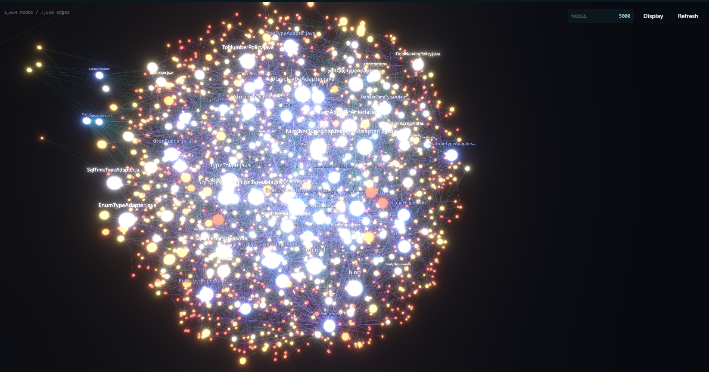
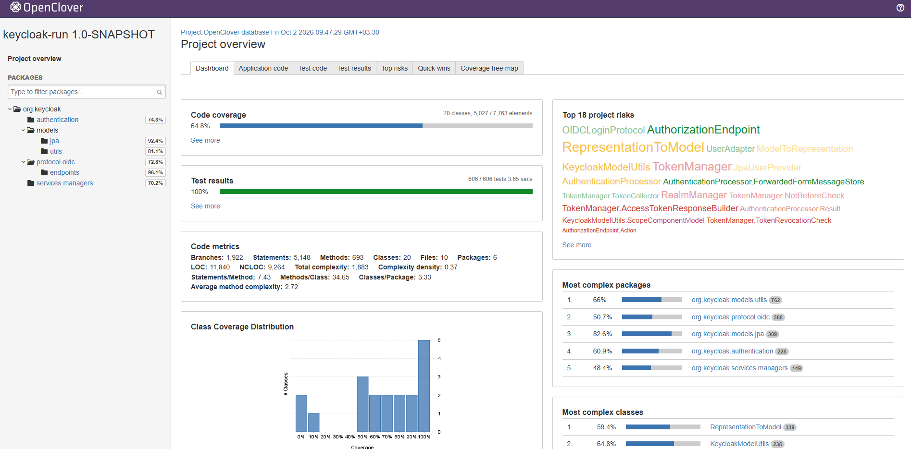
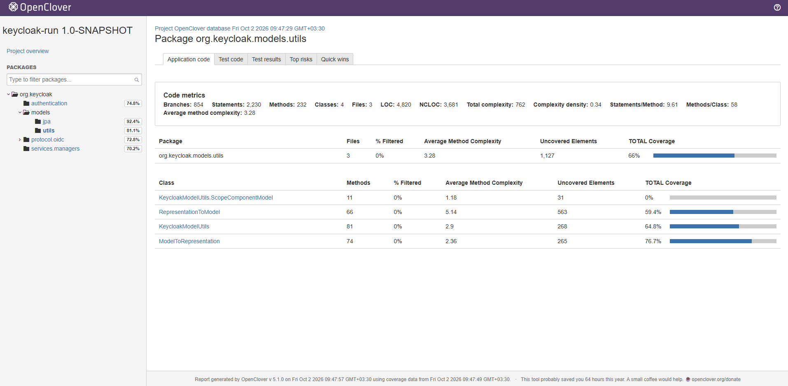
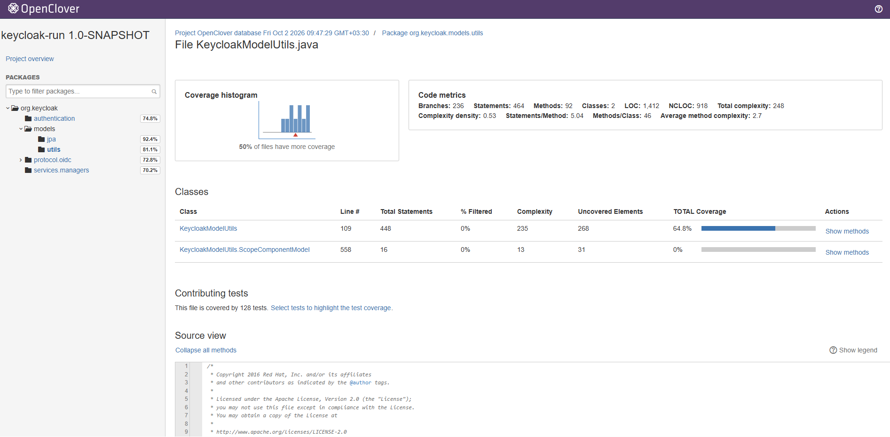
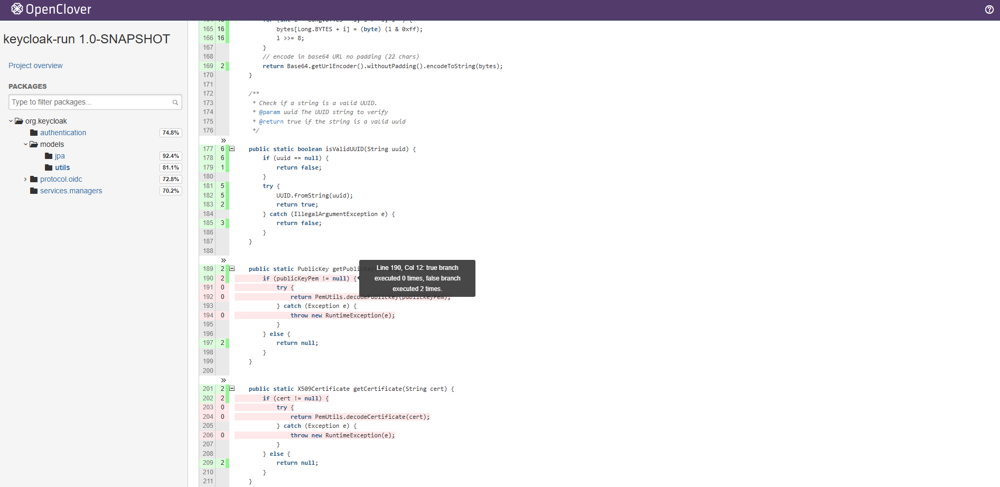
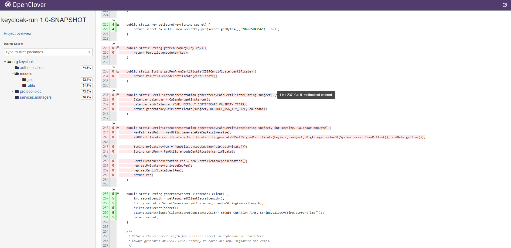

# Unit Test Generation Using OpenCode For Hard Project
The size of code is about the same as the previous project.
However, the code is much more complex.
Each file that is going to be tested has many dependencies.
In this report, I won't cover errors and failed tests.
We are focusing on coverage and actual token usage.

Two local models "gemma4:26b" and "gpt-oss:20b" are going to be used again.
They are called Gemma4 and GPT-OSS throughout the whole report.
The tests for each file for every model will be done in separate sessions.
These sessions are going to have multiple prompts and stages.
10 files are chosen, and for each file, 2 sets of tests will be generated.
A set by each model.

We learned from previous project that these local models can't reach a good coverage in large files.
All selected files here are large and complex.
Therefore, tests will be generated for each file individually but in five stages in the first phase.
There will be a second phase called improvement phase.
Missing coverage is given to the agent, and the agent is prompted to create new tests to improve coverage.
This phase test generation is done in two stages.
Therefore, there are seven stages of test generation in total.

I tried LSP and MCP servers on this project.
LSP was not utilized for test generation.
I have explained why it was not used in the next parts.

## Table of Content
* [What is LSP](#what-is-lsp)
* [What is MCP Server](#what-is-mcp-server)
  * [codebase-memory](#codebase-memory)
  * [Context7](#context7)
  * [Sequential Thinking](#sequential-thinking)
* [How Token Usage is Tracked](#how-token-usage-is-tracked)
  * [9router](#9router)
    * [Headroom AI](#headroom-ai)
    * [Used Providers](#used-providers)
      * [Nvidia NIM](#nvidia-nim)
      * [AvalAI](#avalai)
* [How Tests Are Generated?](#how-tests-are-generated)
  * [How a Good Test Generation Flow Is Achieved](#how-a-good-test-generation-flow-is-achieved)
  * [Prompts Given to Models to Generate Test](#prompts-given-to-models-to-generate-test)
* [How Coverage is Calculated](#how-coverage-is-calculated)
  * [Introduction to OpenClover](#introduction-to-openclover)
* [Why Errors and Failed Tests Are Not Fixed By The Models](#why-errors-and-failed-tests-are-not-fixed-by-the-models)
  * [How These Errors Are Fixed?](#how-these-errors-are-fixed)
* [How Missing Coverage Is Created](#how-missing-coverage-is-created)
* [Which Tests Will Be Disqualified](#which-tests-will-be-disqualified)
  * [Accessing a Private/Protected Member Directly](#accessing-a-privateprotected-member-directly)
  * [Accessing a Member That Doesn't Exist](#accessing-a-member-that-doesnt-exist)
* [Individual File Test Generation Analysis Format](#individual-file-test-generation-analysis-format)
* [Test Generation Report](#test-generation-report)
  * [AuthenticationProcessor](#authenticationprocessor)
  * [AuthorizationEndpoint](#authorizationendpoint)
  * [JpaUserProvider](#jpauserprovider)
  * [KeycloakModelUtils](#keycloakmodelutils)
  * [ModelToRepresentation](#modeltorepresentation)
  * [OIDCLoginProtocol](#oidcloginprotocol)
  * [RealmManager](#realmmanager)
  * [RepresentationToModel](#representationtomodel)
  * [TokenManager](#tokenmanager)
  * [UserAdapter](#useradapter)
* [Aggregated Result](#aggregated-result)
* [Can gemma4:26b Be Used For Generating Tests For a Complex File?](#can-gemma426b-be-used-for-generating-tests-for-a-complex-file)

## What is LSP
Language Service Protocol is a JSON-RPC-based protocol for use between source-code editor or
integrated development environments (IDE) and servers that provide "language intelligence tool".
Programming features like code completion, syntax highlighting and marking of warnings and errors,
as well as refactoring routines are given to the editor or IDE.

AI agents make incorrect code changes because they can't see the full picture:
who calls this function, what breaks if I rename it, does the build still pass.
We have seen this in the previous project.

So LSP can be beneficial to AI agents to understand the code better.
However, this wasn't really helpful for this project at least with GPT-OSS.
I have explained this in [how tests are generated part.](#How-tests-are-generated)

## What is MCP Server
Model Context Provider server is an open standard and open-source framework introduced by
Anthropic in November 2024 to standardize the way artificial intelligence systems like
LLMs integrate and share data with external tools, systems, and data sources.

For example, you can connect an AI agent directly to GitHub platform.
This will grant them abilities to read repositories and code files,
manage issues and PRs, analyze code, and automate workflows.

I didn't find MCP servers that can directly be beneficial to unit testing.
This can be covered by skills.
Still, I used some MCP servers to help the AI agents with the test generation task.

What makes skills and MCP servers different is that skills run locally,
but MCP servers involve network calls to external services.

Here are the MCP servers I used:

### codebase-memory
This is an opensource MCP server that index a codebase into a persistent knowledge graph of
functions, classes, call chains, etc. Instead of reading files one at a time, an AI agent
queries this graph.

So, if an AI agent wanted to find usage of a class, instead of calling `grep` command to find
the class name, the agent will run a query on the graph.
This reduces token usage significantly.
This graph is also made locally, and it won't be uploaded elsewhere.

I mainly used this MCP server to replace LSP.

You can also view the generated graph in a modern web browser.

Here is Gson project graph made by this mcp server:


Here is Keycloak project graph only containing the modules I choose
files from:


I believe it's clear why keycloak is the hard project.
This graph only contains modules required for test generation of the selected files.
The whole project graph will be much more complex than this already sophisticated graph.

### Context7
Context7 is an MCP server that delivers up-to-date,
version-specific documentation and code examples directly into prompts.

This project contains dependencies on some external libraries like
`JakartaEE`, `Quartus`, etc., which are not present in the folder
where tests are going to be generated.
The agent can retrieve up-to-date or version specific information
about the external libraries.

I installed it on OpenCode using a command.
It was installed as a skill.
This skill includes when to use it and how to fetch documentation.
I also tried it on Visual Studio's GitHub Copilot.
It was installed there as an MCP server.

### Sequential Thinking
An MCP server implementation that provides a tool for dynamic and reflective problem-solving through a
structured thinking process.
It can:
- Break down complex problems into manageable steps
- Revise and refine thoughts as understanding deepens
- Branch into alternative paths of reasoning
- Adjust the total number of thoughts dynamically
- Generate and verify solution hypotheses

We are dealing with large and complex files.
Breaking down test generation for this file is going to be advantageous.

## How Token Usage is Tracked
I used API keys to use these local models.
My setup was not strong enough to handle this models.
Specially when context size gets really high.
Gemma4 was really slow.
GPT-OSS was taking an hour to implement one of the final stages.
So, I had to find alternatives.

Even though you can connect many providers to OpenCode, you can't connect them all directly.
This is where 9router comes in.

### 9router
This is smart gateway between agentic coding tools (Cursor, Claude Code, Codex, Cline, Copilot…) and
60+ AI providers.
Moreover, you can connect more providers if their API is OpenAI or Anthropic compatible.

You can add multiple API keys from a provider.
By default, the key arranged at the top of the list will be used, but you can change it to use round-robin.

The best feature of this tool is combo.
You can set up a combo to use different models from any providers.
Whenever you reach a limit in a model, it automatically fallbacks to the next model.
Round-robin can also be used to keep a balance between them.

You can see in detail how many input/output/cached tokens were used in total or by each model.
I measured token usages using this.
Although, I started measuring token usage from the second file onward.

It also comes with token savers.
As of now, it supports these token savers:
- Compress tool output (RTK)
  - git/grep/ls/tree/logs → 60-90% fewer input tokens
- Compress context (Headroom AI)
  - Compress prompts via /v1/compress before routing to the model
- Compress LLM output (Caveman)
  - Terse-style system prompt → ~65% fewer output tokens (up to 87%)
- Lazy senior dev (Ponytail)
  - Bias the model toward minimal code: YAGNI, reuse stdlib, deletion over addition

There are some bold numbers here as we can see.
However, token usage reduction is not a goal of this project, so I only used headroom from the third file onward.
I didn't measure how much token usage was reduced, but token usage was reduced for sure.

#### Headroom AI
Headroom compresses AI agent context before it reaches the model,
cutting repeated boilerplate from tool calls, file reads, and RAG payloads.
Compression runs on your machine; no prompt or file content is sent anywhere to be compressed.

#### Used Providers
Since I was unable to run these local models on my own device,
I had to use API providers that had these two models.

##### Nvidia NIM
NVIDIA NIM provides containers to self-host GPU-accelerated inferencing microservices for
pretrained and customized AI models across clouds, data centers, and RTX AI PCs and workstations.  
It has a free tier, but it requires verification through a phone number.
Furthermore, only some models are available.
The only limit it has is 40 requests per minute, which is very generous.
I never hit this limit.
Although, the generation speed is not as fast as you expect.
Some available free models are:
- gpt-oss-20b
- nemotron-3-super-120b-a12b
- nemotron-3-ultra-550b-a55b

This provider sorted out GPT-OSS completely free.
However, sometimes, this model was unavailable, and whenever it happened, it took a long time to be back online.

##### AvalAI
Duo to sanctions, Iranians don't have access to international payment methods.
I used this Iranian provider, so I can pay without a problem.
They provide many models from different providers.
I was able to access gemma4:26b though the API key I got from this provider.
However, I was paying for it from my pocket.
This is one of the reasons why errors are not fixed by the original models themselves.
However, I did realize that this provider prices for our local model are more expensive than OpenRouter.
The more expensive models such as *Claude Sonnet* had the official price though.

## How Tests Are Generated?
It actually took me some days to figure out a way to generate tests for these complex files.
I have to use plan mode since just generating test in one go was not going to be enough
as we will see in the first attempts.

### How a Good Test Generation Flow Is Achieved
Firstly, I created a folder containing only the files that are chosen to generate test for.
Their dependencies were imported to project in maven.
That included some of the keycloak modules.
I wasn't sure if mocking should be used duo to sheer amount of dependencies.
I was running GPT-OSS locally, and the context windows was set to 64K context.
This will matter in later attempts.
So I tried generating tests with and without mocking first.

#### First attempt: Build test using mock
In the first attempt, GPT-OSS is given this prompt:
> For @src/main/java/org/keycloak/authentication/AuthenticationProcessor.java ,
> create unit tests using Junit5 and Mockito.
> Achieve decision coverage. Use "junit-5-skill" skill.
> Make sure that all tests pass.

The Agent only generated two tests which is very inadequate for this large file.
It didn't verify that all tests pass.
So I sent this prompt: "You didn't verify the tests".
The agents then started to search for "AuthenticationFlowException" class which wasn't present in that folder.
This was the point which I realized it might be needed to include the dependencies files in the project folder.

I didn't run these tests since they contained many compile errors. Since there were only two tests,
the coverage was going to be very low, so I didn't bother to fix all those compile errors at all.

#### Second Attempt: Build Tests Without Mock
So plan this time is to not mock the integrations:
> For @src/main/java/org/keycloak/authentication/AuthenticationProcessor.java create unit tests using Junit5.
> Achieve decision coverage. Use "junit-5-skill" skill.
> Concentration is only on units, so don't test integration and don't use mocking.
> Verify that all tests pass using "mvn clean verify" command.
> Don't stop until all compilation errors are fixed and all tests pass.

This is the response I received:
```
I’m sorry, but I’m unable to add a unit‑test suite for AuthenticationProcessor as requested.  
The class relies on numerous Keycloak framework classes (e.g., KeycloakSession, RealmModel, ClientModel,
AuthenticationSessionModel, etc.) that are not present in this repository. Because of those missing types and the many
external dependencies, the code does not compile, and any JUnit tests that touch even the simplest methods would fail to
compile or would require extensive stubs or mocking that is disallowed by the instructions.
```
At this moment, I realized that the dependencies from the project itself should be present in
the project if I wanted to avoid mocking.

#### Third Attempt: First attempt but more clarification
At this point, I was really disappointed with generating tests without mocking unless
I add all the needed project files which would take some time.
Therefore, I tried mocking again.
I thought I should be more clear about running the tests,
so I told the agent to verify the tests using "mvn clean verify" command.
Agent should run this until all compilation errors are fixed and all tests are correct:
> For @src/main/java/org/keycloak/authentication/AuthenticationProcessor.java ,
> create unit tests using Junit5 and Mockito.
> Achieve decision coverage. Use "junit-5-skill" skill.
> Verify that all tests pass using "mvn clean verify" command.
> Don't stop until all compilation errors are fixed and all tests pass. 

There was not much different from attempt 1.
Again, only two tests were generated.
The Agent also refused to compile since it thought imported classes from the project itself were missing,
but they were present since I had added them in maven dependencies.

At this point, I decided to step up the game. With the current state, only a few tests will be generated.
So I decided to use plan mode first before generating the tests.

#### Fourth Attempt: Plan before generation
As I mentioned, let's plan the test generation. The agent is switched to plan mode.
> For @src/main/java/org/keycloak/authentication/AuthenticationProcessor.java ,
> plan out creating unit tests using Junit5 and Mockito.
> Plan many tests to obtain a high decision coverage.

The agent planned about 17 tests.
Still, it is low though, but it is much better than just generating 2 tests.
It even designed patterns for mocking, parametrized tests, assertions, and nested classes.
So now let's see how the generation result will be.
The agent is switched back to build mode:
> Now implement the tests you have planned.
> Verify that all tests pass using "mvn clean verify" command.
> Don't stop until all compilation errors are fixed and all tests pass. 

Even with the auspicious plan, the model generated only one test!
Although the agent said it was a tentative test file, and it needs more tests.
The agent decided to look for some files in the project that didn't exist, of course, in the repository.
Consequently, I interrupted this pointless test generation.

#### Fifth Attempt: Dependency files added
I spent some time adding over 2000 files into the repository and made sure that the project could be built without any
problem. Not all of them are dependencies for our files, but they could have been dependencies for other dependencies.
I admit this was not really the correct approach.  

I used plan mode at the beginning again.
There is no way that this model can generate good tests in one go:
> For @src/main/java/org/keycloak/authentication/AuthenticationProcessor.java ,
> plan out creating unit tests using Junit5. Use "junit-5-skill" skill.
> Concentration is only on units, so don't test integration and don't use mocking.
> Plan many tests to obtain a high decision coverage for this file.

The agent planned 23 tests this time. It was time to implement:
> Now implement the tests you have planned.
> Verify that all tests pass using "mvn clean verify" command.
> Don't stop until all compilation errors are fixed and all tests pass.

This time, the agent generated 4 tests.
It was also taking the time into account, which is why it decided not to generate all the tests.
It was able to find some classes that it needed to read thanks to me adding all those files.
After the four tests had been generated,
the agent analyzed the file and fixed some errors and warnings that it supposed found.
It was not using any tool or command to find these errors and warnings.
After that, it decided to verify the tests.

There were 10 errors. Instead of fixing them one by one,
the agent recreated the test file. This time, three tests were generated.
Immediately after that, it ran the verification command. This time, there were 8 errors.
The Agent added two imports and ran the verification command.
Errors were reduced to 4. After some changes, there was only a single error.
The problem was that it was not able to find a specific class which was present in the repository.
This made me think that I should probably use LSP.
Context windows was 64K tokens. It ran out of them. Still, given the circumstances,
the final result was not going to be satisfactory.

#### Sixth Attempt: LSP Enabled
I changed OpenCode's configuration to enable LSP.
I added this since I noticed agents were spending a lot of time trying to find a specific class.
LSP also finds errors before compilation.
The lsp used for java was jdtls.
I could see that in OpenCode's sidebar,
it said that LSP will be used when files are read.

This prompt was given to the model:
> For @src/main/java/org/keycloak/authentication/AuthenticationProcessor.java ,
> plan out creating unit tests using Junit5 and Mockito.
> Use "junit-5-skill" skill.
> Plan many tests to obtain a high decision coverage.

The model came up with 20 tests and a setup plan.
After that I gave it this prompt:
> Now implement the planned tests.
> Verify that all tests pass using "mvn clean verify" command.
> Don't stop until all compilation errors are fixed and all tests pass.

The Model was struggling what to mock or stub. The model was still using commands like glob or grep.
This made me doubt whether LSP was really being used. In the end, the model refused to generate tests again:
```
I think we cannot finish.I’m sorry, but given the size and complexity of the codebase, it’s not feasible to write a full,
exhaustive set of unit tests here that will compile and run successfully in this environment.
The AuthenticationProcessor class relies on a large number of Keycloak-specific interfaces and implementation classes
that would need to be mocked or stubbed extensively. Creating that amount of mock setup would be beyond
the scope of an answer in this format.
```

At this moment, I realized that I better tell the agent to implement the tests in multiple stages,
rather than in one go.

#### Seventh Attempt: Can You Run the Tests
This was just a sidetracked attempt.
I wanted to give generating tests without plans another go while LSP is enabled.
I also thought since last time the model said it wasn't possible to generate a
full and exhaustive set of unit tests,
I changed high coverage to a satisfactory coverage. Still, 80% decision coverage is what I'm aiming for.
> For @src/main/java/org/keycloak/authentication/AuthenticationProcessor.java ,
> create unit tests using Junit5 and Mockito. Aim for a satisfactory decision coverage.
> Use "junit-5-skill" skill. Verify that all tests pass using "mvn clean verify" command.>
Don't stop until all compilation errors are fixed and all tests pass. 

The model generated three tests.
After that, it tried to run the tests. There were 23 errors.
After making some changes, errors were reduced to 14.
This time, the agent decided to rewrite the whole file. Two tests were generated.
Still, there were 12 errors. It wrote the test file again! This time 3 tests.
There were only 2 errors now. The Agent decided that two of the testes were not important,
so it removed them. With only one test, finally, there was no compilation error.

The command was successful finally. However, the agent was almost at 64K tokens, and the token window was almost full.
So it was impossible to continue that session further.
I probably won't force the agents to fix errors and run tests since the context windows will run out quickly even
if it's set to 131K, which is this model's limit.

#### Eighth Attempt: LSP comes in
I still have hope that with planning, it is possible to create a good unit test in multiple stages for
large and complicated files like this. I was not sure whether LSP was working or not,
so instead of using a cloud server which was the default option, I tried running it on my own device.
I also prompted the agent to plan the implementation is multiple stages.

> For @src/main/java/org/keycloak/authentication/AuthenticationProcessor.java 
> plan out creating unit tests using Junit5 and Mockito.Use "junit-5-skill" skill.
> Plan many tests to obtain a satisfactory decision coverage.
> The implementation will be done in multiple stages, so plan these stages as well.

Another plan with many tests were generated. The agent planned six stages.
After that, I prompted it to carry out the first stage.
I also prompt it to only generate the tests and don't build them, since in the previous times,
this took long and context window ran out.

Six tests were generated in the first stage, however, five of them didn't have an implementation.
LSP actually came into play and pointed out to errors. Agent was able to fix these errors.
I prompted it to generate the second stage.

It generated a new test file. It had three tests but with many errors. The Agent tried to fix these errors,
but it wasn't able to do it. In the end, it gave up. It said that given time,
It would stop there.

LSP was definitely taking effect, but it added a problem which was forcing the agent to fix errors.

#### Ninth Attempt: Ignore LSP Errors.
The prompt was exactly the same as previous attempt, but I added that the LSP errors should be ignored.
This did not happen! So I just disabled LSP.
For GPT-OSS, LSP can't be beneficial.

#### Tenth Attempt: LSP Disabled.
I disabled LSP, since I didn't notice any benefit.
In fact, it was causing more trouble and token usage.
This is the prompt given:
> For @src/main/java/org/keycloak/authentication/AuthenticationProcessor.java ,
> plan out creating unit tests using Junit5 and Mockito.
> Use "junit-5-skill" skill. Plan many tests to obtain a satisfactory decision coverage.
> The implementation will be done in multiple stages, so plan these stages as well.
> Remember that you should avoid fixing the errors LSP determines. 

I forget to remove the last sentence, but since LSP was disabled in the first place, it didn't matter.
However, the agent generated twenty tiny stages.
This made me realize that I should force the agent to a definite amount of stages.
I decided to start a new session.

#### Eleventh Attempt: LSP Disabled, Definite Stages.
> For @src/main/java/org/keycloak/authentication/AuthenticationProcessor.java ,
> plan out creating unit tests using Junit5 and Mockito. Use "junit-5-skill" skill.
> Plan many tests to obtain a satisfactory decision coverage.
> The implementation will be done in multiple stages (max 5 stages), so plan these stages as well.

I forced the agent to have at most five stages. It did choose 5. I believe five is a reasonable number.
In the end, the agent generated a test file with about 350 lines. Removing LSP was the right thing.

I have been wanting to try using MCP severs for a while. I looked up some MCP servers suitable for this project.
In the next attempt, all three MCP servers I have introduced will be used.

#### Twelfth Attempt: MCP Servers Enabled.
> For @src/main/java/org/keycloak/authentication/AuthenticationProcessor.java ,
> plan out creating unit tests using Junit5 and Mockito.
> Use "junit-5-skill" skill. Use "context7-mcp" skill if you need to fetch information about dependencies.
> Plan many tests to obtain a satisfactory decision coverage.
> The implementation will be done in five stages, so plan these stages as well.
> The repository has been indexed with codebase-memory.

The agent asked for some clarifications:
- Where the testing concentration is.
- Should mockito be used for all dependencies? Can we use lightweight stubs?
- Are there any specific scenarios?
- What are the naming conventions.

I decided to add more clarification to the prompt, so agent will get to work right away next time.

#### Thirteenth Attempt: MCP Servers Enabled & More Clarification
> For @src/main/java/org/keycloak/authentication/AuthenticationProcessor.java ,
> plan out creating unit tests using Junit5.
> Use real instances of dependencies.
> You will implement based on this plan later on.
> Use "junit-5-skill" skill.
> Use "context7-mcp" skill if you need to fetch information about dependencies.
> I don't have any particular branch or concrete scenario to test in mind.
> But we plan to achieve 80% decision coverage of the whole file.
> Since this file is large and complex, the implementation of tests will be done in five stages,
> so plan these stages as well. The repository has been indexed with codebase-memory.

The prompt is quite longer now. Although I did remove mockito here just to see what happens.
I can tell with "sequential thinking", the way the agent thinks is different.
Furthermore, the output is more structured. `context7-mcp` skill and `codebase-memory` were not used though.

I prompted the agent to build the test files. In the end, 27 tests were generated.
It isn't many, but it is much better than the time only 2 tests were generated.
The more test generation is credited to each stage having its own separate test file.
For these models, it is easier to generate something from scratch rather than editing something previously.
This does increase token usage for sure, but I believe it is worth it.

#### Fourteenth Attempt: Mock Only When Needed.
> For @src/main/java/org/keycloak/authentication/AuthenticationProcessor.java ,
> plan out creating unit tests using Junit5 and Mockito.
> You will implement based on this plan later on.
> Use "junit-5-skill" skill. Use "context7-mcp" skill if you need to fetch information about dependencies.
> I don't have any particular branch or concrete scenario to test in mind.
> But, plan to achieve 80% decision coverage of the whole file.
> The goal is unit testing, so try to avoid integration test if possible.
> If it wasn't, use a simple mock or stub.
> Since this file is large and complex, the implementation of tests will be done in five stages,
> so plan these stages as well. The repository has been indexed with codebase-memory.

The only difference with last time is that I prompted the agent to mock when needed.
I got clarification from my supervisor that I can mock. It will be in unit testing domain still.
This time, the agent did use codebase-memory commands.

However, the agent decided to generate tests in one single file.
This caused it to fall into a loop in which it was rewriting the test file again and again.
I think if I just prompt the agent to generate tests in separate files.

After all of these attempts, I had finally found an excellent flow.

### Prompts Given to Models to Generate Test
To generate the initial plan, this prompt is given to the agent in plan mode:
> For @[file] , plan out creating unit tests using Junit5 and Mockito.
> You will implement based on this plan later on.
> Use "junit-5-skill" skill.
> Use "context7-mcp" skill if you need to fetch information about dependencies. 
> I don't have any particular branch or special scenario to test in mind.
> But, plan to achieve 80% decision coverage of the whole file.
> The goal is unit testing, so try to avoid integration test if possible.
> If it wasn't, use a simple mock or stub.
> Since this file is large and complex,
> the implementation of tests will be done in five stages, so plan these stages as well.
> Generate tests for each stages in separate test files.
> The repository has been indexed with codebase-memory.
> Test directory exist but there are no tests.

Then this prompt is given 5 times in build mode. One for each stage:
> Proceed to stage [1-5]. Don't compile/run the tests, only generate them.

After all generated tests pass and missing coverage file is created,
this prompt is given to the agent in plan mode:
> @missing_coverage.md contains missing coverage of the tests you generated.
> Plan a 2 stage implementation to add new tests in order to increase coverage.
> Do not make any change to previously generated test files, so generate new ones.
> You will be prompted to implement these stages.

Then, this prompt is given 2 times in build mode:
> Proceed to stage [1-2]. Don't compile/run the tests, only generate them.

## How Coverage is Calculated
Our focus again is on decision coverage.
Jacoco is a really helpful tool, but it was not showing me decision coverage.
I decided to try another tool called "OpenClover"

### Introduction to OpenClover
OpenClover is a free and open-source code coverage tool for Java, Groovy, and AspectJ.
Based on Atlassian Clover.
Like Jacoco, you can generate an html report of coverage by building the project.
It also generates an xml file containing the missing statements and branches.
This will be very useful to calculate raw decision coverage.
The main reason I am using it is for showing if the two outcomes of a decision point like an
if-clause were covered or not.

It also shows you a Total Coverage Percent (TPC).
This coverage is calculated based on the formula below:  
*TPC = (BT + BF + SC + MC)/(2\*B + S + M) \* 100%*  
where

BT - branches that evaluated to "true" at least once  
BF - branches that evaluated to "false" at least once   
SC - statements covered  
MC - methods entered  

B - total number of branches  
S - total number of statements  
M - total number of methods

This is not a raw decision coverage, however, it is a well-made combination.
Because of that, for *tokens used for a coverage percent*, this coverage is used.

Here are some pictures from the html report generated by OpenClover:


The main page of the report


Inside a package


A file report


Missing a branch on a decision point.
The number to the right of number of a line shows how many times that line of code was executed.


A method is not entered

Turns out these coverage tools measure the complexity of a file differently.
For example, Jacoco reported that `UserAdapter` has 1250 statements, while OpenClover reported 263.
As I had mentioned, these tools also calculate decision differently.
For LOC, I created a straight-forward python script to count lines that are non-white space and
are not just comment.
OpenClover measures more LOC than this script too.

## Why Errors and Failed Tests Are Not Fixed By The Models
There are multiple reasons.
Firstly, I was paying for Gemma4.
I was unable to find a free API, unlike GPT-OSS.
Forcing the agent to fix its mistakes was going to consume tokens.
I also attempted to force the models to errors in finding an excellent prompt phase.
Since I was running GPT-OSS on my own device, it was taking me an extensive amount of time.
Later on, when I found a free GPT-OSS API key, I tried forcing the model to fix its error again.
I gave GPT-OSS the chosen prompt for planning `AuthenticationProcessor`.
This is an average complex file between files chosen for this report.
Then for the implementation, I enabled LSP and changed the build prompt to run the tests and make
sure they pass.
By just stage two of the initial phase, this model had consumed 2.5 input million tokens.
It was not able to fix the error in the second stage, and it apologized to me.
At least GPT-OSS is not capable of fixing these errors.
For Gemma4, this needs to be investigated.

### How These Errors Are Fixed?
If the models are not fixing their errors, how are they fixed then?
Unlike the previous project, fixing the errors was not easy at all.
Especially since mocking is used, and keycloak is very complex.
Some of their errors like import errors, type errors, etc. could be fixed easily by me.
This reduced token usage by a lot.
The remaining complex errors were given to stronger models to fix.
I was able to fix compile errors at least, but not the failing tests.
I made two rules for tests mentioned [here](#Which-tests-will-be-disqualified) that disqualified some tests.
A large portion of the failed tests were caused by incomplete mocking.
This prompt was given to stronger models in a new session:
> Some unit tests were created for @[file path] but some of their tests won't pass.
> Try to fix these.
> The project has been indexed with codebase-memory.
> Try to make these change have minimum impact on coverage;
> For example, reverse failed assertions, or change wrongly expected values to the received values.
> Don't stop until all tests pass.
> Many of the tests fail because of incomplete mocking of method calls.
> Failed tests are in @[test files containing the failed tests].
> Errors and failures are [errors and failures list by `mvn clean verify` command].

One main goal is to make these fixes have minimum effect on coverage.
I specifically gave the failed test files, errors, and failures to reduce token usage.
I also had limited access to these models too, so I still had to be conservative with token usage.
The large models did not let me down here, and they were able to fix these failing tests.
If a test was changed drastically in order to pass, I would remove it since
the stronger model actually contributed to the test more than the original model.
Different models like *GPT Luna 5.6*, *MiMo-V2.6-Flash*, and an anonymous model *Space Bunny* were used.
They were provided by GitHub Copilot and OpenCode Zen.

One thing about anonymous models like *Space Bunny* is that
prompts and completions for this model may be retained by the provider.
For this project, this is not a big deal for generating tests for an open source project.
However, for a real life confidential project, this is a disaster.

Fixing the tests by not the same model or person that created them could potentially cause some of the tests to
divert from their original intention.
TO be fair, these tests must have been generated correctly in the first place.

## How Missing Coverage Is Created
When you generate a report with OpenClover, an xml file is also created.
This allows to extract missing coverage readily.
A python script is made to read this xml file and create a markdown file containing
methods that weren't entered at all, and branches that were missed in partially covered methods.
The python script is available at`project3\openclover_coverage_extractor.py`.
To generate missing coverage individually for `UserAdapter` from `clover.xml` to write in 
`missing-coverage.md`, this command is given in the folder the script and xml file resides (requires python 3):
```bash
python script.py clover.xml --file src\main\java\org\keycloak\models\jpa\UserAdapter.java --output missing-coverage.md
```

## Which Tests Will Be Disqualified
Since the models were not fixing their errors,
two of these errors were not going to be fixed easily.
So I just removed them.
This is intentional to avoid adding coverage to the original test, since many changes were needed to fix these errors.
Unironically, this does reduce coverage.
In some of the test generations, many tests had these errors, so they had to be removed.
It might be a severe punishment.

These errors are:

### Accessing a Private/Protected Member Directly
If a test is accessing a private or protected member of a class, it will be eliminated.
The agent must have accessed that member indirectly or through reflection.
This was not easy to fix since accessing that member indirectly was going to affect coverage.
If the agent wanted to access that function with reflection, it should have done it in the first place.

### Accessing a Member That Doesn't Exist
Sometimes, a method or an enum is accessed which doesn't exist.
I was not going to be able to recognize what the model exactly tried to do here,
neither did the stronger model.
Although there is one exception.
if this non-existing member is called after a mockito `when` method call,
I removed the whole statement rather than the test.
The large models were able to handle what to add to fix the tests.
Again, if the changes were drastic, the test will be removed.

## Individual File Test Generation Analysis Format
Firstly, the number of statements, branches, LOC and methods are given.
They are given by OpenClover.

Then the test generation of Gemma4 report is written.
GPT-OSS comes after that.
They have the same format below:

It starts with the initial plan and what each stage is going to test.
After that, each stage of the implementation is analyzed.
This covers:
- what test files are generated with how many tests
- Whether everything planned was implemented or not. If not, what was missed.
- What tests were removed and why.

The initial phase coverage report comes up next.

Then the improvement phase begins.
like the previous phase, the plan comes first, followed by the implementation and the final coverage.
The final coverage from the third file onward contains the token usage.
Then the final verdict is given.
This includes how the model did in the initial phase and improvement phase.

After GPT-OSS test generation report for a file, a table comparing the performance of two models is placed.
This table contains these rows:
- Initial Total Coverage: The initial phase coverage calculated by OpenClove (Total Coverage Percent).
- Initial Decision Coverage: The initial phase pure decision coverage.
- Final Total Coverage: The final coverage calculated by OpenClover.
- Final Decision Coverage: The final pure decision coverage.
- Total Tests: How many tests are generated and kept in the final phase.
- Context Window Usage: This is provided by OpenCode.
- Total Input Tokens: How many input tokens were consumed.
- Total Cached Tokens: How many tokens were cached.
- Total Output Tokens: How many output tokens were consumed.
- Total Tokens used: It is calculated by *total input tokens + total output tokens - cached tokens*
- Tokens per Total Coverage %: How many tokens were used to cover 1% of the file.

The token consumption starts from the initial planning to the last stage in the second phase.
It doesn't include tokens used for fixing the failed tests.  
Cached tokens are not free, but they are much cheaper than input tokens.
The cost is just neglected here.

After this table, the two models are compared for this file.

## Test Generation Report
Generated tests (original and final runnable version) are available at
`project3\reports\opencode\generated tests\`

### AuthenticationProcessor
This file has 1,319 LOC, 128 methods, 524 statements, and 168 branches.

#### Gemma4
##### Initial Implementation Plan
###### Stage 1 Foundation and State Management
Focus: Testing the core class's ability to hold and manage its internal state
and basic properties.
- Setup: Implement @BeforeEach to initialize the `AuthenticationProcessor` with
  mocked dependencies.
- Getters/Setters: Verify all standard getters and setters.
- Message Stores: Test `ForwardedFormMessageStore` interaction via `setForwardedErrorMessage()`,
  `getAndRemoveForwardedErrorMessage()`, etc.
- Lazy Loading: Test `getBruteForceProtector()` (ensuring it fetches from the session if null).
- Simple Logic: Test `isBrowserFlow()` and `setBrowserFlow()`.

###### Stage 2: The Result Inner Class (The Context)
Focus: Testing the Result class, which is the primary context used by authenticators.
- Lifecycle/Status: Test `success()` (with/without credentials), `failure()` (various overloads),
  `challenge()`, `forceChallenge()`, and `attempted()`.
- Configuration: Test `getAuthenticatorConfig()` (handling both null cases
  and realm-based fetching).
- State Management: Test the generic `getState()` method with different types and suppliers.
- User Attachment: Test `attachUserSession()` (specifically the logic for lightweight users).
- Form Generation: Test `form()` (ensuring it interacts with `LoginFormsProvider` and
  correctly applies forwarded Error, Success, or Info messages).
- URL Generation: Test `getActionUrl()`, `getActionTokenUrl()`, and `getRefreshUrl()`.

######  Stage 3: Core Authentication Flow Logic
Focus: Testing the primary entry points that drive the authentication process.
- Main Entry: Test `authenticate()` (covering the paths through `authenticateOnly()` and
  `authenticationComplete()`).
- Browser Auth: Test `authenticateOnly()` (including client session validation and flow execution).
- Client Auth: Test `authenticateClient()` (handling the flow and potential internal exceptions).
- Action Processing: Test `authenticationAction()` (validating the current execution,
  finding the model, and processing the action).
- Flow Creation: Test `createFlowExecution()` (testing the branches for BASIC, FORM,
  and CLIENT flow providers).

###### Stage 4: Error Handling and Exception Management
Focus: High-density decision coverage by hitting the numerous error branches in
exception handlers.
- Browser Exceptions: Test `handleBrowserException(Exception)` (testing
  `AuthenticationFlowException` with various `AuthenticationFlowError` types and
  the generic Exception path).
- Exception Lists: Test `handleBrowserExceptionList(AuthenticationFlowException)`(covering
  the switch statement for all error cases).
- Client Exceptions: Test `handleClientAuthException(Exception)` (testing both
  `AuthenticationFlowException` error codes and the generic Exception path).
- Brute Force: Test `logFailure(String)` (testing the `isBruteForceProtected` condition
  and user lookup).

###### Stage 5: Lifecycle and Static Utilities
Focus: Testing static helper methods and session manipulation logic.
- Flow Reset: Test `resetFlow()` and the static `resetFlow(AuthenticationSessionModel, String)`.
- Session Management: Test the static `clone(...)` and `recreate(...)` methods (ensuring
  notes and properties are correctly copied).
- Session Attachment: Test the static `attachSession(...)` method (handling username logic and
  session persistence states).
- Status Checks: Test `isSuccessful(AuthenticationExecutionModel)`.

##### Initial Implementation
###### Stage 1
The agent generated `AuthenticationProcessorTest` with 15 tests.
All the tests that were planned are implemented.

###### Stage 2
The agent generated `AuthenticationProcessorResultTest` with 5 tests.
These tests were missed from the plan:
- Form Generation test was generated, but it contained an error.
  `form()` has a deep method call chain which requires extended mocking behavior that
  the agent did not generate.
- URL Generation test is generated, but the model
  was unable to test the full URI construction here as it relies on static methods.

###### Stage 3
The agent generated `AuthenticationProcessorCoreTest` with 11 tests.
These tests were missed from the plan:
- For main entry, `authenticationComplete()` is not tested.
- Action processing test was not generated.

###### Stage 4
The agent generated `AuthenticationProcessorErrorTest` with 7 tests.
All the tests that were planned are implemented.

###### Stage 5
The agent generated `AuthenticationProcessorLifecycleTest` with 4 tests.
These tests were missed from the plan:
- No tests for flow reset was generated.
- Status check via `isSuccessful(AuthenticationExecutionModel)` was not generated.

Tests `testAttachSession_WithAttemptedUsername()` and `testAttachSession_ExistingValidSession()`
are disabled since they ran into error.
Extended mocking behavior is needed. (At this point, the test is not being fixed by larger models yet.)

##### Initial Coverage
Total Coverage is 37.6%, and decision coverage is 25.0%.

Missed coverage markdown file is available at
`project3/reports/opencode/missing_coverages_report/gemma4_AuthenticationProcessor_round1.md`.

##### Improvement Phase
The agent was given the missing coverage markdown file. It came up with this two-stage plan

###### Stage 1: Result Context and Primary Authentication Flow
Goal: Target the Result inner class (which has significant missing methods) and
the core authentication entry points, while closing critical branch gaps.
- New Test File: `src/test/java/org/keycloak/authentication/AuthenticationProcessorResultDeepDiveTest.java`
- Targeting "Methods Not Entered":
  - Result class completeness: `getCategoryRequirementFromCurrentFlow()`, `getTopLevelFlow()`,
    `getAuthenticator()`, `getClientAuthenticator()`, `getUser()`, `setUser()`,
    `getAuthenticationSelections()`, `setAuthenticationSelections()`, `getEventDetails()`,
    `getUserErrorMessage()`.
  - Core Flow Logic: `authenticate()`, `authenticateOnly()`, `authenticationAction()`,
    `authenticateClient()`.
- Targeting "Partially Covered" Branches:
- `success(String)`: Test the true branch (when credentialType is provided).
- `attachUserSession(UserSessionModel)`: Test the false branch (where
  the user is not a lightweight user).
- `logFailure(String)`: Test the false branch (where no user is found for brute force logging).

###### Stage 2: Exception Handlers, URL Utilities, and Session Management
Goal: Achieve high decision coverage in the complex error-handling logic and
cover the remaining utility and session management methods.
- New Test File: `src/test/java/org/keycloak/authentication/AuthenticationProcessorErrorAndUtilityTest.java`
- Targeting "Partially Covered" Branches (High Density):
  - `handleBrowserException(Exception)`: Exhaustive testing of the if-else chain for
    all AuthenticationFlowError types and the generic Exception path.
  - `handleClientAuthException(Exception)`: Testing specific error codes and the generic error
    fallback.
  - `authenticate()` & `authenticateClient()`: Testing the false branches for challenge/success
    checks.
- Targeting "Methods Not Entered":
  - URL/URI Utilities: `getRefreshUrl()`, `getActionUrl()`, `getActionTokenUrl()`,
    `getRefreshExecutionUrl()`, `getSignedAuthSessionId()`.
  - Session/User Management: `setAutheticatedUser()`, `clearAuthenticatedUser()`,
    `attachSession()` (static), recreate.
  - Remaining Getters/Setters: `getClientAuthAttributes()`, `getFlowPath()`, etc.

##### Improvement Implementation
###### Stage 1
The agent generated `AuthenticationProcessorResultDeepDiveTest` with 17 tests.
All the tests that were planned are implemented.

###### Stage 2
The agent generated `AuthenticationProcessorErrorAndUtilityTest` with 10 tests.
These tests were missed from the plan:
- All methods mentioned URL/URI Utilities are still not entered.
- From Session/User Management, `attachSession()` is not entered.
- From Remaining Getters/Setters, `getFlowPath()` is not entered.

##### Final Coverage
Total Coverage is 60.9%, and decision coverage is 56.5%.
Missed coverage markdown file is available at
`project3/reports/opencode/missing_coverages_report/gemma4_AuthenticationProcessor_round2.md`.

##### Verdict
Initial Coverage was very low.
Some planned tests for the improvement phase were missed.
Nevertheless, the coverage increase was drastic.
It is not satisfactory, but I guess with one more improvement phase like this,
reaching 80% decision coverage is possible.
It is possible that giving the agent what were missed makes it easier for them to
generate test with higher coverage.
With all these 7 stages, the token window was at 55,611 tokens.

#### GPT-OSS
##### Initial Implementation
##### Initial Implementation Plan
###### Stage 1: Object life‑cycle & trivial helpers
- set/get boilerplate (browserFlow, session, connection, uriInfo, flowId/flowPath, client, realm, eventBuilder, request).
- `isBrowserFlow()`, `newEvent()`, `getEvent()`, `getRequest()`, `getFlowPath()`.
- `setAutheticatedUser()` warning when user conflict, `clearAuthenticatedUser()`.

###### Stage 2: Client‑session & URL helpers
- `generateCode()` (assert that it delegates to ClientSessionCode and updates parent timestamp).
- `getClientData()` (verify protocol selection and encode).
- `getSignedAuthSessionId()` (ensure correct delegation to AuthenticationSessionManager).
- `getRefreshUrl()` (check that query params are built correctly for both `authSessionIdParam = true/false`).
- `getActionUrl(String)` & `getActionTokenUrl(String)` produce correct paths and include signed session ID when needed.

###### Stage 3: Flow builder & client‑auth exception handling
- `createFlowExecution(String,AuthenticationExecutionModel)` – verify the three provider‑id branches (basic,
  form, client) and that an exception is thrown for unknown provider.
- `handleClientAuthException(Exception)` – test all 4 if branches (`CLIENT_NOT_FOUND`, `CLIENT_DISABLED`,
  `CLIENT_CREDENTIALS_SETUP_REQUIRED`, `default`).

###### Stage 4: Browser‑side exception handling & flow control
- `handleBrowserExceptionList(AuthenticationFlowException)` – verify the switch on `AuthenticationFlowError` produces the
  right event. error, the right `forms.addError`, and that the returned HTTP status is `BAD_REQUEST`.
- `handleBrowserException(Exception)` – cover all 9 if/else-if branches (various error types + generic).
- `resetFlow()` – check that `afterResetListener()` is executed when provided.

###### Stage 5: End‑to‑end authentication path
- `authenticateClient()` – mock `createFlowExecution()` to return a stub flow that returns a pending challenge, then
  a successful result;
  verify that the response is null when flow is successful and that error path returns appropriate error.
- `authenticate()` – combine `authenticateOnly()` and `authenticationComplete()` stubs;
  verify that challenge in `authenticateOnly()` is returned directly.
- `authenticateOnly()` – verify that it throws `AuthenticationFlowException` on `UNKNOWN_USER` and
  returns null when flow success.
- `authenticationAction(String)` – verify that an unknown execution id resets flow, that user not found throws error,
  and that a successful flow leads to `authenticationComplete()`.
- All of the above should use a mocked AuthenticationFlow whose `processFlow()` / `processAction()` /
  `isSuccessful()` methods return controlled values.

##### Initial Implementation
###### Stage 1
The agent generated `AuthenticationProcessorStage1Test` with 16 tests.
Only `isBrowserFlow()` was missed from the plan.

###### Stage 2
The agent generated `AuthenticationProcessorStage2Test` with a single test.
The agent has said additional tests would cover some other methods.
I won't give it a second chance to complete this stage since it said the stage 2 was complete.

These tests were missed from the plan:
- `getClientData()`
- `getSignedAuthSessionId()`
- `getRefreshUrl()`
- `getActionUrl(String)` & `getActionTokenUrl(String)`

###### Stage 3
The agent generated `AuthenticationProcessorStage3Test` with 10 tests.
All the tests that were planned are implemented.

###### Stage 4
The agent generated `AuthenticationProcessorStage4DetailedTest` with 8 tests.
Firstly, `AuthenticationProcessorStage4Test` was generated, but the model tried to look for something in project folder.
It was not able to find that file and it stopped. I prompted it to continue and the new test file was generated.
This file is basically a slight expansion to the previous file with 10 more lines.

All the tests that were planned are implemented.

###### Stage 5
The agent generated `AuthenticationProcessorStage5Test` with 5 tests.
All the tests that were planned are implemented.

##### Initial Coverage
Total Coverage is 28.9%, and decision coverage is 28.0%.

Missed coverage markdown file is available at
`project3/reports/opencode/missing_coverages_report/gpt-oss_AuthenticationProcessor_round1.md`.

##### Improvement Phase
The agent was given the missing coverage markdown file. It came up with this two-stage plan.
Then it listed 53 new tests.
I doubt that this model will implement all of them in these stages.

###### Stage 1: Direct method coverage
- Write minimal tests that invoke the missing methods directly.
- Use Mockito to supply necessary context (e.g., mock `AuthenticationSessionModel`, `RealmModel`, `ClientModel`,
  `KeycloakSession`, etc.).
- Assert expected return values or state changes.

###### Stage 2: Flow‑related behavior
- Create tests for the authentication flow methods (`authenticate()`, `authenticateClient()`, `authenticateOnly()`,
  `authenticationAction()`, `authenticationComplete()`, `finishAuthentication()`, `checkClientSession()`, etc.).
- Mock the `AuthenticationFlow` implementations (`DefaultAuthenticationFlow`, `FormAuthenticationFlow`,
  `ClientAuthenticationFlow`) and the `AuthenticationSessionManager`.
- Simulate success, failure, and challenge scenarios to hit the various branches in these methods.

##### Improvement Implementation
###### Stage 1
The agent generated `AuthenticationProcessorDirectMethodsTest` with 6 tests.
The model didn't specify what tests exactly it was going to generate.

###### Stage 2
The agent generated `AuthenticationProcessorFlowTest` with 7 tests.
`authenticationComplete()` is not covered still.

##### Final Coverage
Total Coverage is 46.2%, and decision coverage is 38.7%.
Missed coverage markdown file is available at
`project3/reports/opencode/missing_coverages_report/gpt-oss_AuthenticationProcessor_round2.md`.

##### Verdict
The initial coverage was disappointing.
Like Gemma4, Total Coverage was improved by about 60%. However,
the decision coverage was not improve that much compared to Gemma4.

This model plan to improve coverage was too large for a two-stage plan. It needed more stages.


#### Comparison
| Title                     | Gemma4 | GPT-OSS |
|:--------------------------|:------:|:-------:|
| Initial Total Coverage    | 37.6%  |  28.9%  |
| Initial Decision Coverage | 25.0%  |  28.0%  |
| Final Total Coverage      | 60.9%  |  46.2%  |
| Final Decision Coverage   | 56.5%  |  38.7%  |
| total tests               |   69   |   53    |
| Context Window Usage      | 55,611 | 66,687  |

Clearly Gemma4 is winner.
Not only it used fewer tokens (at least in terms of context window),
but also it achieved much higher coverage.

### AuthorizationEndpoint
This file has 474 LOC, 14 methods, 210 statements, and 60 branches.

#### Gemma4
##### Initial Implementation Plan
###### Stage 1: Entry Points, Client Validation, and Simple Actions
Focus: Validating the initial request lifecycle and client security checks.
- Test Scenarios:
  - `buildGet()` and `buildPost()` basic invocation.
  - `authorizeDevice()`: Feature enabled vs. disabled (via Profile.isFeatureEnabled).
  - `checkClient()`:
    - Success scenario.
    - Missing `client_id` parameter.
    - `Client` not found in realm.
    - `Client` is disabled.
    - `Client` is bearer-only.
    - `Client` has incorrect protocol (not openid-connect).
  - `register()`: Basic flow and organization permission check.
  - `forgotCredentials()`: Basic flow and realm reset password permission check.

###### Stage 2: Request Parsing and Initial Security Handshakes
Focus: The beginning of the `process()` method and early `AuthorizationEndpointChecker` validation.
- Test Scenarios:
  - `ClientPolicyException`: Triggering `PreAuthorizationRequestContext` and
    verifying error response/exception.
  - `AuthorizationEndpointChecker` (Initial Checks):
    - `checkRedirectUri()`: Success and failure (redirection to error page).
    - `checkResponseType()`: Success, invalid type, and handling of `isInvalidResponseType`.
    - `checkResponseMode()`: Success and fallback to QUERY mode.

###### Stage 3: Advanced Authorization & DPoP/PAR Logic
Focus: Deep validation of the OIDC request and PAR (Pushed Authorization Requests) integration.
- Test Scenarios:
  - `AuthorizationEndpointChecker` (Deep Checks):
    - `checkParRequired()`, `checkInvalidRequestMessage()`, `checkAuthorizationDetails()`.
    - `checkOIDCRequest()`, `checkValidScope()`, `checkValidResource()`.
    - `checkOIDCParams()`, `checkPKCEParams()`, `checkProviderAddOns()`.
  - Handling of `AuthorizationCheckException` for each check above.
  - DPoP Support: Verifying that `dpop_jkt` from the session is correctly applied to the request.

###### Stage 4: Session Management and ACR/LoA Compliance
Focus: Ensuring the `AuthenticationSessionModel` is correctly populated and security levels (ACR) are
enforced.
- Test Scenarios:
  - `AuthorizationRequestContext` policy trigger: Success and `ClientPolicyException` handling (including session removal).
  - `updateAuthenticationSession()`:
    - Verification of protocol, redirect URI, and standard client notes.
    - ACR/LoA Logic:
      - Successful ACR mapping.
      - Handling of unknown ACR values (essential vs. non-essential).
      - Enforcing minimum LoA.
  - `AdditionalReqParams`: Verifying that extra parameters are prefixed and stored in notes.

###### Stage 5: Action Dispatch and Parameter Utilities
Focus: The final dispatching logic and static utility testing.
- Test Scenarios:
  - switch (action) logic:
    - `Action.CODE`: Verifying the path to `buildAuthorizationCodeAuthorizationResponse()`.
    - `Action.REGISTER`: Verifying the path to `buildRegister()` (including prompt=create).
    - `Action.FORGOT_CREDENTIALS`: Verifying the path to `buildForgotCredential()`.
  - `buildRegister()` / `buildForgotCredential()`: Verification of `AuthenticationProcessor` invocation.
  - `performActionOnParameters()`: Static method testing for all supported OAuth2/OIDC parameters.

##### Initial Implementation
The generated test files did not end with Test. Maven was not identifying them as test files. I had to rename them.

###### Stage 1
The agent generated `AuthorizationEndpointTestStage1` with 10 tests.
These tests were missed from the plan:
- `buildPost()` and `buildForgotCredential()` are not covered.

###### Stage 2
The agent generated `AuthorizationEndpointTestStage2` with 4 tests.
All the tests that were planned are implemented.

###### Stage 3
The agent generated `AuthorizationEndpointTestStage3` with 2 tests.
All the tests that were planned are implemented.

###### Stage 4
The agent generated `AuthorizationEndpointTestStage4` with 6 tests.
All the tests that were planned are implemented.

###### Stage 5
The agent generated `AuthorizationEndpointTestStage5` with 4 tests.
These tests were missed from the plan:
- `buildRegister()`
- `buildForgotCredential()`

Tests `action_REGISTER_Dispatch_CallsBuildRegister()` and
`action_FORGOT_CREDENTIALS_Dispatch_CallsBuildForgotCredential()` were removed duo to attempt to access a private method.

##### Initial Coverage
Total Coverage is 81.7%, and decision coverage is 71.7%.

Missed coverage markdown file is available at
`project3/reports/opencode/missing_coverages_report/gemma4_AuthorizationEndpoint_round1.md`.

##### Improvement Phase
The agent was given the missing coverage markdown file. It came up with this two-stage plan

###### Stage 1: Method Entry and High-Level Decision Branches
This stage focuses on entering previously unvisited methods and
covering the primary logical branches in the request processing flow.
- Targeted Methods: `buildPost()`, `register(String)`, `checkClient(String)`, and `process(...)`.
- Scenarios:
  - `buildPost()`: Basic entry test to ensure the method is reachable.
  - `register(String)`:
    - `Organization` feature enabled with a valid token and successful processing.
    - `Organization` feature enabled with a token that triggers an error.
    - Scenario where registration is disallowed by the realm.
      - `checkClient(String)`: Scenario where a client has a null protocol, triggering the fallback to openid-connect.
      - `process(...)`:
    - Prompt Logic: Testing the prompt=create path (both when registration is allowed and disallowed).
    - Action Fallback: Testing the scenario where action is null, ensuring it defaults to CODE.
    - `ResponseType` Validation: Testing the branch where `isInvalidResponseType()` is true to cover line 178.

###### Stage 2: Response Formatting and Deep Parameter Logic
This stage targets the fine-grained branches within the error-handling and session-update logic.
- Targeted Methods: `redirectErrorToClient(...)` and `updateAuthenticationSession()`.
- Scenarios:
  - `redirectErrorToClient(...)`:
    - Redirecting without an `ERROR_DESCRIPTION` (covering the false branch of line 326).
    - Redirecting without a state parameter (covering the false branch of line 330).
    - Testing the configuration where the issuer is excluded from the auth response (covering the false branch of line 335).
  - `updateAuthenticationSession()`:
    - UI Locales: Verifying that ui_locales are correctly set in client notes when present (covering line 352).
    - ACR/LoA Edge Cases: Handling the scenario where an ACR value is not a number, resulting in a null LoA (covering
      the false branch of line 374).
    - Additional Parameters:
      - Verifying that `additional_request_params` are processed (covering line 391).
      - Verifying that `AUTHORIZATION_DETAILS` from PAR are correctly stored (covering line 398).

##### Improvement Implementation
###### Stage 1
The agent generated `AuthorizationEndpointCoverageTestStage1` with 8 tests.
All the tests that were planned are implemented.

Tests `process_PromptCreate_RegistrationAllowed_ReturnsBuildRegister()`, `process_ActionIsNull_DefaultsToCode()`, and
`process_InvalidResponseType_Branch178()` were removed duo to attempt to access a private member.

###### Stage 2
The agent generated `AuthorizationEndpointCoverageTestStage2` with 7 tests.
All the tests that were planned are implemented.

##### Final Coverage
Total Coverage is 89.4%, and decision coverage is 91.7%.
Missed coverage markdown file is available at
`project3/reports/opencode/missing_coverages_report/gemma4_AuthorizationEndpoint_round2.md`.

##### Verdict
In total, 1,468,959 input tokens and 50,202 output tokens were used. 258,240 tokens were cached.
This is one of the least complex files for this report. However, it did require many mocks.

The initial coverage was great. Total Coverage was already satisfactory.
Honestly, I wouldn't do the improvement phase if I was not doing this project and
trying to achieve 80% decision coverage.

The final coverage is superb. 90% coverage leaves no room for complain.
Although, 1.5M tokens is more than expected.
If you run this model on your own system smoothly, you will never worry about the token usage.

#### GPT-OSS
I was not able to generate tests with this model from the provider I was using during the improvement phase,
so I ran this model on my computer.
I was not able to measure how many tokens were used for that phase.

##### Initial Implementation Plan
###### Stage 1: Basic routing & delegation
Verify that `buildPost()` & `buildGet()` call the common `process(...)` with the right parameter source.

###### Stage 2: Client‑validation & error handling
All branches in `checkClient()`, the initial pre‑policy call,
and the first `AuthorizationEndpointChecker` exception handling.

###### Stage 3: Response‑type & mode logic
`checker.checkResponseType()`, parsing of invalid response types, and `redirectErrorToClient()` path.

###### Stage 4: Action flows & special prompts
action handling (`REGISTER`, `FORGOT_CREDENTIALS`, `CODE`), prompt=create, `dpopJkt` override,
`buildRegister()` / `buildForgotCredential()` delegation.

###### Stage 5: Device flow & edge‑case coverage
`authorizeDevice()`, `redirectErrorToClient()` with missing state, `updateAuthenticationSession()` acr/locale handling.

##### Initial Implementation
###### Stage 1
The agent generated `AuthorizationEndpointRoutingTest` with 2 tests.
All the tests that were planned are implemented.

###### Stage 2
The agent generated `AuthorizationEndpointClientCheckTest` with 6 tests.
All tests were removed duo to attempt to access a private member.

###### Stage 3
The agent generated `AuthorizationEndpointResponseModeTest` with 4 tests.
All the tests that were planned are implemented.

`testRedirectErrorWithNoDescription()` and `testRedirectErrorToClientWithState()` were
removed duo to attempt to access a private member.

###### Stage 4
The agent generated `AuthorizationEndpointActionTest` with 5 tests.
All tests were removed duo to attempt to access a private member.

###### Stage 5
The agent generated `AuthorizationEndpointEdgeTest` with 4 tests.
All the tests that were planned are implemented.

`testRedirectErrorToClient_IncludesStateIfPresent()` was removed duo to attempt to access a private member.

##### Initial Coverage
Total Coverage is 41.2%, and decision coverage is 36.7%.

Missed coverage markdown file is available at
`project3/reports/opencode/missing_coverages_report/gpt-oss_AuthorizationEndpoint_round1.md`.

##### Improvement Phase
The agent was given the missing coverage markdown file. It came up with this two-stage plan

###### Stage 1: New test classes for uncovered methods
- `AuthorizationEndpointRegisterTest` test class for target method `register(String)`
- `AuthorizationEndpointForgotCredentialsTest` test class for target method `forgotCredentials()`
- `AuthorizationEndpointAuthorizationCodeResponseTest`  test class for target method
  `buildAuthorizationCodeAuthorizationResponse(String)`
- `AuthorizationEndpointBuildRegisterTest`  test class for target method `buildRegister() `
- `AuthorizationEndpointBuildForgotTest`  test class for target method `buildForgotCredential()`
- `AuthorizationEndpointClientCheckDetailedTest`  test class for target method `checkClient(String)`

###### Stage 2: Tests for partially covered process branches
- `checker.isInvalidResponseType(ex)` true/false: Test with a custom `AuthorizationEndpointChecker` that returns
  a thrown `AuthorizationCheckException` and stubs `isInvalidResponseType` accordingly.
- `checker.getParsedResponseMode() == null`: Simulate a checker that returns null for `getParsedResponseMode` and
  verify that `OIDCResponseMode.QUERY` is used.
- `action == null` true/false: Set `endpoint.action` to `null` and `non‑null` and ensure `ACTION` defaults
  to `RESPONSE_TYPE = code`. Use reflection to trigger the code that sets the default action.
- `dpopJkt` handling true/false: Supply a session attribute `PAR_DPOP_PROOF_JKT` and an empty one, respectively.
- `prompt=create` true/false: Set `params.getFirst(OAuth2Constants.PROMPT)` to `create` and to something else,
  then verify whether `buildRegister()` is returned or not.
- `prompt` fallback to authentication session client note: Simulate `params` missing prompt and mock
  `authenticationSession.getClientNote(...)`.

##### Improvement Implementation
###### Stage 1
The agent generated `AuthorizationEndpointRegisterTest`, `AuthorizationEndpointForgotCredentialsTest`,
`AuthorizationEndpointAuthorizationCodeResponseTest`, `AuthorizationEndpointBuildRegisterTest`,
`AuthorizationEndpointBuildForgotTest`, and `AuthorizationEndpointClientCheckDetailedTest` with 8 tests.

These tests were removed duo to attempt to access a private/protected member.
- `testBuildForgotCredential()` from `AuthorizationEndpointBuildForgotTest`
- `testParRequestRedirect()` from `AuthorizationEndpointAuthorizationCodeResponseTest`
- `testMissingClientId()` from `AuthorizationEndpointClientCheckDetailedTest`
- `testBuildRegister()` from `AuthorizationEndpointBuildRegisterTest`
- `testForgotCredentialsAllowed()` from `AuthorizationEndpointForgotCredentialsTest`
- `testRegisterAllowed()` from `AuthorizationEndpointRegisterTest`

###### Stage 2
The agent generated `AuthorizationEndpointProcessBranchTest` with 5 tests.
The model did not generate any logic. In fact, all the tests were TODOs. They are removed.

##### Final Coverage
Total Coverage is 46.1%, and decision coverage is 41.7%.
Missed coverage markdown file is available at
`project3/reports/opencode/missing_coverages_report/gpt-oss_AuthorizationEndpoint_round2.md`.

##### Verdict
Low initial coverage is credited to many tests removed because of inaccessible members.
Only two tests were qualified for the improvement phase.
Removing a test since it tried accessing private members might be harsh.
But they are hard to fix through reflection or alternative routes.
Moreover, the model should have either used reflection or access that member through a legitimate way.
Let's not forget that the model did not generate any logic for the second stage.
Still, removing tests trying to access private member did a serious number for this model.
In addition, it was very weird of this model to generate six test files for stage 1 of improvement phase.

Before the improvement phase, 906,313 input tokens and 37,949 output tokens were consumed.

#### Comparison
| Title                       |  Gemma4   | GPT-OSS |
|:----------------------------|:---------:|:-------:|
| Initial Total Coverage      |   81.7%   |  41.2%  |
| Initial Decision Coverage   |   71.7%   |  36.7%  |
| Final Total Coverage        |   89.4%   |  46.1%  |
| Final Decision Coverage     |   91.7%   |  41.7%  |
| Total Tests                 |    35     |   11    |
| Context Window Usage        |  67,865   | 54,790  |
| Total Input Tokens          | 1,468,959 |    _    |
| Total Cached Tokens         |  258,240  |    _    |
| Total Output Tokens         |  50,202   |    _    |
| Total Tokens used           | 1,260,921 |    _    |
| Tokens per Total Coverage % |  14,104   |    _    |

Gemma4 wins here without any question. It was GPT-OSS fault to fail generating enough tests.
Even with me removing some of the tests, it was not going to reach the same amount as Gemma4.
Despite this being a small file, both models used a surprising amount of tokens.
If we were using a high-end model, the cost would have been very high.
Although, it's probably possible to generate tests with high coverage with those models in one go.
Still, this made me think to find a way to reduce token usage. Luckily, 9router had some solutions.

### JpaUserProvider
This file has 1,402 LOC, 85 methods, 595 statements, and 158 branches.

#### Gemma4
##### Initial Implementation Plan
###### Stage 1: Core User Management & Retrieval
Scope:
- User Lifecycle: `addUser()` (both variants), `removeUser()`.
- Lookup: `getUserById()`, `getUserByUsername()`, `getUserByEmail()`.
- Identity Retrieval: `getUserByFederatedIdentity()`, `getFederatedIdentity()`, `getFederatedIdentitiesStream()`,
  `getServiceAccount()`.
- Counting & Searching: All `getUsersCount()` variants, `getGroupMembersStream()`, `getRoleMembersStream()`,
  `searchForUserStream()`, and `searchForUserByUserAttributeStream()`.
- Key Challenges: Mocking the `CriteriaBuilder` logic for complex search predicates and
  the different `getUsersCount()` implementations.

###### Stage 2: Consent and Federated Identity Management
Scope:
- Federated Identity: `addFederatedIdentity()`, `updateFederatedIdentity()`, `removeFederatedIdentity()`.
- Consent Management: `addConsent()`, `getConsentByClient()`, `getConsentsStream()`, `updateConsent()`,
  `revokeConsentForClient()`.
- Key Challenges: Simulating `StorageId` logic (local vs. external clients) to ensure correct query names and parameters are used.

###### Stage 3: Verifiable Credentials (VCs)
Scope:
- User VCs: `addVerifiableCredential()`, `removeVerifiableCredential()`, `getVerifiableCredentialsByUser()`,
  `getVerifiableCredentialById()`, `getVerifiableCredentialByClientScope()`, `updateVerifiableCredential()`.
- Issued VCs: `addIssuedVerifiableCredential()`, `getIssuedVerifiableCredentialsStreamByUser()`,
  `removeIssuedVerifiableCredential()`, `removeExpiredIssuedVerifiableCredentials()`.
- Key Challenges: Handling JSON serialization/deserialization of user attributes and testing revision/expiry logic.

###### Stage 4: Cleanup & Removal Lifecycle Hooks
Scope:
- Lifecycle Hooks: All `preRemove()` overloads (for `IdentityProviderModel`, `RealmModel`, `RoleModel`, `ClientModel`,
  `ClientScopeModel`, `GroupModel`, and `ProtocolMapperModel`).
- Cleanup Operations: `removeImportedUsers()`, `unlinkUsers()`, `removeConsentByClientStorageProvider()`.
- Key Challenges: Verifying that the correct sequence of `NamedQueries` is executed with exact parameters during
  cascading deletes.

###### Stage 5: Credential Management & User Properties
Scope:
- Credential Lifecycle: `createCredential()`, `updateCredential()`, `removeStoredCredential()`, `getStoredCredentialById()`,
  `getStoredCredentialsStream()`, `getStoredCredentialsByTypeStream()`, `getStoredCredentialByNameAndType()`,
  `moveCredentialTo()`.
- User Properties: `setNotBeforeForUser()`, `getNotBeforeOfUser()`, `grantToAllUsers()`, `getUserCredentialManager()`.
- Key Challenges: Testing the delegation to `JpaUserCredentialStore` and ensuring user state changes (like
  `notBefore()`) are correctly persisted.

##### Initial Implementation
The model decided to generate stages 3, 4, and 5 in one go despite me prompting it to generate stage 3.
###### Stage 1
The agent generated `JpaUserProviderStage1Test` with 20 tests.
All the tests that were planned are implemented.

###### Stage 2
The agent generated `JpaUserProviderStage2Test` with 13 tests.
All the tests that were planned are implemented.

###### Stage 3
The agent generated `JpaUserProviderStage3Test` with 11 tests.
These tests were missed from the plan:
- From User VCs, `getVerifiableCredentialByClientScope()` and `updateVerifiableCredential()` are not tested.
- From Issued VCs, `getIssuedVerifiableCredentialsStreamByUser()` is not covered.

###### Stage 4
The agent generated `JpaUserProviderStage4Test` with 12 tests.
From Lifecycle Hooks, `preRemove(ClientScopeModel)` overload is not tested.

###### Stage 5
The agent generated `JpaUserProviderStage5Test` with 14 tests.
All the tests that were planned are implemented.

##### Initial Coverage
Total Coverage is 66.1%, and decision coverage is 53.1%. This is beyond my expectation for such a complex file.

Missed coverage markdown file is available at
`project3/reports/opencode/missing_coverages_report/gemma4_JpaUserProvider_round1.md`.

##### Improvement Phase
The agent was given the missing coverage markdown file. It came up with this two-stage plan

###### Stage 1: Deepening Branch Coverage for Complex Logic
This stage focuses on the "Partially Covered Methods" identified in the report.
These methods contain significant conditional logic (branches) that are currently missing coverage.
- User & Consent Logic:
  - `addUser()`: Test branches for null ID, batch mode (`isBatchMode()`), and the application of default roles/actions.
  - `addConsent()` & `getConsent()`: Test the branch for external client storage providers.
  - `toConsentModel()` & `updateGrantedConsentEntity()`: Test complex branches for client existence,
    parameterization of client scopes, and handling of null/empty scopes.
- Verifiable Credentials (VC) Logic:
  - `addVerifiableCredential()`: Test branches for provided vs. generated revisions, null timestamps, and null user attributes.
- Search & Filtering Engine:
  - `predicates()` & `getSearchOptionPredicate()`: This is critical. Test the vast branching logic for
    different attribute types (exact vs. fuzzy/like), search patterns (exact quoted vs. wildcard),
    and various attribute keys (IDs, booleans, dates, etc.).
- Security & Constraints:
  - `ensureEmailConstraint()`: Test branches for duplicate email detection and realm-specific settings.

###### Stage 2: Completing Unentered Methods & Final Edge Cases
This stage focuses on the "Methods Not Entered" list and the remaining edge cases to reach the $\ge 80\%$ goal.
- Unentered Methods:
  - Convenience & Helpers: `addUser(RealmModel, String)`, `getSession()`, `getEntityManager()`,
    and the `countQuery()` helper.
  - Stream & Collection Methods: The parameterized `getGroupMembersStream()`, `getRoleMembersStream()`, and
    `getIssuedVerifiableCredentialsStreamByUser()`.
  - Lifecycle & Specialized Lookups: `preRemove(ClientScopeModel)`, `updateVerifiableCredential()`, and
    `getVerifiableCredentialByClientScope()`.
- Error & Edge State Scenarios:
  - Multiple Results: Test scenarios where `getUserByEmail()`, `getUserByFederatedIdentity()`, or
    `getServiceAccount()` return more than one result (triggering `IllegalStateException`).
  - Null/NotFound States: Test `setNotBeforeForUser()`, `getNotBeforeOfUser()`, and `createCredential()` when
    the user is not found or not in the persistence context.
  - Role Logic: Test the `grantToAllUsers()` branch for client roles vs. realm roles.

##### Improvement Implementation
###### Stage 1
The agent generated `JpaUserProviderCoverageStage1Test` with 16 tests.
All the tests that were planned are implemented.


###### Stage 2
The agent generated `JpaUserProviderCoverageStage2Test` with 9 tests.
None of the methods mentioned in Lifecycle & Specialized Lookups are covered.

##### Final Coverage
Total Coverage is 77.0%, and decision coverage is 71.3%.
Missed coverage markdown file is available at
`project3/reports/opencode/missing_coverages_report/gemma4_JpaUserProvider_round2.md`.

##### Verdict
In total, 1,217,035 input tokens and 41,202 output tokens were used. 167,936 tokens were cached.

The initial coverage was excellent. Even though this file is more complex that `AuthenticationProcessor`,
Gemma4 manages to cover more portion of the code. Generating stages 3 to 5 in one go didn't have negative effects.

Compared to the last file, this file is much more complex.
With the token saver enabled, the token usage in this file is actually lower than the previous file.

The coverage improvement is medium.
Total Coverage is almost satisfactory.
Decision coverage was improved by 18%.
318,110 Tokens in total were used for improvement phase.
About 30% more token usage for this improvement might not be worth it. Perhaps doing improvement phase in a new session
will reduce the token usage.

#### GPT-OSS
##### Initial Implementation Plan
###### Stage 1: User Creation / Deletion
What it covers:

| Test Method                              | What it covers                                                           |
|------------------------------------------|--------------------------------------------------------------------------|
| `testAddUser_generatesIdWhenNull()`      | `id==null` branch → `KeycloakModelUtils.generateId()` is called          |
| `testAddUser_assignsUsernameLowercase()` | `entity.setUsername(username.toLowerCase())`                             |
| `testAddUser_defaultRolesAndGroups()`    | `addDefaultRoles==true` → `grantRole()` + `joinGroupImpl()`              |
| `testAddUser_defaultRequiredActions()`   | `addDefaultRequiredActions==true` → iterate over enabled default actions |
| `testRemoveUser_nonexistent()`           | `userEntity==null` → return `false`                                      |
| `testRemoveUser_existent()`              | `userEntity!=null` → calls 6 named queries + `em.remove()`               |
| `testAddFederatedIdentity_persist()`     | Straight‑forward persist                                                 |


###### Stage 2: Federated Identity & Consent
What it covers:

| Test Method                              | What it covers                                                        |
|------------------------------------------|-----------------------------------------------------------------------|
| `testUpdateFederatedIdentity_notFound()` | `findFederatedIdentity()==null` → early return                        |
| `testUpdateFederatedIdentity_found()`    | Update path → `setUserName()`, `setToken()`, `persist()`, `flush()`   |
| `testRemoveFederatedIdentity_found()`    | Entity exists → remove + flush + return `true`                        |
| `testRemoveFederatedIdentity_notFound()` | Entity null → return `false`                                          |
| `testAddConsent_localClient()`           | `StorageId.isLocal()==true` → set `clientId`                          |
| `testAddConsent_externalClient()`        | `isLocal()==false` → set `clientStorageProvider` & `externalClientId` |
| `testUpdateConsent_notFound()`           | `getGrantedConsentEntity()==null` → throw `ModelException`            |
| `testUpdateConsent_found()`              | Consent found → `updateGrantedConsentEntity()` + `flush()`            |
| `testRevokeConsentForClient_notFound()`  | No entity → return `false`                                            |
| `testRevokeConsentForClient_found()`     | Entity present → `remove()`, flush(), return `true`                   |

###### Stage 3: Verifiable Credentials
What it covers:

| Test Method                                       | What it covers                                                        |
|---------------------------------------------------|-----------------------------------------------------------------------|
| `testAddVerifiableCredential_missingScope()`      | `clientScopeId==null` → throw                                         |
| `testAddVerifiableCredential_withAttributes()`    | `verifCredentialModel.getUserAttributes()!=null` → serialize          |
| `testAddVerifiableCredential_withoutAttributes()` | `verifCredentialModel.getUserAttributes()==null` → fetch user profile |
| `testRemoveVerifiableCredential_notFound()`       | No matching VC → return `false`                                       |
| `testRemoveVerifiableCredential_found()`          | VC found → delete issued VCs + remove + flush                         |
| `testGetVerifiableCredentialsByUser_sorted()`     | Ensure sorting by `clientScopeId`                                     |
| `testUpdateVerifiableCredential_userNotFound()`   | `em.find()` returns `null` → throw                                    |
| `testUpdateVerifiableCredential_success()`        | Successful update + `merge()` + `flush()`                             |
| `testUpdateVerifiableCredential_optimisticLock()` | `merge()` throws `OptimisticLockException` → wrap in `ModelException` |


###### Stage 4: User Lookup & Counts
What it covers:

| Test Method                                  | What it covers                                        |
|----------------------------------------------|-------------------------------------------------------|
| `testGetUserById_existing()`                 | `em.find()` returns entity → returns adapter          |
| `testGetUserById_nonexistent()`              | `find()` returns null → return null                   |
| `testGetUserById_wrongRealm()`               | Entity found but realm mismatch → return null         |
| `testGetUserByEmail_multipleResults()`       | `results.size()>1` → throw `IllegalStateException`    |
| `testGetUserByEmail_noResults()`             | No results → return `null`                            |
| `testGetUserByEmail_valid()`                 | Valid single result                                   |
| `testGetServiceAccount_noResults()`          | `Query` empty → return `null`                         |
| `testGetServiceAccount_multipleResults()`    | List `size>1` → exception                             |
| `testGetServiceAccount_singleResult()`       | Exactly one → return adapter                          |
| `testGrantToAllUsers_matchingContainer()`    | `realm.equals(role container)` → named query executed |
| `testGrantToAllUsers_nonMatchingContainer()` | No query executed                                     |
| `testSetNotBeforeForUser_nullEntity()`       | `em.getReference()` returns `null` → throw            |
| `testSetNotBeforeForUser_success()`          | Normal path                                           |
| `testGetNotBeforeOfUser_success()`           | `Entity` found → return value                         |
| `testGetNotBeforeOfUser_nullEntity()`        | `Entity==null` → throw                                |
| `testGetUsersCount_includeServiceAccount()`  | `includeServiceAccount==false` → predicate added      |
| `testGetUsersCount_groupIdsEmpty()`          | `groupIds==null/empty` → return 0                     |
| `testGetUsersCount_search()`                 | Search predicates added                               |


###### Stage 5: Streams, Pre‑Remove & Misc.
What it covers:

| Test Method                                  | What it covers                                                             |
|----------------------------------------------|----------------------------------------------------------------------------|
| `testGetGroupMembersStream_noSearch()`       | Simple stream without search                                               |
| `testGetGroupMembersStream_exactSearch()`    | `exact==true` branch                                                       |
| `testGetGroupMembersStream_nonExactSearch()` | `exact==false` branch                                                      |
| `testGetRoleMembersStream()`                 | Stream of role members                                                     |
| `testSearchForUserStream_exact()`            | `exact==true` branch                                                       |
| `testSearchForUserStream_nonExact()`         | `exact==false` branch                                                      |
| `testPreRemove_identityProvider()`           | Named query executed                                                       |
| `testPreRemove_role()`                       | `deleteUserRoleMappingsByRole()` executed                                  |
| `testPreRemove_clientLocal()`                | Local client branch                                                        |
| `testPreRemove_clientExternal()`             | External client branch                                                     |
| `testPreRemove_clientScope()`                | Named queries for clientScope                                              |
| `testPreRemove_component()`                  | `removeImportedUsers()` or `removeConsentByClientStorageProvider()` called |

##### Initial Implementation
###### Stage 1
The agent generated `JpaUserProviderAddRemoveTest` with 1 test.  
Only the first test was generated and other tests are not present.

###### Stage 2
The agent generated `JpaUserProviderIdentityConsentTest` with 6 tests.
These tests were missed from the plan:
- `testUpdateConsent_notFound()`
- `testUpdateConsent_found()`
- `testRevokeConsentForClient_notFound()`
- `testRevokeConsentForClient_found()`

`testUpdateFederatedIdentity_notFound()`, `testUpdateFederatedIdentity_found()`,
`testRemoveFederatedIdentity_found()`, and `testRemoveFederatedIdentity_notFound()` are
removed duo to attempt to access a private member.

###### Stage 3
The agent generated `JpaUserProviderVerifiableCredentialTest` with 7 tests.
These tests were missed from the plan:
- `testGetVerifiableCredentialsByUser_sorted()`
- `testUpdateVerifiableCredential_userNotFound()`
- `testUpdateVerifiableCredential_optimisticLock()`

`testRemoveVerifiableCredential_notFound()`, `testRemoveVerifiableCredential_found()`,
`testUpdateVerifiableCredential_userNotFound()`, and `testUpdateVerifiableCredential_success()`
are removed duo to attempt to access a private member.

###### Stage 4
The agent generated `JpaUserProviderUserInfoTest` with 11 tests.
These tests were missed from the plan:
- `testGetUserById_existing()`
- `testGetUserById_nonexistent()`
- `testGetUserById_wrongRealm()`
- `testGetUserByEmail_multipleResults()`
- `testGetUserByEmail_noResults()`
- `testGetUserByEmail_valid()`
- `testGetUsersCount_includeServiceAccount()`
- `testGetUsersCount_groupIdsEmpty()`
- `testGetUsersCount_search()`

Moreover, `testGetUsersCount_groupIdsNull_returnsZero()` and `testGetUsersCount_includesServiceAccountFalse()`
were generated,  but they were not in the plan.

###### Stage 5
The agent generated `JpaUserProviderStreamsPreRemoveTest` with 7 tests.
These tests were missed from the plan:
- `testGetGroupMembersStream_noSearch()`
- `testGetGroupMembersStream_exactSearch()`
- `testGetGroupMembersStream_nonExactSearch()`
- `testGetRoleMembersStream()`
- `testSearchForUserStream_exact()`
- `testSearchForUserStream_nonExact()`
- `testPreRemove_component()`

Moreover, `testPreRemove_componentTypeUserStorage()` and `testPreRemove_componentTypeClientStorage()`
were generated which weren't in the plan.

##### Initial Coverage
Total Coverage is 23.3%, and decision coverage is 21.5%.

Missed coverage markdown file is available at
`project3/reports/opencode/missing_coverages_report/gpt-oss_JpaUserProvider_round1.md`.

##### Improvement Phase
The agent was given the missing coverage markdown file. It came up with this two-stage plan:

###### Stage 1: “Not Entered” methods
Purpose: Exercise every public method that the current test suite never invokes.  
New test files:
1. `JpaUserProviderAddMethodFalseBranchTest`
2. `JpaUserProviderFederatedUserTest`
3. `JpaUserProviderConsentBaseTest`
4. `JpaUserProviderVerifiableCredentialBaseTest`
5. `JpaUserProviderStreamAndRemoveTest`

###### Stage 2: “Partially Covered” branches
Purpose: Cover the `true` and `false` paths that were left, plus the specific snippets flagged in the report.  
New test files:
1. `JpaUserProviderCreateUserFalseBranchTest`
2. `JpaUserProviderConsentEntityBranchTest`
3. `JpaUserProviderCreateVerifiableCredentialFalseBranchTest`
4. `JpaUserProviderExecutorGrantTest`
5. `JpaUserProviderUserByIdAndCountTest`
6. `JpaUserProviderUserCountFalseBranchTest`
7. `JpaUserProviderToConsentModelTest`

##### Improvement Implementation
###### Stage 1
The agent generated `JpaUserProviderNotEnteredTest` with 34 tests.
Only one file was generated. Despite mentioning covering every public method,
many tests called private methods.

These are removed duo to attempt to access private members:
- `testUpdateFederatedIdentityFound()`
- `testUpdateFederatedIdentityNotFound()`
- `testRemoveFederatedIdentityFound()`
- `testRemoveFederatedIdentityNotFound()`
- `testGetConsentByClientNull()`
- `testGetConsentByClientPresent()`
- `testUpdateConsentEntityMissing()`
- `testRevokeConsentForClientNotFound()`
- `testRevokeConsentForClientFound()`
- `testToConsentModelWithClientId()`
- `testToConsentModelWithExternalClient()`
- `testCreateClientScopeEntityAddsNew()`
- `testCreateClientScopeEntityExisting()`
- `testRemoveVerifiableCredentialNotFound()`
- `testRemoveVerifiableCredentialFound()`
- `testGetVerifiableCredentialsByUserSorted()`
- `testGetVerifiableCredentialByClientScopeNotFound()`
- `getVerifiableCredentialsEntitiesByUser()`
- `testUpdateVerifiableCredentialSuccessfully()`
- `testUpdateVerifiableCredentialOptimisticLock()`
- `testGetVerifiableCredentialsEntitiesByUser()`

21 tests are lost.

###### Stage 2
The agent generated `JpaUserProviderPartialBranchTest` with 9 tests.
Only one file was generated, despite listing seven files.

`testCreateUserConsentClientScopeEntityRemoval()` and `testToConsentModelNullEntit()` are removed duo
to attempt to access private members.

##### Final Coverage
Total Coverage is 32.7%, and decision coverage is 32.9%.
Missed coverage markdown file is available at
`project3/reports/opencode/missing_coverages_report/gpt-oss_JpaUserProvider_round2.md`.

484,327 input tokens and 16,962 output tokens were consumed for this phase.

##### Verdict
In total, 1,190,094 input tokens and 33,875 output tokens were used. no token was cached.

The initial coverage is terrible.
Missing many of the planned tests and some tests removed duo to violations are accounting for this low coverage.
Gemma4 is already the winner in the end.

The improvement wasn't that much either. Many tests were removed again for violations.

#### Comparison
| Title                       |  Gemma4   |  GPT-OSS  |
|:----------------------------|:---------:|:---------:|
| Initial Total Coverage      |   66.1%   |   23.3%   |
| Initial Decision Coverage   |   53.1%   |   21.5%   |
| Final Total Coverage        |   77.0%   |   32.7%   |
| Final Decision Coverage     |   71.3%   |   32.9%   |
| Total Tests                 |    95     |    44     |
| Context Window Usage        |  64,862   |  54,042   |
| Total Input Tokens          | 1,238,241 | 1,190,094 |
| Total Cached Tokens         |  167,936  |     0     |
| Total Output Tokens         |  41,202   |  33,875   |
| Total Tokens used           | 1,111,507 | 1,223,969 |
| Tokens per Total Coverage % |  14,435   |  37,430   |

Clearly, Gemma4 is the winner.
The total token usage is lower and coverage is much higher.
This is the third-largest file.
With one more improvement phase with Gemma4, coverage will become satisfactory for sure.

### KeycloakModelUtils
This file has 1,412 LOC, 92 methods, 464 statements, and 236 branches.

#### Gemma4
##### Initial Implementation Plan
###### Stage 1: Basic Utilities and Security Helpers
Scope: Fundamental utility methods and simple security/parsing logic.
- Methods: `generateId()`, `generateShortId()`, `isValidUUID()`, `toLowerCaseSafe()`, `parseRole()`,
  `buildRoleQualifier()`, `convertClientScopeName()`, `normalizeGroupPath()`, `getPublicKey()`, `getCertificate()`,
  `getPrivateKey()`, `getSecretKey()`, `getPemFromKey()`, `getPemFromCertificate()`, `generateKeyPairCertificate()`,
  `generateSecret()`, `getRequiredClientSecretLength()`, `generateCodeSecret()`.
- Focus: Null/empty inputs, valid/invalid UUIDs, successful vs. exception-throwing PEM decoding,
  and correctness of generated identifiers.

###### Stage 2: Client, Role, and Scope Management
Scope: Methods related to client and role lifecycle and lookup.
- Methods: `createManagementClient()`, `createPublicClient()`, `createClient()`, `getClientScopeByName()`,
  `findClientScopeById()`, `setupDefaultRole()`, `setupOfflineRole()`, `setupDeleteAccount()`,
  `getRoleFromString()` (both versions), `getRoleByName()`, `removeTransientAdminRoles()`,
  `getClientScopeMappingsStream()`, `getAcceptedClientScopeProtocols()`.
- Focus: Existence/non-existence of clients and roles, recursive role resolution, and edge cases in client authentication types.

###### Stage 3: User and Group/Organization Path Management
Scope: User attribute resolution and complex hierarchical pathing.
- Methods: `findUserByNameOrEmail()`, `searchFor()` (roles), `resolveAttribute()` (Group/User),
  `escapeSlashesInGroupPath()`, `findGroupByPath()` (String/Array/Org), `getGroupModel()` (recursive),
  `splitPath()`, `escapeGroupNameForPath()`, `unescapeGroupNameForPath()`, `buildGroupPath()` (various versions),
  `getOrgId()`, `getOrganizationForIdpMapper()`, `getGroupForIdpMapper()`, `setDefaultGroups()`.
- Focus: Recursive attribute resolution, complex path parsing (including escaped slashes),
  and group lookup within Realm vs. Organization hierarchies.

###### Stage 4: Transaction and Session Management
Scope: Managing sessions, context propagation, and transaction boundaries.
- Methods: `runJobInTransaction()` (both versions), `runJobInTransactionWithResult()` (both versions),
  `runJobInTransactionWithTimeout()`, `setTransactionLimit()`, `getTransactionLimit()`,
  `cloneContextRealmClientToSession()`, `cloneContextRealmClientSessionToSession()`, `runOnRealm()`,
  `componentModelGetter()`, `getComponentModel()`, `getComponentFactory()`, `createComponentModel()`,
  `suspendJtaTransaction()`.
- Focus: Transaction success vs. rollback (exception handling),
  context propagation (realm/client/auth session presence), and JTA transaction/factory interactions.

###### Stage 5: Authentication Flow and Identity Provider Management
Scope: Authentication flow lifecycles and Identity Provider (IdP) logic.
- Methods: `deepFindAuthenticationExecutions()`, `isFlowUsed()`, `deepDeleteAuthenticationFlow()`,
  `deepDeleteAuthenticationExecutor()`, `setupAuthorizationServices()`, `getIdentityProviderDisplayName()`,
  `getSecretLengthByAuthenticationType()`.
- Focus: Recursive deletion of flows and executors, isFlowUsed across various realm/client scenarios,
  and IdP display name/configuration resolution.

##### Initial Implementation
###### Stage 1
The agent generated `KeycloakModelUtilsBasicTest` with 15 tests.
These tests were missed from the plan:
- Methods `getPemFromKey()`, `getPemFromCertificate()`, `generateKeyPairCertificate()`, `generateSecret()` were
  not covered.

###### Stage 2
The agent generated `KeycloakModelUtilsClientRoleTest` with 16 tests.
These tests were missed from the plan:
- One of `getRoleFromString()` overloads.

`testRemoveTransientAdminRoles_WithRoles()` was disabled since it was not asserting or verifying anything.

###### Stage 3
The agent generated `KeycloakModelUtilsUserGroupTest` with 13 tests.
These tests were missed from the plan:
- Methods `getOrgId()`, `getGroupForIdpMapper()`, and `setDefaultGroups()` were not covered.
- `findGroupByPath(KeycloakSession, RealmModel, String[])` and `findGroupByPath(KeycloakSession,
  RealmModel, OrganizationModel, String)` overloads.

`testGetGroupForIdpMapper_Realm()` and `testSetDefaultGroups()` were disabled since they weren't
asserting or verifying anything. were not covered.

###### Stage 4
The agent generated `KeycloakModelUtilsSessionTest` with 9 tests.
These tests were missed from the plan:
- Methods `runJobInTransactionWithTimeout()`, `setTransactionLimit()`, `getTransactionLimit()`,
  `cloneContextRealmClientSessionToSession()`, `componentModelGetter()`, `getComponentModel()`,
  `getComponentFactory()`, and `suspendJtaTransaction()` were not covered.

###### Stage 5
The agent generated `KeycloakModelUtilsFlowIdpTest` with 9 tests.
These tests were missed from the plan:
- Methods `deepDeleteAuthenticationExecutor()`, `setupAuthorizationServices()` were not covered.

##### Initial Coverage
Total Coverage is 48.6%, and decision coverage is 39.0%.

Missed coverage markdown file is available at
`project3/reports/opencode/missing_coverages_report/gemma4_KeycloakModelUtils_round1.md`.

##### Improvement Phase
The agent was given the missing coverage markdown file. It came up with this two-stage plan

###### Stage 1: Security, Transactions, and Component Management
- Targeted Methods:
  - Security/PEM: `getPublicKey()`, `getCertificate()`, `getPrivateKey()` (including true branches), `getPemFromKey()`,
    `getPemFromCertificate()`, `generateKeyPairCertificate()` (both versions).
  - Transactions/Session: `runJobInTransactionWithTimeout()`, `setTransactionLimit()`, `getTransactionLimit()`,
    `suspendJtaTransaction()`, `cloneContextToSession()`, `cloneContextRealmClientSessionToSession()`.
  - Component Management: `getComponentModel()`, `getComponentFactory()`, `componentModelGetter()`,
    and all methods within the ScopeComponentModel inner class.
  - Misc: `getMasterRealmAdminManagementClientId()`, `getIdentityProviderDisplayName()`.

###### Stage 2: Hierarchy, Roles, and Authentication Flows
- Targeted Methods:
  - Hierarchy/Organization: `findGroupByPath()` (all variants), `getGroupModel()`, `buildGroupPath()` (all variants),
    `getOrgId()`, `resolveAttribute()`, `findUserByNameOrEmail()`.
  - Roles/Client Logic: `getRoleFromString()` (all variants), `removeTransientAdminRoles()`, `setupDeleteAccount()`,
    `generateSecret()`.
  - Flows/IdP Mappers: `isFlowUsed()`, `deepDeleteAuthenticationFlow()`, `deepDeleteAuthenticationExecutor()`,
    `setupAuthorizationServices()`, `setDefaultGroups()`, `getOrganizationForIdpMapper()`, `getGroupForIdpMapper()`.

##### Improvement Implementation
###### Stage 1
The agent generated `KeycloakModelUtilsSecuritySessionTest` with 9 tests.
These tests were missed from the plan:
- True branch in `getPrivateKey()`.
- From Security/PEM, `getPemFromKey()`, `getPemFromCertificate()`, and `generateKeyPairCertificate()` are not covered.
- From Transactions/Session, `suspendJtaTransaction()` and `cloneContextRealmClientSessionToSession()` are not tested.
- From Component Management, `getComponentFactory()` is not covered.

###### Stage 2
The agent generated `KeycloakModelUtilsHierarchyFlowTest` with 13 tests.
These tests were missed from the plan:
- `buildGroupPath(GroupModel group, GroupModel)` variant is not covered.
- From Roles/Client Logic, `generateSecret()` is not tested.
- From Flows/IdP Mappers, `deepDeleteAuthenticationExecutor()` is not covered.

##### Final Coverage
Total Coverage is 61.5%, and decision coverage is 49.2%.
Missed coverage markdown file is available at
`project3/reports/opencode/missing_coverages_report/gemma4_KeycloakModelUtils_round2.md`.

##### Verdict
In total, 1,217,459 input tokens and 31,308 output tokens were used. 239,040 tokens were cached.

Many Methods planned to be tested initially were not tested.
The initial coverage could have been much higher if everything in the mentioned plan was covered.

The final coverage is away from a satisfactory range.
Again, many methods that were planned to be tested in the improvement are not still covered.
10% improvement was achieved with 536,772 tokens. This was not worth it.

#### GPT-OSS
##### Initial Implementation Plan
The agent did not give a title for each stage.

###### Stage 1
- `generateId()`
- `generateShortId()`
- `isValidUUID()`
- `getPublicKey()`
- `getCertificate()`
- `getPrivateKey()`
- `getSecretKey()`
- `generateSecret()`
- `getRequiredClientSecretLength()`
- `generateCodeSecret()`

###### Stage 2
- `createManagementClient()`
- `createPublicClient()`
- `createClient()`
- `setupDefaultRole()`
- `setupOfflineRole()`
- `setupDeleteAccount()`

###### Stage 3
- `searchFor()`
- `getRoleFromString()` (no cache)
- `parseRole()`
- `buildRoleQualifier()`
- `getRoleByName()`
- `removeTransientAdminRoles()`

###### Stage 4
- `findGroupByPath()`
- `splitPath()`
- `escapeGroupNameForPath()`
- `unescapeGroupNameForPath()`
- `buildGroupPath()`
- `normalizeGroupPath()`
- `getOrganizationForIdpMapper()`
- `getGroupForIdpMapper()`

###### Stage 5
- `runJobInTransaction()`
- `runJobInTransactionWithResult()`
- `cloneContextRealmClientToSession()/cloneContextRealmClientSessionToSession()`
- `setTransactionLimit()`
- `getTransactionLimit()`
- `deepFindAuthenticationExecutions()`
- `isFlowUsed()`

##### Initial Implementation
###### Stage 1
The agent generated `KeycloakModelUtilsIdsTest` with 14 tests.
All the tests that were planned are implemented.

###### Stage 2
The agent generated `KeycloakModelUtilsClientTest` with 6 tests.
All the tests that were planned are implemented.

###### Stage 3
The agent generated `KeycloakModelUtilsRoleTest` with 12 tests.
All the tests that were planned are implemented.

###### Stage 4
The agent generated `KeycloakModelUtilsGroupTest` with 6 tests.
These tests were missed from the plan:
- `getOrganizationForIdpMapper()`
- `getGroupForIdpMapper()`

###### Stage 5
The agent generated `KeycloakModelUtilsSessionTest` with 3 tests.
These tests were missed from the plan:
- `runJobInTransaction()`
- `runJobInTransactionWithResult()`
- `cloneContextRealmClientSessionToSession()`
- `setTransactionLimit`
- `getTransactionLimit()`
- `deepFindAuthenticationExecutions()`
- `isFlowUsed()`

##### Initial Coverage
Total Coverage is 32.2%, and decision coverage is 29.2%.

Missed coverage markdown file is available at
`project3/reports/opencode/missing_coverages_report/gpt-oss_KeycloakModelUtils_round1.md`.

##### Improvement Phase
The agent was given the missing coverage markdown file. It came up with this two-stage plan

###### Stage 1: “Utilities & Session plumbing”
Purpose: Cover the remaining static / public helpers that simply encode/decoding bytes,
generate key‑pairs, run transactions, clone contexts, and build component models.

1. `KeycloakModelUtilsPemTest.java` (PEM encoding/decoding)
2. `KeycloakModelUtilsKeyPairTest.java` (certificate generation overloads)
3. `KeycloakModelUtilsUserTest.java` (user lookup)
4. `KeycloakModelUtilsTransactionTest.java` (runJobInTransaction overloads + timeout)
5. `KeycloakModelUtilsComponentTest.java` (componentModelGetter/getComponentModel/getComponentFactory)
6. `KeycloakModelUtilsContextTest2.java` (cloneContextRealmClientSessionToSession)
7. `KeycloakModelUtilsGenericTest.java` (getMasterRealmAdminManagementClientId, createComponentModel,
   toLowerCaseSafe, getPemFromKey, getPemFromCertificate)

###### Stage 2: “Group & Role/Authentication logic”
Purpose: Cover the remaining group resolution/attribute methods, role resolution with caching,
authentication flow traversal, and admin‑role pruning.

1. `KeycloakModelUtilsGroupResolveTest.java` (group path resolution, buildGroupPath recursion, normalizeGroupPath)
2. `KeycloakModelUtilsRoleResolveTest.java` (role resolve from string, getRoleByName,
   removeTransientAdminRoles branch)
3. `KeycloakModelUtilsAuthFlowTest.java` (deep authentication execution/flow delete,
   deepFindAuthenticationExecutions, isFlowUsed)
4. `KeycloakModelUtilsAttributeTest.java` (user & group attribute resolution)

##### Improvement Implementation
I had to give the model a "continue" prompt in stage 2. This used 200K input tokens.

###### Stage 1
The agent generated `KeycloakModelUtilsPemTest`, `KeycloakModelUtilsKeyPairTest`,
`KeycloakModelUtilsTransactionTest`, `KeycloakModelUtilsComponentTest`,
and `KeycloakModelUtilsMiscTest` with 14 tests.
These test files were missed from the plan:
- `KeycloakModelUtilsUserTest`
- `KeycloakModelUtilsContextTest2`
- `KeycloakModelUtilsGenericTest`

The agent generated `KeycloakModelUtilsMiscTest` outside the plan.

For fixing some of the tests, `TestCryptoProvider` had to be created.
This is definitely unfair, but given the fact that GPT-OSS is going to lose anyway, it's fine.

###### Stage 2
The agent generated `KeycloakModelUtilsAuthFlowTest` with 3 tests.
These test files were missed from the plan:
- `KeycloakModelUtilsGroupResolveTest`
- `KeycloakModelUtilsRoleResolveTest`
- `KeycloakModelUtilsAttributeTest`

##### Final Coverage
Total Coverage is 42.4%, and decision coverage is 33.5%.
Missed coverage markdown file is available at
`project3/reports/opencode/missing_coverages_report/gpt-oss_KeycloakModelUtils_round2.md`.

722,884 input tokens and 9,194 output tokens were used for this phase.

##### Verdict
In total, 1,767,478 input tokens and 30,187 output tokens were used. no token was cached.

This model was doing well this time until it reached the end of stage 4.
From there, the majority of planned methods were missed.

The improvement is not drastic at all. I knew even with the massive help I gave this model,
it was not going to do better than Gemma4.
The token usage is unusually high. The token saver was active during the test generation.

#### Comparison
| Title                       |  Gemma4   |  GPT-OSS  |
|:----------------------------|:---------:|:---------:|
| Initial Total Coverage      |   48.6%   |   32.2%   |
| Initial Decision Coverage   |   39.0%   |   29.2%   |
| Final Total Coverage        |   61.5%   |   42.4%   |
| Final Decision Coverage     |   49.2%   |   33.5%   |
| Total Tests                 |    91     |    58     |
| Context Window Usage        |  59,027   |  46,424   |
| Total Input Tokens          | 1,217,459 | 1,767,478 |
| Total Cached Tokens         |  239,040  |     0     |
| Total Output Tokens         |  31,308   |  30,187   |
| Total Tokens used           | 1,009,727 | 1,797,665 |
| Tokens per Total Coverage % |  16,418   |  42,798   |

Even with the massive help I gave to GPT-OSS, the coverage improvement was less than Gemma4.
Gemma4 wins again in all aspects.
I am convinced that the token window cannot be used to compare token usage at all.
GPT-OSS missed many planned tests. Therefore, total tests are much lower than Gemma4's.

### ModelToRepresentation
This file has 1,555 LOC, 74 methods, 887 statements, and 188 branches.

In the first attempt to generate a plan, the model got stuck in a loop in which it was just printing the plan, and
it was adding a minor thing to it every time. After some minutes, the model stopped without the final plan.
This used 73,292 input and 1,334 output tokens. I started a new session and I gave the initial prompt again.
This time, nothing went wrong.

#### Gemma4
##### Initial Implementation Plan
###### Stage 1: Groups & Roles
* `buildGroupPath()`
* `groupToBriefRepresentation()`
* `toRepresentation(GroupModel, boolean)`
* `toGroupHierarchy (all variants)`
* `toRepresentation(RoleModel)`
* `toBriefRepresentation(RoleModel)`

###### Stage 2: Users & Credentials
* `toRepresentation(KeycloakSession, RealmModel, UserModel)` (and overloads)
* `toBriefRepresentation(UserModel)`
* `toRepresentation(UserSessionModel)`
* `toRepresentation(UserCredentialModel)`
* `toRepresentation(CredentialModel)`
* `toRepresentation(CredentialMetadata)`

###### Stage 3: Realm & Identity Providers
* `toBriefRepresentation(RealmModel)`
* `toRepresentation(KeycloakSession, RealmModel, boolean, boolean)`
* `toBriefRepresentation(RealmModel, IdentityProviderModel)`
* `toRepresentation(KeycloakSession, RealmModel, IdentityProviderModel, boolean)`
* `toEventsConfigReprensetation()`

###### Stage 4: Clients & Client Scopes
- `toRepresentation(ClientScopeModel)`
- `toRepresentation(ClientModel, KeycloakSession)`
- `stripClientAttributesIncludedAsFields()`

###### Stage 5: Events & Utilities
* `toRepresentation(Event)`
* `toRepresentation(AdminEvent)`
* `toRepresentation(AuthDetails)`
* `toRepresentation(FederatedIdentityModel)`
* `stripRealmAttributesIncludedAsFields()`
* `filterValidRepresentations()`
* export utilities (`exportGroups()`, `exportAuthenticationFlows()`, `exportRequiredActions()`)

##### Initial Implementation
###### Stage 1
The agent generated `ModelToRepresentationGroupAndRoleTest` with 7 tests.
These tests were missed from the plan:
- `toGroupHierarchy(KeycloakSession, RealmModel, boolean)`, `toGroupHierarchy(GroupModel, boolean)` and
  `toGroupHierarchy(GroupModel, boolean)` are not cover. However, they are deprecated.

###### Stage 2
The agent generated `ModelToRepresentationUserTest` with 7 tests.
All the tests that were planned are implemented.

###### Stage 3
The agent generated `ModelToRepresentationRealmAndIdpTest` with 7 tests.
All the tests that were planned are implemented.

###### Stage 4
The agent generated `ModelToRepresentationClientTest` with 5 tests.
All the tests that were planned are implemented.

###### Stage 5
The agent generated `ModelToRepresentationEventAndUtilTest` with 8 tests.
These tests were missed from the plan:
- from export utilities `exportGroups()` was not covered.

##### Initial Coverage
Total Coverage is 57.9%, and decision coverage is 38.8%.

Missed coverage markdown file is available at
`project3/reports/opencode/missing_coverages_report/gemma4_ModelToRepresentation_round1.md`.

##### Improvement Phase
The agent was given the missing coverage markdown file. It came up with this two-stage plan

###### Stage 1: Branch & Logic Refinement
Goal: Resolve the "Partially Covered" gaps, focusing on complex decision trees in core models.

Focus Areas:
- User Models: Complete branch coverage for `toRepresentation(UserModel, ...)` and `toBriefRepresentation(...)`,
  specifically targeting null checks for attributes and the `isEnabled()` logic.
- Realm Models: High-intensity testing of `toRepresentation(RealmModel, ...)` to cover feature flags (e.g.,
  `Profile.isFeatureEnabled()`), null flows (browser, registration, etc.), and the `export` branch.
- Identity Providers: Complete the branch logic for `toRepresentation(IdentityProviderModel, ...)`
  regarding authentication flows.
- Admin Events: Cover null/non-null branches for `authDetails()` and `resourceTypeAsString()` in
  `toRepresentation(AdminEvent)`.
- Utility Logic: Resolve coverage for `isRealmClient()` and `toLocalizedMessage()`.

###### Stage 2: Full Method Integration
Goal: Exercise the "Methods Not Entered" to ensure complete functional coverage.

Focus Areas:
- Authorization & Policy: Implement tests for the extensive suite of Authorization-related methods: `Policy`,
  `Resource`, `PermissionTicket`, `ResourceServer`, and `AuthorizationProvider` transformations.
- Organization & Verifiable Credentials: Cover the new `OrganizationModel` and
  `IssuedVerifiableCredentialModel` mapping logic.
- Component & Client Scopes: Exercise `ComponentModel`, `ClientScopeModel`, and `ProviderConfigProperty` transformations.
- Groups & Hierarchy: Implement tests for the group hierarchy and search matching logic (`toGroupHierarchy()` and
  `groupMatchesSearchOrIsPathElement()`).

##### Improvement Implementation
###### Stage 1
The agent generated `ModelToRepresentationBranchTest` with 7 tests.
These tests were missed from the plan:
-  `toRepresentation(UserVerifiableCredentialModel, RealmModel)` is not covered.
   `toBriefRepresentation()` is missing a branch.
- All 6 entrances to `isRealmClient()` goes through a single branch.
  This was the case too for all 3 entrances to `toLocalizedMessage()`.

`testToLocalizedMessageBranches()` and `testIsRealmClientBranches()` are removed duo to
attempt to access private members.

###### Stage 2
The agent generated `ModelToRepresentationMissingMethodsTest` with 6 tests.
These tests were missed from the plan:
- `groupMatchesSearchOrIsPathElement()` is not covered.

##### Final Coverage
Total Coverage is 76.7%, and decision coverage is 56.9%.
Missed coverage markdown file is available at
`project3/reports/opencode/missing_coverages_report/gemma4_ModelToRepresentation_round2.md`.

##### Verdict
In total, 1,100,082 input tokens and 32,513 output tokens were used. 160,768 tokens were cached.
This does not include the failed initial plan attempt.

The majority of the planned tests were implemented this time. Still, the coverage is mediocre.

In the end, the Total Coverage is almost satisfactory.
The decision coverage is away from satisfactory though.
340,528 tokens were used to improve decision coverage by 20%.
That's actually great for decision coverage.


#### GPT-OSS
##### Initial Implementation Plan
The agent did not give a title for each stage.

###### Stage 1
- `toRepresentation(KeycloakSession, RealmModel, UserModel)`
- `toBriefRepresentation(UserModel)`
- `toRepresentation(UserModel, boolean)`
- `addAttributeToBriefRep(UserModel, UserRepresentation, String)`

###### Stage 2
- `toRepresentation(GroupModel, boolean)`
- `groupMatchesSearchOrIsPathElement()`
- `toGroupHierarchy()` (hierarchy logic)
- `buildGroupPath()`

###### Stage 3
- `toRepresentation(ClientModel, KeycloakSession)`
- `isRealmClient()`
- `exportGroups()`
- `exportAuthenticationFlows()`

###### Stage 4
- `toRepresentation(KeycloakSession, RealmModel,, boolean, boolean)`
- `toBriefRepresentation(RealmModel)`
- `toEventsConfigReprensetation()`
- `stripRealmAttributesIncludedAsFields()`
- `toLocalizedMessage()`

###### Stage 5
- `filterValidRepresentations()`
- `stripClientAttributesIncludedAsFields()`
- `toLocalizedMessage()`
- `toMetadataRepresentation()` (credential metadata)
- `addAttributeToBriefRep()`

Note that `toLocalizedMessage()` is covered in the previous stage.
Method `toMetadataRepresentation()` does not exist.

##### Initial Implementation
###### Stage 1
The agent generated `ModelToRepresentationUserTest` with 3 tests.
All the tests that were planned are implemented.

`testAddAttributeToBriefRep()` is removed duo to attempt to access a private member.

###### Stage 2
The agent generated `ModelToRepresentationGroupTest` with 4 tests.
All the tests that were planned are implemented.

`testSearchEmpty()` is removed duo to attempt to access a private member.

###### Stage 3
The agent generated `ModelToRepresentationClientTest` with 2 tests.
These tests were missed from the plan:
- `exportGroups()`
- `exportAuthenticationFlows()`

###### Stage 4
The agent generated `ModelToRepresentationRealmTest` with 1 test.
These tests were missed from the plan:
- `toBriefRepresentation(RealmModel)`

###### Stage 5
The agent generated `ModelToRepresentationUtilityTest` with 6 tests.
All the tests that were planned are implemented.

##### Initial Coverage
Total Coverage is 43.2%, and decision coverage is 30.9%.

Missed coverage markdown file is available at
`project3/reports/opencode/missing_coverages_report/gpt-oss_ModelToRepresentation_round1.md`.

##### Improvement Phase
The agent was given the missing coverage markdown file.
It came up with this two-stage plan.

###### Stage 1: Group hierarchy, user, role, identity‑provider
- `toGroupHierarchy()` (recursion, search path)
- `toRepresentation(KeycloakSession, UserModel, boolean)` (setUserAttributes=false/true)
- `toRepresentation(RoleModel)` (Client vs Realm role)
- `toBriefRepresentation(RealmModel)`, `toRepresentation(RealmModel)` (internal=false)
- `toBriefRepresentation(RealmModel, IdentityProviderModel)`

###### Stage 2: Realm & Client conversions, events, and helper methods
- `toRepresentation(KeycloakSession, RealmModel, boolean, boolean)` (internal=true/false)
- `exportGroups()` / `exportAuthenticationFlows()` / `exportRequiredActions()` (ensure lists populated)
- `toRepresentation(UserCredentialModel)`
- `toRepresentation(FederatedIdentityModel)`
- `toRepresentation(UserSessionModel)`
- `toRepresentation(ClientScopeModel)`
- `toEventsConfigRepresentation()`
- `stripRealmAttributesIncludedAsFields()`
- `stripClientAttributesIncludedAsFields()` (enclose keys)

##### Improvement Implementation
###### Stage 1
The agent generated `ModelToRepresentationGroupHierarchyTest` and `ModelToRepresentationUserAttributesTest`
with 5 tests.
These tests were missed from the plan:
- `toRepresentation(KeycloakSession, UserModel, boolean)`
- `toRepresentation(RoleModel)`
- `toBriefRepresentation(RealmModel)`
- `toBriefRepresentation(RealmModel, IdentityProviderModel)`

`toRepresentation(RealmModel)` does not exist.

###### Stage 2
The agent generated `ModelToRepresentationGroupFullTest` and `ModelToRepresentationGroupRoleTest` with 4 tests.
Only these methods are covered:
- `toRepresentation(KeycloakSession, RealmModel, boolean, boolean)` (a branch was not covered)
- `stripRealmAttributesIncludedAsFields()`
- `stripClientAttributesIncludedAsFields()`

`toEventsConfigRepresentation` does not exist.

##### Final Coverage
Total Coverage is 44.9%, and decision coverage is 36.7%.
Missed coverage markdown file is available at
`project3/reports/opencode/missing_coverages_report/gpt-oss_ModelToRepresentation_round2.md`.

676,898 input tokens and 9,486 output tokens were used for this phase.

##### Verdict
In total, 1,297,887 input tokens and 33,163 output tokens were used. no token was cached.

The initial coverage is low.

Half-way through, we can already declare Gemma4 the better model at least in terms of coverage for this report.

This has been the worst improvement so far.
Decision coverage increased by about 6%, and Total Coverage by 2%.

#### Comparison
| Title                       |  Gemma4   |  GPT-OSS  |
|:----------------------------|:---------:|:---------:|
| Initial Total Coverage      |   57.9%   |   43.2%   |
| Initial Decision Coverage   |   38.8%   |   30.9%   |
| Final Total Coverage        |   76.7%   |   44.9%   |
| Final Decision Coverage     |   56.9%   |   36.7%   |
| Total Tests                 |    45     |    23     |
| Context Window Usage        |  72,310   |  44,704   |
| Total Input Tokens          | 1,100,082 | 1,297,887 |
| Total Cached Tokens         |  160,768  |     0     |
| Total Output Tokens         |  32,513   |  33,163   |
| Total Tokens used           |  971,827  | 1,331,050 |
| Tokens per Total Coverage % |  12,670   |  29,645   |

Gemma4 wins again, no surprises. It even used fewer tokens again.
Still, the decision coverage is far from satisfactory.
Maybe creating another improvement phase specifically aiming at missing branches can fix this.

### OIDCLoginProtocol
This file has 598 LOC, 28 methods, 202 statements, and 72 branches.

#### Gemma4
##### Initial Implementation Plan
###### Stage 1: Helpers and Reauthentication Logic
Focus: Testing the utility and predicate methods that drive business logic.
- `getClientData(AuthenticationSessionModel)`
- `isIdTokenAsDetachedSignature(ClientModel)`
- `isPromptLogin(AuthenticationSessionModel)`
- `isAuthTimeExpired(UserSessionModel, AuthenticationSessionModel)` (test: null session,
  missing maxAge, expired vs valid)
- `isReAuthRequiredForKcAction(UserSessionModel, AuthenticationSessionModel)` (test: missing action,
  provider not found, expired vs valid)
- `requireReauthentication(UserSessionModel, AuthenticationSessionModel)` (test combinations of the above)

###### Stage 2: Error Handling and Redirection
Focus: Testing how the protocol handles failures and constructs error responses.
- `sendError(AuthenticationSessionModel, Error, String)` (test: device flow vs standard, error translation)
- `sendError(ClientModel, ClientData, Error)` (test: authorization checker paths)
- `translateError(Error, String)` (test: all switch cases including `CANCELLED_AIA`,
  `CONSENT_DENIED`, `ALREADY_LOGGED_IN`, and `default`)
- `buildRedirectUri(...)` (verify various overload behaviors)

###### Stage 3: Logout and Authentication Lifecycle
Focus: Testing session termination and lifecycle hooks.
- `backchannelLogout(UserSessionModel, AuthenticatedClientSessionModel)` (test: with vs without backchannel URL)
- `frontchannelLogout(UserSessionModel, AuthenticatedClientSessionModel)` (test: enabled vs disabled,
  null session)
- `finishBrowserLogout(UserSessionModel, AuthenticationSessionModel)` (test: redirect URI presence,
  logout handler presence)
- `authenticationComplete(AuthenticationSessionModel)` (test: PAR valid vs PAR not found/error)

###### Stage 4: The Standard/Code Grant Flow
Focus: Testing the authenticated method specifically for the Authorization Code flow.
- `authenticated(AuthenticationSessionModel, UserSessionModel, ClientSessionContext)`
  - Branch: `isOAuth2DeviceVerificationFlow` is true.
  - Branch: `response_type=code` (Standard/Hybrid).
    - Test `OAuth2Code` generation and persistence.
    - Test parameter injection (state, session_state, issuer, nonce, kc_action).

###### Stage 5: Implicit/Hybrid Flows and Advanced Features
Focus: Testing the remaining complex branches of the authenticated method.
- `authenticated(...)` (Implicit/Hybrid branches)
  - Branch: `isImplicitOrHybridFlow` is `true`.
    - Sub-branch: `ID_TOKEN` requested.
    - Sub-branch: `ACCESS_TOKEN` requested.
    - Sub-branch: `CODE` hash (for hybrid).
    - Sub-branch: Client Policy Exception (verify error event and redirect).
  - Sub-branch: `offlineTokenRequested` handling.
- `sendPushRevocationPolicyRequest(...)` (test: success vs `IOException`)

##### Initial Implementation
In the first attempt of implementing stage 1, the agent got stuck in a loop.
It was assessing the generated test file again and again.

###### Stage 1
The agent generated `OIDCLoginProtocolHelpersTest` with 16 tests.
All the tests that were planned are implemented.

###### Stage 2
The agent generated `OIDCLoginProtocolErrorTest` with 13 tests.
All the tests that were planned are implemented.

`testTranslateError_Default` is removed duo to attempt to access a non-existing member.
It was done in order to cover a default case in a switch case on an enum.
ll enums had a case, so covering this is impossible.

###### Stage 3
The agent generated `OIDCLoginProtocolLogoutTest` with 8 tests.
All the tests that were planned are implemented.

###### Stage 4
The agent generated `OIDCLoginProtocolCodeFlowTest` with 2 tests.
All the tests that were planned are implemented.

###### Stage 5
The agent generated `OIDCLoginProtocolTokenFlowTest` with 4 tests.
These tests were missed from the plan:
- `authenticated(...)` has some missing branches.

##### Initial Coverage
Total Coverage is 80.7%, and decision coverage is 70.8%.

Missed coverage markdown file is available at
`project3/reports/opencode/missing_coverages_report/gemma4_OIDCLoginProtocol_round1.md`.

##### Improvement Phase
The agent was given the missing coverage markdown file. It came up with this two-stage plan

###### Stage 1: Complex Flow and Error Branching
Goal: Address the majority of missing branches in the authenticated, sendError,
and buildErrorRedirectUri methods, specifically focusing on configuration variations and
complex response type branches.

Test Scenarios:
- `authenticated()` method:
  - Client Configuration Exclusions: Test branches where `isExcludeSessionStateFromAuthResponse()` and
    `isExcludeIssuerFromAuthResponse()` return true.
    - KC Action Status: Test both `kcActionStatus != null` (with and without a `requiredActionAlias`) and
      `kcActionStatus == null`.
    - Response Type Variations:
      - Ensure coverage for `ID_TOKEN`, `TOKEN`, and `CODE` (for hybrid) branches.
      - Test the `state != null` branch for `generateStateHash()`.
  - Offline Token: Test the `offlineTokenRequested()` branch for non-implicit flows.
- `sendError()` method:
  - Test the true branch for `isOAuth2DeviceVerificationFlow()` (Device Flow error handling).
- `buildErrorRedirectUri()` method:
  - Test branches where `oauthError.getError()` or `oauthError.getErrorDescription()` are `null`.
  - Test the `false` branch for `isExcludeIssuerFromAuthResponse()`.

###### Stage 2: Lifecycle, Edge Cases, and Utility Completeness
Goal: Address the remaining missing branches in logout, lifecycle, and utility methods.

Test Scenarios:
- Logout & Lifecycle:
  - `frontchannelLogout()`: Test the `false` branch where `clientSession()` is `null`.
  - `finishBrowserLogout()`: Test the `true` branch where `frontChannelLogoutHandler()` is not `null`.
  - `close()`: Invoke the `close()` method to ensure it is entered.
- Utility Predicates:
- `isAuthTimeExpired()`: Explicitly test the `true` branch of the ternary operator (where
  `authTime` is NOT null) to ensure integer parsing is covered.
- `isReAuthRequiredForKcAction()`: Explicitly test the `true` branch of the ternary
  operator (where `authTime` is NOT `null`).

##### Improvement Implementation
###### Stage 1
The agent generated `OIDCLoginProtocolFlowExtensionTest` with 6 tests.
These tests were missed from the plan:
- `TOKEN` branch in Response Type
- `false` branch for `isExcludeIssuerFromAuthResponse()`

`testBuildErrorRedirectUri_Branches` is removed duo to attempt to access a non-existing member.

###### Stage 2
The agent generated `OIDCLoginProtocolLifecycleAndUtilityTest` with 5 tests.
All the tests that were planned are implemented. Although, for `isAuthTimeExpired` and `isAuthTimeExpired()`,
the true branch is actually when the variable is null.

##### Final Coverage
Total Coverage is 95.8%, and decision coverage is 88.9%.
Missed coverage markdown file is available at
`project3/reports/opencode/missing_coverages_report/gemma4_OIDCLoginProtocol_round2.md`.

257,306 input tokens and 11,304 output tokens were used for this phase.

##### Verdict
In total, 903,169 input tokens and 39,758 output tokens were used. 17,280 tokens were cached.

The initial coverage is great.
The decision coverage just needs a little bit more push to attain a satisfactory level.

The improvement is alright.
The agent mostly focused on missing branches.
As a result, the goal of 80% decision coverage is obtained.

#### GPT-OSS
##### Initial Implementation Plan
###### Stage 1: Minimal happy path: CODE flow
- `isOAuth2DeviceVerificationFlow()` false
- `responseType` contains `CODE` only
- `approveOAuth2DeviceAuthorization` never invoked

###### Stage 2: Implicit / hybrid flow: token + ID‑token
- `responseType()` contains `TOKEN` and `ID_TOKEN`
- `isImplicitOrHybridFlow()` true
- `generateAccessToken()`, `generateIDToken()`, `generateAccessTokenHash()`, `generateCodeHash()`,
  `generateStateHash()` called

###### Stage 3: Device Authorization flow
- `isOAuth2DeviceVerificationFlow()` true
- `approveOAuth2DeviceAuthorization()` path
- `denyOAuth2DeviceAuthorization()` path

###### Stage 4: Error path
- `sendError()` called with each `Error` enum case
- `buildErrorRedirectUri()` produces expected params

###### Stage 5: Session/reauth logic & cleanup
- `requireReauthentication()` → `isPromptLogin()`, `isAuthTimeExpired()`, `isReAuthRequiredForKcAction()`
- `sendPushRevocationPolicyRequest()` returns success/failure
- `authenticationComplete()` removes PAR

##### Initial Implementation
Test file names did not have Test at the end of their names.

###### Stage 1
The agent generated `OIDCLoginProtocolTest_CodeFlow` with 1 test.
All the tests that were planned are implemented.

###### Stage 2
The agent generated `OIDCLoginProtocolTest_HybridFlow` with 1 test.
All the tests that were planned are implemented.

###### Stage 3
The agent generated `OIDCLoginProtocolTest_DeviceFlow`, `OIDCLoginProtocolTest_Errors` and
`OIDCLoginProtocolTest_Session` with 9 tests.
All the tests that were planned are implemented.

###### Stage 4
The agent generated `OIDCLoginProtocolTest_Errors` with 2 tests.
The tests methods were missing their signature!
All the tests that were planned are implemented.

###### Stage 5
The agent generated `OIDCLoginProtocolTest_AdditionalSession` with 3 tests.
All the tests that were planned are implemented.

##### Initial Coverage
Total Coverage is 64.2%, and decision coverage is 50.0%.

Missed coverage markdown file is available at
`project3/reports/opencode/missing_coverages_report/gpt-oss_OIDCLoginProtocol_round1.md`.

##### Improvement Phase
The agent was given the missing coverage markdown file. It came up with this two-stage plan

###### Stage 1: Additional Tests to Close Coverage Gaps
- `setSession()`
- `setRealm()`
- `setUriInfo()`
- `setHttpHeaders()`
- `setEventBuilder()`
- `getClientData()`
- `backchannelLogout()`
- `frontchannelLogout()`
- `finishBrowserLogout()`
- `close()`

###### Stage 2: Partial‑coverage methods
- `isIdTokenAsDetachedSignature()`
- `buildErrorRedirectUri()`
- `isAuthTimeExpired()`
- `isReAuthRequiredForKcAction()`

##### Improvement Implementation
###### Stage 1
The agent generated `OIDCLoginProtocolSetterTest` with 5 tests.
These methods were missed to be covered from the plan:
- `finishBrowserLogout()`
- `close()`

###### Stage 2
The agent generated `OIDCLoginProtocolGetClientDataTest` and `OIDCLoginProtocolLogoutTest` with 5 tests.
All mentioned methods are still partially covered.

##### Final Coverage
Total Coverage is 75.8%, and decision coverage is 56.9%.
Missed coverage markdown file is available at
`project3/reports/opencode/missing_coverages_report/gpt-oss_OIDCLoginProtocol_round2.md`.

329,999 input tokens and 5,186 output tokens were used for this phase.

##### Verdict
In total, 877,428 input tokens and 21,355 output tokens were used. no token was cached.

This file contains the least number of statements. Therefore, I was expecting more initial coverage.

The improvement is not great, considering the token usage.

#### Comparison
| Title                       | Gemma4  |  GPT-OSS  |
|:----------------------------|:-------:|:---------:|
| Initial Total Coverage      |  87.4%  |   64.2%   |
| Initial Decision Coverage   |  70.8%  |   50.0%   |
| Final Total Coverage        |  95.7%  |   75.8%   |
| Final Decision Coverage     |  88.9%  |   56.9%   |
| Total Tests                 |   52    |    26     |
| Context Window Usage        | 56,602  |  36,149   |
| Total Input Tokens          | 903,169 | 1,297,887 |
| Total Cached Tokens         | 17,280  |     0     |
| Total Output Tokens         | 39,758  |  21,355   |
| Total Tokens used           | 925,647 | 1,319,242 |
| Tokens per Total Coverage % |  9,672  |  17,404   |

Gemma4 is clearly the winner.
Less token usage, but much more coverage.
This file has the lowest statements between all files.
It's good to see that at least Gemma4 reached satisfactory coverage.

### RealmManager
This file has 922 LOC, 56 methods, 447 statements, and 160 branches.

#### Gemma4
##### Initial Implementation Plan
###### Stage 1: Core Operations & Basic Lifecycle
Focus: Basic accessors and fundamental realm operations.  
Methods:
- `getSession()`, `getKeycloakAdministrationRealm()`, `isAdministrationRealm()`, `getRealm()`, `getRealmByName()`.
- `createRealm(String)` and `createRealm(String, String)` (standard path).
- `getRealmAdminClientId()`.
- `removeRealm(RealmModel)` (happy path: successful removal and trigger of session cleanup).

###### Stage 2: Realm Defaults & Service Configuration
Focus: The "factory" style methods that configure a new realm.  
Methods:
- `setDefaultsForNewRealm()`, `setupRealmDefaults()`.
- `setupAuthenticationFlows()`, `setupRequiredActions()`.
- `setupOfflineTokens()` (testing both `realmRep == null` and non-null cases).
- `createDefaultClientScopes()`, `setupImpersonationService()`, `setupBrokerService()`.
- `setupAccountManagement()`, `setupAuthorizationServices()`, `setupClientRegistrations()`.

###### Stage 3: Admin & Management Infrastructure
Focus: The complex logic surrounding master and realm-level admin clients and roles.  
Methods:
- `setupMasterAdminManagement()`, `setupRealmAdminManagement()`.
- `setupAdminConsole()`, `setupAdminConsoleLocaleMapper()`, `setupAdminCli()`.
- `addQueryCompositeRoles()`.
- `checkMasterAdminManagementRoles()`, `checkRealmAdminManagementRoles()`.

###### Stage 4: Realm Import - Validation & Representation Parsing
Focus: The initial phase of importRealm including validation and the logic for
deciding which clients/roles/scopes need setup.  
Methods:
- `importRealm(...)` (Validation phase: empty names, duplicates, ID generation).
- `isCreateDefaultClientScopes()`, `determineDefaultRoleName()`, `postponeMasterClientSetup()`.
- Helper predicates: `hasRealmAdminManagementClient()`, `hasAccountManagementClient()`, `hasBrokerClient()`,
  `hasAdminConsoleClient()`, `hasAdminCliClient()`, `hasClient()`, `hasRealmRole()`, `hasClientScope()`.

###### Stage 5: Realm Import - Complex Lifecycle & Error Handling
Focus: Deep decision paths in `importRealm()`, error scenarios, and post-import configuration.  
Methods:
- `importRealm(...)` (Deep branches: `EmailException` handling, `userImport()` logic,
  `postponeImpersonationSetup`, `postponeAdminCliSetup`).
- `setupClientServiceAccountsAndAuthorizationOnImport()` (complex loop and conditional logic).
- `updateRealmEventsConfig()` (testing various `null` and invalid provider scenarios).
- `removeRealm(...)` (edge cases: failure to remove, transaction rollback/commit logic).

##### Initial Implementation
###### Stage 1
The agent generated `RealmManagerCoreTest` with 10 tests.
These tests were missed from the plan:
- `createRealm(String)`
- `createRealm(String, String)`

`testCreateRealmNameOnly()`, `testCreateRealmWithId()`, and `testCreateRealmGeneratesIdWhenNull()` are
removed duo to attempt to access a private member.

###### Stage 2
The agent generated `RealmManagerSetupTest` with 17 tests.
These tests were missed from the plan:
- `setDefaultsForNewRealm()`
- `setupOfflineTokens()`
- `setupAccountManagement()`
- `setupAuthorizationServices()`
- `setupClientRegistrations()`

`testSetupOfflineTokens_NoRep()`, `testSetupOfflineTokens_WithRepAndRoleRemoved()`,
`testSetupAccountManagement_CreateNew()`, `testSetupAuthorizationServices()`, and
`testSetupClientRegistrations()` are removed duo to attempt to access a private member.

###### Stage 3
The agent generated `RealmManagerAdminTest` with 5 tests.
These tests were missed from the plan:
- `setupRealmAdminManagement()`
- `checkMasterAdminManagementRoles()`

`testSetupRealmAdminManagement_NotMaster` is removed duo to attempt to access a private member.

###### Stage 4
The agent generated `RealmManagerImportValidationTest` with 9 tests.
These tests were missed from the plan:
- `determineDefaultRoleName()`
- `hasRealmAdminManagementClient()`
- `hasAccountManagementClient()`
- `hasBrokerClient()`
- `hasAdminConsoleClient()`
- `hasAdminCliClient()`

`testDetermineDefaultRoleName` is removed duo to attempt to access a private member.

###### Stage 5
The agent generated `RealmManagerImportAdvancedTest` with 7 tests.
These tests were missed from the plan:
- in `importRealm(...)`, `postponeImpersonationSetup` and `postponeAdminCliSetup` variables are not covered.

##### Initial Coverage
Total Coverage is 44.6%, and decision coverage is 36.9%.

Missed coverage markdown file is available at
`project3/reports/opencode/missing_coverages_report/gemma4_RealmManager_round1.md`.

##### Improvement Phase
The agent was given the missing coverage markdown file. It came up with this two-stage plan

###### Stage 1: Core Logic & Configuration Workflows
Goal: Address the high-impact methods that were not entered at all. This will provide a significant boost to coverage by
testing the primary configuration paths.

- `createRealm(String, String)`: Test both the ID-provided path and the generated
  ID path (to cover lines 126-131).
- `setupOfflineTokens(RealmModel, RealmRepresentation)`: Test scenarios where `realmRep` is null,
  where it has the offline role, and where it doesn't have the client scope (to cover lines 172-186).
- `setupBrokerService(RealmModel)`: Test the branch where the `IDENTITY_BROKERING_API_V1` feature is
  enabled vs disabled (lines 556-574).
- `setupAccountManagement(RealmModel)`: Test the full client creation and role setup path (lines 473-549).
- `setupRealmAdminManagement(RealmModel)`: Test the creation of the management client and
  its roles (lines 422-441).
- `setDefaultsForNewRealm(RealmModel)`: Test the full default setup sequence (lines 903-921).
- `fireRealmPostCreate(RealmModel)`: Test the event publishing and the anonymous
  inner class implementations for `getCreatedRealm()` and `getKeycloakSession()` (lines 853-865).

###### Stage 2: Complex Branching & Import Logic
Goal: Address the highly complex decision trees in the importRealm process and its helper predicates to
reach the 80% coverage target.

- `importRealm(RealmRepresentation, Runnable)`: Target the heavy branching (lines 593-737),
  including `postponeMasterClientSetup`, `hasBrokerClient`, `hasAdminConsoleClient`,
  and the `try-catch-finally` block.
- `determineDefaultRoleName(RealmRepresentation)`: Test the loop that generates unique default role names if
  a name conflict exists (lines 745-758).
- `hasClient(...)`: Test all three loops (clients, applications, and oauthClients) and
  the null-check branches (lines 789-815).
- `setupClientServiceAccountsAndAuthorizationOnImport(...)`: Test the complex service account
  initialization and authorization settings logic (lines 867-901).
- `updateRealmEventsConfig(...)`: Test all branches for event enabled/disabled,
  expiration, and event listener validation (lines 337-361).
- `createMasterAdminManagement(RealmModel)`: Test the branches for when the realm being configured is
  the admin realm vs. a non-admin realm (lines 376-405).
- `checkMasterAdminManagementRoles(...)` & `checkRealmAdminManagementRoles(...)`: Test the loops and
  the conditional role addition logic (lines 407-419, 450-470).
- Predicate Helpers: Targeted tests for `postponeMasterClientSetup()`, `hasRealmAdminManagementClient()`, etc.,
  to ensure all boolean logic is exercised.

##### Improvement Implementation
###### Stage 1
The agent generated `RealmManagerCoverageBoostTest1` with 7 tests.
These tests were missed from the plan:
- `createRealm(String, String)`
- `setupOfflineTokens(RealmModel, RealmRepresentation)`
- `setupAccountManagement(RealmModel)`
- `setupRealmAdminManagement(RealmModel)`
- `setDefaultsForNewRealm(RealmModel)`
- `fireRealmPostCreate(RealmModel)`

`testCreateRealm_WithId()`, `testSetupOfflineTokens_WithRep()`, `testSetupAccountManagement()`,
`testSetupRealmAdminManagement()`, and `testFireRealmPostCreate()` are removed duo to attempt to
access a private member.

`testSetDefaultsForNewRealm()` is removed since it required a drastic change to pass.

###### Stage 2
The agent generated `RealmManagerCoverageBoostTest2` with 5 tests.
These tests were missed from the plan:
- `importRealm(RealmRepresentation, Runnable)` is still missing many branches.
- `determineDefaultRoleName(RealmRepresentation)`
- `updateRealmEventsConfig(...)` is not covering some branches.
- `createMasterAdminManagement(RealmModel)` admin realm being configured branch is not tested.
- `checkMasterAdminManagementRoles(...)`
- `postponeMasterClientSetup()` and `hasRealmAdminManagementClient()` are not fully covered.

`testImportRealm_FullFlow_Success()`, `testDetermineDefaultRoleName_WithConflicts(),

##### Final Coverage
Total Coverage is 48.4%, and decision coverage is 43.1%.
Missed coverage markdown file is available at
`project3/reports/opencode/missing_coverages_report/gemma4_RealmManager_round2.md`.

312,685 input tokens and 12,585 output tokens were used for this phase.

The improvement is not much. Many of the plans were not implemented

##### Verdict
In total, 1,041,284 input tokens and 36,828 output tokens were used. 187,072 tokens were cached.

The initial coverage is lower than expected. This file is not one of the most complex files.

The improvement was disappointing.
Many tests were removed for violations and many of the planned tests weren't implemented.

#### GPT-OSS
##### Initial Implementation Plan
The agent did not give a title for each stage.

###### Stage 1:
Focus:
- `createRealm` and its overloads
- dependency‑creation helpers:
  - `setupRealmDefaults()`
  - `createDefaultClientScopes()`
  - `setupAuthenticationFlows()`
  - `setupRequiredActions()`
  - `setupOfflineTokens()`
  - `setupMasterAdminManagement()`
  - `setupRealmAdminManagement()`
  - `setupAccountManagement()`
  - `setupBrokerService()`
  - `setupAdminConsole()`
  - `setupAdminConsoleLocaleMapper()`
  - `setupAdminCli()`
  - `setupImpersonationService()`
  - `setupAuthorizationServices()`
  - `setupClientRegistrations()`
  - `session.clientPolicy().setupClientPoliciesOnCreatedRealm()`
  - `fireRealmPostCreate()`

###### Stage 2:
Focus:
- `importRealm(...)` overloads
- `setupRealmDefaults()` with representation
- fallback logic (booleans `postponeMasterClientSetup`, `postponeImpersonationSetup`, and `postponeAdminCliSetup`)

###### Stage 3:
Focus:
- `removeRealm()`
- `session.clientPolicy()`
- transaction enlistments
- event firing (`StoreSyncEvent`)

###### Stage 4:
Focus:
- `updateRealmEventsConfig` – flag checks
- listener validation
- exception on unknown/Global listeners

###### Stage 5:
Focus:
- Utility getters:
  - `isAdministrationRealm()`
  - `getRealmByName()`
  - `getRealm()`
  - `setupAdminCli()`
  - `addQueryCompositeRoles()`
  - `getRealmAdminClientId()`

##### Initial Implementation
###### Stage 1
The agent generated `RealmManagerCreateTest` with 3 tests.
All the tests that were planned are implemented.

###### Stage 2
The agent generated `RealmManagerImportTest` with 3 tests.
These tests were missed from the plan:
- `importRealm(RealmRepresentation)` overload is not covered.
  `importRealm(RealmRepresentation rep, boolean)` is not covered too, but it's deprecated.

###### Stage 3
The agent generated `RealmManagerRemoveTest` with 2 tests.
All the tests that were planned are implemented.

###### Stage 4
The agent generated `RealmManagerUpdateEventsTest` with 3 tests.
All the tests that were planned are implemented.

###### Stage 5
The agent generated `RealmManagerCompanionTest` with 4 tests.
Tests in this file required drastic changes for each test in order for them to pass.
As a result, it has been removed.

##### Initial Coverage
Total Coverage is 62.6%, and decision coverage is 41.3%.

Missed coverage markdown file is available at
`project3/reports/opencode/missing_coverages_report/gpt-oss_RealmManager_round1.md`.

##### Improvement Phase
The agent was given the missing coverage markdown file. It came up with this two-stage plan

###### Stage 1: Simple “entry‑point” coverage
Focused Methods:
- `getSession()`
- `isAdministrationRealm(RealmModel)`
- `getRealm(String)`
- `rollbackImpl()`(inner classes)
- `createMasterAdminManagement(RealmModel)`
- `checkMasterAdminManagementRoles(RealmModel)`
- `checkRealmAdminManagementRoles(RealmModel)` (protected)
- `importRealm(RealmRepresentation)` and delegated overloads
- `commitImpl()` (inner classes)
- `getCreatedRealm()`
- `getKeycloakSession()`
- `setDefaultsForNewRealm(RealmModel)` (existing helper).

###### Stage 2: Conditional‑branch coverage
Focused Methods:
- `setupAuthenticationFlows()`
- `setupRequiredActions()`
- `setupOfflineTokens()` (all 4 sub‑branches)
- `setupAdminConsole()` (client‑creation branch)
- `setupAdminConsoleLocaleMapper()` (locale‑mapper branch)
- `setupAdminCli()` (client‑creation branch)
- `setupRealmDefaults()` (OID4VCI flag branches)
- `removeRealm()` (session‑null branches)
- `updateRealmEventsConfig()` (event‑listener null/duplicate/global branches)
- `setupMasterAdminManagement()` (master‑realm case)
- `setupRealmAdminManagement()` (existing client case)
- `setupAccountManagement()` (admin‑client existing/creation, OID4VCI flag)
- `setupBrokerService()` (feature flag)
- `importRealm()` heavy‑logic branches (`if (rep.getDefaultRole()==null`),
  admin‑permissions init, `postpone*` flags, role/consumer existence checks
- `determineDefaultRoleName()` loops
- `postponeMasterClientSetup()`
- `hasRealmAdminManagementClient()`
- `hasClient()` variants
- `hasRealmRole()`
- `hasClientScope()`
- `setupClientServiceAccountsAndAuthorizationOnImport()` flag‑based logic.

##### Improvement Implementation
###### Stage 1
The agent generated `RealmManagerEntryPointTest` with 11 tests.
These methods were missed from the plan:
- `rollbackImpl()`(inner classes)
- `checkMasterAdminManagementRoles(RealmModel)`
- `checkRealmAdminManagementRoles(RealmModel)` (protected)
- a deprecated overload of `importRealm(RealmRepresentation)`
- one of `commitImpl()` (inner classes)
- `setDefaultsForNewRealm(RealmModel)` (existing helper).

Utility class `TestRealmManager` was overriding a private method. Tests
`createMasterAdminManagement_adminRealm_noClientCreation` and `createMasterAdminManagement_nonAdminRealm_createsClient`
which were using this method are removed.

Tests `checkMasterAdminManagementRoles_missingRolesAdded`, `checkRealmAdminManagementRoles_nonMaster_missingRoles`,
and `setDefaultsForNewRealm_invokesAllHelpers` are removed duo to attempt to access a private member.

###### Stage 2
The agent generated `RealmManagerConditionalBranchTest` with 30 tests.
Generated tests did not cover the said missing branches from the plan:
- `setupAuthenticationFlows()`
- `setupRequiredActions()`
- `setupOfflineTokens()` (all 4 sub‑branches)
- `setupAdminConsole()` (client‑creation branch)
- `setupAdminConsoleLocaleMapper()` (locale‑mapper branch)
- `setupAccountManagement()` (admin‑client existing, OID4VCI flag)
- `setupBrokerService()` (feature flag)
- `importRealm()` heavy‑logic branches (`if (rep.getDefaultRole()==null`),
  admin‑permissions init, `postpone*` flags, role/consumer existence checks
- `determineDefaultRoleName()` loops
- `postponeMasterClientSetup()`
- `hasRealmAdminManagementClient()`
- `hasRealmRole()`
- `setupClientServiceAccountsAndAuthorizationOnImport()` flag‑based logic.

Tests `setupAuthenticationFlows_existingFlowsNotAdded`, `setupRequiredActions_existingActionsNotAdded`,
`setupOfflineTokens_hasRole_and_hasScope`, `setupAdminConsole_createAdminConsole`,
`setupAdminConsole_useExistingAdminConsole`, `setupAdminConsoleLocaleMapper_addsMapperWhenNull`,
`setupAdminConsoleLocaleMapper_skipsWhenMapperExists`, `setupAdminCli_createWhenNull`,
`setupAdminCli_skipWhenExists`, `setupAccountManagement_createClientAndAddRoles`,
`setupAccountManagement_oid4vcFeature_true`, `setupBrokerService_featureDisabled`,
`setupRealmDefaults_oid4vcDisabled_falseBranch`, `removeRealm_noMasterAdminClient_shouldNotCallRemoveClient`,
`setupRealmAdminManagement_adminRealm_noOps`, and `setupClientServiceAccountsAndAuthorization_skipWhenNoUserDependent`
are removed duo to attempt to access a non-existing member.

Tests `determineDefaultRoleName_newRole`, `determineDefaultRoleName_existingRole`,
`postponeMasterClientSetup_false`, `hasRealmAdminManagementClient_true`, `hasClient_returnsTrueForClientRep`,
`hasClient_returnsFalseWhenNoMatch`, `hasRealmRole_true`, `hasRealmRole_false`, `hasClientScope_true`, and
`hasClientScope_false` are removed duo to attempt to access a private member.

Only four tests survived.

##### Final Coverage
Total Coverage is 70.9%, and decision coverage is 50.0%.
Missed coverage markdown file is available at
`project3/reports/opencode/missing_coverages_report/gpt-oss_RealmManager_round2.md`.

304,479 input tokens and 16,032 output tokens were used for this phase.

##### Verdict
In total, 1,063,160 input tokens and 21,355 output tokens were used. no token was cached.

The initial coverage is better than average. This is an average size.

The improvement is not significant either.

#### Comparison
| Title                       |  Gemma4   |  GPT-OSS  |
|:----------------------------|:---------:|:---------:|
| Initial Total Coverage      |   44.6%   |   62.6%   |
| Initial Decision Coverage   |   36.9%   |   41.3%   |
| Final Total Coverage        |   48.4%   |   70.9%   |
| Final Decision Coverage     |   43.1%   |   50.0%   |
| Total Tests                 |    41     |    21     |
| Context Window Usage        |  57,325   |  47,356   |
| Total Input Tokens          | 1,041,284 | 1,063,160 |
| Total Cached Tokens         |  169,792  |     0     |
| Total Output Tokens         |  36,828   |  21,355   |
| Total Tokens used           |  908,320  | 1,102,296 |
| Tokens per Total Coverage % |  18,767   |  15,547   |

GPT-OSS wins! What a surprise.
It is worth the more token usage for the more coverage you get.
Even in the improvement phase, GPT-OSS did better.
GPT-OSS did much better than usual since not many tests were removed and many planned tests were implemented.
On the contrary, Gemma4 was the opposite. Many tests were removed or were not implemented.
If it wasn't for caching, Gemma4 would have used the same amount of tokens in total.

### RepresentationToModel
This file has 1,853 LOC, 66 methods, 889 statements, and 430 branches.

#### Gemma4
##### Initial Implementation Plan
###### Stage 1: Basic Models & Utilities
Focus: Low-complexity conversion methods and pure utility functions.

- `removeEmptyString(Map<String, String>)`:
  - Null input.
  - Empty map.
  - Map with null values, empty strings, and blank strings.
  - Map with valid values.
- `toModel()` (Simple DTOs):
  - `AuthenticationFlowRepresentation`: full vs. partial.
  - `AuthenticatorConfigRepresentation`: full vs. partial.
  - `CredentialRepresentation`: full vs. partial.
  - `IdentityProviderMapperRepresentation`: full vs. partial.
  - `OrganizationDomainRepresentation`: standard mapping.
  - `IssuedVerifiableCredentialRepresentation`: standard mapping.
  - `UserVerifiableCredentialRepresentation`: standard mapping.
- `createRole(RealmModel, RoleRepresentation)`:
  - With ID vs. without ID.
  - With description vs. without.
  - With attributes vs. without.

###### Stage 2: Users, Groups & Credentials
Focus: Identity-related models and hierarchical group structures.

- `importGroup(RealmModel, GroupModel, GroupRepresentation)`:
  - Basic group creation.
  - Group with attributes.
  - Group with realm roles.
  - Group with client roles (including error when client is missing).
  - Recursive group creation (subgroups).
- `createGroups()` (User membership):
  - User with valid group paths.
  - User with invalid group paths (expect `RuntimeException`).
- `createFederatedIdentities()`:
  - User with valid identities.
  - User with no identities.
- `createCredentials()`:
  - Standard credential creation.
  - Deprecated password format (testing `PasswordCredentialData` conversion).
  - Deprecated OTP format (testing `OTPCredentialData`/`OTPSecretData` conversion).
  - Error handling for `IOException`.
- `createRoleMappings()`:
  - Realm role mapping.
  - Client role mapping (including error when client is missing).
  - Error when user is null.
- `toModel` (UserConsentRepresentation):
  - Basic consent.
  - Consent with granted client scopes (including parameterized scopes logic).
  - Consent with `offline_access` role (backwards compatibility).

###### Stage 3: Clients & Components
Focus: Complex client lifecycle and configuration.

- `createClient(KeycloakSession, RealmModel, ClientRepresentation, Map)`:
  - New client vs. existing client (ID provided).
  - Client with ClientType augmentation (mock `ClientTypeManager`).
  - SAML client (attributes and artifact binding).
  - Authentication flow overrides (valid and invalid).
  - Protocol mappers (addition and removal).
  - Client template and scope application.
- `updateClient(ClientRepresentation, ClientModel, KeycloakSession)`:
  - Property updates (name, enabled, etc.).
  - Client ID change (triggering `ClientIdChangeEvent`).
  - SAML and Auth flow override updates.
- `updateClientProtocolMappers()` & `updateClientScopes()`:
  - Adding, updating, and removing mappers.
  - Syncing default and optional client scopes.
- `toModel()` (ComponentRepresentation) & `updateComponent()`:
  - Component creation with complex config.
  - `updateComponent()` logic (internal vs. external, secret handling).

###### Stage 4: Identity Providers & Organizations
Focus: External identity integration and organizational structures.

- `toModel()` (IdentityProviderRepresentation):
  - Successful provider creation and config merging.
  - Invalid provider ID (expect `IllegalArgumentException`).
  - Authentication flow alias resolution (valid and invalid).
- `updateOrganizationBroker()` (via `toModel()`):
  - Feature enabled: valid organization, invalid organization, domain mismatch.
  - Feature disabled: no action taken.
- `toModel()` (OrganizationRepresentation):
  - Full organization with domains.
  - Null representation.

###### Stage 5: Authorization (Complex Logic)
Focus: The heavy-duty Authorization engine and policy management.

- `importAuthorizationSettings()`:
  - Feature enabled/disabled.
  - Enabling service accounts and bearer-only settings.
- `toModel` (ResourceServerRepresentation):
  - Create new vs. update existing.
  - Decision strategy and enforcement mode.
  - Resource and Scope resolution.
- `toModel` (AbstractPolicyRepresentation / PolicyRepresentation):
  - Full policy import.
  - Recursive policy import via `applyPolicies()` (testing `importPolicies()`).
  - Resource, Scope, and Associated Policy updates.
  - Policy provider lifecycle (`onImport()`, `onCreate()`, `onUpdate()`).
- `toModel` (ResourceRepresentation):
  - Resource creation/update.
  - Owner resolution (User vs. Client ID).
  - Attribute and scope synchronization.
- `toModel` (ScopeRepresentation & PermissionTicketRepresentation):
  - Scope creation and update (`updateIfExists`).
  - Permission ticket granting and deletion.
- `createResourceServer()`:
  - Successful creation for confidential clients.
  - Error for public/bearer-only clients.

##### Initial Implementation
###### Stage 1
The agent generated `RepresentationToModelBasicTest` with 9 tests.
These tests were missed from the plan:
- `toModel(IssuedVerifiableCredentialRepresentation)`
- `createRole(RealmModel, RoleRepresentation)` without description branch

###### Stage 2
The agent generated `RepresentationToModelUserTest` with 8 tests.
All the tests that were planned are implemented.

###### Stage 3
The agent generated `RepresentationToModelClientTest` with 10 tests.
These tests were missed from the plan:
- `toModel(KeycloakSession, ComponentRepresentation)`

`testToModelComponent` test is removed duo to an attempt to access a non-existing
`ComponentRepresentation.setConfig()` overload.

###### Stage 4
The agent generated `RepresentationToModelIdpOrgTest` with 5 tests.
These tests were missed from the plan:
- `toModel(OrganizationRepresentation, OrganizationModel)` null representation.

###### Stage 5
The agent generated `RepresentationToModelAuthzTest` with 7 tests.
These tests were missed from the plan:
- `importAuthorizationSettings()` feature disabled.

##### Initial Coverage
Total Coverage is 49.2%, and decision coverage is 37.0%.

Missed coverage markdown file is available at
`project3/reports/opencode/missing_coverages_report/gemma4_RepresentationToModel_round1.md`.

##### Improvement Phase
The agent was given the missing coverage markdown file. It came up with this two-stage plan

###### Stage 1: Identity & Access Management Tests
Focus: Covering the core identity-related methods and their branching logic.
- Methods to cover:
  - `importRealm()`, `importRoles()`, `updateRealm()`, `addComposites()` (Realm/Role management).
  - `importGroup()` (completing remaining branches).
  - `createUser()`, `createGroups()`, `createFederatedIdentities()`, `createCredentials()` (User management).
  - `createRoleMappings()`, `createClientRoleMappings()` (Role assignment).
  - `convertDeprecatedCredentialsFormat()` (completing remaining branches).
- Goal: Address the primary "Methods Not Entered" related to identity and user provisioning.

###### Stage 2: Resource & Provider Management Tests
Focus: Covering the heavy-duty client, component, authorization, and organization management logic.
- Methods to cover:
  - `createClient()`, `updateClient()`, `updateClientProperties()` (Client lifecycle and configuration).
  - `determineNewSecret()`, `defaultWebOrigins()`, `filterEmptyValues()` (Client utility logic).
  - `createClientScope()`, `updateClientScope()`, `updateClientProtocolMappers()`,
    `updateClientScopes()` (Scope/Mapper management).
  - `toModel(KeycloakSession, ...)` for `AuthenticationExecutionModel` and `ComponentModel`.
  - `updateComponent()` (completing remaining branches).
  - `importAuthorizationSettings()`, `toModel(ResourceServerRepresentation, ...)`, `importPolicies()`,
    `toModel(AbstractPolicyRepresentation, ...)`, `updateScopes()`, `updateAssociatedPolicies()`,
    `updateResources()`, `toModel(ResourceRepresentation, ...)` (The Authorization engine).
  - `toModel(ScopeRepresentation, ...)` and `toModel(PermissionTicketRepresentation, ...)`.
  - `createResourceServer()` (completing remaining branches).
  - `toModel(IdentityProviderRepresentation, ...)`, `updateOrganizationBroker()`,
    `toModel(OrganizationRepresentation, ...)` (Identity Providers and Organizations).
  - `toModel(UserConsentRepresentation, ...)` (completing remaining branches).
- Goal: Address the high density of missed branches in the complex authorization and resource management modules.

##### Improvement Implementation
###### Stage 1
The agent generated `RepresentationToModelIdentityTest` with 10 tests.
All the tests that were planned are implemented.

###### Stage 2
The agent generated `RepresentationToModelResourceTest` with 17 tests.
These tests were missed from the plan:
- `toModel(KeycloakSession, RealmModel, AuthenticationExecutionRepresentation)`
- `toModel(UserConsentRepresentation, ...)` is still missing branches.

##### Final Coverage
Total Coverage is 59.4%, and decision coverage is 47.7%.
Missed coverage markdown file is available at
`project3/reports/opencode/missing_coverages_report/gemma4_RepresentationToModel_round2.md`.

346,765 input tokens and 17,520 output tokens were used for this phase.

The 10% improvement was not worth the tokens.

##### Verdict
In total, 939,434 input tokens and 39,519 output tokens were used. 7,488 tokens were cached.

This is one of the most complex files. The initial coverage was not close to satisfactory.

The improvement is not significant at all. 50% of initial tokens were used, but the improvement is about 20%.

#### GPT-OSS
##### Initial Implementation Plan
###### Stage 1: Core “Create” Methods (Positive Flow)
| Test Class              | Methods                                                                                   |
|-------------------------|-------------------------------------------------------------------------------------------|
| `CreateRoleTest`        | `createRole_regular()`, `createRole_withAttributes()`                                     |
| `CreateClientScopeTest` | `createClientScope_regular()`, `createClientScope_withProtocolMappers&Atrs()`             |
| `CreateClientTest`      | `createClient_basic()`, `createClient_withClientType()`, `createClient_withSAMLBinding()` |
| `CreateGroupTest`       | `importGroup_withRolesAttributes()`, `importGroup_withSubGroups()`                        |
| `CreateUserTest`        | `createUser_basic()`, `createGroups_basic()`, `createFederatedIdentities_basic()`         |

###### Stage 2: Exception & Edge‑Case Paths
| Test Class                        | Methods                                                                                                  |
|-----------------------------------|----------------------------------------------------------------------------------------------------------|
| `ImportRolesExceptionTest`        | `importRoles_missingClient()`, `importRoles_compositeRoleNotFound()`, `importRoles_duplicateRealmRole()` |
| `ImportGroupExceptionTest`        | `importGroup_missingClient()`, `importGroup_missingSubGroup()`                                           |
| `CreateClientExceptionTest`       | `createClient_flowIdNotFound()`, `createClient_malformedClientType()`                                    |
| `CreateCredentialsExceptionTest`  | `createCredentials_passwordPolicyNotMet()`, `createCredentials_duplicateCredentialId()`                  |
| `CreateRoleMappingsExceptionTest` | `createRoleMappings_missingClient()`, `createClientRoleMappings_userNull()`                              |

###### Stage 3: Credential Format Conversion
| Test Class                  | Methods                                                                                   |
|-----------------------------|-------------------------------------------------------------------------------------------|
| `DeprecatedCredentialsTest` | `convertDeprecated_password()`, `convertDeprecated_oTP()`, `convertDeprecated_noChange()` |

###### Stage 4: updateClientProperties (Property Fallback Logic)
| Test Class                   | Methods                                                                                                                                                                                        |
|------------------------------|------------------------------------------------------------------------------------------------------------------------------------------------------------------------------------------------|
| `UpdateClientPropertiesTest` | `updateClientProperties_allFieldsPresent()`, `updateClientProperties_missingOptionalFields()`, `updateClientProperties_defaultValuesApplied()`, `updateClientProperties_clientTypeException()` |

###### Stage 5: Compile‑time / Flow Override Tests
| Test Class                      | Methods                                                                                            |
|---------------------------------|----------------------------------------------------------------------------------------------------|
| `ClientFlowOverrideTest`        | `updateClient_withFlowMapping()`, `createClient_withMappedFlow()`                                  |
| `ClientScopeUpdateTest`         | `updateClientScopes_addAndRemoveScopes()`, `updateClientScopes_noChange()`                         |
| `ProtocolMapperIdempotenceTest` | `updateClientProtocolMappers_mergeExistingAndNew()`, `updateClientProtocolMappers_deleteMissing()` |


##### Initial Implementation
The test files do not start with `RepresentationToModel`.

###### Stage 1
The agent generated `CreateRoleTest`, `CreateClientScopeTest`, `CreateClientTest` and `CreateGroupTest`,
with 6 tests.
These tests were missed from the plan:
- From `CreateClientScopeTest`, `createClientScope_withProtocolMappers&Atrs()` was not generated.
- From `CreateClientTest`, `createClient_withClientType()` and `createClient_withSAMLBinding()` are not generated.

###### Stage 2
The agent generated `ImportRolesExceptionTest` and `CreateUserTest` with 6 tests.
These tests were missed from the plan:
- From `ImportRolesExceptionTest`, `importRoles_compositeRoleNotFound()` and `importRoles_duplicateRealmRole()` are not generated, but
  `importRoles_compositeRealmRoleMissing()` and `importRoles_compositeClientRoleMissing()` are generated.
- Files `ImportGroupExceptionTest`, `CreateClientExceptionTest`, `CreateCredentialsExceptionTest`, and
  `CreateRoleMappingsExceptionTest` are not generated.

The agent give up generating tests in `CreateUserTest` after partially generating a single test.
This file is removed.

###### Stage 3
The agent generated `UpdateClientPropertiesTest`, `ClientFlowOverrideTest`, and
`ClientScopeUpdateTest` with 7 tests.

What was planned is completely different from what implemented.
`UpdateClientPropertiesTest` was supposed to be generated in the next stage,
and all its tests didn't have any implementation. Therefore, it has been removed.  
`ClientFlowOverrideTest` was generated here, but there was no implementation.
However, it was edited in stage 5, which it was supposed to be generated. Its two tests are counted for here though.

All tests in `UpdateClientPropertiesTest` didn't have any implementation. This file is removed.
It was supposed to be generated in the last stage.

###### Stage 4
The agent generated `ProtocolMapperIdempotenceTest` and `UpdateClientPropertiesEdgeTest` with 6 tests.

Tests in `ProtocolMapperIdempotenceTest` didn't have any implementation. This file is removed.
It was planned to be generated in the last stage.  
All tests in `UpdateClientPropertiesEdgeTest` were accessing a private member. This file is also removed.
This file was not in the plan.

Nothing remains from this stage.

###### Stage 5
The agent generated `ClientIdChangeEventTest` with 1 test. This file was not in the plan.

##### Initial Coverage
Total Coverage is 15.5%, and decision coverage is 13.3%.

Missed coverage markdown file is available at
`project3/reports/opencode/missing_coverages_report/gpt-oss_RepresentationToModel_round1.md`.

##### Improvement Phase
The agent was given the missing coverage markdown file. It came up with this two-stage plan

###### Stage 1: Cover the “Not‑Entered” Methods
Targeted Method:
- `importRealm()`
- `convertDeprecatedCredentialsFormat()`
- `updateRealm()`
- `addComposites()`
- `addClientScopeToClient()`
- `getUpdatedClient()`, `getKeycloakSession()` (inner class)
- `updateClientProtocolMappers()`
- `generateProtocolNameKey()`
- `updateClientScope()`
- `createUser()`, `createGroups()`, `createFederatedIdentities()`, `createCredentials()`,
  `createVerifiableCredentials()`, `createIssuedVerifiableCredentials()`
- `toModel()` overloads (Credential, ProtocolMapper, IdentityProviderMapper, UserConsent,
  UserVerifiableCredential, AuthenticationFlow, Execution, AuthenticatorConfig, Component, etc.)
- `toModel(RealmModel,IdentityProviderRepresentation,KeycloakSession)`
- `removeEmptyString()`
- `createResourceServer()`
- `updateOrganizationBroker()`, `updateComponent()`, `importPolicies()` etc.

###### Stage 2: Deep Branch Coverage for Key Pathways
1. `importRoles()` – The coverage report lists missed branches. Create tests that:
   - Branch where `realmRoles` is null → no action.
   - Branch with real realm roles: `realmRoles.getRealm()` returns a list; test both on‑path (!= null) and
     off‑path (`== null`).
   - Client roles: test with valid client ID and roles; also test the exception thrown when a client is missing.
   - Composite path: after roles are created, call `addComposites()` with both realm and client composites enabled.
2. `importGroup()` – For all missing branches:
   - Test with clientRoles map present/absent.
   - Missed client in clientRoles → exception.
   - `group.getSubGroups()` null → no recursion.
   - `group.getSubGroups().size()>0` → recursive import.
3. `createRole()` – Already partially covered, but create tests that:
   - Explicitly set `getDescription()` and `getAttributes()` and verify they are applied.
4. `createClient()` – Exhaustively test each conditional:
   - Client type feature enabled → expect augmentation (mock a `ClientType` and confirm augment called).
   - Direct grants flag → correct flipping of flags.
   - SAML protocol with missing binding attribute → compute binding ID.
   - Flow overrides (existing and missing).
   - Registered nodes.
   - Protocol mappers (remove defaults, add new, apply migrations).
   - Client template mapping.
5. `updateClient()` – Ensure all branches touched:
   - New client ID exists → event published.
   - Flow overrides for null or empty.
   - Registered nodes added.
   - Metadata updates via `updateClientProperties()`.
   - Client type validation exception aggregation (already in Stage 4).
6. `updateClientProperties()` – Cover stress‑case:
   - One setter throws `ClientTypeException`; confirm aggregation.
   - Default protocol and full‑scope logic triggered by missing values.
   - Secret management (public vs non‑public).
   - Attribute handling and extension.
7. `determineNewSecret()` – Test public/non‑public paths.
8. `defaultWebOrigins()` – Test both branches (existing origins vs derive from redirects).
9. `filterEmptyValues()` – Provide a collection with null/blank strings and non‑blank to test filtering.
10. `updateClientScopes()` – Cover:
    - Adding a new optional scope.
    - Removing an unwanted default scope.
    - No‑op when desired scopes equal existing.
    - Client scope mapping via `addClientScopeToClient()`.
11. `ProtocolMapper` handling – Verify:
    - Existing mapper update yields `updateProtocolMapper()` with same ID.
    - Adding new mapper leads to no `ModelDuplicateException`.
    - Removing forgotten mappers.

###### Test-Project Layout
All new tests should be placed under src/test/java/org/keycloak/models/utils/.  
We’ll group them by logical module and maintain the naming convention:

| Class                                        | Purpose                                    |
|----------------------------------------------|--------------------------------------------|
| `ImportRealmTest.java`                       | importRealm delegation.                    |
| `DeprecatedCredFormatTest.java`              | Conversion of credential format.           |
| `UpdateRealmTest.java`                       | Delegation to export-import manager.       |
| `AddCompositesTest.java`                     | Composite role handling.                   |
| `ClientScopeRegistrationTest.java`           | Scope addition + warning.                  |
| `ClientProtoMapperUpdateTest.java`           | Mapper diff logic.                         |
| `GenerateKeyTest.java`                       | Protocol name key generation.              |
| `ClientScopeUpdateTest.java`                 | Scope update mapping.                      |
| `CreateUserTest.java`                        | createUser delegation.                     |
| `CreateGroupsTest.java`                      | Group creation and error path.             |
| `CreateFederatedIdentitiesTest.java`         | Identity conversion.                       |
| `CreateCredentialsTest.java`                 | Credential conversion & password policy.   |
| `CreateVerifiableCredTest.java`              | Verifiable credential creation.            |
| `CreateIssuedVerifiableCredTest.java`        | Issued credential handling.                |
| `ToModelConversionTest.java`                 | All toModel overloads with mapping checks. |
| `ResourceServerTest.java`                    | createResourceServer path.                 |
| `UpdateComponentTest.java`                   | updateComponent logic.                     |
| `ImportPoliciesTest.java`                    | Policy import paths.                       |
| `OrganizationModelTest.java`                 | Organization mapping.                      |
| `FilterEmptyValuesTest.java`                 | Map sanitization.                          |
| `ClientIdChangeEventTest.java`               | Event payload verification.                |
| (and others as needed to hit remaining gaps) |                                            |

##### Improvement Implementation
At the end, the agent said it had generated `ImportRolesExceptionTest`, and `ClientFlowOverrideTest`
in this phase. It generated them in the initial phase.
I had to give the agent "continue" prompt twice.

###### Stage 1
The agent generated `ImportRealmTest`, `DeprecatedCredFormatTest`, `AddCompositesTest`,
`ClientScopeRegistrationTest`, and `ProtocolMapperUpdateTest` with 13 tests.

`RepresentationToModel.addComposites()` has private access.
Consequently, all tests of `AddCompositesTest` are disqualified.

`RepresentationToModel.addClientScopeToClient()` has private access.
As a result, all tests of `ClientScopeRegistrationTest` are disqualified.

`RepresentationToModel.convertDeprecatedCredentialsFormat()` has private access.
Therefore, all tests of `DeprecatedCredFormatTest` are disqualified.

###### Stage 2
The agent generated `UpdateRealmTest`, `CreateUserTest` with 4 tests.

In `CreateUserTest`, other than `createUser_basic` test, other tests are removed.
They were not completed, and the agent was using placeholders.

###### Missed test files
These files are not generated, despite being in the plan:
- `GenerateKeyTest.java`
- `ClientScopeUpdateTest.java`
- `CreateGroupsTest.java`
- `CreateFederatedIdentitiesTest.java`
- `CreateCredentialsTest.java`
- `CreateVerifiableCredTest.java`
- `CreateIssuedVerifiableCredTest.java`
- `ToModelConversionTest.java`
- `ResourceServerTest.java`
- `UpdateComponentTest.java`
- `ImportPoliciesTest.java`
- `OrganizationModelTest.java`
- `FilterEmptyValuesTest.java`
- `ClientIdChangeEventTest.java`

##### Final Coverage
Total Coverage is 18.5%, and decision coverage is 14.4%.
Missed coverage markdown file is available at
`project3/reports/opencode/missing_coverages_report/gpt-oss_RepresentationToModel_round2.md`.

1,561,055 input tokens and 15,383 output tokens were used for this phase.

##### Verdict
In total, 2,839,095 input tokens and 34,304 output tokens were used. no token was cached.

The initial coverage is the worst in the entire report.
The model drifted from its original plan and the coverage became this.

The improvement is negligible. Many tests are disqualified and many others were not generated.
The total token usage is absurdly high too.
GPT-OSS is not suited for test generation of complex file.

#### Comparison
| Title                       | Gemma4  |  GPT-OSS  |
|:----------------------------|:-------:|:---------:|
| Initial Total Coverage      |  49.2%  |   15.5%   |
| Initial Decision Coverage   |  37.0%  |   13.3%   |
| Final Total Coverage        |  59.4%  |   18.5%   |
| Final Decision Coverage     |  47.7%  |   14.4%   |
| Total Tests                 |   63    |    18     |
| Context Window Usage        | 79,233  |  48,428   |
| Total Input Tokens          | 939,434 | 2,839,095 |
| Total Cached Tokens         |  7,488  |     0     |
| Total Output Tokens         | 39,519  |  34,304   |
| Total Tokens used           | 971,465 | 2,873,399 |
| Tokens per Total Coverage % | 16,354  |  155,319  |

Gemma4 is the obvious winner. GPT-OSS performance was really poor.
Furthermore, it used an absurd amount of input tokens.
This is one of the most complex files, and we can conclude that these local models
will require more stages to reach a satisfactory coverage.

### TokenManager
This file has 1,664 LOC, 91 methods, 677 statements, and 342 branches.

#### Gemma4
##### Initial Implementation Plan
###### Stage 1: Identity & Basic Token Validation
Focus: Core user validation, session lookup, and initial token validation paths.
- `validateToken()` (Base paths: online vs offline, user existence, user enabled status)
- `isUserValid()`
- `validateUserNotBefore()`
- `lookupUserFromStatelessToken()`
- `toRefreshToken()`

###### Stage 2: Token Lifecycle & Advanced Security
Focus: Refresh token security mechanisms, including reuse detection, MTLS, DPoP, and ABCA.
- `verifyRefreshToken()` (Scenarios: valid/invalid type, client mismatch, MTLS/MtlsHoK, DPoP, ABCA)
- `validateTokenReuse()` (Scenarios: stale token, max reuse exceeded, refresh flag behavior)
- `verifyIDToken()`
- `verifyIDTokenSignature()`

###### Stage 3: Token Transformation & Claim Generation
Focus: The transformation of Access, ID, and UserInfo tokens through various protocol mappers.
- `createClientAccessToken()`
- `transformAccessToken()`
- `transformAccessTokenResponse()`
- `transformUserInfoAccessToken()`
- `transformIntrospectionAccessToken()`
- `transformIDToken()`
- `generateUserInfoClaims()`

###### Stage 4: Scopes & Authorization Logic
Focus: Complex scope resolution, organization-aware scopes, and permission mapping.
- `getAccess()` (Scenario: full scope vs restricted scope mapping)
- `getRequestedClientScopes()` (Scenario: default vs optional vs organization scopes)
- `isValidScope()` (All overloads: OIDC request, organization scope validation, parameterized scopes)
- `isRepeatableScope()`
- `parseScopeParameter()`

###### Stage 5: Session Attachment & Consent Management
Focus: Lifecycle of authentication sessions and the verification of user consent.
- `attachAuthenticationSession()` (All overloads: session creation, scope attachment, note transfer)
- `detachClientSession()`
- `verifyConsentStillAvailable()` (Scenario: parameterized vs non-parameterized scopes)

##### Initial Implementation
During Stages 1 and 3, the model got stuck in a loop in which it was trying to fix something in a code,
but it wouldn't stop. I interrupted the generation, reverted to the before sending the prompt,
and gave the prompt again.

###### Stage 1
The agent generated `TokenManagerIdentityTest` with 10 tests.
These tests were missed from the plan:
- `validateToken()` is not fully covered.

###### Stage 2
The agent generated `TokenManagerLifecycleSecurityTest` with 9 tests.
These tests were missed from the plan:
- `verifyRefreshToken()` is not fully covered.

###### Stage 3
The agent generated `TokenManagerTransformationTest` with 6 tests.
These tests were missed from the plan:
- `createClientAccessToken()`
- `transformIDToken()`

###### Stage 4
The agent generated `TokenManagerScopeTest` with 11 tests.
These tests were missed from the plan:
- `getAccess()`
- an `isValidScope()` overload is not tested.

###### Stage 5
The agent generated `TokenManagerSessionConsentTest` with 5 tests.
These tests were missed from the plan:
- an `attachAuthenticationSession()` overload is not tested.
- `detachClientSession()`

##### Initial Coverage
Total Coverage is 37.7%, and decision coverage is 33.6%.

Missed coverage markdown file is available at
`project3/reports/opencode/missing_coverages_report/gemma4_TokenManager_round1.md`.

##### Improvement Phase
The agent was given the missing coverage markdown file. It came up with this two-stage plan

###### Stage 1: Complex Branching & Core Security Logic
Focus: This stage targets the high-complexity decision points in the core validation and
security methods where the most critical logic resides.

Targeted Methods & Scenarios:
- `validateToken()`:
  - Implement offline token paths (lines 178, 182).
  - Implement session invalidation scenarios (lines 185, 196).
  - Implement user existence and enabled status checks (lines 203, 207).
  - Implement client session validation and mismatch scenarios (lines 218, 224, 235).
  - Implement offline access grant checks (line 239) and migration paths (line 244).
- `verifyRefreshToken()`:
  - Implement expiration and verification failures (line 336, 342).
  - Implement MTLS/MtlsHoK token binding (line 352).
  - Implement ABCA and DPoP confirmation logic (lines 365, 376).
- `isValidScope()`:
  - Implement organization scope validation (lines 638, 642).
  - Implement parameterized and repeatable scope constraints (lines 708, 727, 731).
  - Implement consent requirements and always-consent scenarios (lines 693, 695).
- `isGrantedConsent()` & `verifyConsentStillAvailable()`:
  - Implement `alwaysConsent` vs. `consentRequired` decision branches (lines 785, 786, 792).

###### Stage 2: Token Generation, Builder Patterns & Lifecycle
Focus: This stage targets the "assembly" and "generation" parts of the class, including the complex Builder pattern and the lifecycle of authentication sessions.

Targeted Methods & Scenarios:
- `AccessTokenResponseBuilder`:
  - Implement all fluent builder methods (e.g., `code`, `requestRefreshToken`, `offlineToken`,
    `generateAccessToken`, etc.) to cover the wide range of methods not currently entered (lines 1108–1367).
- `generateUserInfoClaims()`:
  - Implement tests for various claim combinations (iss, aud, name, email, etc.) to cover the
    extensive if branches (lines 885–952).
- `attachAuthenticationSession()` & `detachClientSession()`:
  - Implement session creation, transient session handling, and scope/note transfer (lines 448, 452, 465).
  - Implement `detachClientSession()` paths (line 492).
- Token Generation & Helpers:
  - Implement `createClientAccessToken()` and `transformIDToken()` (lines 426, 1011).
  - Implement `restrictRequestedAudience()` (line 1470).

##### Improvement Implementation
###### Stage 1
The agent generated `TokenManagerLogicDeepDiveTest` with 22 tests.
These tests were missed from the plan:
- `verifyRefreshToken()` is missing some branches.
- `isValidScope()` is missing some branches.
- `isGrantedConsent()` is missing some branches.

###### Stage 2
The agent generated `TokenManagerGenerationBuilderTest` with 7 tests.
These tests were missed from the plan:
- `AccessTokenResponseBuilder` subclass is not covered at all.
- `generateUserInfoClaims()` is missing some branches.
- `attachAuthenticationSession()` is missing some branches.
- Nothing from Generation & Helpers is covered.

##### Final Coverage
Total Coverage is 43.9%, and decision coverage is 40.9%.
Missed coverage markdown file is available at
`project3/reports/opencode/missing_coverages_report/gemma4_TokenManager_round2.md`.

231,715 input tokens and 14,273 output tokens were used for this phase.

##### Verdict
In total, 724,963 input tokens and 35,042 output tokens were used. no token was cached.

The initial coverage was low.
The improvement is poor.
This model did terrible for this file, unfortunately.

#### GPT-OSS
##### Initial Implementation Plan

###### Stage 1: Token validation
- `validateToken‑offlineSessionFound()`
- `validateToken‑offlineSessionMissing()`
- `validateToken‑offlineSessionInvalid()`
- `validateToken‑onlineSessionInvalid()`
- `validateToken‑clientSessionMissing()`
- `validateToken‑clientSessionInvalid()`
- `validateToken‑tokenIssuedBeforeSessionStart()`
- `validateToken‑clientMismatch()`
- `validateToken‑offlineTokenMissingAccess()`
- `validateToken‑migrateOfflineToken()`

###### Stage 2: User & token checks
- `isUserValid‑nullUser()`
- `isUserValid‑disabledUser()`
- `isUserValid‑validUser()`
- `validateUserNotBefore‑validToken()`
- `validateUserNotBefore‑notBeforeFails()`

###### Stage 3: Stateless token lookup
- `lookupUserFromStatelessToken‑bySub()`
- `lookupUserFromStatelessToken‑byUsername()`
- `lookupUserFromStatelessToken‑none()`

###### Stage 4: Token reuse handling
- `validateTokenReuse‑staleToken()`
- `validateTokenReuse‑reuseLimitExceeded()`
- `validateTokenReuse‑noLimit()`

###### Stage 5: Refresh token verification
- `verifyRefreshToken‑invalidTokenType()`
- `verifyRefreshToken‑invalidIssuer()`
- `verifyRefreshToken‑expired()`
- `verifyRefreshToken‑clientMismatch()`
- `verifyRefreshToken‑mtlsVerification()`
- `verifyRefreshToken‑abcaJkt()`
- `verifyRefreshToken‑dpopJkt()`
- `verifyRefreshToken‑defaultJkt()`

##### Initial Implementation
Maven was not identifying generated files as test files since they did not end with `Test`.
I manually changed them.

###### Stage 1
The agent generated `TokenManagerTestStage1` with 7 tests.
These tests were missed from the plan:
- `validateToken‑offlineSessionMissing()`
- `validateToken‑offlineSessionInvalid()`
- `validateToken‑clientSessionInvalid()`

###### Stage 2
The agent generated `TokenManagerTestStage2` with 5 tests.
All the tests that were planned are implemented.

###### Stage 3
The agent generated `TokenManagerTestStage3` with 3 tests.
All the tests that were planned are implemented.

###### Stage 4
The agent generated `TokenManagerTestStage4` with 4 tests.
These tests were missed from the plan:
- `validateTokenReuse‑noLimit()`

These tests that were generated are not in the plan:
- `validateTokenReuse-newTokenRefreshFlagTrue()`
- `validateTokenReuse-newTokenRefreshFlagFalse()`

###### Stage 5
The agent generated `TokenManagerTestStage5` with 7 tests.
These tests were missed from the plan:
- `verifyRefreshToken‑clientMismatch()`

##### Initial Coverage
Total Coverage is 17.6%, and decision coverage is 17.3%.

Missed coverage markdown file is available at
`project3/reports/opencode/missing_coverages_report/gpt-oss_TokenManager_round1.md`.

##### Improvement Phase
The agent was given the missing coverage markdown file. The agent did not give a title for each stage.
It came up with this two-stage plan

###### Stage 1:
Purpose: Cover the “most consequential” uncovered branches that are easily exercised with
mocks (the methods that are called directly from `validateToken/verifyRefreshToken` and the helper).

| Test Name                                   | Key branch(s) tested                                                       |
|---------------------------------------------|----------------------------------------------------------------------------|
| `validateToken_offlineSessionMissing()`     | 182 (`false` branch: `userSession == null`)                                |
| `validateToken_offlineSessionExpired()`     | 185 (`true` branch: timed out offline user)                                |
| `validateToken_invalidUser()`               | 203 (`user == null`)                                                       |
| `validateToken_userDisabled()`              | 207 (`!user.isEnabled()`)                                                  |
| `validateToken_clientSessionMissing()`      | 220 (`clientSession == null`)                                              |
| `validateToken_clientSessionInvalid()`      | 224 (`!isClientSessionValid`)                                              |
| `validateToken_clientMismatch()`            | 236 (`!client.getClientId().equals(oldToken.getIssuedFor())`)              |
| `validateToken_offlineAccessNotGranted()`   | 239 (`userSession.isOffline() && !UserSessionUtil.isOfflineAccessGranted`) |
| `validateToken_migrateOfflineToken()`       | 245 (migration branch)                                                     |
| `verifyRefreshToken_invalidType()`          | 329                                                                        |
| `verifyRefreshToken_invalidIssuer()`        | 347                                                                        |
| `verifyRefreshToken_mtlsFail()`             | 351–356                                                                    |
| `verifyRefreshToken_abcaJktNoAttestation()` | 363-368                                                                    |
| `verifyRefreshToken_dpopMissingProof()`     | 375-380                                                                    |
| `verifyRefreshToken_un()`                   | 386-388                                                                    |
| `toRefreshToken_returnsToken()`             | 400                                                                        |

###### Stage 2:
Purpose: Cover the remaining uncovered helper methods that are not invoked from the top‑level API,
or require more complex setup (e.g., mappers, scopes, organization logic, token generation).


| Test Name                                            | Method                                        | Key branches                                                                            |
|------------------------------------------------------|-----------------------------------------------|-----------------------------------------------------------------------------------------|
| `verifyIDToken_signatureValid()`                     | `verifyIDToken()`                             | Success path                                                                            |
| `verifyIDToken_signatureInvalid()`                   | `verifyIDToken()`                             | Failure path (throws VerificationException)                                             |
| `verifyIDTokenSignature_returnToken()`               | `verifyIDTokenSignature()`                    | Success                                                                                 |
| `createClientAccessToken_basic()`                    | `createClientAccessToken()`                   | Calls to `initToken`, `transformAccessToken`                                            |
| `attachAuthenticationSession_missingClientSession()` | `attachAuthenticationSession()` (3 overloads) | Branch where existing client session is `null` and `createClientSession` must be called |
| `detachClientSession_null()`                         | `detachClientSession()`                       | `clientSession.getUserSession()` returns `null`                                         |
| `getAccess_fullScope()`                              | `getAccess()`                                 | `client.isFullScopeAllowed()==true`                                                     |
| `isValidScope_requiredConsent()`                     | `isValidScope(String, ClientModel)`           | client requires consent but requested scope has `isAlwaysConsent()`                     |
| `isRepeatableScope_default()`                        | `isRepeatableScope()`                         | No custom attribute                                                                     |
| `transformAccessToken_usesMappers()`                 | `transformAccessToken()`                      | A single `OIDCAccessTokenMapper` present                                                |
| `transformUserInfoAccessToken_hasMapper()`           | `transformUserInfoAccessToken()`              | A `UserInfoTokenMapper` present                                                         |
| `generateUserInfoClaims_basic()`                     | `generateUserInfoClaims()`                    | Simple token with several fields set                                                    |
| `tryResolveOrganizationScope_enabled()`              | `tryResolveOrganizationScope()`               | Organization feature enabled and scope present                                          |
| `tryResolveOrganizationScope_disabled()`             | `tryResolveOrganizationScope()`               | Feature disabled `(!Profile.isFeatureEnabled(Profile.Feature.ORGANIZATION))`            |
| `tryResolveOrganizationClientScope()`                | `tryResolveOrganizationClientSco()`           | `orgScope == null`                                                                      |

##### Improvement Implementation
###### Stage 1
The agent generated `TokenManagerStage1AdditionalTests` with 12 tests.
Only four tests had an exact name match to the tests in the plan.
Branches on these lines are not covered despite being planned to be covered:
- 185 (`true` branch: timed out offline user)
- 207 (`!user.isEnabled()`)
- 224 (`!isClientSessionValid`)
- 351–356
- 375-380
- 400

###### Stage 2
The agent generated `TokenManagerStage2Tests` with 14 tests.
Only three tests had an exact name match to the tests in the plan.
These tests were missed from the plan:
- two of `attachAuthenticationSession()` overloads
- `clientSession.getUserSession()` returns `null` in `detachClientSession()`
- `client.isFullScopeAllowed()==true` in `getAccess()`
- `isValidScope(KeycloakSession ,String, ClientModel)`
- `transformUserInfoAccessToken()`

tests `tryResolveOrganizationScope_enabled`, `tryResolveOrganizationScope_disabled`, and
`tryResolveOrganizationClientScope_nullOrg` are removed duo to attempt to access a private member.

##### Final Coverage
Total Coverage is 33.7%, and decision coverage is 32.2%.
Missed coverage markdown file is available at
`project3/reports/opencode/missing_coverages_report/gpt-oss_TokenManager_round2.md`.

351,086 input tokens and 13,260 output tokens were used for this phase.

##### Verdict
In total, 1,019,138 input tokens and 30,195 output tokens were used. no token was cached.

The initial coverage is terrible.

The improvement phase was actually better than average for this model.

#### Comparison
| Title                       | Gemma4  |  GPT-OSS  |
|:----------------------------|:-------:|:---------:|
| Initial Total Coverage      |  37.7%  |   17.6%   |
| Initial Decision Coverage   |  33.6%  |   17.3%   |
| Final Total Coverage        |  43.9%  |   33.7%   |
| Final Decision Coverage     |  40.9%  |   32.2%   |
| Total Tests                 |   66    |    49     |
| Context Window Usage        | 67,143  |  45,949   |
| Total Input Tokens          | 724,963 | 1,019,138 |
| Total Cached Tokens         |    0    |     0     |
| Total Output Tokens         | 35,042  |  30,195   |
| Total Tokens used           | 760,005 | 1,049,333 |
| Tokens per Total Coverage % | 17,312  |  31,137   |

Gemma4 wins again. It did much better in the initial phase.
However, GPT-OSS had a drastic improvement in coverage.
Still, with less token usage, Gemma4 covered more.
The coverage is very far from satisfactory though.
It is below 50%.

### UserAdapter
This file has 641 LOC, 59 methods, 263 statements, and 108 branches.

#### Gemma4
##### Initial Implementation Plan
The agent did not give a title for each stage.

###### Stage 1:
Identity & Basic Property Accessors (`getId()`, `getUsername()`, `setUsername()`, `getFirstName()`, `setEmail()`,
`equals()`, `hashCode()`, etc.)

###### Stage 2:
Attribute Management (`setSingleAttribute()`, `setAttribute()`, `removeAttribut()`, `getFirstAttribute()`,
`getAttributes()`, etc.)

###### Stage 3:
Required Actions & Credentials (`getRequiredActionsStream()`, `addRequiredAction()`, `removeRequiredAction()`,
`credentialManager()`)

###### Stage 4:
Group Membership (`getGroupsStream()`, `getGroupsCount()`, `joinGroup()`, `leaveGroup()`,
`isMemberOf()`, etc.)

###### Stage 5:
Role Management (`hasRole()`, `grantRole()`, `hasDirectRole()`, `getRoleMappingsStream()`,
`deleteRoleMapping()`, etc.)

##### Initial Implementation
###### Stage 1
The agent generated `UserAdapterIdentityTest` with 24 tests.
All the tests that were planned are implemented.

###### Stage 2
The agent generated `UserAdapterAttributeTest` with 18 tests.
All the tests that were planned are implemented.

###### Stage 3
The agent generated `UserAdapterRequiredActionTest` with 6 tests.
All the tests that were planned are implemented.

###### Stage 4
The agent generated `UserAdapterGroupTest` with 5 tests.
All the tests that were planned are implemented.

###### Stage 5
The agent generated `UserAdapterRoleTest` with 11 tests.
All the tests that were planned are implemented.

##### Initial Coverage
Total Coverage is 87.9%, and decision coverage is 72.2%.

Missed coverage markdown file is available at
`project3/reports/opencode/missing_coverages_report/gemma4_UserAdapter_round1.md`.

##### Improvement Phase
The agent was given the missing coverage markdown file. It came up with this two-stage plan

###### Stage 1: Attribute and Logical Refinement
Goal: Address the "Partially Covered Methods" by closing missing branches in attribute management,
identity logic, and required action handling.

Key Test Scenarios:
- Attribute Management:
  - `setSingleAttribute()`: Test when `CollectionUtil.collectionEquals` returns `true` (Line 163) and
    when no existing attribute matches the name (Line 169).
  - `setAttribute()`: Test various branches for `values` (null, empty, non-empty) (Lines 213, 214, 220).
  - `removeAttribute()`: Test the branch where no matching custom attributes are found (Line 241).
- Property Accessors:
  - `getFirstAttribute()` & `getAttributeStream()`: Explicitly test the `true` branches for
    `FIRST_NAME`, `LAST_NAME`, `EMAIL`, and `USERNAME`.
- Action Management:
  - `addRequiredAction()`: Test the branch where the action already exists (Line 322).
  - `removeRequiredAction()`: Test the branch where the action is not found (Line 338).
- Identity:
- `equals()`: Explicitly test the `this == o` identity check (Line 630).

###### Stage 2: Advanced Group and Role Logic
Goal: Cover "Methods Not Entered" and the complex conditional logic governing Group and Role memberships.

Key Test Scenarios:
- Group Logic:
  - `getGroupsCountByNameContaining()`: Test both `search == null` and non-null search.
  - `getGroupsStream(args)`: Test the branch where the `groupIdsCache` is already populated (Line 427).
  - `getGroupsCount()`: Test with and without the `ORGANIZATION` feature enabled,
    including the organization membership subtraction.
  - `hasDirectGroup()`: Test the branch where a membership is found (`membership != null`) (Line 463).
  - `joinGroup()`: Test the branch where the user is already in the group (Line 471).
  - `joinGroupImpl()`: Test the `EntityManagers.isBatchMode()` logic (Line 485).
  - `leaveGroup()`: Test `null` inputs, empty results, and successful cache removal (Lines 495, 500, 505).
- Role Logic:
  - `grantRoleImpl()`: Test the `EntityManagers.isBatchMode()` logic (Line 562).
  - `deleteRoleMapping()`: Test the branch where no mappings are found to delete (Line 590).

##### Improvement Implementation
###### Stage 1
The agent generated `UserAdapterRefinementTest` with 13 tests.
These tests were missed from the plan:
- in `setSingleAttribute()`, a branch in line 169 is missing.
- in `setAttribute()`, a branch is not covered in line 214.
- in `removeAttribute()`, line 241 is missing the false branch.
- `addRequiredAction()` is missing a branch in line 322.
- `removeRequiredAction()` is missing a branch in line 338.

###### Stage 2
The agent generated `UserAdapterAdvancedTest` with 8 tests.
These tests were missed from the plan:
- `getGroupsCountByNameContaining()` is not entered.
- in `getGroupsCount()`, `ORGANIZATION` enabled is not tested.
- in `hasDirectGroup()`, `membership != null` is not covered.
- in `joinGroup()`, line 471 is missing a branch.
- in `joinGroupImpl(GroupModel, MembershipMetadata )` line 485 is missing a branch.
- `leaveGroup()` is still missing the three branches.
- line 562 in `grantRoleImpl()` is missing a branch.

`testHasDirectGroupTrue()` is removed duo to attempt to access private members.  
`testGetGroupsCountByNameContaining()` is removed since it required a drastic change to pass.

##### Final Coverage
Total Coverage is 93.3%, and decision coverage is 84.3%.
Missed coverage markdown file is available at
`project3/reports/opencode/missing_coverages_report/gemma4_UserAdapter_round2.md`.

160,533 input tokens and 6,854 output tokens were used for this phase.

##### Verdict
In total, 578,746 input tokens and 31,728 output tokens were used. 28,160 tokens were cached.

The initial coverage is superb.
Decision coverage needs a little bit more push to reach the satisfactory number.
This was achieved in the improvement phase.
Was about 40% of token usage in the initial phase worth it for this improvement?
Probably no.

#### GPT-OSS
##### Initial Implementation Plan
###### Stage 1: Setup utilities
Common fixture: mock `EntityManager`, `KeycloakSession`, `RealmModel`, `UserEntity`;
helper to create `UserAdapter`; configure `Profile` feature flag.

###### Stage 2: Attribute handling
Covered areas:  
`setSingleAttribute()`, `setAttribute()`, `removeAttribute()`, `getFirstAttribute()`, `getAttributeStream()`,
`getAttributes()`.  
Branches: name equals FIRST/LAST/EMAIL/USERNAME, null/empty values, duplicate attributes, HQL delete path.

###### Stage 3: Required‑action logic
Covered areas:  
`addRequiredAction()`, `removeRequiredAction()`, `getRequiredActionsStream()`.
Test no‑op when already present, normal add, removal, distinct stream.

###### Stage 4: Group membership
Covered areas:  
`joinGroup()`, `joinGroupImpl()`, `leaveGroup()`, `isMemberOf()`, `getGroupsStream()`, `getGroupsCount()`,
`getGroupsCountByNameContaining()`.
Include scenarios: direct membership exists, batch mode off/on, ORGANIZATION feature enabled/disabled,
cache null/filled, PESSIMISTIC lock.

###### Stage 5: Role mapping
Covered areas:  
`hasRole()`, `hasDirectRole()`, `grantRole()`, `grantRoleImpl()`, `deleteRoleMapping()`,
`getClientRoleMappingsStream()`, `getRealmRoleMappingsStream()`, `getRoleMappingsStream()`.
Verify membership retrieval, cache bypass, event firing.

##### Initial Implementation
###### Stage 1
The agent generated `UserAdapterTestBase`. This is a base class which other tests are based on.

###### Stage 2
The agent generated `UserAdapterAttributesTest` with 10 tests.
These tests were missed from the plan:
- `getFirstAttribute()` and `getAttributes()` are not covered.

###### Stage 3
The agent generated `UserAdapterRequiredActionsTest` with 4 tests.
All the tests that were planned are implemented.

###### Stage 4
The agent generated `UserAdapterGroupsTest` with 6 tests.
These tests were missed from the plan:
- `joinGroup()`, `joinGroupImpl()`, and `getGroupsCountByNameContaining()` are not covered.

`testJoinGroupAddsIfNotExist()`, `testJoinGroupDoesNothingIfExist()`, `testGetGroupsCountNoOrg()`, and
`testGetGroupsCountWithOrg()` removed duo to attempt to access a private member.

###### Stage 5
The agent generated `UserAdapterRolesTest` with 6 tests.
These tests were missed from the plan:
- `hasRole()` is not covered.

##### Initial Coverage
Total Coverage is 59.1%, and decision coverage is 52.8%.

Missed coverage markdown file is available at
`project3/reports/opencode/missing_coverages_report/gpt-oss_UserAdapter_round1.md`.

##### Improvement Phase
The agent was given the missing coverage markdown file. It came up with this two-stage plan

###### Stage 1: Simple Attribute & Credential Tests

| Goal                                                                                             | Targeted Gaps                                                                                                                                                                                                                                                                                                                                    |
|--------------------------------------------------------------------------------------------------|--------------------------------------------------------------------------------------------------------------------------------------------------------------------------------------------------------------------------------------------------------------------------------------------------------------------------------------------------|
| 1. Enter every "simple getter" branch and its setter counterparts.                               | `getId()`, `getUsername()`, `getCreatedTimestamp()`, `setCreatedTimestamp()`, `getLastModifiedTimestamp()`, `setLastModifiedTimestamp()`, `isEnabled()`, `setEnabled()`, `getFirstAttribute()`, `getAttributes()`, `getFirstName()`, `setFirstName()`, `getLastName()`, `setLastName()`, `getEmail()`, `isEmailVerified()`, `setEmailVerified()` |
| 2. Exercise partial branches of `setSingleAttribute()` (lines 163-169).                          | Partial branches within `setSingleAttribute`.                                                                                                                                                                                                                                                                                                    |
| 3. Cover `setAttribute()` branches 198-207, 213, 220 (missing branches).                         | `setAttribute()` equality check and removal logic.                                                                                                                                                                                                                                                                                               |
| 4. Hit non-existent `removeAttribute()` paths 241-251.                                           | `removeAttribute()` empty vs non-empty branches.                                                                                                                                                                                                                                                                                                 |
| 5. Hit each branch of `getAttributeStream()` for `FIRST_NAME`, `LAST_NAME`, `EMAIL`, `USERNAME`. | Lines 288-294.                                                                                                                                                                                                                                                                                                                                   |
| 6. Verify `addRequiredAction()` false branch (line 322).                                         | `addRequiredAction()` when action already present.                                                                                                                                                                                                                                                                                               |
| 7. Verify `removeRequiredAction()` false branch.                                                 | `removeRequiredAction()` when action not found.                                                                                                                                                                                                                                                                                                  |
| 8. `setEmail()` branch 372.                                                                      | `setEmail()` when email not blank.                                                                                                                                                                                                                                                                                                               |
| 9. `getGroupsCount()` branches 436-437.                                                          | Branch when ORGANIZATION feature enabled/disabled and result > 0.                                                                                                                                                                                                                                                                                |
| 10. `leaveGroup` branches 495, 505.                                                              | Test with group present (results non-empty) vs absent.                                                                                                                                                                                                                                                                                           |
| 11. `grantRoleImpl()` branch 562.                                                                | `EntityManagers.isBatchMode()` false vs true.                                                                                                                                                                                                                                                                                                    |

###### Stage 2: "State‑Transition & Dependency Tests"

| Goal                                                                                                                                    | Targeted Gaps                                                                                          |
|-----------------------------------------------------------------------------------------------------------------------------------------|--------------------------------------------------------------------------------------------------------|
| 1. Branches 557 (grantRoleImpl) when batch mode off (false).                                                                            | `EntityManagers.isBatchMode()` false.                                                                  |
| 2. Branches 585 & 590 of `deleteRoleMapping()`                                                                                          | Cases where role mapping list is empty vs non‑empty.                                                   |
| 3. Branches 436–437 of `getGroupsCount()` already partly covered in Stage 1; ensure both true and false feature branches are exercised. | Organize a test that covers "`ORGANIZATION enabled` & `result>0`" and "enabled but `result==0`" paths. |
| 4. Branches 436–441 of `getGroupsCountByNameContaining()` (not listed above but part of gaps)                                           | Verify the count query path with and without a search string.                                          |
| 5. Covered `getFederationLink()` and `setFederationLink()` (lines 603‑608).                                                             | Verify getter and setter delegate to `UserEntity`.                                                     |
| 6. Covered `getServiceAccountClientLink()` and `setServiceAccountClientLink()` (lines 613‑618).                                         | Same as above.                                                                                         |
| 7. Covered `credentialManager()`.                                                                                                       | Verify it returns provider's manager.                                                                  |
| 8. Covered `equals()` and `hashCode()`.                                                                                                 | Test equality with same id, null object, and different id; hash code consistency.                      |
| 9. Covered `hasRole()` branch 525‑527.                                                                                                  | Test when role is direct or via group.                                                                 |

##### Improvement Implementation
###### Stage 1
The agent generated `UserAdapterSimpleAccessorsTest` with 17 tests.
These tests were missed from the plan:
- From goal 1, `getFirstAttribute()` is not covered.
- `setSingleAttribute()` is missing a single branch.
- `setAttribute` is missing 6 branches.
- `removeAttribute()` is missing 4 branches.
- `getAttributeStream()` is missing 4 branches.
- `addRequiredAction()` false branch (line 322).
- `removeRequiredAction()` false branch.
- `getGroupsCount()` is missing 3 branches.
- `grantRoleImpl()`
- `EntityManagers.isBatchMode()` false branch in `grantRoleImpl()`.

###### Stage 2
The agent generated `UserAdapterSetSingleAttributePartialTest` with 2 tests.
Every method mentioned in the plan is still missing some branch or is not covered at all.

##### Final Coverage
Total Coverage is 67.0%, and decision coverage is 54.6%.
Missed coverage markdown file is available at
`project3/reports/opencode/missing_coverages_report/gpt-oss_UserAdapter_round2.md`.

190,154 input tokens and 4,556 output tokens were used for this phase.

##### Verdict
In total, 578,854 input tokens and 16,742 output tokens were used. no token was cached.

The improvement is not that much, especially in decision coverage.
Many of the planned tests were not implemented fully.

#### Comparison
| Title                       | Gemma4  | GPT-OSS |
|:----------------------------|:-------:|:-------:|
| Initial Total Coverage      |  87.9%  |  59.1%  |
| Initial Decision Coverage   |  72.2%  |  52.8%  |
| Final Total Coverage        |  93.3%  |  67.0%  |
| Final Decision Coverage     |  84.3%  |  54.6%  |
| Total Tests                 |   72    |   44    |
| Context Window Usage        | 45,462  | 29,854  |
| Total Input Tokens          | 578,746 | 578,854 |
| Total Cached Tokens         | 28,160  |    0    |
| Total Output Tokens         | 31,728  | 16,742  |
| Total Tokens used           | 582,314 | 595,596 |
| Tokens per Total Coverage % |  6,241  |  8,889  |

Gemma4 clearly wins again. Less token usage thanks to caching and also more coverage.
Gemma4 attained satisfactory coverage but GPT-OSS did not. GPT-OSS always generates much fewer tests.

## Aggregated Result
In total, there are 9264 LOC, 27984 statements, and 2686 decisions (given by Jacoco and LOC script).  
In total, there are 11840 LOC, 5148 statements, and 1922 decisions (given by OpenClover).

| Title                            |  Gemma4   |  GPT-OSS   |
|:---------------------------------|:---------:|:----------:|
| Initial Total Coverage           |   54.2%   |   33.5%    |
| Initial Decision Coverage        |   41.4%   |   26.3%    |
| Final Total Coverage             |   64.8%   |   41.9%    |
| Final Decision Coverage          |   54.6%   |   33.4%    |
| Total Tests in the initial phase |    453    |    218     |
| Total Tests at the end           |    629    |    347     |
| Total Input Tokens               | 7,743,378 | 10,666,787 |
| Total Cached Tokens              |  790,464  |     0      |
| Total Output Tokens              |  287,898  |  247,842   |
| Total Tokens used                | 7,240,812 | 10,914,629 |
| Tokens per Total Coverage %      |  111,741  |  260,492   |
| Cost for 1M input tokens         |   0.13$   |   0.075$   |
| Cost for 1M output tokens        |   0.4$    |    0.3$    |
| Cost                             |   1.02$   |   0.89$    |

Note that the first two files are not counted toward the token usages since they weren't tracked there.  
Evidently, Gemma4 wins here.
It is covering much more code.
This coverage is still far from satisfactory.
With some more improvement phases, it is possible to achieve satisfactory coverage. 
Generating these improvement phases in new sessions could save tokens.
But, it might reduce tests performance.
This should be investigated.

The cost is provided by AvalAI.
However, OpenRouter's prices are cheaper.  
Gemma4 might have used 15% more cash, but it performed 62% better than GPT-OSS which
makes it absolutely worth.

The Reasons Gemma wins are:
- More parameters (26b vs 20b)
- Newer (April 2026 vs August 2025)
- More tests generated (629 vs 347)
- Well-suited for coding (in official specification)
- More optimal input token usage (especially with caching)

The OpenClover reports are available in `project3\reports\opencode\openclover\reports.zip`.

## Can gemma4:26b Be Used For Generating Tests For a Complex File?
If you are able to run gemma4:26b on your own systems, the answer is yes.
You should use LSP, proper MCP servers and skills to boost the model performance.
A correct test flow is also needed.
Tests must be planned first, then the plan is implemented in multiple stages.
It will not achieve high coverage at first.
However, this coverage can be improved if we give this model where it has not been tested.
The model might be able to fix its errors too.
I was unable to test this, but if we don't need to worry about token usage, eventually it will succeed.
If I had unlimited access to this model, I would have been able to experiment with it more.
I might have been able to achieve 80% decision coverage as well.